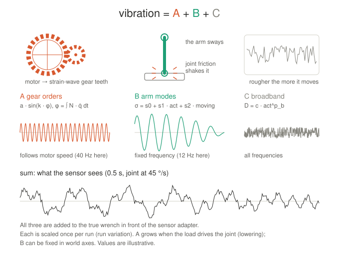
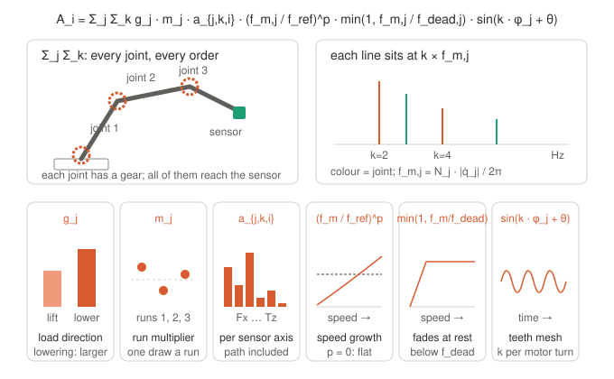
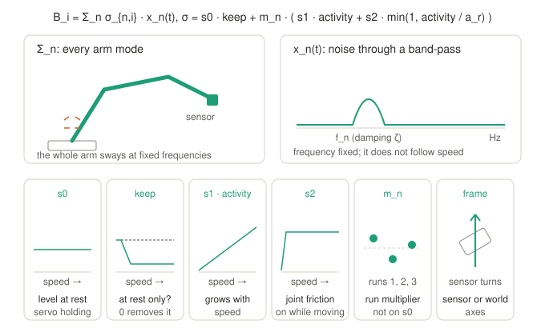
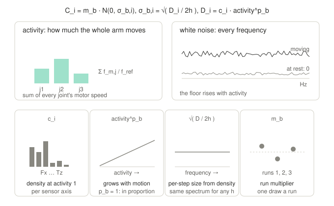

# Force-torque sensor: vibration of a moving arm (design draft)

Status: the requirements are in [spec/force-torque-vibration.md](../spec/force-torque-vibration.md) (`FTV-*`). Open questions 2 and 3 of section 9 stay open; the first version uses per-axis amplitudes and leaves the arm IMU out.

## In one picture: vibration = A + B + C



The vibration added to the true wrench, on each sensor axis i, is the sum of three components (FTV-060):

```text
w_i = A_i + B_i + C_i

A_i = Σ_j Σ_k  g_j · m_j · a_{j,k,i} · (f_m,j / f_ref)^p · min(1, f_m,j / f_dead,j) · sin(k · φ_j + θ_{j,k,i})
B_i = Σ_n  σ_{n,i} · x_n(t),   σ_{n,i} = s0_{n,i} + m_n · ( s1_{n,i} · activity + s2_{n,i} · min(1, activity / a_r,n) )
C_i = m_b · N(0, σ_b,i),       σ_b,i = √( D_i / 2h ),   D_i = c_i · activity^p_b
```

- **A, gear orders.** Inside each joint a motor turns N times faster than the joint and drives a strain-wave gear.
  The teeth mesh k times per motor turn and shake the wrist. The tone follows the motor speed: at 45 °/s and N = 160
  the motor turns 20 times a second, and order 2 sounds at 40 Hz. It is larger when the load drives the joint
  (lowering) than when the joint drives the load (lifting). Sections 3.1 and 3.5; FTV-110 to 185.
- **B, arm modes.** The arm is a long, lightly damped structure that sways at fixed frequencies (8 to 17 Hz in the
  data). A little of it is there at rest (s0, the servo holding); joint friction shakes it while the arm moves, at
  about the same level whatever the speed (s2); it may also grow with speed (s1). Sections 3.2, 3.6 and 3.7;
  FTV-210 to 255.
- **C, broadband.** A rough floor over all frequencies that rises with motion. Section 3.3; FTV-310 and 320.

The run multipliers m_j, m_n and m_b are drawn once per run (section 3.4): the same motion repeated on a real arm gives a different strength each time, and one draw per run stands for that. With no run variation they are 1. The level at rest s0
is not scaled by them.

Term by term: each factor of the formulas above, with a small picture of what it does.







Variables:

| Symbol | Meaning | Unit | Configuration key | Requirement |
|---|---|---|---|---|
| i | sensor axis: Fx, Fy, Fz, Tx, Ty, Tz (sensor axes, FLU) | — | axis keys `fx` … `tz`, groups `fxy` … | FTV-450 |
| h | physics step | s | (from the host) | FTV-010 |
| **A** | | | | |
| j | joint, in the order of the configuration | — | `joints[]`, `name` | FTV-420 |
| N_j | gear ratio, motor turns per joint turn | — | `gear_ratio` | FTV-110 |
| q̇_j | joint velocity, from the host every step | rad/s | (input) | FTV-020 |
| φ_j | motor angle, φ_j ← φ_j + N_j · q̇_j · h | rad | — | FTV-110 |
| f_m,j | motor rotation frequency, N_j · \|q̇_j\| / 2π | Hz | — | FTV-120 |
| k | order: tones per motor turn (2 and 4 for a strain-wave gear) | — | `orders[].order` | FTV-130 |
| a_{j,k,i} | amplitude of order k on axis i at the reference speed | N or N·m | `orders[].amplitude` | FTV-140 |
| p | how the amplitude grows with motor speed (0: constant) | — | `orders[].exponent` | FTV-140 |
| f_ref | reference motor frequency | Hz | `f_ref_hz` (default 50) | FTV-140, 240 |
| f_dead,j | below this motor frequency the orders fade out | Hz | `deadband_hz` (default 1) | FTV-140 |
| θ_{j,k,i} | phase, drawn once at creation | rad | — | FTV-150 |
| g_j | load-direction gain: `positive` while the joint drives, `negative` while the load drives, with a lag | — | `load_gain` {`positive`, `negative`, `lag_s`} | FTV-170 to 185 |
| (resonance) | optional gain of the modes at the order's frequency | — | `orders[].resonance` | FTV-160 |
| **B** | | | | |
| n | arm mode, in the order of the configuration | — | `modes[]` | FTV-430 |
| f_n, ζ_n | mode frequency and damping | Hz, — | `frequency_hz`, `damping` | FTV-210 |
| x_n(t) | white noise through a band-pass at f_n, scaled to standard deviation 1 | — | — | FTV-210, 220 |
| s0_{n,i} | level at rest (the servo holding) | N or N·m | `at_rest` | FTV-230 |
| s1_{n,i} | growth with activity | N or N·m | `per_activity` | FTV-230 |
| s2_{n,i} | level while moving, whatever the speed (joint friction) | N or N·m | `per_motion` | FTV-230 |
| a_r,n | activity at which the level while moving is reached | — | `motion_ramp` (default 0.02) | FTV-235 |
| activity | how much the arm moves: Σ_j f_m,j / f_ref | — | — | FTV-240 |
| (at rest while moving) | share of s0 kept while moving (1 keeps, 0 removes) | — | `at_rest_while_moving` | FTV-232 |
| (frame) | axes of the mode: the sensor's, or fixed in the world | — | `frame` | FTV-250, 255 |
| **C** | | | | |
| D_i | one-sided density of the broadband component | unit²/Hz | — | FTV-310 |
| c_i | density at activity 1 | unit²/Hz | `broadband.density_per_activity` | FTV-310 |
| p_b | how the density grows with activity | — | `broadband.exponent` (default 1) | FTV-310 |
| **All** | | | | |
| m_j | run multiplier of joint j: scales every order amplitude of the joint (A) | — | `joints[].run_log_sigma`, `joints[].run_group` | FTV-350, 360 |
| m_n | run multiplier of mode n: scales s1 and s2, not s0 (B) | — | `modes[].run_log_sigma`, `modes[].run_group` | FTV-350, 360 |
| m_b | run multiplier of the broadband component: scales σ_b (C) | — | `broadband.run_log_sigma`, `broadband.run_group` | FTV-350, 360 |
| σ_r | spread of a run multiplier: m = exp(σ_r · z); 0 (default) gives m = 1 | — | `run_log_sigma` | FTV-350 |
| z | standard normal number N(0, 1), drawn once per run; components with the same `run_group` share one z | — | `run_group` | FTV-370, 380 |

The figure uses illustrative values (one order, one mode, joint at 45 °/s), not a fitted configuration.

## 1. Why

A wrist force-torque sensor on a real arm measures more than its own noise. Measurements of a KUKA LBR Med 14 with an
ATI Gamma (Zenodo 11096791, CC BY 4.0, about 700 Hz) show three layers:

| Layer | At rest | Arm rotating slowly about one axis |
|---|---|---|
| Sensor white noise (40–300 Hz floor) | reproduced by the noise model of [force-torque-adapter.md](force-torque-adapter.md) within 0.97–1.00 per axis | — |
| Arm vibration, 8–17 Hz | present (servo holding) | present |
| Broadband rise and sharp peaks (about 40, 90 and 200 Hz) | absent | floor 64–350 times higher in PSD |

The second and third layers are not errors of the sensor: the sensor measures a structure that really vibrates. They
belong between the physics and the sensor, like the rotor vibration of the drone sensors
([drone-common.md](../spec/drone-common.md) 4.4), which adds disturbances without changing the physics. No
simulator we checked (Gazebo, Isaac Sim, MuJoCo, Drake) models motion-induced vibration of a force-torque sensor;
their noise is Gaussian plus bias or drift at most. ArduPilot SITL drives IMU vibration from motor speed
(`SIM_VIB_*`), the closest analogue.

## 2. What the literature establishes

Checked in full on 2026-11-19 unless marked †.

- Strain-wave (harmonic drive) gearing produces error and torque ripple at **2× the wave-generator (motor) rotation
  and its even harmonics**:
  - [1] describes a disturbance "of two cycles per motor revolution and its higher harmonics", with band-pass
    filters at 2×, 4× and 6× the motor frequency.
  - [9] models the synchronous transmission error as the 2nd and 4th harmonics of the motor angle.
  - [6] states that the reducer of a robot joint "vibrates at double the frequency of the rotation speed of the
    motor".
  - [3] reports the wave-generator rotation frequency 1× in the axial direction and 4× in the circumferential
    direction.
  - "Little gear-mesh content" [4] † could not be read.
- **The frequency follows motor speed:**
  - [6] sets a notch centre at twice the motor speed.
  - [7] makes the notch centre "change linearly with the angular velocity" (a rotating machine, not a robot).
  - Order tracking by equal-angle resampling is used for robot reducers under varying speed [8] † (abstract only).
- **The amplitude is roughly constant with speed:**
  - [6] states the vibration amplitude "is approximately constant regardless of the rotation speed of the motor".
  - [9] models the error with fixed angle amplitudes.
- **Resonance amplifies it.** It grows when a harmonic k·f_m meets a structural frequency [1][3][9]. On a 6-axis
  industrial robot [9], the tip vibration is excited near 12 Hz (11.5–11.8 Hz, the anti-resonance seen from the
  motor, which is the arm with the motor held). 22 Hz is the motor-side resonance.
- Rigid-body compensation (gravity and inertia of the payload) is established [10][11][12] †. It removes the slow,
  deterministic part, not the vibration. Learned compensation from joint states also targets the slow part
  [13][14] †.
- Collision detection uses thresholds that grow with joint velocity [15][16] †.

## 3. Model

Three components, added to the true wrench in sensor axes every physics step, from the joint velocities of the arm.

### 3.1 Order components (follow motor speed)

For joint j with gear ratio N_j and joint velocity q̇_j, the motor phase advances with the joint:

```text
φ_j(t) = ∫ N_j · q̇_j dt              (motor angle, rad)
f_m,j  = N_j · |q̇_j| / 2π            (motor rotation frequency, Hz)
```

Each listed order k of joint j adds, on each sensor axis i,

```text
w_i += A_{j,k,i}(f_m,j) · sin(k · φ_j + θ_{j,k,i})
A    = a_{j,k,i} · (f_m,j / f_ref)^p_{j,k} · min(1, f_m,j / f_dead,j)   (default p = 0: constant [6][9]; taper to 0 at rest)
```

Following the phase rather than the frequency keeps the tone continuous when the speed changes (order tracking).
θ is drawn once per unit from the vibration random stream. Typical orders: 2 and 4 for strain-wave gearing,
1 for shaft imbalance, pole pairs × 1 for electrical ripple.

Optional: an order's amplitude is multiplied by the gain of the structural modes at its frequency k·f_m
(section 3.2), so that it grows when it crosses a resonance [9].

### 3.2 Structural modes (fixed frequencies)

Narrow-band random vibration at fixed frequencies: white noise through a second-order band-pass at f_n with damping
ζ, scaled to a standard deviation per axis. Each mode has an at-rest level (servo holding; the 8–17 Hz component
of the data) and a level that grows with motion activity:

```text
σ_n,i = s0_n,i + s1_n,i · activity,   activity = Σ_j f_m,j / f_ref
```

### 3.3 Broadband rise with motion

White noise whose density grows with activity, on top of the sensor's own noise:

```text
density_i = c_i · activity^p_b
```

This covers the 64–350 times rise of the 40–300 Hz floor in the data.

### 3.4 Run-to-run variation

Repeating the same motion does not give the same vibration. In the two recordings of Zenodo 11096791 without contact
(the same speed profile, the same day), the strength of the components changed by:

| Component | Second / first (amplitude) | σ of ln(amplitude) from the two |
|---|---|---|
| Orders (40 Hz comb) | 0.88 | 0.09 |
| Lines at 100 and 300 Hz (not following speed) | 0.16 and 0.16 | 1.3 |
| Broadband floor between the lines | 0.48–0.69 per axis | about 0.4 |
| Arm vibration growing with motion (Fx, Fz, Ty) | 0.21–0.54 | about 1.1 |

The 100 and 300 Hz lines changed by the same factor, so they share a source. A model fitted to one recording
reproduces that recording and misses the other by these factors.

The model therefore draws, once per run, a log-normal multiplier m = exp(σ_r · z) for each component, and applies it
to the parts driven by motion (the orders, the growth of a mode, the broadband rise). Components with a common
source share one z (`run_group`). The configured values are the median over runs; σ_r is the spread. A host that
wants several runs creates the model with several seeds. With σ_r = 0 (default) nothing changes.

Two recordings give a rough σ_r only; it is a first value to be replaced when more repetitions are available.

```text
m_c  = exp(σ_r,c · z_g(c)),   z_g ~ N(0, 1), one per group g (stream vibration_run)
A    → m · A,   s1 → m · s1,   σ_b → m · σ_b,   s0 unchanged
```

### 3.5 Load direction of a joint

A strain-wave gear's transmission error has a purely kinematic part and a part from the torsional compliance of the
flexspline [19]; the second depends on the transmitted torque. When the torque through a joint changes sign, the
teeth carry the load on the other flank, and the order components (the 2× wave-generator ripple, measured on a KUKA
LBR iiwa joint in [20]) change in size.

Evidence (Zenodo 11096791, the two recordings without contact): the tool goes over the top, so the gravity torque of
the turning joint changes sign half-way (MuJoCo, KUKA iiwa 14 model with the tool fitted from the calibration
recording). The order-2 line (40 Hz) became larger after the sign change:

| Recording | After / before (median of 0.3 s windows) | Windows |
|---|---|---|
| First (free) | 1.36 | 34 / 22 |
| Second (taps; windows away from the taps) | 1.49 | 8 / 6 |

A prototype fitted on the first recording only (gain while lowering / while lifting 1.95, lag 0.7 s) predicted 1.71
for the second (real 1.49) and reduced the mean |log₂| error of the 40 Hz envelope there from 0.28 to 0.18. On the
first recording it reduced the error by 24 % only: the window-to-window spread is not explained by the load.

A line at 100 Hz that seemed strongest near zero load (1.19× in the first recording) did not repeat in the second
(0.97×); it is not modelled.

The model therefore multiplies the orders of a joint by a gain that follows the direction of the transmitted power
τ·q̇ with a first-order lag:

```text
P   = τ · q̇                     (τ: torque the joint transmits, host input)
g  → g+ (P > 0, the joint drives: lifting)   or   g- (P < 0, the load drives: lowering)
g  ← g + (1 − exp(−h / T)) (g_target − g)
A  → g · m · A                  (m: run multiplier, section 3.4)
```

The lag stands for the time the flexspline needs to wind up through its soft region near zero torque (the catalogue
stiffness is lowest there); its value (0.7 s) is a fit, not a measured physical constant.

### 3.6 Excitation while moving (friction)

The arm's own modes (section 3.2) are excited much more while the arm moves than at rest. In the Zenodo 11096791 free
rotation, the 5–20 Hz level on Fx was about 10 times the level at rest. The level hardly depends on the speed:

| Phase of the free rotation | Joint speed | Fx, 5–20 Hz |
|---|---|---|
| Start of motion | 4°/s | 0.37 N |
| Acceleration | 24°/s | 0.39 N |
| Cruise | 45°/s | 0.29–0.77 N |
| Deceleration | 21°/s | 0.59 N |
| After the stop | 0 | 0.04 N |

Fitting σ ∝ v^α over the moving windows gives α = 0.12 (first recording) and −0.5 (second, windows away from the
taps); the growth proportional to activity (FTV-230, s1) would be α = 1. The level rises within 0.3 s of the start
and falls to about 0.1 within 0.5 s of the stop. This is what a speed-independent (Coulomb-like) friction torque in
the joint, shaking the arm's lightly damped modes, would give. The excitation is close to Gaussian (kurtosis 3.2 of
the band-passed signal), so it is not a train of distinct stick-slip events.

The level while moving is a phenomenological model fitted to the observation, not a friction model. Friction that
changes during motion is known to excite resonances of motion stages [22], and stiction near rest adds a pre-sliding
stiffness that resonates with the inertia [21][22]. No measurement was found that shows a speed-independent random
friction torque in a strain-wave robot joint. The vibration measured in the joints of a KUKA LBR iiwa during motion is
angle-periodic [20]; that is the order component of section 3.1 (2× per motor turn, 40 Hz at 45°/s) and cannot give
the 5–20 Hz level at cruise, but it crosses the arm's modes at about 8–10°/s during acceleration and deceleration,
where a resonance should appear (not yet checked).

The model therefore has a level while moving, independent of the speed above a small ramp:

```text
σ = s0 + s1 · activity + s2 · min(1, activity / a_r)      s2: per_motion, a_r: motion_ramp (default 0.02)
```

In the first recording, the frequency of one mode also jumped up by about 1.3 Hz at the moment the arm stopped (pose
unchanged), as if the joints stiffened when the friction sticks: about 20 % more stiffness, the kind of pre-sliding
stiffness measured on a motor [21] and on stages [22]. This was not visible in the second recording (tap ringing) and
is not modelled.

A mode seen at rest may also belong to the stuck joints only. The lightly damped 9.33 Hz mode of the free rotation
(ζ 0.023, mostly on Fz) is measured at rest. Kept at the same level while moving, it made the cruise Fz in 5–20 Hz
1.9 times the recording; removed while moving, 1.06 times, with nothing else changed (20 runs, median). A mode can
therefore keep a share of its level at rest while moving (FTV-232): 1 keeps it, 0 removes it once the level while
moving is reached.

### 3.7 Direction fixed in the world

In the free rotation, the sensor turns 180° about a horizontal axis. The Fz part of the 5–20 Hz vibration does not
follow the speed but the angle θ: large near 0° and 180°, almost gone near 90°.

| θ (0.3 s windows) | 0–16° | 29° | 56° | 83° | 96° | 123° | 151° | 173–178° |
|---|---|---|---|---|---|---|---|---|
| Fz, 5–20 Hz [N, rms] | 0.08–0.14 | 0.20 | 0.05 | 0.02 | 0.02 | 0.06 | 0.11 | 0.13–0.19 |

The correlation of this level with \|cos θ\| is 0.88 over the moving windows. From the gravity in the sensor
axes, the sensor z axis is horizontal at 0° and 180° and vertical at 90°: the vibration is along a direction fixed in
the world, horizontal and in the plane of the rotation (inferred: a sway of the arm or its base). The larger Fx of the
arm modes (fixed in sensor axes) hides the matching \|sin θ\| part on Fx.

Per-axis amplitudes in sensor axes cannot give this (VIB-A7): with them, the modelled Fz was 0.22 times the
recording during the acceleration and 1.9 times at cruise, and its correlation with \|cos θ\| 0.04. A mode can
therefore be given in world axes (FTV-250): the host passes the sensor orientation each step (FTV-026) and the model
rotates the mode into the sensor axes. With a world mode along the horizontal in the rotation plane (16 Hz, ζ 0.5,
while moving) and the Fz of the sensor-fixed 7.5 Hz mode removed, the modelled Fz was 0.98 times the recording during
the acceleration, 1.55 at cruise and 0.75 during the deceleration, with a correlation of 0.86 with \|cos θ\| (20
runs, median).

## 4. Where it sits: in front of the adapter, implemented in Sensor PRO

```text
joint velocities ─▶ force-torque vibration model ─▶ vibration wrench
true wrench (physics) ───────────────────────────┴─(+)─▶ ForceTorqueTruth ─▶ any force-torque adapter
```

- **Position:** on the host side, in front of the adapter. The vibration is added to the truth, so
  `ForceTorqueTruth` and every adapter stay as they are, and the same vibration can be put in front of any
  implementation (Gazebo too).
- **Public (this repository):** this design, the configuration and the requirements, and an interface header for the
  model, so that hosts and tools can call it and other implementations can provide one.
- **Private (Sensor PRO):** the implementation, delivered as binaries like the sensor models.
- **Reached by name:** a host gets the model from an implementation by name, through an entry point of its own
  (for example `HAKO_SENSOR_HOST_MODEL_ENTRY(hakoniwa)`). `SensorAdapterImplementation` is not extended, so binaries
  built against the current header keep working; an implementation without the model simply has no such entry.

A sketch of the interface (names not final):

```cpp
class IForceTorqueVibration {
public:
    virtual ~IForceTorqueVibration() = default;
    // One physics step: joint velocities [rad/s] in the order of the configuration; returns the wrench to add,
    // in sensor axes.
    virtual bool step(std::uint64_t sim_time_ns, const std::vector<double>& joint_velocity, Wrench& out,
                      std::string& error) = 0;
    virtual bool reset(std::string& error) = 0;  // phases, filters, random streams back to creation
};
// Created from a configuration file (section 6), the physics step and a seed.
```

Its random streams follow the common derivation (seed, vehicle, sensor, characteristic), so the same seed gives the
same vibration, independent of the adapter's own streams.

## 5. Inputs

- Joint velocities q̇_j every physics step (rad/s, joint side), for example from the joint truth that the joint sensor
  adapter already receives, or from MoveIt trajectories replayed in the simulation.
- Gear ratio per joint (N_j). Load or motor current could scale amplitudes; the literature gives no simple law, so
  they are left out of the first version.

## 6. Configuration sketch

```json
{
  "type": "force_torque_vibration",
  "f_ref_hz": 50,
  "joints": [
    { "name": "joint7", "gear_ratio": 160, "deadband_hz": 1,
      "orders": [ { "order": 2, "exponent": 0, "resonance": true,
                    "amplitude": { "fx": 0.05, "fy": 0.03, "fz": 0.08, "tx": 0.002, "ty": 0.004, "tz": 0.0005 } } ] }
  ],
  "modes": [
    { "frequency_hz": 9.5, "damping": 0.05,
      "at_rest": { "fz": 0.08, "fx": 0.03 }, "per_activity": { "fz": 0.05 } }
  ],
  "broadband": { "exponent": 1.0, "density_per_activity": { "fx": 0.01, "fz": 0.006 } }
}
```

Per-axis values use the same keys as the rest of the force-torque configuration (groups or axes, FTS-ADP-520).

## 7. Fitting from data

What data identifies which parameter, and the recording protocol: [force-torque-vibration-identification.md](force-torque-vibration-identification.md).

1. Record at rest, then the same motion at three or four speeds (at least two), or one motion whose acceleration and deceleration sweep the speed.
2. Spectrogram against motor frequency N·|q̇|: lines whose frequency moves with speed are orders, fixed lines are
   modes.
3. Orders: fit a and p from the line amplitude at each speed. Modes: f_n and ζ from the peak, s0 at rest, s1 from the
   speeds. Broadband: c and p_b from the floor at each speed.
4. Validate on a motion or speed not used for fitting.

Zenodo 11096791 has one cruise speed, but its acceleration and deceleration sweep the speed, which is enough to
tell orders from modes (section 7.1); the at-rest levels and the broadband level are fitted at that one cruise
speed.

Open data sets checked on 2026-11-19 (landing pages and file listings only). None has a wrist F/T at 500 Hz or more,
joint states, and the same motion at two or more speeds:

| Data set | License | F/T | Joint states | Speeds | Use here |
|---|---|---|---|---|---|
| [Zenodo 11096791](https://zenodo.org/records/11096791) (KUKA LBR Med 14) | CC BY 4.0 | ATI Gamma, ~700 Hz | orientation ~100 Hz | one slow rotation | modes, at-rest levels, broadband at one speed |
| [REASSEMBLE](https://researchdata.tuwien.ac.at/records/0ewrv-8cb44) (Franka FR3) | CC BY 4.0 | AIDIN AFT200, rate not stated | yes | teleoperated, varying | possible, if the F/T rate is high; 54.8 GiB in one archive, mostly contact |
| [voraus-AD](https://github.com/vorausrobotik/voraus-ad-dataset) (Yu-Cobot) | CC BY-NC-SA 4.0 (non-commercial) | none | 500 Hz, motor and joint speed, torques | speed-up and slow-down within moves | order tracking on the joint side only; licence excludes commercial use |
| [Zenodo 7235963](https://zenodo.org/records/7235963), [7240050](https://zenodo.org/records/7240050) (Fraunhofer IPK cobot) | CC BY 4.0 | yes, rate not stated | yes | one free linear move | only if the bag rate is 500 Hz or more |
| [NIST UR5 degradation](https://data.nist.gov/od/id/754A77D9DA1E771AE0532457068179851962) | NIST open data | none | 125 Hz | speed, payload, temperature varied | how joint-side peaks follow speed, below 62.5 Hz |

Others were rejected for a low rate (100–125 Hz controller-estimated TCP force), missing joint states, restricted
access or a paid licence. A clean separation of orders and modes most likely needs our own recording: rest, then the
same motion at two or more speeds, with a wrist F/T at 500 Hz or more and the joint velocities.

### 7.1 What one recording already showed (2026-11-19)

The free rotation of Zenodo 11096791 (about 180° in 5 s) accelerates for about 1.3 s, cruises at about 45°/s and
decelerates for about 1 s. Short-time spectra of all six axes, tracked against the rotation speed (from the
orientation records), show:

- The strongest line between 8 and 60 Hz moves in proportion to speed: about 19 Hz at 20°/s, 40 Hz at 45°/s.
  - The correlation is 0.973.
  - The slope through the origin gives order × gear ratio = 324, that is order 2 with a gear ratio of about 162.
  - 152 of 154 short windows lie within ±3 Hz of order 2 with a ratio of 160.
- At cruise speed, a comb at 40.0, 80.0, 120.4, 160.8, 200.8, 241.5 and 281.5 Hz: the order-2 line and its multiples.
- Lines near 33 Hz and 100 Hz stay at the same frequency in acceleration, cruise and deceleration: mode candidates.
- In the runs with hammer taps and a push, the taps and the push dominate the low band at times. Where the line shows,
  it lies on the same slope.

So a single motion with acceleration and deceleration can separate orders from modes; separate recordings at two
speeds are not required.

## 8. Scope and assumptions

The model is a simplification on purpose. Its assumptions are numbered so that results can say which ones they rely
on, and each carries its evidence: **measured** (checked on data), **literature** (established, not yet checked on
our data), **inferred** (our reading, to be checked), or **simplification** (known not to hold exactly; kept for a
first version).

| ID | Assumption | Evidence | How to check | If wrong |
|---|---|---|---|---|
| VIB-A1 | The sensor's own white noise is independent of the motion | measured at rest only (Zenodo 11096791) | rest vs motion at a frequency free of vibration | the sensor noise has to grow with motion as well |
| VIB-A2 | Order frequencies are integer multiples k of the motor rotation frequency N·\|q̇\|/2π | literature [1][6][9]; **measured** on Zenodo 11096791 (section 7.1), with the gear ratio inferred | the line frequency against speed, within one motion (acceleration, cruise, deceleration) or at several speeds | the orders are fixed modes, or the gear ratio is wrong |
| VIB-A3 | Order amplitude follows a · (f_m / f_ref)^p, tapered linearly to zero below a dead band; p = 0 by default | literature for p = 0 [6][9]; **measured p ≈ 0.8** on the order-2 line of Zenodo 11096791 within one motion (acceleration and deceleration, 5–45°/s: 0.24 N at 5°/s, 1.14 N at 45°/s), against the literature | amplitude of the tracked line against speed | a table of amplitude vs speed replaces the power law |
| VIB-A4 | Order phases are random per unit and constant | simplification | phase is not observable in a PSD | none for spectra; matters only for time-domain matching |
| VIB-A5 | Structural modes have fixed frequency and damping, independent of arm pose | simplification | two poses at rest | mode frequency becomes a function of pose |
| VIB-A6 | The broadband rise grows with activity = Σ f_m / f_ref | inferred | floor at two or more speeds | another activity measure (max, per joint) |
| VIB-A7 | The direction of each component in sensor axes is fixed (per-axis amplitudes), except for modes given in world axes (VIB-A14) | simplification; **measured not to hold** for the Fz part of the 5–20 Hz vibration (section 3.7) | the same motion in two poses | amplitudes must be mapped through the arm geometry (section 9, question 2) |
| VIB-A8 | Components add linearly to the true wrench; the sensor stages after them (low-pass, saturation) act on the sum | literature (superposition) and the design of the adapter | — | — |
| VIB-A9 | Load, temperature, wear and contact do not change the vibration | simplification | out of scope | amplitudes and frequencies drift; not modelled |
| VIB-A10 | Run-to-run variation is a log-normal multiplier per component, constant during a run, on the motion-driven parts only; components with a common source share it | **measured** on two recordings (section 3.4); the distribution and σ_r inferred from two | three or more repetitions of the same motion | the multiplier also varies within a run, or the level at rest varies too |
| VIB-A11 | The order components of a joint change in size with the direction of the power the joint transmits (a gain per direction, first-order lag); modes and broadband do not | **measured** on two recordings (section 3.5), the gains and the lag inferred from one; load and pose change together there | the same motion with the tool going under instead of over, or with an added payload | the gain depends on the load size or on the pose, not only on the direction |
| VIB-A12 | While the arm moves, its modes are excited at a level that does not depend on the speed (friction); the frequency of a mode stays fixed | **measured** on two recordings (section 3.6): level vs speed and start/stop; the ramp (0.02) inferred from the start | recordings at several speeds, and a mode's frequency over the pose | the level depends on the load or the joint, or the mode frequency moves with the pose (seen in the first recording, not modelled); or the excitation is the angle-periodic ripple [20] near resonance rather than friction |
| VIB-A13 | A mode measured at rest may exist only while the joints stick, and fade as the level while moving is reached | **measured** on one recording (section 3.6): the cruise Fz; the share kept (0) inferred | rest, motion and stop in several poses | the mode stays while moving but changes frequency or damping |
| VIB-A14 | Part of the vibration has a direction fixed in the world; it is rotated into the sensor axes with the sensor orientation | **measured** on one recording (section 3.7): Fz against \|cos θ\|; the world direction (horizontal, in the rotation plane) and its spectrum inferred | rotations about other axes and in other poses | the direction is fixed in the arm (a link) rather than in the world |

**In scope:** order components following motor speed, fixed structural modes (at rest and with motion), a broadband
rise with motion, reproducible from a seed.

**Out of scope (first version):** load- and temperature-dependent vibration, vibration caused by contact or impacts,
pose-dependent modes, non-stationary changes (wear), and the vibration of the arm's IMU (section 9, question 3).

**Known gaps against the real data now:**
- The gear ratio of the rotating joint is not documented; 160 (order 2) is inferred from the fitted slope.
- The joint that turned is not identified beyond "about the sensor y axis".
- Lines that stay at the same frequency in every speed phase (near 33 and 100 Hz) are taken as mode candidates
  (VIB-A5) by inference.

## 9. Open questions

1. **Where the model lives — decided (2026-11-19): in front of the adapter, implemented in Sensor PRO.** It
   computes the vibration wrench from the joint velocities and adds it to the truth, like the drone rotor vibration.
   The specification and the interface header are public; the implementation is private and ships as binaries
   (section 4). `ForceTorqueTruth` and `SensorAdapterImplementation` do not change, so existing implementations and
   binaries keep working, and the same vibration can be added in front of any implementation (Gazebo too), which
   keeps comparisons fair. (Rejected: inside the adapter, which would add the joint velocities to
   `ForceTorqueTruth`, an interface and binary change.)
2. Whether amplitudes are configured per sensor axis directly (simple, as above) or as a force direction per joint
   mapped through the arm geometry (more physical, needs the kinematics).
3. Whether the IMU of an arm (end-effector accelerometer) gets the same model.

## References

Read in full on 2026-11-19 unless marked †; † items were not opened in full (abstract or search result only).

1. M. Itoh, "Self-Compensating Control for Suppression of Rotational Speed Variation Generated in a Geared Servo
   System", SANYO DENKI Technical Report No. 5, May 1998.
   <https://sanyodenki.com/archive/document/corporatedata/technicalreport/1998/TR5e_s_en.pdf>
2. Lu et al., Electrical Engineering (Springer), 2× torque ripple of a harmonic drive.
   <https://link.springer.com/article/10.1007/s00202-012-0264-4> †
3. J. Tan, D. Shi, D. Huang, J. Gu, "Test and analysis of three axis vibration of harmonic drives", Vibroengineering
   PROCEDIA 16, 19–24, 2017. DOI 10.21595/vp.2017.19378. <https://extrica.com/article/19378>
4. G. He, B. Zhou, Y. Zheng, H. Lin, L. Xu, Z. Zheng, "Unraveling the Vibration Mechanism in Robotic Harmonic Drive:
   Coupled Dynamics Under Cyclic Inertial Loading and Installation Errors", Machines 13(12):1083, 2025.
   DOI 10.3390/machines13121083. † (site blocked automated access)
5. Shi et al., kinematic error of harmonic drives as position harmonics, largely speed independent. † (no stable
   link found)
6. F. Zhao, T. Mamba (Yaskawa Electric), "Notch filter, external force estimator, motor control apparatus, and robotic
   system", US 2016/0016310 A1, 2016. <https://patents.google.com/patent/US20160016310A1/en>
7. D. H. Carlson (3M), "Adaptable spatial notch filter", WO 2004/029634 A2, 2004.
   <https://patents.google.com/patent/WO2004029634A2/en>
8. M. Lin, X. Zhang, L. Yao, Y. Gong, J. Zhang, Y. Yang, "Application of Order Tracking Analysis Method in Fault
   Diagnosis of Swing Fatigue Tests of Precision Reducers for Robots", Jixie Chuandong 46 (2022), 156–162.
   DOI 10.16578/j.issn.1004.2539.2022.10.024. † (abstract only)
9. M. Iwasaki, H. Nakamura, "Vibration Suppression for Angular Transmission Errors in Harmonic Drive Gearings and
   Application to Industrial Robots", Proc. 19th IFAC World Congress, Cape Town, 2014.
   <https://skoge.folk.ntnu.no/prost/proceedings/ifac2014/media/files/0659.pdf>
10. Kubus, Kröger and Wahl, IROS 2008: payload inertial parameters for F/T compensation (used by ROS
    force_torque_tools). <https://index.ros.org/r/force_torque_tools/> †
11. Lund University: accelerometer and force sensor fusion. <https://lup.lub.lu.se/search/files/5836402/625573.pdf> †
12. Automated continuous F/T bias estimation, arXiv 2403.01068 (2024). <https://arxiv.org/abs/2403.01068> †
13. Mohy el Dine et al. (2018): recurrent-network observer for wrist F/T, KUKA LWR-4 with ATI Gamma.
    <https://jsanch2s.github.io/files/2018_rnnob.pdf> †
14. Wrist F/T compensation on an industrial dual-arm robot, regression vs random forest. <https://core.ac.uk/download/288359083.pdf> †
15. Sotoudehnejad and Kermani, ICRA 2014 and thesis: velocity-dependent collision thresholds. <https://ir.lib.uwo.ca/etd/1829> †
16. Legged manipulator collision detection, arXiv 2207.14745 (2022). <https://arxiv.org/abs/2207.14745> †
17. ArduPilot SITL vibration parameters `SIM_VIB_FREQ_X/Y/Z`, `SIM_VIB_MOT_MAX`. <https://discuss.ardupilot.org/t/how-to-simulate-tuning/102826> †
18. Skrede et al., RCAR 2024, contact-wrench estimation; data: Zenodo 11096791 (CC BY 4.0). <https://zenodo.org/records/11096791>
19. N. Ghorbel, P. S. Gandhi, F. Alpeter, "On the Kinematic Error in Harmonic Drive Gears", ASME J. Mech. Design 123(1):90–97, 2001. DOI 10.1115/1.1334379 † (abstract)
20. N. Chawda, G. Niemeyer, "Toward Torque Control of a KUKA LBR IIWA for Physical Human-Robot Interaction", IROS 2017. <https://la.disneyresearch.com/wp-content/uploads/Toward-Torque-Control-of-a-KUKA-LBR-IIWA-for-Physical-Human-Robot-Interaction-Paper.pdf>
21. J. Y. Yoon, D. L. Trumper, "Friction modeling, identification, and compensation based on friction hysteresis and Dahl resonance", Mechatronics 24(6):734–741, 2014. DOI 10.1016/j.mechatronics.2014.02.006 † (most of the text, from a copy)
22. X. Dong, C. E. Okwudire, "Influence of Design Parameters on the Effectiveness of Friction Isolators in Mitigating Pre-motion Friction in Mechanical Bearings", Mechatronics (accepted manuscript). <https://par.nsf.gov/servlets/purl/10218198> † (part of the text)

The gear ratios of the KUKA LBR Med 14 / LBR iiwa 14 joints were not found in an official source.
