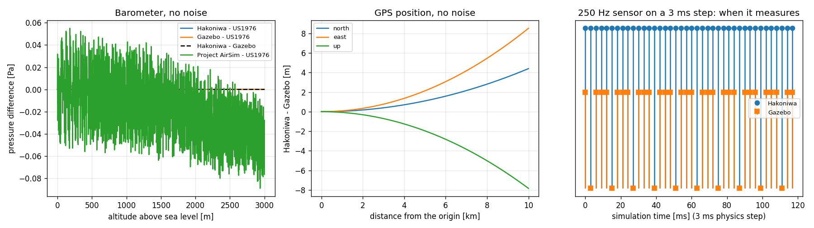

# Axis 0: no-noise agreement (2026-11-01)

These are the results for axis 0 of [Evaluation axes](evaluation-axes.md). We fed the same truth to the Hakoniwa sensor adapter, the Gazebo adapter (gz-sensors 10.2.0) and Project AirSim (core_sim compiled as is), all with every error turned off, and compared the values.
The physics step is 1 ms (3 ms only for the timing rule). We ran on macOS (arm64).

Method: as in "Method" in [Drone sensor results](README.md).

## Results

| Sensor | Truth | Hakoniwa vs Gazebo difference | Project AirSim (core_sim) |
|---|---|---|---|
| Gyro | Motion with time-varying attitude and angular velocity, 20 s, 250 Hz | 0 (bit-identical) | Up to 3.0e-8 rad/s from Hakoniwa (computed in 32-bit floating point) |
| Accelerometer | Same (hovering while swaying) | Up to 3.6e-15 m/s² | Up to 4.8e-7 m/s² from Hakoniwa (same reason) |
| Magnetometer | Geomagnetic field at a fixed location, changing attitude, 50 Hz | Up to 2.2e-11 nT | Agrees with Hakoniwa (difference 0) |
| Barometer | Height 0 to 3000 m | **0** (both agree with US 1976) | Up to 0.09 Pa from US 1976 (computed in 32-bit floating point). **Pressure altitude is off by up to 2.65 m** |
| GPS | 10 km north-west from the origin, 100 m/s | At 10 km: 9.6 m horizontal, 7.8 m vertical | From Gazebo: 15.9 m horizontal, 7.8 m vertical. From Hakoniwa: 13.0 m north, 21.8 m east, 0 vertical |
| Sample times (1 ms physics step) | All of the above | Number of times a different physics step was sampled: 0 | 0 |
| Sample times (3 ms physics step, 250 Hz) | 3 s | Hakoniwa 1000 times, Gazebo 750 times | A period that does not divide evenly is refused at creation |

## Explanation of the differences

### Barometer: atmosphere equations

- Hakoniwa now uses the standard gravity g₀ = 9.80665 m/s² and the correct ISA (US 1976) form (geopotential altitude). As a result, **Hakoniwa, Gazebo and an independently computed US 1976 agree with an error of 0.000 Pa**. In the first measurement, Hakoniwa used g = 9.81 and the geometric height directly, and was 21.4 Pa off at 3000 m.
- Project AirSim computes in 32-bit floating point, so it is up to 0.09 Pa off from US 1976.
- Project AirSim's pressure altitude (the height computed back from the pressure) is off by up to 2.65 m. The inverse formula is not the exact inverse of the pressure formula.

### GPS: converting the local position to latitude and longitude

- The horizontal difference grows with the square of the distance (0.1 m at 1 km, 2.4 m at 5 km, 9.6 m at 10 km).
- **The vertical difference (7.8 m) is the curvature of the Earth** (d² / 2R = 10 km² / (2 × 6371 km) ≈ 7.85 m).
  - Gazebo (the same `SphericalCoordinates` as gz-sim): treats the local plane as the plane tangent to the Earth at the origin. The farther away, the higher it rises above the ground.
  - Hakoniwa: maps the local plane bent along the Earth's surface. Height is preserved.
- **The horizontal difference (9.6 m) also comes from the different mapping**: tangent plane versus following the surface.
- Project AirSim (core_sim) also maps along the surface (the distance and bearing measured from the origin become a distance and bearing on the sphere). Height is preserved as in Hakoniwa (vertical difference 0). However, it treats the Earth as a sphere of radius 6,378,137 m, so at 10 km it is 13.0 m north and 21.8 m east off from Hakoniwa, which maps on the ellipsoid (WGS84).
- Project AirSim's GPS outputs latitude and longitude as 32-bit floating point. Near Tokyo (35.7° N, 139.8° E), one step is about 0.4 m north and about 1.4 m east.
- Velocity agreed (maximum difference 0; Project AirSim 1.8e-8 m/s from 32-bit rounding).
- This is not about which one is right. It is a difference in the rule for mapping the flat simulation world onto the round Earth.

### Sample times: a period that does not divide the physics step

We ran a 250 Hz (4 ms) sensor with a 3 ms physics step.

- Hakoniwa rounds the period to a number of physics steps (4 ÷ 3 rounded to 1 step). So it **samples every step (333 Hz)**.
- Gazebo holds the period as time. It advances the next sample time by 4 ms each time and samples at the first step past that time. The intervals mix 3 ms and 6 ms, giving **250 Hz on average**.
- The Project AirSim adapter refuses, at creation, a period that does not divide evenly by the physics step (core_sim just samples at each interval it is given and has no period).
- With periods that divide evenly (for example 4 ms with a 1 ms physics step, the normal use), all three sampled at the same times.
- Hakoniwa now prints a warning when the period does not divide evenly (SEN-COM-177).

## Summary

- Gyro, accelerometer, magnetometer and sample times (with evenly dividing periods) agree in all three, apart from rounding. There are no mistakes in frame, unit or time handling.
- For the barometer, after Hakoniwa was corrected to the proper ISA form, Hakoniwa and Gazebo agree exactly with US 1976. Project AirSim's inverse computation of pressure altitude is inexact.
- The Hakoniwa GPS mapping onto the Earth is as specified for Hakoniwa (map around the origin following the surface). Gazebo uses the plane tangent to the Earth at the origin; Project AirSim maps along the surface but treats the Earth as a sphere.
