# ドローンのセンサーの誤差特性（2026-11-19）

[English](README.md) | 日本語

実際のセンサーは、真値をそのまま出しません。取り付けの影響、個体ごとのずれ、ノイズ、ドリフト、測る周期と遅れ、分解能とレンジが加わります。ジャイロ、加速度、地磁気、気圧、GPS のどれでも、これらは同じ考え方で決めています（[共通の仕様](../../spec/drone-common.md)）。

このページは、誤差の種類ごとに1節を立てます。各節は、はじめに仕組みを説明する図（説明用に描いたもの）を置き、次にセンサーごとの実測のグラフを置きます。実測のグラフでは、出力が設定どおりになることを確かめます。

## 共通の流れ


真値は、上の段を左から順に通って、測った値になります。

- **取り付け**は、シミュレータ側の共通部品（ホスト）が行います。
- **それ以外の段**は、センサーの実装が行います。データシートの値を、1段ずつ当てはめます。
- 段の順番と設定のキーは、5つのセンサーで共通です。センサーによって持たない段があり、下の表の「—」がそれです。

## 測り方

```text
動き（式）─▶ ホストの部品：取り付け、真値 ─▶ アダプタ（共通の口）─▶ CSV ─▶ 図
```

- **物理エンジンは使いません。** 剛体を、式で書いた動きで動かします。動きは、静止、旋回、段差、傾き、上昇、動き出しです。このリポジトリのホストの部品（`host/sensor_host.hpp`）が、シミュレータのホストと同じように取り付けを当て、センサーの真値を作ります。
- **誤差は1回に1つです。** 誤差を1つだけ入れた設定で測ります。そのため、各図はその誤差の効き方だけを示します。
- **共通の口を通します。** アダプタは、実装の名前から作ります（`sensor_adapter_implementation.hpp`）。ツールは、口の後ろの実装を知りません。
- **測ったもの：** [hakoniwa-sensor-pro](https://github.com/hakoniwalab/hakoniwa-sensor-pro) v0.1.0 の箱庭の実装です。
  - 公開バイナリ：`hakoniwa-sensor-pro-0.1.0-macos-arm64.zip`（SHA-256 `82040299ea2eed32139626b8c30a787fb5bc7c44d0660f303edc2155158deb23`）
  - 環境：macOS 27（Apple silicon）、物理の周期 1 ms
  - 乱数の種：断りがなければ 1
- **設定：** 仕様の範囲にある説明用の値で、特定のチップの値ではありません。ドローンのセンサーの設定は、センサーの FRD 軸で書きます（Drone PRO の流儀）。真値と実測のグラフは FLU 軸です。
- **世界：** 東京です。
  - 位置：北緯 35.6812°、東経 139.7671°、高さ 40 m
  - 磁場：全磁力 46,000 nT、偏角 −7.5°、伏角 49.5°
  - 大気：標準大気

ツール、設定、スクリプトは [tools/error-characteristics](../../../tools/error-characteristics) にあります。ビルドとコマンドは、そこの README にあります。実測のグラフは、すべて1分ほどで作り直せます。仕組みの図は、そこの `concepts/` で作り直せます。

## まとめ

| 誤差 | センサー | 設定 | 測った値 |
|---|---|---|---|
| 取り付け（位置） | 加速度 | 中心から 0.1 / 0.2 m、180°/s で旋回：−ω²r = −0.987 / −1.974 m/s² | −0.987 / −1.974 m/s² |
| 取り付け（位置） | 気圧 | 0.5 / 1.0 m 高く取り付け：約 −6 / −12 Pa | −5.98 / −11.97 Pa |
| 取り付け（位置） | GPS | アンテナを 0.5 m 前に付け、その場で旋回：半径 0.5 m の円 | 半径 0.501 m |
| 零点のずれ | ジャイロ / 加速度 | σ 1°/s / 20 mg | 0.999°/s / 20.3 mg（1000 個体） |
| 零点のずれ | 気圧 | σ 4 m | 3.82 m（1000 個体） |
| 鉄の影響 | 地磁気 | ハードアイアン (3000, −1500, 800) nT（FRD）＋ソフトアイアン：一回転の軌跡の中心 | FLU で (2.3, 1.3) µT。下の計算どおり |
| ノイズ | ジャイロ | σ 0.0500°/s | 0.0497°/s（5000 サンプル） |
| ノイズ密度 | ジャイロ | 0.00024 rad/s/√Hz、周期 2 / 4 / 8 ms：σ 0.00537 / 0.00379 / 0.00268 rad/s | 0.00538 / 0.00377 / 0.00266 rad/s |
| ノイズ | 地磁気 | σ 30 nT | 29.1 nT |
| ノイズ | 気圧 | σ 0.1 m | 0.0994 m |
| ノイズ | GPS | 位置（水平）σ 0.3 m | 北 0.303 m、東 0.299 m（3000 測位） |
| ノイズ | GPS | 速度（水平）σ 0.1 m/s | 0.102 m/s |
| 周期と遅れ | ジャイロ | 周期 4 ms、さらに遅れ 10 ms。1.002 秒の段差：1.004 秒 / 1.012 秒で変わる | 1.004 秒 / 1.012 秒 |
| 周期と遅れ | 地磁気 | 周期 20 ms、さらに遅れ 50 ms。1.005 秒の旋回：1.020 秒 / 1.060 秒 | 1.020 秒 / 1.060 秒 |
| 周期と遅れ | 気圧 | 周期 20 ms、さらに遅れ 60 ms。1.005 秒の段差：1.020 秒 / 1.080 秒 | 1.020 秒 / 1.080 秒 |
| レンジ | ジャイロ | フルスケール 2000°/s：切れて、飽和のフラグ | 2000.0°/s、3.500 秒からフラグ（真値が超えるのは 3.491 秒） |
| レンジ | 気圧 | 300 hPa：約 9164 m で切れる | 9177 m から切れる |

N 個のサンプルから求めた標準偏差には、相対で約 1/√(2N) の誤差があります。5000 サンプルなら 1 %、1000 個体なら 2 % です。上の差は、どれもその2倍以内です。

## 1. 取り付け

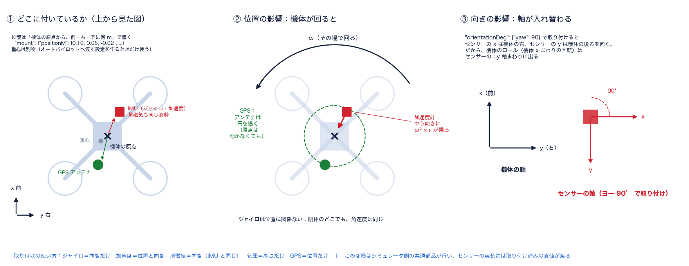

取り付けは「位置」と「向き」の2つで書きます。

- **位置：** 機体の原点から、前・右・下に何 m かです。重心からではありません。
- **向き：** ロール・ピッチ・ヨーの角度です。

機体が回ると、原点から離れたセンサーには余分な動きが出ます。加速度計には遠心加速度が乗り、GPS のアンテナは円を描きます。向きを回して付けると、軸が入れ替わります。この計算はホストの部品が行うので、センサーの実装によりません。

この節では、5つの測定をします。どれも、取り付け以外の誤差は入れていません（真値だけの設定）。

### 1-1. 旋回中の加速度計（位置）

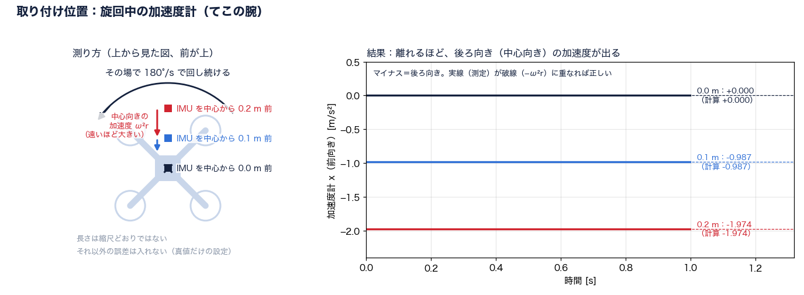

- **測ったこと：** 機体をその場で 180°/s で回し続けます。IMU を中心、0.1 m 前、0.2 m 前に付けた3通りで、加速度計の前向き（x）の値を測りました。
- **グラフの見方：**
  - 横軸は時間です。縦軸は加速度計 x の値で、マイナスは後ろ向き、つまり回転の中心向きです。
  - 実線が測った値、破線が計算値（−ω²r）です。
- **結果：** 0.1 m 前では −0.987 m/s²、0.2 m 前では −1.974 m/s² で、計算と一致しました。中心に付けたものは 0 です。

### 1-2. ヨー 90° 回して付けたジャイロ（向き）

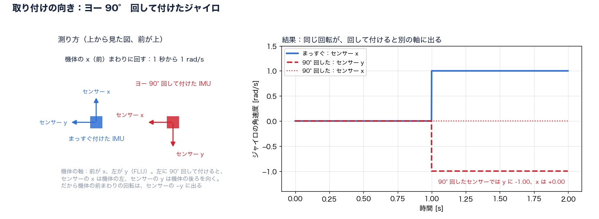

- **測ったこと：** 機体を、1 秒から前（x 軸）まわりに 1 rad/s で回します。まっすぐ付けた IMU と、左に 90° 回して付けた IMU で、ジャイロの各軸の値を測りました。
- **グラフの見方：**
  - 横軸は時間、縦軸はジャイロの角速度です。
  - 青がまっすぐ付けた IMU の x 軸です。赤の破線と点線が、回して付けた IMU の y 軸と x 軸です。
- **結果：** まっすぐ付けた IMU では、x に +1.00 が出ます。回して付けた IMU では、y に −1.00 が出て、x は 0 のままです。同じ回転が、取り付けの向きに合わせて別の軸に出ています。

### 1-3. ヨー 90° 回して付けた地磁気センサー（向き）

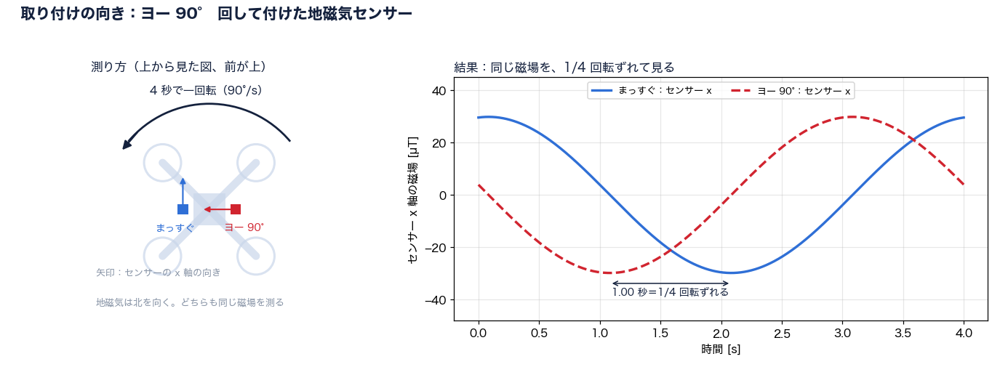

- **測ったこと：** 機体をその場で、4 秒で一回転させます。まっすぐ付けたセンサーと、90° 回して付けたセンサーで、センサー x 軸の磁場を測りました。
- **グラフの見方：**
  - 横軸は時間、縦軸はセンサー x 軸の磁場です。
  - 磁場は北を向いているので、回るとセンサー x の値は波になります。波の山は、センサー x が北を向いた時刻です。
- **結果：** 2本の波は、1.00 秒（1/4 回転）ずれました。回して付けたセンサーは、同じ磁場を 90° 先の向きで見ています。

### 1-4. 高く付けた気圧センサー（位置）

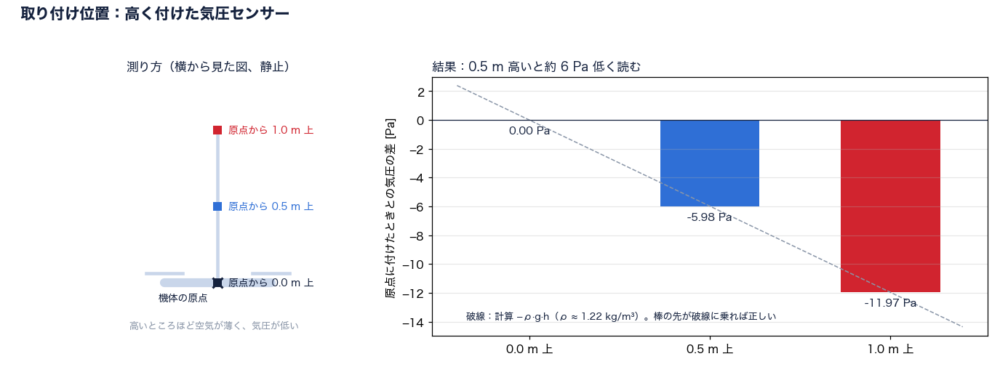

- **測ったこと：** 機体を静止させたまま、気圧センサーを原点、0.5 m 上、1.0 m 上に付けた3通りで、気圧を測りました。
- **グラフの見方：**
  - 縦軸は、原点に付けたときの気圧との差です。マイナスは、気圧が低いことを示します。
  - 破線は、空気の重さから計算した値（−ρ·g·h）です。
- **結果：** 0.5 m 上では −5.98 Pa、1.0 m 上では −11.97 Pa で、計算と一致しました。高いところは空気が薄いので、気圧が低く出ます。

### 1-5. 前に付けた GPS アンテナ（位置）


- **測ったこと：** 機体の原点は動かさず、その場で 8 秒に一回転させます。アンテナを中心に付けた場合と、0.5 m 前に付けた場合で、GPS の位置を毎秒 10 回測りました。
- **グラフの見方：** 地図のように、上が北、右が東です。点の1つ1つが、1回の測位です。
- **結果：** 中心のアンテナは、1点にとどまります。0.5 m 前のアンテナは、半径 0.501 m の円を描きました。機体は動いていなくても、アンテナは動いているからです。

## 2. 個体ごとのずれと感度


**零点のずれ**は、電源を入れたときに個体ごとに1つ決まり、動いている間は変わりません。乱数の σ で書くか、固定値で書きます。**感度**は、出力の倍率のずれ（スケール誤差）と、ほかの軸への漏れ（他軸感度）です。地磁気では、機体の鉄の影響もこの2つの形で入ります。ハードアイアンはずれ、ソフトアイアンは感度です。

ずれのグラフ（2-1、2-2）は、どれも「ヒストグラム」です。横軸がその値、縦軸がその値だった個数で、山の幅が個体差の大きさを表します。赤い線は、設定した σ のとおりなら出るはずの形です。棒の山が赤い線に重なれば、設定どおりです。

### 2-1. 1000 個の IMU の零点のずれ

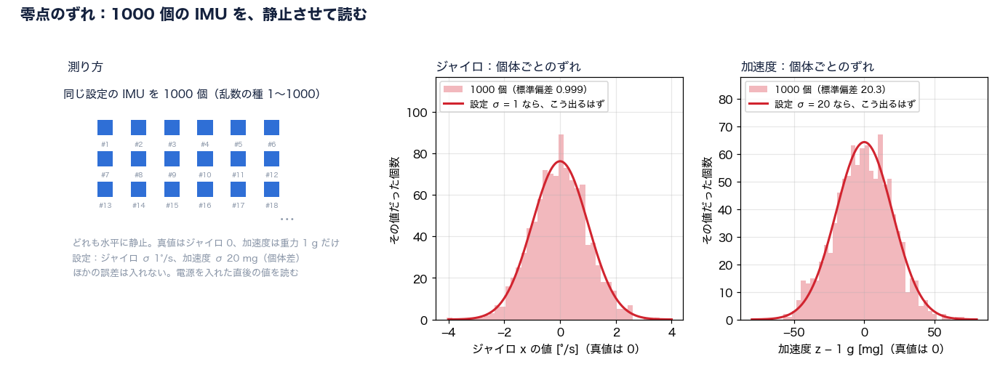

- **測ったこと：** 同じ設定の IMU を 1000 個（乱数の種 1〜1000）用意しました。どれも水平に静止させ、電源を入れた直後の値を読みました。真値は、ジャイロが 0、加速度が重力の 1 g だけです。
- **グラフの見方：** 左がジャイロ x、右が加速度 z から 1 g を引いた値です。どちらも真値は 0 なので、0 からの外れがその個体のずれです。
- **結果：** 1000 個の標準偏差は、ジャイロ 0.999°/s（設定 1°/s）、加速度 20.3 mg（設定 20 mg）でした。

### 2-2. 1000 個の気圧センサーの零点のずれ

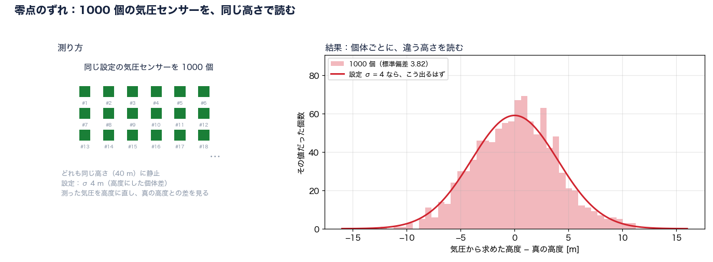

- **測ったこと：** 同じ設定の気圧センサー 1000 個を、同じ高さ（40 m）に静止させて読みました。
- **グラフの見方：** 横軸は、測った気圧から求めた高度と真の高度の差です。気圧のずれを、高さのメートルで見ています。
- **結果：** 標準偏差 3.82 m（設定 4 m）でした。個体ごとに、違う高さを読みます。

### 2-3. 地磁気の鉄の影響

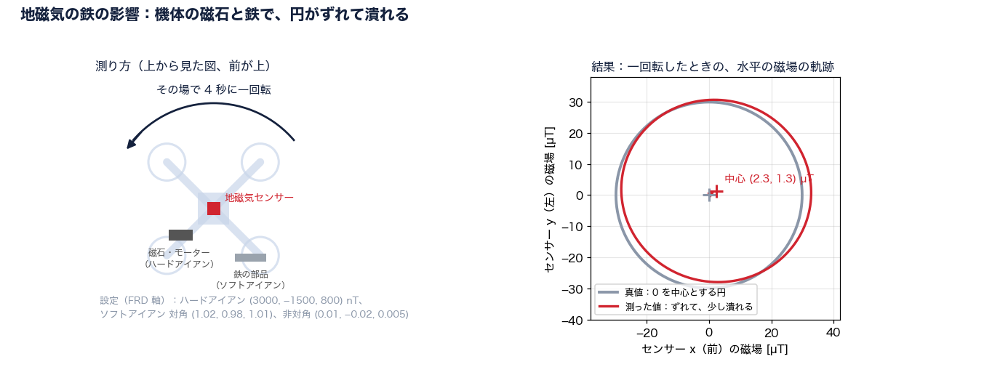

- **測ったこと：** 機体をその場で、4 秒で一回転させました。機体の磁石（ハードアイアン）と鉄の部品（ソフトアイアン）の影響を設定しています。
- **グラフの見方：** 横軸がセンサー x（前）、縦軸がセンサー y（左）の磁場です。一回転の間の水平の磁場を、点の軌跡として描いています。影響がなければ、0 を中心とする円になります。
- **結果：** 円の中心が (2.3, 1.3) µT にずれ、少し潰れました。中心の位置は、設定から次のように計算でき、測った値と一致します。
  1. 設定は FRD 軸なので、ハードアイアン (3000, −1500) nT は、FLU では (3000, +1500) nT です。
  2. ソフトアイアンの非対角成分が、鉛直の磁場（FLU で約 −35 µT）を混ぜます。x に −700 nT、y に FRD で +175 nT です。
  3. よって中心は (3000 − 700, 1500 − 175) nT = (2.3, 1.3) µT です。

## 3. ノイズ


ノイズは、測るたびに新しく、真値の周りに散らばる値です。σ（標準偏差）で書きます。データシートがノイズ密度で書いている場合は、その値をそのまま書けます。その場合、σ は周期から決まります（σ = ノイズ密度 ÷ √周期、[共通の仕様](../../spec/drone-common.md) 4.3）。

ヒストグラム（3-1、3-3）の見方は 2 節と同じです。横軸がその値、縦軸がその値が出た回数です。赤い線に棒の山が重なれば、設定どおりです。

### 3-1. 静止したジャイロのノイズ

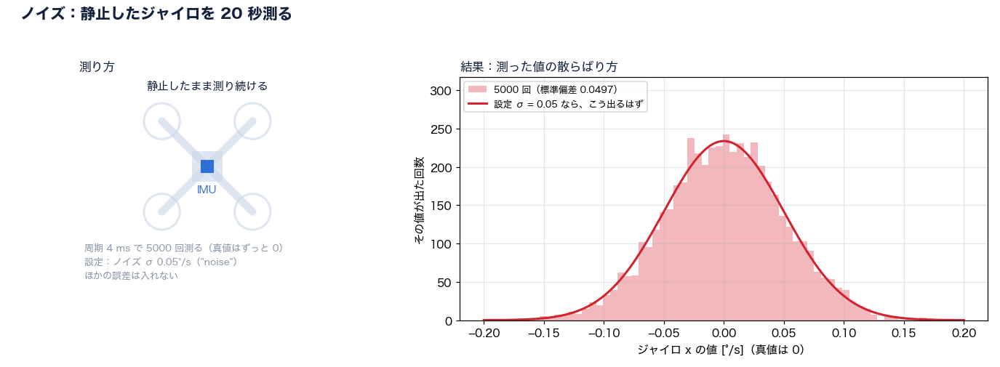

- **測ったこと：** 静止した IMU を、周期 4 ms で 20 秒（5000 回）測りました。真値はずっと 0 です。
- **グラフの見方：** 横軸はジャイロ x の値、縦軸はその値が出た回数です。
- **結果：** 5000 回の標準偏差は 0.0497°/s（設定 0.05°/s）でした。

### 3-2. ノイズ密度：周期を変えたジャイロ

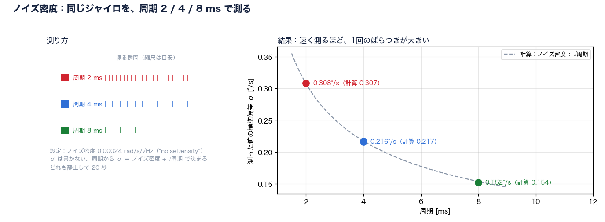

- **測ったこと：** σ ではなく、ノイズ密度 0.00024 rad/s/√Hz で設定したジャイロを、周期 2 / 4 / 8 ms の3通りで、静止させて 20 秒ずつ測りました。
- **グラフの見方：** 横軸は周期、縦軸はその周期で測った値の標準偏差です。破線は、計算（ノイズ密度 ÷ √周期）です。
- **結果：** 0.308 / 0.216 / 0.152°/s で、計算（0.307 / 0.217 / 0.154°/s）と一致しました。速く測るほど1回のばらつきは大きくなり、そのぶん回数が多くなります。

### 3-3. 静止した地磁気センサーと気圧センサーのノイズ

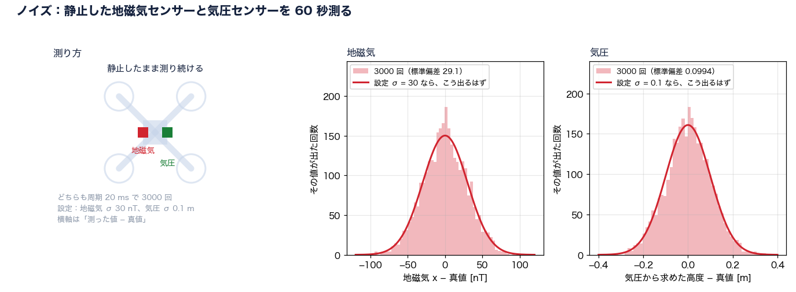

- **測ったこと：** 静止した地磁気センサーと気圧センサーを、周期 20 ms で 60 秒（3000 回）測りました。
- **グラフの見方：** 横軸は「測った値 − 真値」、縦軸はその値が出た回数です。気圧は、高度に直して見ています。
- **結果：** 標準偏差は、地磁気 29.1 nT（設定 30 nT）、気圧 0.0994 m（設定 0.1 m）でした。

### 3-4. 静止した GPS のノイズ

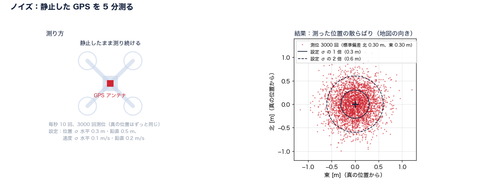

- **測ったこと：** 静止した GPS を、毎秒 10 回で 5 分（3000 回）測位しました。
- **グラフの見方：** 地図の向きで、上が北、右が東です。点の1つ1つが1回の測位で、真の位置が中心の ＋ です。実線の円が設定 σ（0.3 m）、破線の円がその2倍です。
- **結果：** 標準偏差は、北 0.303 m、東 0.299 m でした。点の約 4 割が実線の円の中に入ります（2次元の正規分布の性質）。速度のノイズも、0.102 m/s（設定 0.1 m/s）でした。

## 4. ドリフト

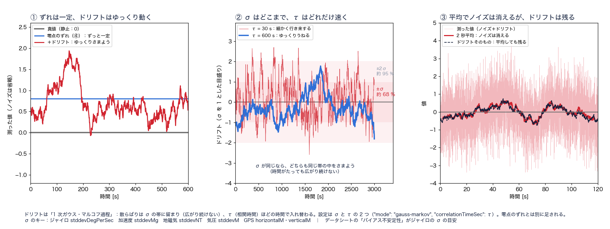

ドリフトは、ゆっくりさまよう零点のずれです。1次のガウス・マルコフ過程で、σ（どこまでさまようか）と τ（どれだけ速く入れ替わるか）の2つで書きます（[共通の仕様](../../spec/drone-common.md) 4.2）。

この節には「Allan 偏差」のグラフが出てきます。見方は次の通りです。

- 横軸は、何秒ぶんの値を平均するかです。縦軸は、そうして平均した値が、平均ごとにどれだけばらつくかです。
- ノイズだけなら、長く平均するほどばらつきは小さくなり、グラフは右下がりの破線のまま下がり続けます。
- ドリフトがあると、ある長さから先は平均しても小さくならず、赤い線が破線から離れて下げ止まります。ここが、ノイズよりドリフトが目立ち始める時間の長さです。

### 4-1. 静止したジャイロのドリフト

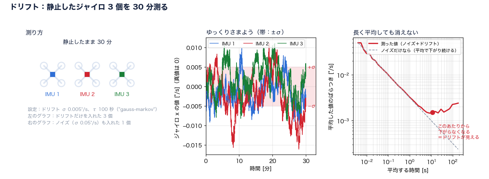

- **測ったこと：** 静止した IMU を 30 分測りました。中央のグラフはドリフトだけを入れた3個（σ 0.005°/s、τ 100 秒）です。右のグラフは、ノイズ（σ 0.05°/s）も入れた1個です。
- **グラフの見方：** 中央は、横軸が時間（分）、縦軸がジャイロ x の値（真値は 0）です。帯は ±σ です。右は Allan 偏差です。
- **結果：** 3個とも、0 のまわりを数分の周期でさまよい、だいたい ±2σ の中に収まります。Allan 偏差は、10 秒あたりから破線を離れて下げ止まりました。

### 4-2. 静止した地磁気センサーのドリフト

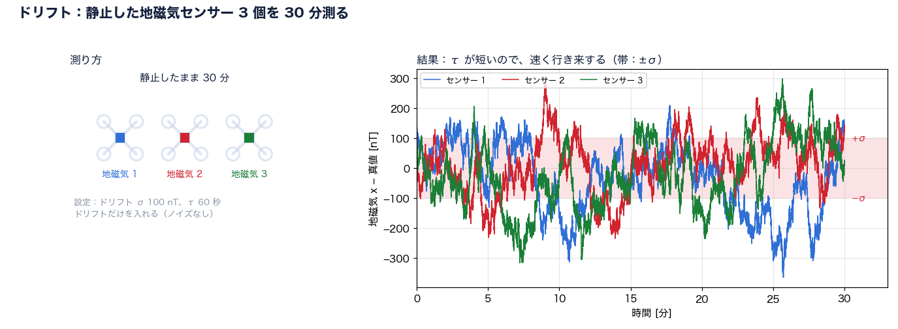

- **測ったこと：** ドリフトだけ（σ 100 nT、τ 60 秒）を入れた地磁気センサー3個を、静止させて 30 分測りました。
- **グラフの見方：** 横軸は時間（分）、縦軸は「地磁気 x − 真値」です。帯は ±σ です。
- **結果：** 3個とも、±σ 程度の幅でさまよいました。τ が 60 秒と短いので、ジャイロ（τ 100 秒）より細かく行き来します。

### 4-3. 静止した気圧センサーのドリフト

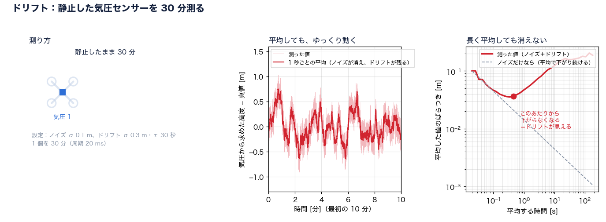

- **測ったこと：** ノイズ（σ 0.1 m）とドリフト（σ 0.3 m、τ 30 秒）を入れた気圧センサーを、静止させて 30 分測りました。
- **グラフの見方：** 中央は最初の 10 分で、横軸が時間、縦軸が「高度 − 真値」です。薄い線が測った値、濃い線が 1 秒ごとの平均です。右は Allan 偏差です。
- **結果：** 1 秒平均でノイズは消えますが、濃い線は ±0.5 m ほどゆっくり動き続けます。これがドリフトです。Allan 偏差は、0.5 秒あたりから下げ止まりました。

### 4-4. 静止した GPS のドリフト

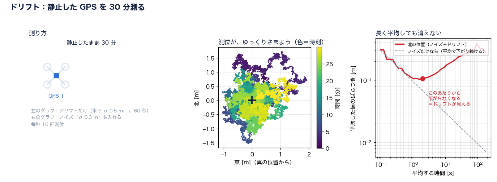

- **測ったこと：** 静止した GPS を 30 分測位しました。中央はドリフトだけ（水平 σ 0.5 m、τ 60 秒）、右はノイズ（σ 0.3 m）も入れたものです。
- **グラフの見方：** 中央は地図の向き（上が北）で、点の色が時刻です。右は、北の位置の Allan 偏差です。
- **結果：** 測位は、真の位置（＋）のまわりを 1 m ほどの範囲でゆっくりさまよいました。色が時刻ごとにかたまっているのは、ゆっくり動いているからです。

## 5. 周期と遅れ


センサーは周期ごとにだけ測り、次まで同じ値を出し続けます。遅れは、真値をずらしてから周期で測る、という形で入ります。そのため、見かけの遅れは「遅れ」から「遅れ＋周期」の間になります。測る瞬間は、時刻 0 から周期の倍数です。

この節のグラフは、どれも同じ見方です。

- 横軸は、真値が変わった瞬間（赤い点線）からの時間です。
- 灰色が真値、青が「周期だけ」の設定、緑の破線が「周期＋遅れ」の設定で測った値です。
- 青と緑が灰色から右にずれている分が、センサーの遅れです。

### 5-1. ジャイロ（周期 4 ms、遅れ 10 ms）

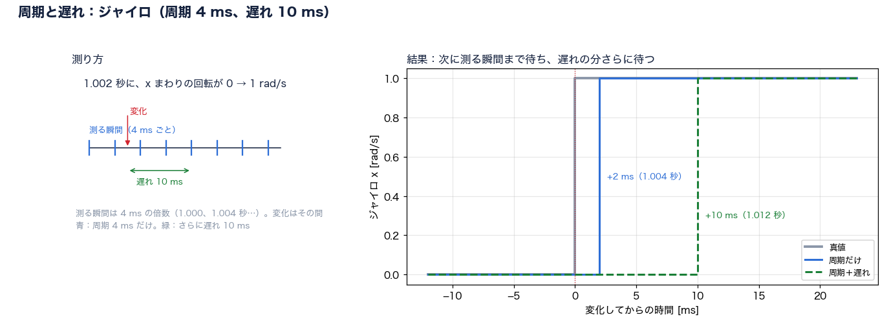

- **測ったこと：** 1.002 秒に、機体の x まわりの回転を 0 から 1 rad/s に一瞬で変えました。測る瞬間（4 ms の倍数）の間に変化が来るように、時刻を選んでいます。
- **結果：** 周期だけでは、次に測る 1.004 秒（+2 ms）に変わりました。遅れ 10 ms を足すと、1.012 秒（+10 ms）に変わりました。ずらした真値が 1.012 秒に変わり、それがちょうど測る瞬間に当たるからです。

### 5-2. 地磁気（周期 20 ms、遅れ 50 ms）

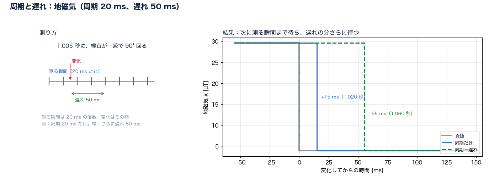

- **測ったこと：** 1.005 秒に、機首を一瞬で 90° 回しました。
- **結果：** 周期だけでは 1.020 秒（+15 ms）、遅れを足すと 1.060 秒（+55 ms）に変わりました。

### 5-3. 気圧（周期 20 ms、遅れ 60 ms）

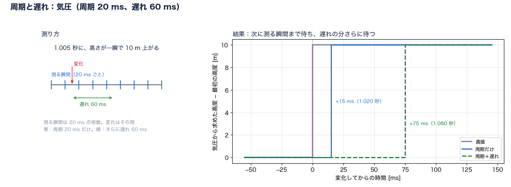

- **測ったこと：** 1.005 秒に、高さを一瞬で 10 m 上げました。
- **結果：** 周期だけでは 1.020 秒（+15 ms）、遅れを足すと 1.080 秒（+75 ms）に変わりました。

### 5-4. GPS（周期 100 ms、遅れ 100 ms）

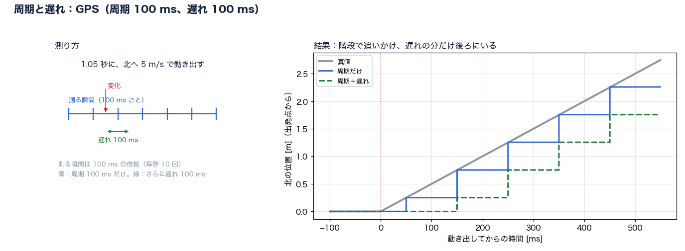

- **測ったこと：** 1.05 秒に、北へ 5 m/s で動き出しました。
- **グラフの見方：** 縦軸は北の位置です。真値（灰色）はなめらかに増え、測った値は 100 ms ごとの階段になります。
- **結果：** 青の階段は、測った瞬間の真値に乗ります。緑の階段は、さらに 100 ms 前の位置、つまり 0.5 m 後ろを示し続けます。

## 6. 分解能とレンジ

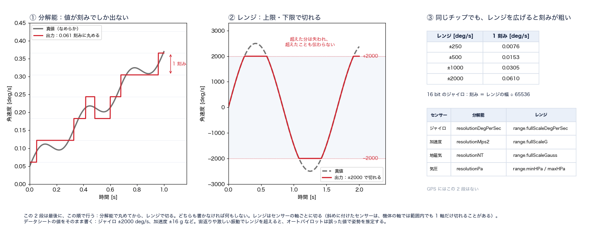

最後の2段です。分解能の刻みに丸めてから、レンジで切ります。どちらも、書かなければ何もしません。GPS には、この2段はありません。

### 6-1. ジャイロの分解能（0.061°/s 刻み）

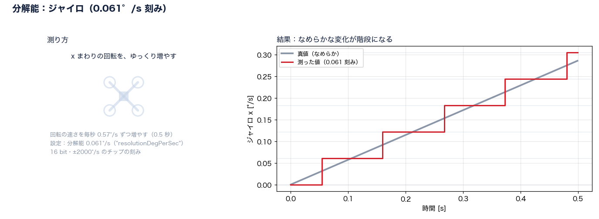

- **測ったこと：** 機体の x まわりの回転を、毎秒 0.57°/s ずつゆっくり増やしました（0.5 秒）。分解能は、16 bit・±2000°/s のチップに当たる 0.061°/s です。
- **グラフの見方：** 横軸は時間、縦軸はジャイロ x の値です。灰色が真値、赤が測った値です。
- **結果：** なめらかな変化が、0.061°/s 刻みの階段になりました。刻みより小さい変化は、出力に出ません。

### 6-2. ジャイロのレンジ（±2000°/s）

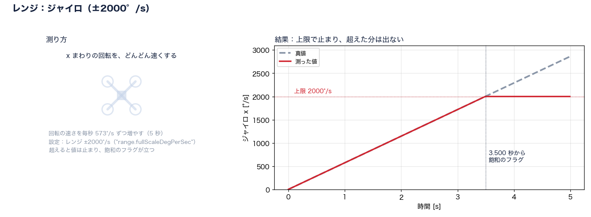

- **測ったこと：** 機体の x まわりの回転を、毎秒 573°/s ずつどんどん速くしました（5 秒）。
- **グラフの見方：** 灰色の破線が真値、赤が測った値です。縦の点線は、飽和のフラグが立った時刻です。
- **結果：** 測った値は 2000°/s で止まり、それより先は出ません。飽和のフラグは、最初に切れたサンプル（3.500 秒）から立ちました。真値が 2000°/s を超えるのは 3.491 秒で、その次のサンプルです。

### 6-3. 地磁気の分解能とレンジ（15 nT 刻み、±0.3 G）

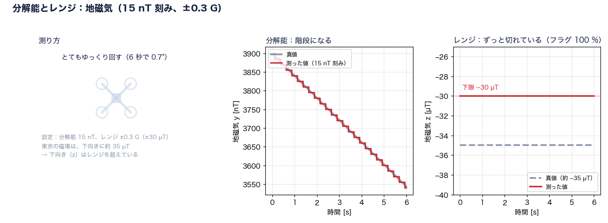

- **測ったこと：** 機体をとてもゆっくり回しました（6 秒で 0.7°）。分解能は 15 nT、レンジは ±0.3 G（±30 µT）です。
- **グラフの見方：** 中央はセンサー y の磁場、右はセンサー z（鉛直）の磁場です。
- **結果：** y は、15 nT 刻みの階段になりました。z は真値が約 −35 µT で、レンジ（−30 µT）を超えています。そのため、すべてのサンプルで −30 µT に切られ、フラグが立ち続けました。レンジを狭く設定しすぎると、こうなります。

### 6-4. 気圧の分解能とレンジ（0.5 Pa 刻み、300〜1100 hPa）

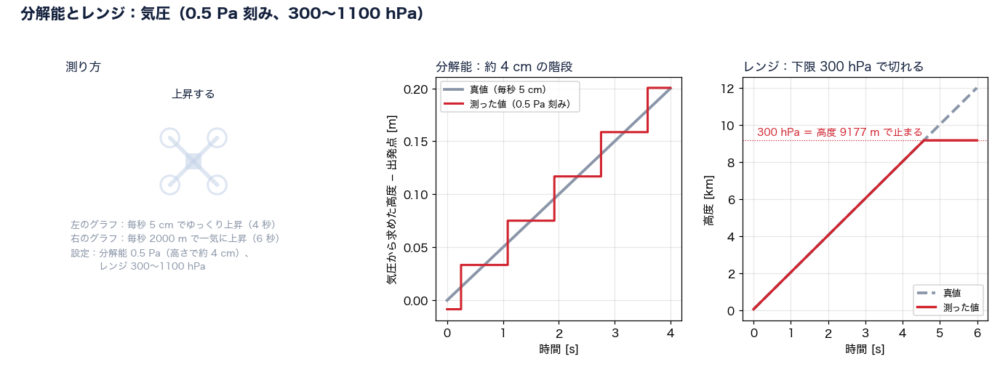

- **測ったこと：** 中央は、毎秒 5 cm でゆっくり上昇した場合です。右は、毎秒 2000 m で一気に上昇した場合です（レンジを見るための、ありえない速さ）。
- **グラフの見方：** 中央の縦軸は、出発点からの高度です。右の縦軸は高度（km）です。
- **結果：** ゆっくりした上昇は、0.5 Pa（高さで約 4 cm）刻みの階段になりました。一気に上昇すると、気圧が下限の 300 hPa になる高度 9177 m で止まりました。

## このページで示していないこと

- **感度（スケール誤差・他軸感度）の実測：** 仕組みの図だけです。地磁気のソフトアイアンは、2節で実測しています。
- **特定のチップとの一致：** 設定は説明用の値です。チップのデータシートの値も、同じキーで書けます。
- **ほかの実装（Gazebo、Project AirSim）：** ツールは名前で実装を選べます。ほかの実装との比較は、[ドローンのセンサー](../drone/README.md) にあります。
- **仕様にある IMU のフィルタとロータの振動：** まだ示していません。
