# ドローンのセンサーの誤差特性（2026-11-19）

[English](README.md) | 日本語

実際のセンサーが真値に加えるもの、つまり取り付けの影響、ノイズ、個体ごとのずれ、ドリフト、測る周期、遅れ、分解能、レンジは、ジャイロ、加速度、地磁気、気圧、GPS で同じ考え方で決めています（[共通の仕様](../../spec/drone-common.md)）。処理の順番（真値 → 取り付け → 遅れ → サンプリング → ノイズ → ドリフト → 飽和）、乱数の流れとリセット、Gauss-Markov ドリフトとノイズ密度の式が共通です。このページでは、その誤差を1つずつ、センサーごとに見せ、出力が設定どおりになることを確かめます。

## 測り方

```text
動き（式）─▶ ホストの部品：取り付け、真値 ─▶ アダプタ（共通の口）─▶ CSV ─▶ 図
```

- **物理エンジンを使いません。** 剛体を、式で書いた動き（静止、旋回、段差、傾き、上昇、動き出し）で動かします。このリポジトリのホストの部品（`host/sensor_host.hpp`）が、シミュレータのホストと同じように、取り付けを当ててセンサーの真値を作ります。
- **誤差は1回に1つです。** 誤差を1つだけ入れた設定で測るので、図はその誤差の効き方だけを示します。
- **共通の口を通します。** アダプタは実装の名前から作ります（`sensor_adapter_implementation.hpp`）。ツールは、口の後ろの実装を知りません。
- **測ったもの：** [hakoniwa-sensor-pro](https://github.com/hakoniwalab/hakoniwa-sensor-pro) v0.1.0 の箱庭の実装（公開バイナリ `hakoniwa-sensor-pro-0.1.0-macos-arm64.zip`、SHA-256 `82040299ea2eed32139626b8c30a787fb5bc7c44d0660f303edc2155158deb23`）。macOS 27（Apple silicon）、物理の周期 1 ms、乱数の種は断りがなければ 1 です。
- **設定：** 仕様の範囲にある説明用の値で、特定のチップの値ではありません。ドローンのセンサーの設定は、センサーの FRD 軸（Drone PRO の流儀）で書きます。真値と図は FLU 軸です。
- **世界：** 東京（北緯 35.6812°、東経 139.7671°、40 m）、全磁力 46,000 nT（偏角 −7.5°、伏角 49.5°）、標準大気です。

ツール、設定、スクリプトは [tools/error-characteristics](../../../tools/error-characteristics) にあります。ビルドとコマンドは、そこの README にあります。すべての図は、1分ほどで作り直せます。

## まとめ

| センサー | 誤差 | 設定 | 測った値 |
|---|---|---|---|
| 加速度 | てこの腕：中心から 0.1 / 0.2 m、180°/s で旋回 | −ω²r = −0.987 / −1.974 m/s² | −0.987 / −1.974 m/s² |
| ジャイロ | 白色ノイズ | σ 0.0500°/s | 0.0497°/s（5000 サンプル） |
| ジャイロ | ノイズ密度 0.00024 rad/s/√Hz、周期 2 / 4 / 8 ms | σ 0.00537 / 0.00379 / 0.00268 rad/s | 0.00538 / 0.00377 / 0.00266 rad/s |
| ジャイロ / 加速度 | 個体ごとの零点のずれ | σ 1°/s / 20 mg | 0.999°/s / 20.3 mg（1000 個体） |
| ジャイロ | 周期 4 ms、さらに遅れ 10 ms。1.002 秒の段差 | 1.004 秒で変わる / 1.012 秒 | 1.004 秒 / 1.012 秒 |
| ジャイロ | フルスケール 2000°/s | 切れて、飽和のフラグ | 2000.0°/s、3.500 秒からフラグ（真値が超えるのは 3.491 秒） |
| 地磁気 | 白色ノイズ | σ 30 nT | 29.1 nT |
| 地磁気 | ハードアイアン (3000, −1500, 800) nT（FRD）＋ソフトアイアン | 一回転の軌跡の中心 | FLU で (2.3, 1.3) µT。下の計算どおり |
| 地磁気 | 周期 20 ms、さらに遅れ 50 ms。1.005 秒の旋回 | 1.020 秒 / 1.060 秒 | 1.020 秒 / 1.060 秒 |
| 気圧 | 0.5 / 1.0 m 高く取り付け | 約 −6 / −12 Pa | −5.98 / −11.97 Pa |
| 気圧 | 白色ノイズ | σ 0.1 m | 0.0994 m |
| 気圧 | 個体ごとの零点のずれ | σ 4 m | 3.82 m（1000 個体） |
| 気圧 | 周期 20 ms、さらに遅れ 60 ms。1.005 秒の段差 | 1.020 秒 / 1.080 秒 | 1.020 秒 / 1.080 秒 |
| 気圧 | レンジ 300 hPa | 約 9164 m で切れる | 9177 m から切れる |
| GPS | アンテナを 0.5 m 前に、その場で旋回 | 半径 0.5 m の円 | 半径 0.501 m |
| GPS | 位置のノイズ（水平） | σ 0.3 m | 北 0.303 m、東 0.299 m（3000 測位） |
| GPS | 速度のノイズ（水平） | σ 0.1 m/s | 0.102 m/s |

N 個のサンプルから求めた標準偏差には、相対で約 1/√(2N) の誤差があります（5000 サンプルで 1 %、1000 個体で 2 %）。上の差は、どれもその2倍以内です。

## ジャイロと加速度

### 取り付け

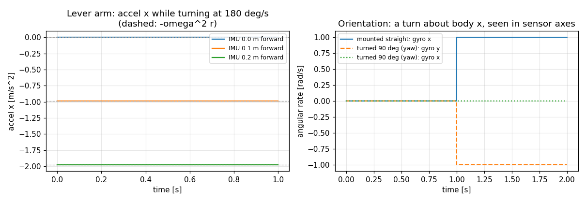

左：機体が 180°/s で旋回するとき、中心から 0.1 m と 0.2 m に付けた加速度計には、遠心加速度 −ω²r（破線）が出ます。右：機体の x 軸まわりの回転を、まっすぐ付けた IMU と、ヨーで 90° 回して付けた IMU で見たもの。回して付けたセンサーでは、−y 軸に出ます。どちらもホストの部品が作るので、IMU の実装によりません。

### ノイズとノイズ密度

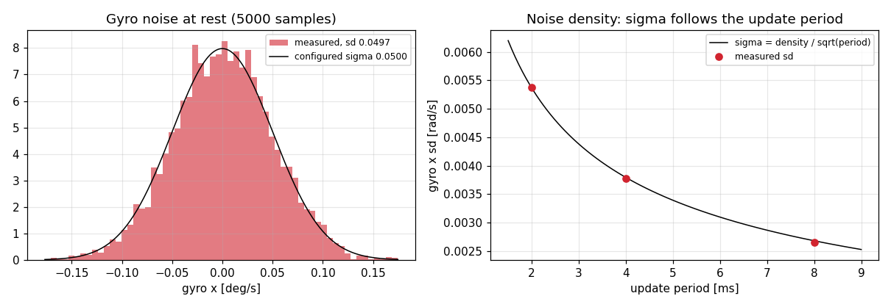

左：静止時のジャイロ x の値と、設定した σ の正規分布。右：σ の代わりにノイズ密度で書くと、σ は周期に合わせて σ = ノイズ密度 / √周期 で変わります（[共通の仕様](../../spec/drone-common.md) 4.3）。

### 個体ごとの零点のずれ

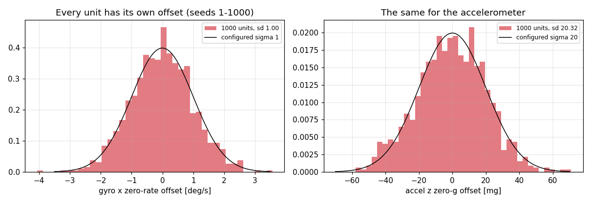

ずれは起動時に個体ごとに1つ決まり、そのまま保たれます。乱数の種 1〜1000 の 1000 個体です。

### ドリフト

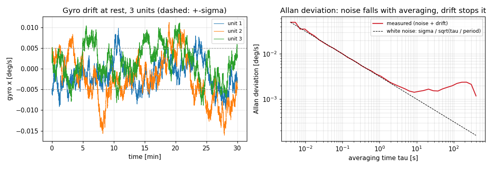

左：静止した3個体の、30分間の Gauss-Markov ドリフト（σ 0.005°/s、τ 100 秒）。右：ノイズとドリフトを合わせた Allan 偏差。白色ノイズは平均を長くとると下がりますが（破線）、ドリフトで下げ止まります。

### 周期と遅れ

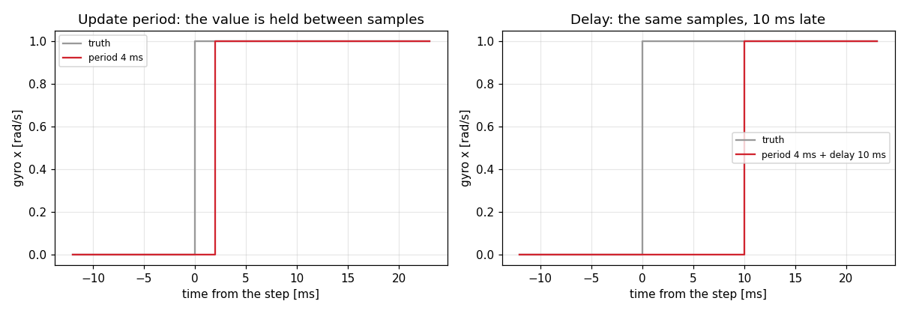

2つのサンプルの間（サンプルは 4 ms の倍数の時刻）にあたる 1.002 秒の段差。左：次のサンプル（1.004 秒）まで値が保持されます。右：遅れ 10 ms を足すと、同じサンプルの並びが 10 ms 遅れ、1.012 秒から出ます。

### 分解能とレンジ

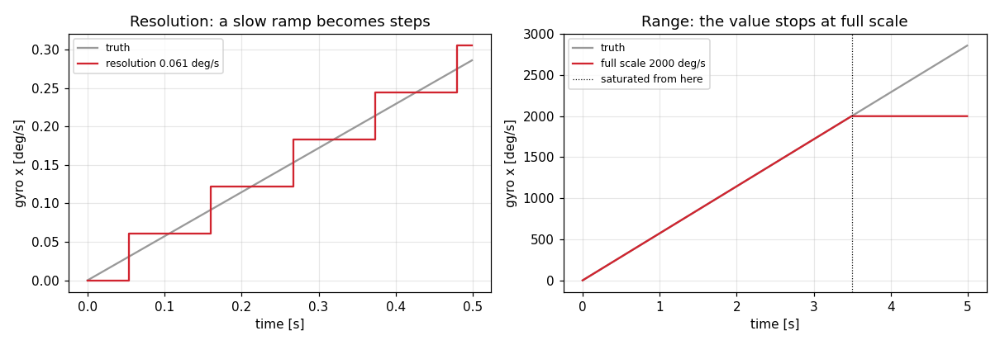

左：ゆっくりした傾きが、0.061°/s 刻みの階段になります。右：値はフルスケールの 2000°/s で止まり、最初に切れたサンプルから飽和のフラグが立ちます。

## 地磁気

### 取り付け、ハードアイアンとソフトアイアン

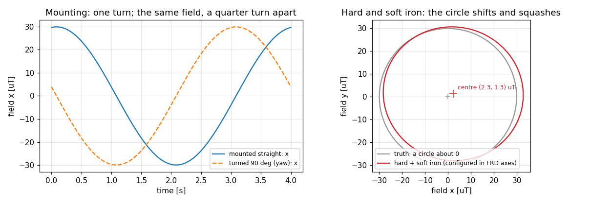

左：4 秒で一回転。ヨーで 90° 回して付けたセンサーは、同じ磁場を 1/4 回転ずれて見ます。右：一回転の水平の磁場は、0 を中心とする円です。ハードアイアンとソフトアイアンで、円がずれて潰れます。設定は FRD 軸なので、ハードアイアン (3000, −1500) nT は、FLU では (3000, +1500) nT です。さらに、ソフトアイアンの非対角成分が鉛直の磁場（FLU で約 −35 µT）を x（−700 nT）と y（FRD で +175 nT）に混ぜます。中心は (3000 − 700, 1500 − 175) nT = (2.3, 1.3) µT となり、測った値と一致します。

### ノイズとドリフト

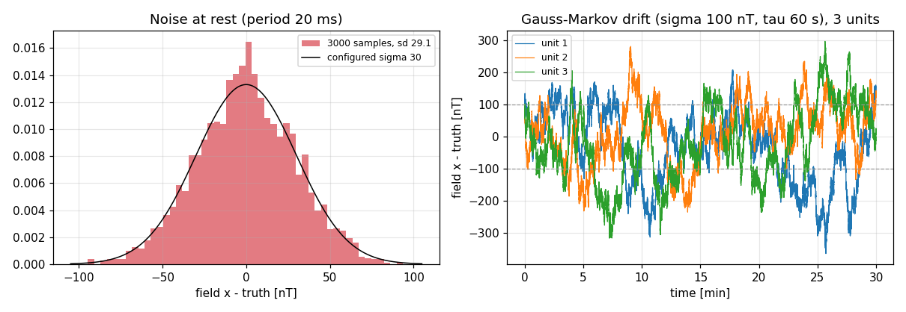

左：静止時のノイズと、σ 30 nT。右：3個体の、30分間の Gauss-Markov ドリフト（σ 100 nT、τ 60 秒）。

### 周期、遅れ、分解能、レンジ

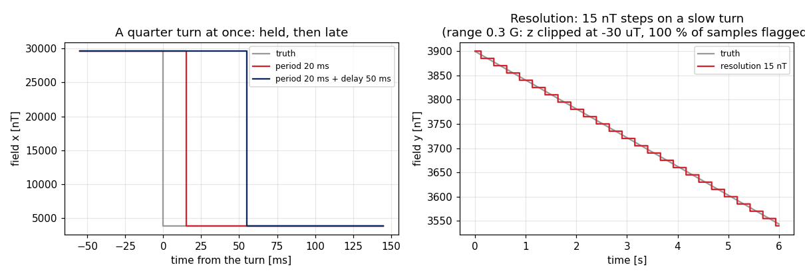

左：1.005 秒に、一瞬で 1/4 回転。次の 20 ms のサンプルまで保持され、遅れを足すと 50 ms 遅れます。右：ゆっくり回すと、15 nT 刻みの階段になります。レンジを 0.3 G（30 µT）にすると、鉛直の成分（約 −35 µT）は、すべてのサンプルで −30 µT に切られ、フラグが立ちます。

## 気圧

### 取り付けと零点のずれ

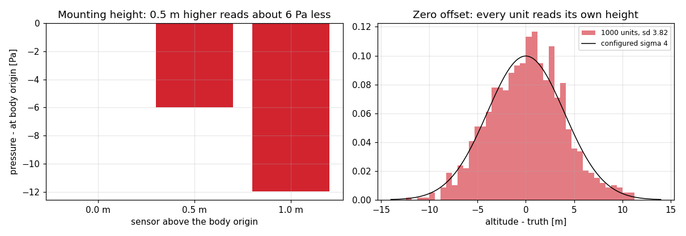

左：機体の原点から 0.5 m、1.0 m 上に付けたセンサーは、約 6 Pa、12 Pa 低く読みます（ρ·g·h）。右：個体ごとの零点のずれ（高度のメートル）。1000 個体です。

### ノイズとドリフト

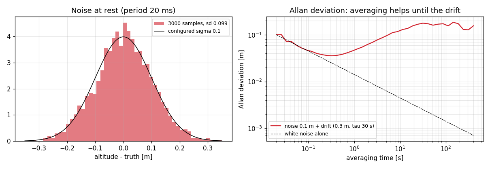

左：静止時のノイズと、σ 0.1 m。右：ノイズと Gauss-Markov ドリフト（0.3 m、τ 30 秒）を合わせた Allan 偏差。

### 周期、遅れ、分解能、レンジ

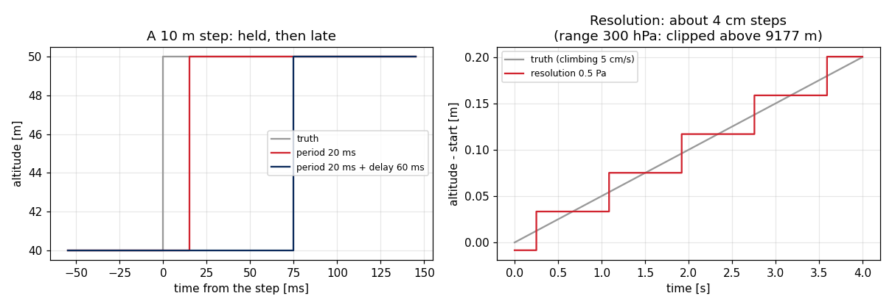

左：1.005 秒に 10 m の段差。次の 20 ms のサンプルまで保持され、遅れを足すと 60 ms 遅れます。右：毎秒 5 cm の上昇が、0.5 Pa（約 4 cm）刻みの階段になります。速く上昇すると、300 hPa（気圧高度 9177 m）で切れます。

## GPS

### 取り付けとノイズ

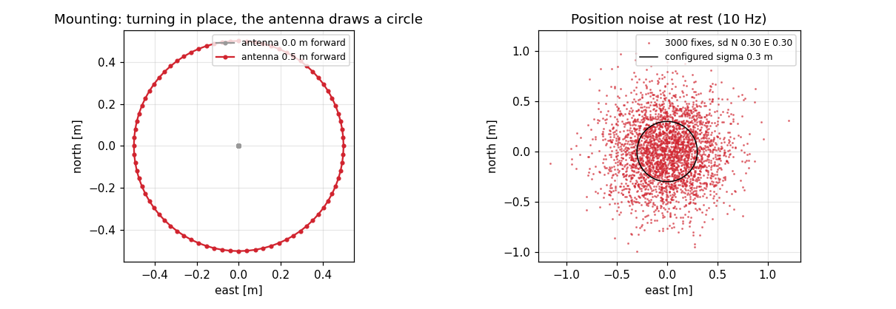

左：その場で旋回すると、0.5 m 前に付けたアンテナは円を描きます。中心に付けたアンテナは、1点にとどまります。右：静止時の位置のノイズ（毎秒 10 測位）と、σ 0.3 m。

### ドリフト

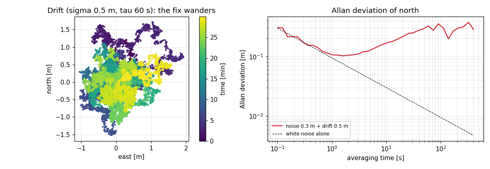

左：Gauss-Markov ドリフト（水平 0.5 m、τ 60 秒）で、30分間に測位がさまよう様子。右：ノイズとドリフトを合わせた、北の位置の Allan 偏差。

### 周期と遅れ

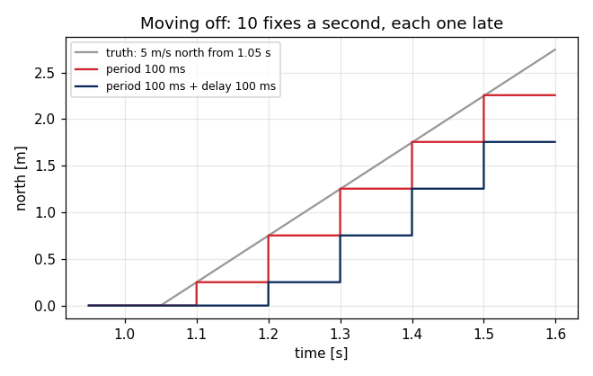

1.05 秒に北へ 5 m/s で動き出す場面。毎秒 10 回の測位と、遅れを足したときの、100 ms 遅れた同じ測位です。

GPS には、分解能とレンジの設定がありません。

## このページで示していないこと

- 特定のチップとの一致：設定は説明用の値です。チップのデータシートの値も、同じキーで書けます。
- ほかの実装（Gazebo、Project AirSim）：ツールは名前で選べます。ほかの実装との比較は [ドローンのセンサー](../drone/README.md) にあります。
- 仕様にある IMU のフィルタとロータの振動：まだ示していません。
