# ドローンのセンサーの誤差特性（2026-11-19）

[English](README.md) | 日本語

実際のセンサーは、真値をそのまま出しません。取り付けの影響、個体ごとのずれ、ノイズ、ドリフト、測る周期と遅れ、分解能とレンジが加わります。ジャイロ、加速度、地磁気、気圧、GPS のどれでも、これらは同じ考え方で決めています（[共通の仕様](../../spec/drone-common.md)）。

このページは、誤差の種類ごとに1節を立てます。各節は、はじめに仕組みを説明する図（説明用に描いたもの）を置き、次にセンサーごとの実測のグラフを置きます。実測のグラフでは、出力が設定どおりになることを確かめます。

## 共通の流れ

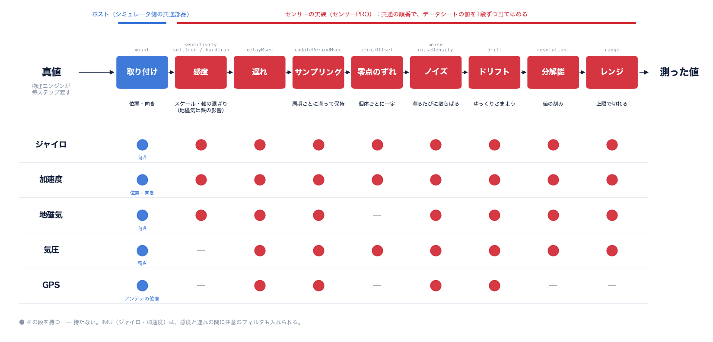

真値は、上の段を左から順に通って、測った値になります。

- **取り付け**は、シミュレータ側の共通部品（ホスト）が行います。
- **それ以外の段**は、センサーの実装が行います。データシートの値を、1段ずつ当てはめます。
- 段の順番と設定のキーは、5つのセンサーで共通です。センサーによって持たない段があり、下の表の「—」がそれです。

## 測り方

```text
動き（式）─▶ ホストの部品：取り付け、真値 ─▶ アダプタ（共通の口）─▶ CSV ─▶ 図
```

- **物理エンジンは使いません。** 剛体を、式で書いた動きで動かします。動きは、静止、旋回、段差、傾き、上昇、動き出しです。このリポジトリのホストの部品（`host/sensor_host.hpp`）が、シミュレータのホストと同じように取り付けを当て、センサーの真値を作ります。
- **誤差は1回に1つです。** 誤差を1つだけ入れた設定で測ります。そのため、各図はその誤差の効き方だけを示します。
- **共通の口を通します。** アダプタは、実装の名前から作ります（`sensor_adapter_implementation.hpp`）。ツールは、口の後ろの実装を知りません。
- **測ったもの：** [hakoniwa-sensor-pro](https://github.com/hakoniwalab/hakoniwa-sensor-pro) v0.1.0 の箱庭の実装です。
  - 公開バイナリ：`hakoniwa-sensor-pro-0.1.0-macos-arm64.zip`（SHA-256 `82040299ea2eed32139626b8c30a787fb5bc7c44d0660f303edc2155158deb23`）
  - 環境：macOS 27（Apple silicon）、物理の周期 1 ms
  - 乱数の種：断りがなければ 1
- **設定：** 仕様の範囲にある説明用の値で、特定のチップの値ではありません。ドローンのセンサーの設定は、センサーの FRD 軸で書きます（Drone PRO の流儀）。真値と実測のグラフは FLU 軸です。
- **世界：** 東京です。
  - 位置：北緯 35.6812°、東経 139.7671°、高さ 40 m
  - 磁場：全磁力 46,000 nT、偏角 −7.5°、伏角 49.5°
  - 大気：標準大気

ツール、設定、スクリプトは [tools/error-characteristics](../../../tools/error-characteristics) にあります。ビルドとコマンドは、そこの README にあります。実測のグラフは、すべて1分ほどで作り直せます。仕組みの図は、そこの `concepts/` で作り直せます。

## まとめ

| 誤差 | センサー | 設定 | 測った値 |
|---|---|---|---|
| 取り付け（位置） | 加速度 | 中心から 0.1 / 0.2 m、180°/s で旋回：−ω²r = −0.987 / −1.974 m/s² | −0.987 / −1.974 m/s² |
| 取り付け（位置） | 気圧 | 0.5 / 1.0 m 高く取り付け：約 −6 / −12 Pa | −5.98 / −11.97 Pa |
| 取り付け（位置） | GPS | アンテナを 0.5 m 前に付け、その場で旋回：半径 0.5 m の円 | 半径 0.501 m |
| 零点のずれ | ジャイロ / 加速度 | σ 1°/s / 20 mg | 0.999°/s / 20.3 mg（1000 個体） |
| 零点のずれ | 気圧 | σ 4 m | 3.82 m（1000 個体） |
| 鉄の影響 | 地磁気 | ハードアイアン (3000, −1500, 800) nT（FRD）＋ソフトアイアン：一回転の軌跡の中心 | FLU で (2.3, 1.3) µT。下の計算どおり |
| ノイズ | ジャイロ | σ 0.0500°/s | 0.0497°/s（5000 サンプル） |
| ノイズ密度 | ジャイロ | 0.00024 rad/s/√Hz、周期 2 / 4 / 8 ms：σ 0.00537 / 0.00379 / 0.00268 rad/s | 0.00538 / 0.00377 / 0.00266 rad/s |
| ノイズ | 地磁気 | σ 30 nT | 29.1 nT |
| ノイズ | 気圧 | σ 0.1 m | 0.0994 m |
| ノイズ | GPS | 位置（水平）σ 0.3 m | 北 0.303 m、東 0.299 m（3000 測位） |
| ノイズ | GPS | 速度（水平）σ 0.1 m/s | 0.102 m/s |
| 周期と遅れ | ジャイロ | 周期 4 ms、さらに遅れ 10 ms。1.002 秒の段差：1.004 秒 / 1.012 秒で変わる | 1.004 秒 / 1.012 秒 |
| 周期と遅れ | 地磁気 | 周期 20 ms、さらに遅れ 50 ms。1.005 秒の旋回：1.020 秒 / 1.060 秒 | 1.020 秒 / 1.060 秒 |
| 周期と遅れ | 気圧 | 周期 20 ms、さらに遅れ 60 ms。1.005 秒の段差：1.020 秒 / 1.080 秒 | 1.020 秒 / 1.080 秒 |
| レンジ | ジャイロ | フルスケール 2000°/s：切れて、飽和のフラグ | 2000.0°/s、3.500 秒からフラグ（真値が超えるのは 3.491 秒） |
| レンジ | 気圧 | 300 hPa：約 9164 m で切れる | 9177 m から切れる |

N 個のサンプルから求めた標準偏差には、相対で約 1/√(2N) の誤差があります。5000 サンプルなら 1 %、1000 個体なら 2 % です。上の差は、どれもその2倍以内です。

## 1. 取り付け


取り付けは「位置」と「向き」の2つで書きます。

- **位置：** 機体の原点から、前・右・下に何 m かです。重心からではありません。
- **向き：** ロール・ピッチ・ヨーの角度です。

機体が回ると、原点から離れたセンサーには余分な動きが出ます。加速度計には遠心加速度が乗り、GPS のアンテナは円を描きます。向きを回して付けると、軸が入れ替わります。この計算はホストの部品が行うので、センサーの実装によりません。

この節では、5つの測定をします。どれも、取り付け以外の誤差は入れていません（真値だけの設定）。

### 1-1. 旋回中の加速度計（位置）


- **測ったこと：** 機体をその場で 180°/s で回し続けます。IMU を中心、0.1 m 前、0.2 m 前に付けた3通りで、加速度計の前向き（x）の値を測りました。
- **グラフの見方：**
  - 横軸は時間です。縦軸は加速度計 x の値で、マイナスは後ろ向き、つまり回転の中心向きです。
  - 実線が測った値、破線が計算値（−ω²r）です。
- **結果：** 0.1 m 前では −0.987 m/s²、0.2 m 前では −1.974 m/s² で、計算と一致しました。中心に付けたものは 0 です。

### 1-2. ヨー 90° 回して付けたジャイロ（向き）


- **測ったこと：** 機体を、1 秒から前（x 軸）まわりに 1 rad/s で回します。まっすぐ付けた IMU と、左に 90° 回して付けた IMU で、ジャイロの各軸の値を測りました。
- **グラフの見方：**
  - 横軸は時間、縦軸はジャイロの角速度です。
  - 青がまっすぐ付けた IMU の x 軸です。赤の破線と点線が、回して付けた IMU の y 軸と x 軸です。
- **結果：** まっすぐ付けた IMU では、x に +1.00 が出ます。回して付けた IMU では、y に −1.00 が出て、x は 0 のままです。同じ回転が、取り付けの向きに合わせて別の軸に出ています。

### 1-3. ヨー 90° 回して付けた地磁気センサー（向き）


- **測ったこと：** 機体をその場で、4 秒で一回転させます。まっすぐ付けたセンサーと、90° 回して付けたセンサーで、センサー x 軸の磁場を測りました。
- **グラフの見方：**
  - 横軸は時間、縦軸はセンサー x 軸の磁場です。
  - 磁場は北を向いているので、回るとセンサー x の値は波になります。波の山は、センサー x が北を向いた時刻です。
- **結果：** 2本の波は、1.00 秒（1/4 回転）ずれました。回して付けたセンサーは、同じ磁場を 90° 先の向きで見ています。

### 1-4. 高く付けた気圧センサー（位置）


- **測ったこと：** 機体を静止させたまま、気圧センサーを原点、0.5 m 上、1.0 m 上に付けた3通りで、気圧を測りました。
- **グラフの見方：**
  - 縦軸は、原点に付けたときの気圧との差です。マイナスは、気圧が低いことを示します。
  - 破線は、空気の重さから計算した値（−ρ·g·h）です。
- **結果：** 0.5 m 上では −5.98 Pa、1.0 m 上では −11.97 Pa で、計算と一致しました。高いところは空気が薄いので、気圧が低く出ます。

### 1-5. 前に付けた GPS アンテナ（位置）

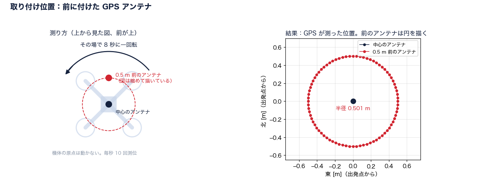

- **測ったこと：** 機体の原点は動かさず、その場で 8 秒に一回転させます。アンテナを中心に付けた場合と、0.5 m 前に付けた場合で、GPS の位置を毎秒 10 回測りました。
- **グラフの見方：** 地図のように、上が北、右が東です。点の1つ1つが、1回の測位です。
- **結果：** 中心のアンテナは、1点にとどまります。0.5 m 前のアンテナは、半径 0.501 m の円を描きました。機体は動いていなくても、アンテナは動いているからです。

## 2. 個体ごとのずれと感度

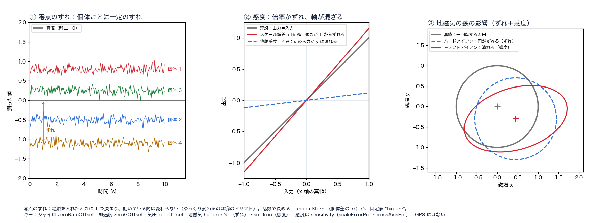

**零点のずれ**は、電源を入れたときに個体ごとに1つ決まり、動いている間は変わりません。乱数の σ で書くか、固定値で書きます。**感度**は、出力の倍率のずれ（スケール誤差）と、ほかの軸への漏れ（他軸感度）です。地磁気では、機体の鉄の影響もこの2つの形で入ります。ハードアイアンはずれ、ソフトアイアンは感度です。

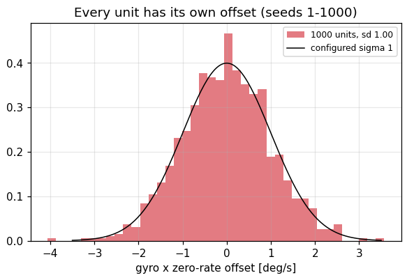 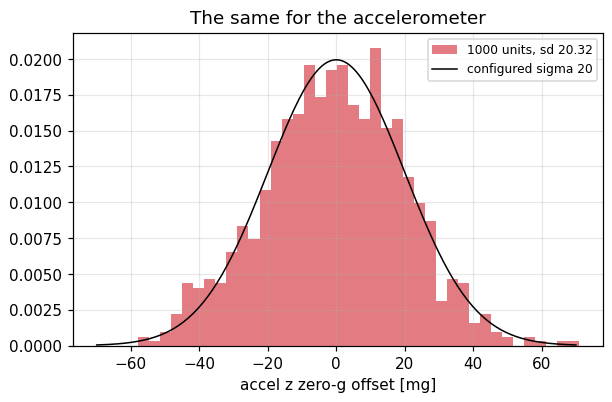

ジャイロ（左）と加速度（右）の零点のずれです。乱数の種 1〜1000 の、1000 個体を測りました。広がりは、設定した σ の正規分布に重なります。

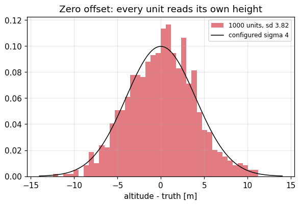 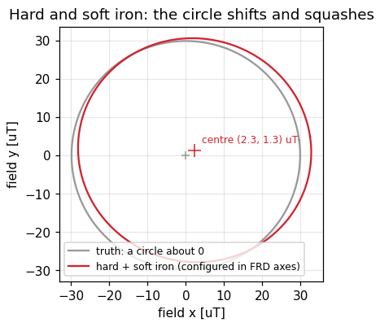

左は気圧の零点のずれ（高度のメートル）で、1000 個体です。右は地磁気の鉄の影響です。

一回転させたときの水平の磁場は、真値では 0 を中心とする円です。ハードアイアンとソフトアイアンが入ると、この円がずれて潰れます。中心の位置は、設定から次のように計算できます。

1. 設定は FRD 軸なので、ハードアイアン (3000, −1500) nT は、FLU では (3000, +1500) nT です。
2. ソフトアイアンの非対角成分が、鉛直の磁場（FLU で約 −35 µT）を混ぜます。x に −700 nT、y に FRD で +175 nT です。
3. よって中心は (3000 − 700, 1500 − 175) nT = (2.3, 1.3) µT で、測った値と一致します。

## 3. ノイズ

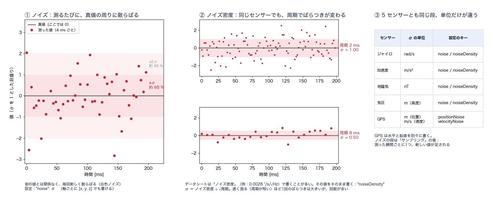

ノイズは、測るたびに新しく、真値の周りに散らばる値です。σ（標準偏差）で書きます。データシートがノイズ密度で書いている場合は、その値をそのまま書けます。その場合、σ は周期から決まります（σ = ノイズ密度 ÷ √周期、[共通の仕様](../../spec/drone-common.md) 4.3）。

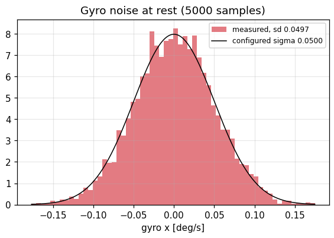 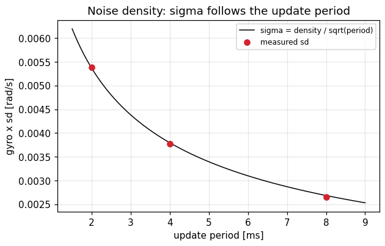

左はジャイロ x の、静止時の値です。設定した σ の正規分布に重なります。右はノイズ密度で書いた場合で、周期 2 / 4 / 8 ms で σ が式どおりに変わります。

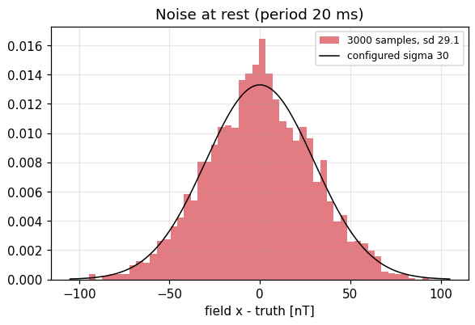 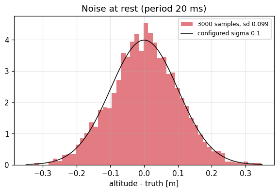

地磁気（左、σ 30 nT）と気圧（右、σ 0.1 m）の、静止時のノイズです。

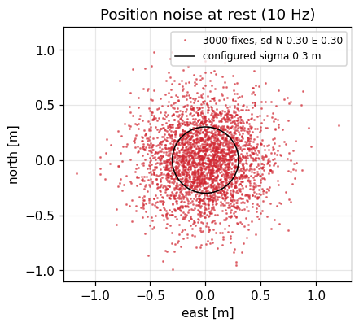

GPS の、静止時の位置のノイズです（毎秒 10 測位、σ 0.3 m）。

## 4. ドリフト


ドリフトは、ゆっくりさまよう零点のずれです。1次のガウス・マルコフ過程で、σ（どこまでさまようか）と τ（どれだけ速く入れ替わるか）の2つで書きます（[共通の仕様](../../spec/drone-common.md) 4.2）。平均をとっても消えないので、Allan 偏差のグラフでは、ノイズが平均で下がる線が、ドリフトのところで下げ止まります。

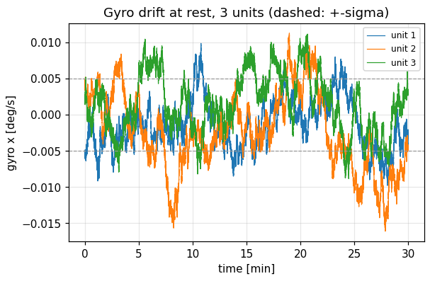 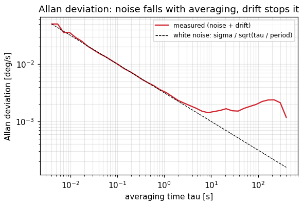

左は、静止したジャイロ3個体の、30分間のドリフトです（σ 0.005°/s、τ 100 秒）。右は、ノイズとドリフトを合わせた Allan 偏差です。白色ノイズは平均を長くとると下がりますが（破線）、ドリフトで下げ止まります。

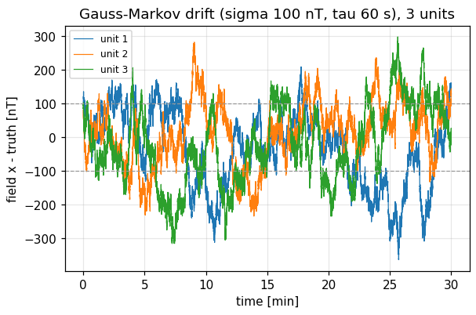 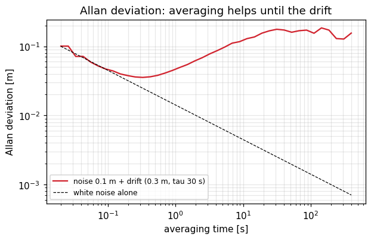

左は地磁気3個体の、30分間のドリフトです（σ 100 nT、τ 60 秒）。右は、気圧のノイズとドリフト（0.3 m、τ 30 秒）を合わせた Allan 偏差です。

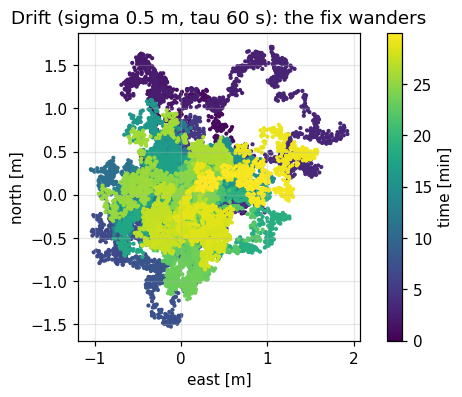 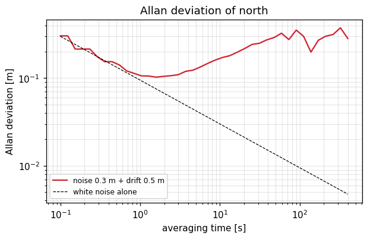

左は、GPS のドリフト（水平 0.5 m、τ 60 秒）で、30分間に測位がさまよう様子です。右は、ノイズとドリフトを合わせた、北の位置の Allan 偏差です。

## 5. 周期と遅れ

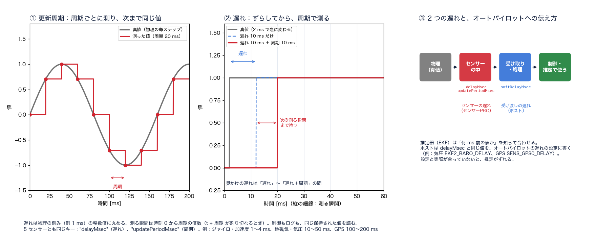

センサーは周期ごとにだけ測り、次まで同じ値を出し続けます。遅れは、真値をずらしてから周期で測る、という形で入ります。そのため、見かけの遅れは「遅れ」から「遅れ＋周期」の間になります。測る瞬間は、時刻 0 から周期の倍数です。

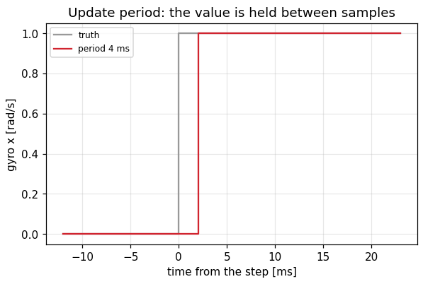 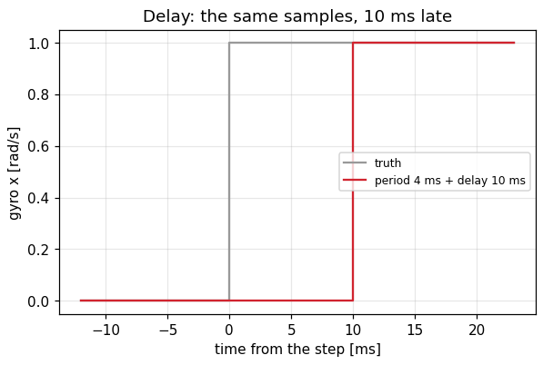

ジャイロの例です。1.002 秒の段差は、2つのサンプルの間にあたります（サンプルは 4 ms の倍数の時刻）。左は周期だけの場合で、次のサンプル（1.004 秒）まで値が保持されます。右は遅れ 10 ms を足した場合で、同じサンプルの並びが 10 ms 遅れ、1.012 秒から出ます。

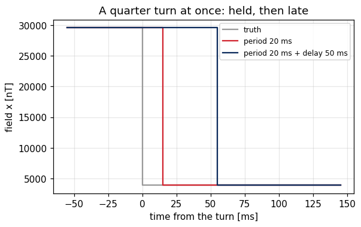 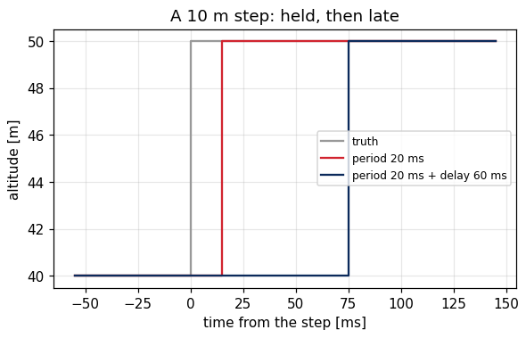

左は地磁気で、1.005 秒に一瞬で 1/4 回転します。次の 20 ms のサンプルまで保持され、遅れを足すとさらに 50 ms 遅れます。右は気圧で、1.005 秒に 10 m の段差です。同じように保持され、遅れを足すと 60 ms 遅れます。

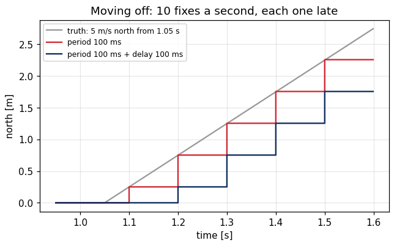

GPS で、1.05 秒に北へ 5 m/s で動き出す場面です。毎秒 10 回の測位と、遅れを足したときの、100 ms 遅れた同じ測位を示します。

## 6. 分解能とレンジ


最後の2段です。分解能の刻みに丸めてから、レンジで切ります。どちらも、書かなければ何もしません。GPS には、この2段はありません。

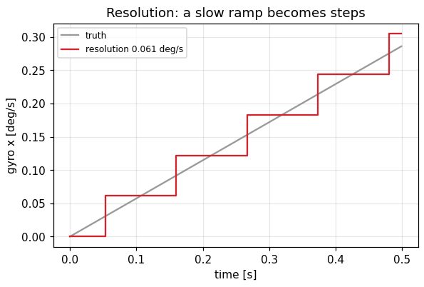 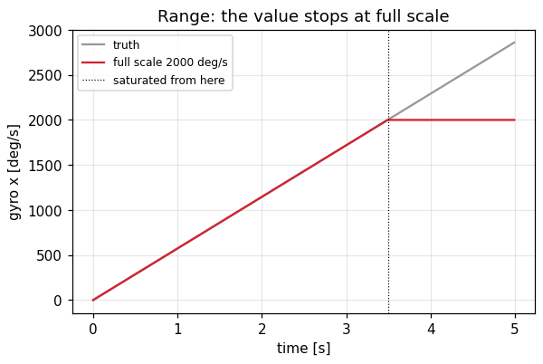

ジャイロの例です。左では、ゆっくりした傾きが 0.061°/s 刻みの階段になります。右では、値がフルスケールの 2000°/s で止まり、最初に切れたサンプルから飽和のフラグが立ちます。

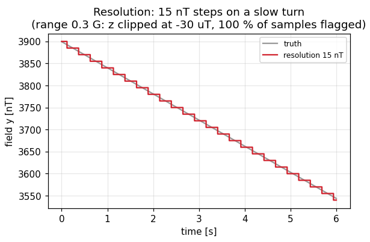 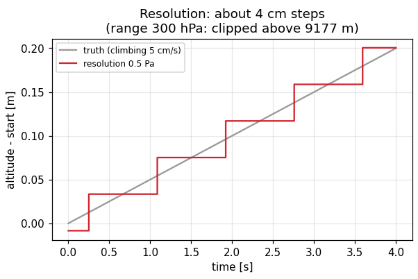

左は地磁気です。ゆっくり回すと、15 nT 刻みの階段になります。レンジを 0.3 G（30 µT）にすると、鉛直の成分（約 −35 µT）はすべてのサンプルで −30 µT に切られ、フラグが立ちます。右は気圧です。毎秒 5 cm の上昇が、0.5 Pa（約 4 cm）刻みの階段になります。速く上昇すると、300 hPa（気圧高度 9177 m）で切れます。

## このページで示していないこと

- **感度（スケール誤差・他軸感度）の実測：** 仕組みの図だけです。地磁気のソフトアイアンは、2節で実測しています。
- **特定のチップとの一致：** 設定は説明用の値です。チップのデータシートの値も、同じキーで書けます。
- **ほかの実装（Gazebo、Project AirSim）：** ツールは名前で実装を選べます。ほかの実装との比較は、[ドローンのセンサー](../drone/README.md) にあります。
- **仕様にある IMU のフィルタとロータの振動：** まだ示していません。
