# Error characteristics of the drone sensors (2026-11-19)

English | [日本語](README.ja.md)

What a real sensor adds to the truth — mounting effects, noise, a per-unit offset, drift, the update period, delay,
resolution and range — is described the same way for the gyroscope, the accelerometer, the magnetometer, the
barometer and GPS ([common specification](../../spec/drone-common.md)): one processing order
(truth → mounting → delay → sample → noise → drift → saturation), the same random streams and reset, the same
Gauss-Markov drift and noise-density formulas. This page shows each of those errors on its own, sensor by sensor, and
checks that the output follows the configured value.

## How we measure

```text
motion (a formula) ─▶ host helpers: mounting pose, truth ─▶ adapter (common interface) ─▶ CSV ─▶ figures
```

- **No physics engine.** A rigid body moves along a motion written as a formula: at rest, turning, a step, a ramp, a
  climb, moving off. The host helpers of this repository (`host/sensor_host.hpp`) apply the mounting pose and build
  the sensor truth, as a simulator host would.
- **One error at a time.** Each run uses a configuration that turns on one error only, so a figure shows what that
  error does and nothing else.
- **Through the common interface.** The adapters are created by implementation name
  (`sensor_adapter_implementation.hpp`); the tool knows nothing of the implementation behind it.
- **Measured with:** the Hakoniwa implementation of [hakoniwa-sensor-pro](https://github.com/hakoniwalab/hakoniwa-sensor-pro)
  v0.1.0 (the released binaries, `hakoniwa-sensor-pro-0.1.0-macos-arm64.zip`,
  SHA-256 `82040299ea2eed32139626b8c30a787fb5bc7c44d0660f303edc2155158deb23`), macOS 27 on Apple silicon, physics
  step 1 ms, random seed 1 unless stated.
- **Settings:** illustrative values within the ranges of the specification, not those of a particular chip. The
  drone sensor settings are written in the sensor's FRD axes (the Drone PRO convention); the truth and the figures are
  in FLU.
- **World:** Tokyo (35.6812 N, 139.7671 E, 40 m), a 46000 nT field with declination −7.5° and inclination 49.5°, the
  standard atmosphere.

The tool, the configurations and the scripts are in [tools/error-characteristics](../../../tools/error-characteristics);
the README there gives the build and the commands. Every figure is reproduced in about a minute.

## Summary

| Sensor | Error | Configured | Measured |
|---|---|---|---|
| Accelerometer | lever arm, 0.1 / 0.2 m from the centre, turning at 180°/s | −ω²r = −0.987 / −1.974 m/s² | −0.987 / −1.974 m/s² |
| Gyroscope | white noise | σ 0.0500°/s | 0.0497°/s (5000 samples) |
| Gyroscope | noise density 0.00024 rad/s/√Hz, period 2 / 4 / 8 ms | σ 0.00537 / 0.00379 / 0.00268 rad/s | 0.00538 / 0.00377 / 0.00266 rad/s |
| Gyroscope / accelerometer | zero offset per unit | σ 1°/s / 20 mg | 0.999°/s / 20.3 mg (1000 units) |
| Gyroscope | update period 4 ms; + delay 10 ms, step at 1.002 s | first change at 1.004 s; at 1.012 s | 1.004 s; 1.012 s |
| Gyroscope | full scale 2000°/s | clipped, saturated flag | 2000.0°/s, flag from 3.500 s (truth crosses at 3.491 s) |
| Magnetometer | white noise | σ 30 nT | 29.1 nT |
| Magnetometer | hard iron (3000, −1500, 800) nT FRD + soft iron | centre of one turn | (2.3, 1.3) µT FLU, as computed below |
| Magnetometer | update period 20 ms; + delay 50 ms, turn at 1.005 s | 1.020 s; 1.060 s | 1.020 s; 1.060 s |
| Barometer | mounting 0.5 / 1.0 m higher | about −6 / −12 Pa | −5.98 / −11.97 Pa |
| Barometer | white noise | σ 0.1 m | 0.0994 m |
| Barometer | zero offset per unit | σ 4 m | 3.82 m (1000 units) |
| Barometer | update period 20 ms; + delay 60 ms, step at 1.005 s | 1.020 s; 1.080 s | 1.020 s; 1.080 s |
| Barometer | range 300 hPa | clipped near 9164 m | clipped from 9177 m |
| GPS | antenna 0.5 m forward, turning in place | a circle of 0.5 m | radius 0.501 m |
| GPS | position noise (horizontal) | σ 0.3 m | north 0.303 m, east 0.299 m (3000 fixes) |
| GPS | velocity noise (horizontal) | σ 0.1 m/s | 0.102 m/s |

A sample standard deviation over N samples has a relative standard error of about 1/√(2N): 1 % for 5000 samples,
2 % for 1000 units. The differences above are within two of those.

## Gyroscope and accelerometer

### Mounting

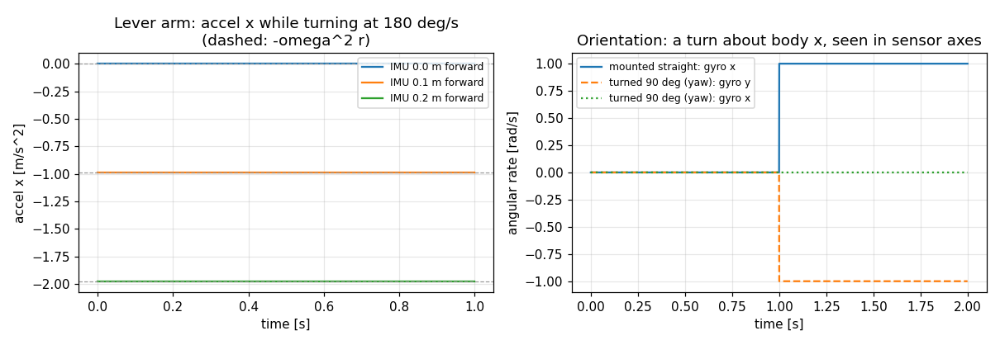

Left: the body turns at 180°/s; an accelerometer 0.1 m and 0.2 m from the centre reads the centripetal acceleration
−ω²r (dashed). Right: a turn about the body's x axis, with the IMU mounted straight and turned 90° in yaw; the turned
sensor sees it on its −y axis. Both come from the host helpers, the same for every IMU implementation.

### Noise and noise density

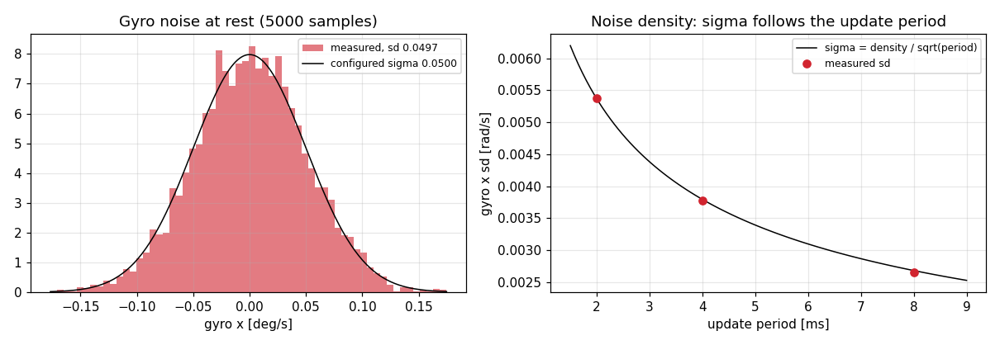

Left: at rest, the gyro x values against a normal distribution of the configured σ. Right: with a noise density
instead of a σ, the σ follows the update period, σ = density / √period ([common specification](../../spec/drone-common.md),
4.3).

### Zero offset per unit

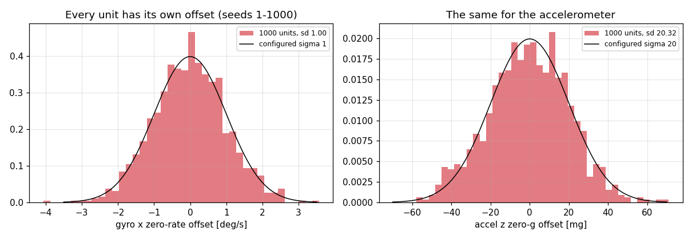

One offset per unit, drawn at start-up and kept; 1000 units with seeds 1 to 1000.

### Drift

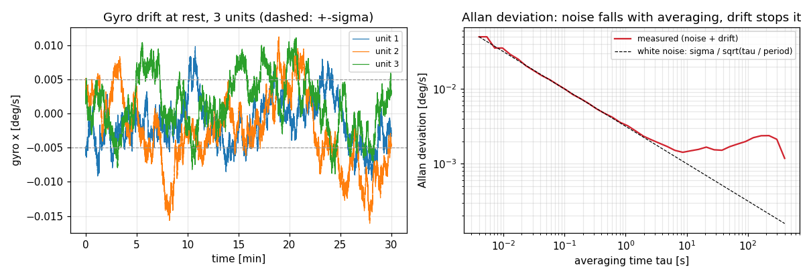

Left: Gauss-Markov drift (σ 0.005°/s, τ 100 s) of three units at rest over 30 minutes. Right: the Allan deviation of
noise plus drift: the white noise falls with averaging (dashed line) until the drift stops it.

### Update period and delay

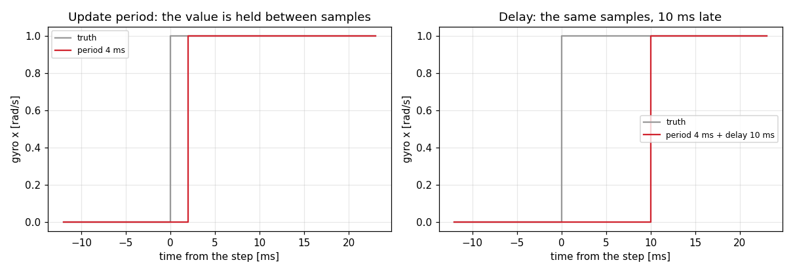

A step at 1.002 s, between two samples (the samples are at multiples of 4 ms). Left: the value is held until the next
sample, 1.004 s. Right: with a 10 ms delay, the same samples come 10 ms late, from 1.012 s.

### Resolution and range

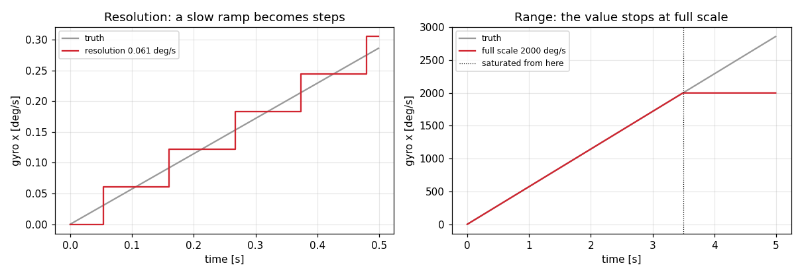

Left: a slow ramp becomes 0.061°/s steps. Right: the value stops at the full scale, 2000°/s, and the saturated flag is
set from the first clipped sample.

## Magnetometer

### Mounting, hard and soft iron

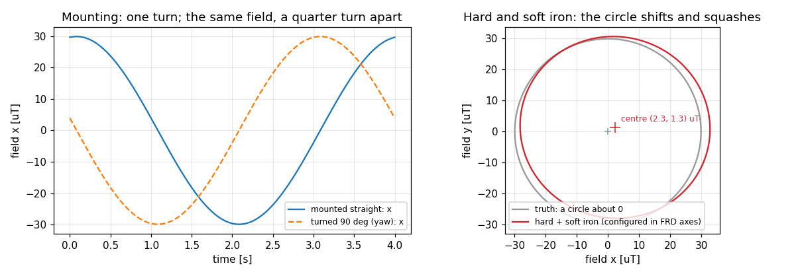

Left: one turn in 4 s; the sensor turned 90° in yaw sees the same field a quarter turn apart. Right: the horizontal
field over one turn is a circle about 0; hard and soft iron shift and squash it. The settings are in FRD axes: the
hard iron (3000, −1500) nT is (3000, +1500) nT in FLU, and the soft iron's off-diagonal terms mix the vertical field
(about −35 µT in FLU) into x (−700 nT) and y (+175 nT in FRD): the centre is (3000 − 700, 1500 − 175) nT =
(2.3, 1.3) µT, as measured.

### Noise and drift

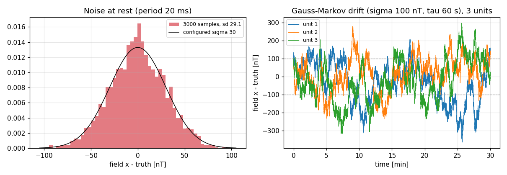

Left: the noise at rest against σ 30 nT. Right: Gauss-Markov drift (σ 100 nT, τ 60 s) of three units over 30 minutes.

### Update period, delay, resolution and range

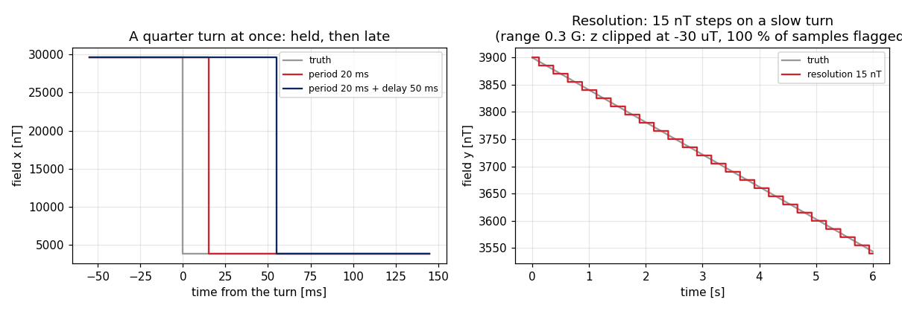

Left: a quarter turn at once at 1.005 s; held until the next 20 ms sample, and 50 ms later with the delay. Right: a
slow turn in 15 nT steps. With a range of 0.3 G (30 µT) the vertical component, about −35 µT, is clipped at −30 µT in
every sample and flagged.

## Barometer

### Mounting and zero offset

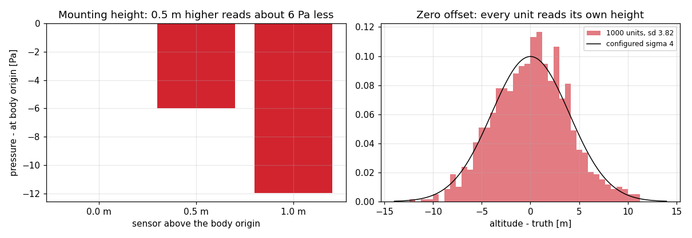

Left: a sensor mounted 0.5 m and 1.0 m above the body origin reads about 6 Pa and 12 Pa less (ρ·g·h). Right: one
zero offset per unit, in metres of altitude; 1000 units.

### Noise and drift

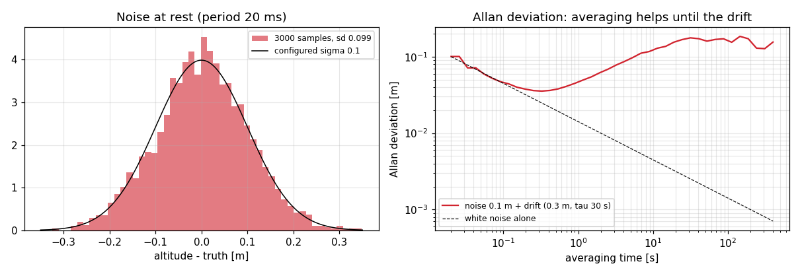

Left: the noise at rest against σ 0.1 m. Right: the Allan deviation of noise plus Gauss-Markov drift (0.3 m, τ 30 s).

### Update period, delay, resolution and range

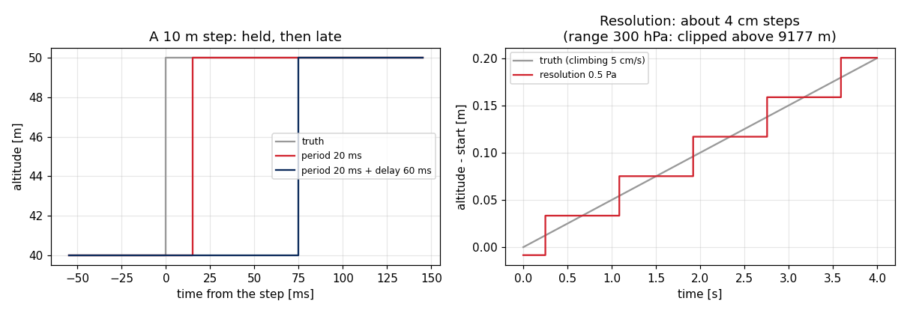

Left: a 10 m step at 1.005 s; held until the next 20 ms sample, and 60 ms later with the delay. Right: a climb at
5 cm/s in 0.5 Pa steps (about 4 cm). A fast climb is clipped at 300 hPa, from 9177 m of pressure altitude.

## GPS

### Mounting and noise

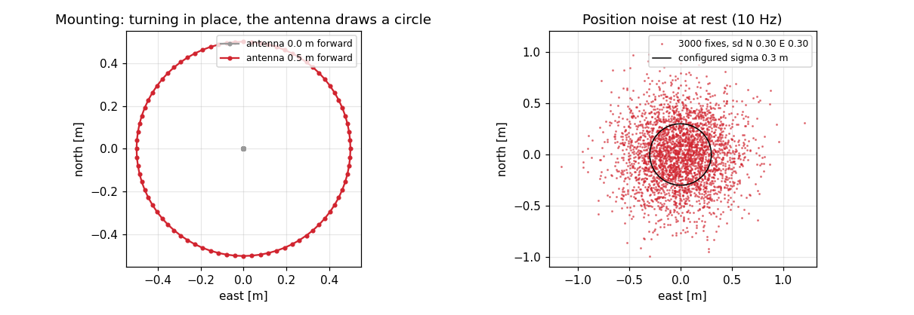

Left: turning in place, an antenna 0.5 m forward draws a circle; at the centre it stays at one point. Right: the
position noise at rest, 10 fixes a second, against σ 0.3 m.

### Drift

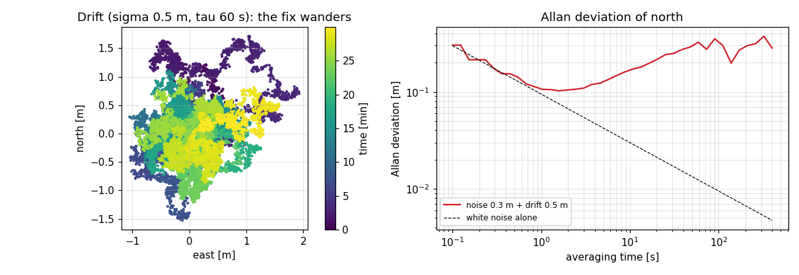

Left: the fix wandering over 30 minutes with a Gauss-Markov drift (horizontal 0.5 m, τ 60 s). Right: the Allan
deviation of north with noise plus drift.

### Update period and delay

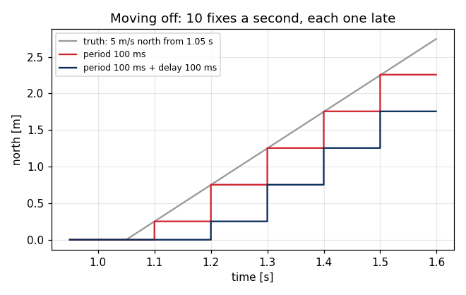

Moving off north at 5 m/s at 1.05 s: 10 fixes a second, and the same fixes 100 ms late with the delay.

GPS has no resolution or range settings.

## What this does not show

- Agreement with a particular chip: the settings are illustrative. A chip's datasheet values can be written in the
  same keys.
- The other implementations (Gazebo, Project AirSim): the tool takes them by name as well; the comparison with them is
  in [Drone sensors](../drone/README.md).
- The IMU filter and rotor vibration, which the specification also has: not shown here yet.
