# Error characteristics of the drone sensors (2026-11-19)

English | [日本語](README.ja.md)

A real sensor does not report the truth as it is. It adds the effects of its mounting, a per-unit offset, noise,
drift, its update period and delay, its resolution and its range. The gyroscope, accelerometer, magnetometer,
barometer and GPS all define these the same way ([common specification](../../spec/drone-common.md)).

This page has one section per kind of error. Each section opens with a figure that explains the mechanism (drawn for
illustration), followed by measurement cards for the sensors. The cards check that the output follows the
configuration.

## The common pipeline

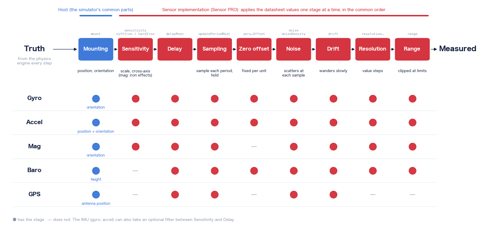

The truth goes through the stages above from left to right and comes out as the measured value.

- **Mounting** is done by the simulator's common parts (the host).
- **Every other stage** is done by the sensor implementation, which applies the datasheet values one stage at a time.
- The order of the stages and the setting keys are the same for the five sensors. Some sensors lack some stages;
  those are the "—" in the table.

## How it is measured

```text
motion (formula) ─▶ host parts: mounting, truth ─▶ adapter (common interface) ─▶ CSV ─▶ figures
```

- **No physics engine.** A rigid body follows a motion written as a formula: at rest, turning, a step, a tilt, a
  climb, moving off. The host parts of this repository (`host/sensor_host.hpp`) apply the mounting and build the
  sensor truth, as a simulator's host does.
- **One error at a time.** Each run uses a configuration with a single error, so each figure shows how that error acts
  and nothing else.
- **Through the common interface.** The adapter is created by implementation name
  (`sensor_adapter_implementation.hpp`). The tool does not know the implementation behind the interface.
- **Measured:** the Hakoniwa implementation of [hakoniwa-sensor-pro](https://github.com/hakoniwalab/hakoniwa-sensor-pro)
  v0.1.0.
  - Public binary: `hakoniwa-sensor-pro-0.1.0-macos-arm64.zip` (SHA-256
    `82040299ea2eed32139626b8c30a787fb5bc7c44d0660f303edc2155158deb23`)
  - Environment: macOS 27 (Apple silicon), physics step 1 ms
  - Random seed: 1 unless stated
- **Configurations:** illustrative values within the ranges of the specification, not those of a particular chip. The
  drone sensor settings are written in the sensor's FRD axes (the Drone PRO convention); the truth and the measured
  plots are in FLU axes.
- **World:** Tokyo.
  - Position: 35.6812° N, 139.7671° E, 40 m
  - Magnetic field: 46,000 nT total, declination −7.5°, inclination 49.5°
  - Atmosphere: standard

The tool, the configurations and the scripts are in [tools/error-characteristics](../../../tools/error-characteristics),
with the build and the commands in its README. Every card can be redrawn in a few minutes; the concept figures are
drawn by its `concepts/`.

## Summary

| Error | Sensor | Configured | Measured |
|---|---|---|---|
| Mounting (position) | accelerometer | 0.1 / 0.2 m from the center, turning at 180°/s: −ω²r = −0.987 / −1.974 m/s² | −0.987 / −1.974 m/s² |
| Mounting (position) | barometer | mounted 0.5 / 1.0 m higher: about −6 / −12 Pa | −5.98 / −11.97 Pa |
| Mounting (position) | GPS | antenna 0.5 m forward, turning in place: a circle of radius 0.5 m | radius 0.501 m |
| Zero offset | gyro / accelerometer | σ 1°/s / 20 mg | 0.999°/s / 20.3 mg (1000 units) |
| Zero offset | barometer | σ 4 m | 3.82 m (1000 units) |
| Iron | magnetometer | hard iron (3000, −1500, 800) nT (FRD) + soft iron: center of one turn | (2.3, 1.3) µT in FLU, as computed below |
| Noise | gyro | σ 0.0500°/s | 0.0497°/s (5000 samples) |
| Noise density | gyro | 0.00024 rad/s/√Hz at 2 / 4 / 8 ms: σ 0.00537 / 0.00379 / 0.00268 rad/s | 0.00538 / 0.00377 / 0.00266 rad/s |
| Noise density | gyro | integrated for 60 s: angle error 0.106° at any period | 0.092 / 0.090 / 0.104° (100 seeds) |
| Noise | magnetometer | σ 30 nT | 29.1 nT |
| Noise | barometer | σ 0.1 m | 0.0994 m |
| Noise | GPS | position (horizontal) σ 0.3 m | N 0.303 m, E 0.299 m (3000 fixes) |
| Noise | GPS | velocity (horizontal) σ 0.1 m/s | 0.102 m/s |
| Period and delay | gyro | period 4 ms, plus a 10 ms delay; a step at 1.002 s: changes at 1.004 s / 1.012 s | 1.004 s / 1.012 s |
| Period and delay | magnetometer | period 20 ms, plus a 50 ms delay; a turn at 1.005 s: 1.020 s / 1.060 s | 1.020 s / 1.060 s |
| Period and delay | barometer | period 20 ms, plus a 60 ms delay; a step at 1.005 s: 1.020 s / 1.080 s | 1.020 s / 1.080 s |
| Range | gyro | full scale 2000°/s: clipped, saturated flag | 2000.0°/s, flag from 3.500 s (the truth exceeds it at 3.491 s) |
| Range | barometer | 300 hPa: clipped at about 9164 m | clipped from 9177 m |

A standard deviation from N samples has a relative error of about 1/√(2N): 1 % for 5000 samples, 2 % for 1000 units.
Every difference above is within twice that.

## 1. Mounting

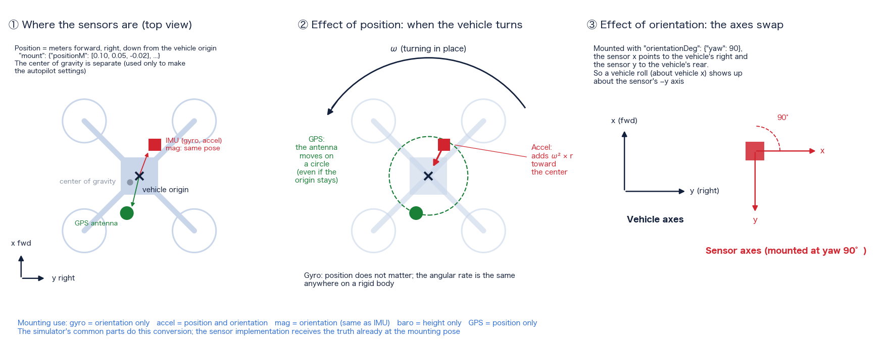

A mounting has two parts.

- **Position:** how many meters forward, right and down from the vehicle origin. Not from the center of gravity.
- **Orientation:** roll, pitch and yaw angles.

When the vehicle turns, a sensor away from the origin sees extra motion: the accelerometer gets a centripetal
acceleration, and the GPS antenna draws a circle. A turned mounting swaps the axes. The host parts do this
computation, so it does not depend on the sensor implementation.

This section has five measurements. None has an error other than the mounting (truth-only configurations).

### 1-1. An accelerometer while turning (position)

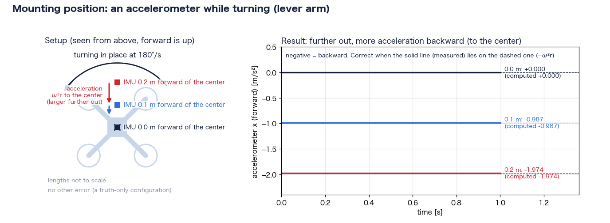

- **Measured:** the vehicle keeps turning in place at 180°/s. The IMU is at the center, 0.1 m forward and 0.2 m
  forward; the accelerometer's forward axis (x) is read in each case.
- **How to read it:**
  - Horizontal: time. Vertical: accelerometer x; negative is backward, toward the center of the turn.
  - Solid lines are measured, dashed lines computed (−ω²r).
- **Result:** −0.987 m/s² at 0.1 m and −1.974 m/s² at 0.2 m, as computed. At the center it is 0.

### 1-2. A gyro turned 90° in yaw (orientation)

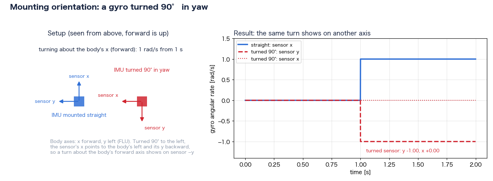

- **Measured:** from 1 s the vehicle turns about its forward (x) axis at 1 rad/s. An IMU mounted straight and an IMU
  turned 90° to the left are read on each gyro axis.
- **How to read it:**
  - Horizontal: time. Vertical: gyro angular rate.
  - Blue is the straight IMU's x. The red dashed and dotted lines are the turned IMU's y and x.
- **Result:** the straight IMU shows +1.00 on x. The turned IMU shows −1.00 on y and 0 on x: the same turn appears on
  another axis, following the mounting.

### 1-3. A magnetometer turned 90° in yaw (orientation)

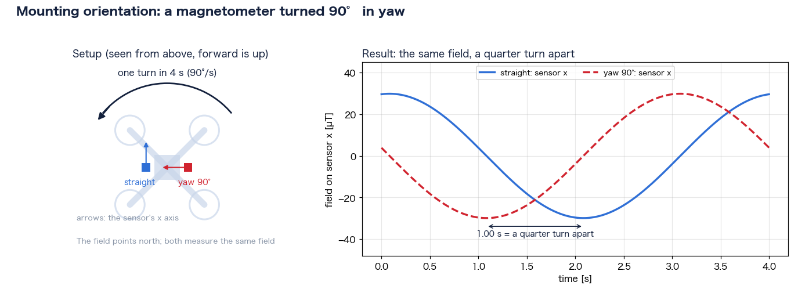

- **Measured:** the vehicle makes one turn in place in 4 s. A sensor mounted straight and one turned 90° are read on
  sensor x.
- **How to read it:**
  - Horizontal: time. Vertical: the field on sensor x.
  - The field points north, so turning makes sensor x a wave. A peak is when sensor x faces north.
- **Result:** the two waves are 1.00 s (a quarter turn) apart. The turned sensor sees the same field 90° ahead.

### 1-4. A barometer mounted higher (position)

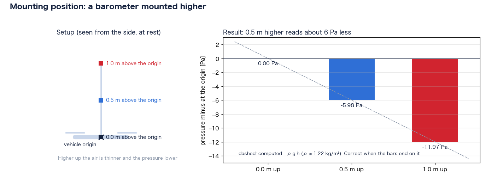

- **Measured:** with the vehicle at rest, the barometer is at the origin, 0.5 m above and 1.0 m above it.
- **How to read it:**
  - Vertical: the pressure minus the pressure at the origin. Negative means lower pressure.
  - The dashed line is computed from the weight of the air (−ρ·g·h).
- **Result:** −5.98 Pa at 0.5 m and −11.97 Pa at 1.0 m, as computed. Higher up the air is thinner and the pressure
  lower.

### 1-5. A GPS antenna mounted forward (position)

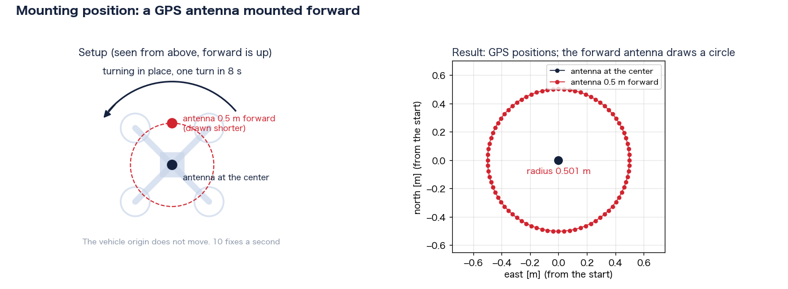

- **Measured:** the vehicle origin does not move; the vehicle turns in place once in 8 s. With the antenna at the
  center and 0.5 m forward, GPS is read 10 times a second.
- **How to read it:** like a map, north up and east right. Each dot is one fix.
- **Result:** the center antenna stays at one point. The forward antenna draws a circle of radius 0.501 m: the vehicle
  does not move, but the antenna does.

## 2. Per-unit offset and sensitivity

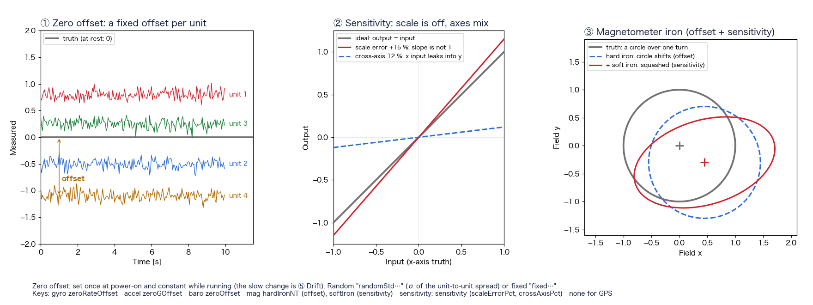

The **zero offset** is drawn once per unit at power-on and does not change while running. It is written as a random σ
or as a fixed value. **Sensitivity** is the error of the output's scale (scale error) and the leak into other axes
(cross-axis sensitivity). In the magnetometer, the vehicle's iron comes in the same two forms: hard iron is an offset,
soft iron a sensitivity.

### 2-1. The offset does not change with time

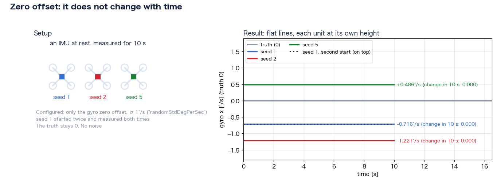

- **Measured:** an IMU with only the offset, at rest for 10 s, with seeds 1, 2 and 5. Seed 1 is started twice and
  measured both times.
- **How to read it:** horizontal: time; vertical: gyro x. The truth stays 0.
- **Result:**
  - Every line is flat for the 10 s (change 0.000°/s).
  - The heights differ by seed (+0.486 / −0.716 / −1.221°/s).
  - The second start of seed 1 lies exactly on the first.

The offset is drawn once, at start-up, and then does not change with time. This is what sets it apart from noise
(section 3), which changes at every sample, and from drift (section 4), which moves slowly.

The random value comes from the seed, the vehicle name and the sensor name. With the same seed, every start gives the
same offset, so results can be reproduced. To stand for another unit or another day's start, change the seed. A value
measured on the real part can also be written as a fixed value (`fixed…`).

The next two cards, 2-2 and 2-3, line up many units to see how large the offsets are. The plots are histograms.

- Horizontal: the offset. Vertical: the number of units with that offset. Along the horizontal axis are units, not
  time.
- The red line is the shape expected with the configured σ. The bars following the red line means the configuration
  holds.

### 2-2. The zero offset of 1000 IMUs

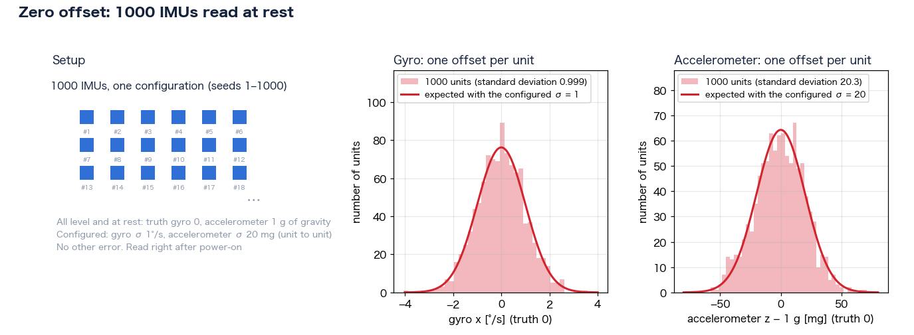

- **Measured:** 1000 IMUs with one configuration (seeds 1–1000), all level and at rest, read right after power-on. The
  truth is 0 for the gyro and 1 g of gravity for the accelerometer.
- **How to read it:** left, gyro x; right, accelerometer z minus 1 g. Both have a truth of 0, so the distance from 0 is
  the unit's offset.
- **Result:** the standard deviation over 1000 units is 0.999°/s for the gyro (configured 1°/s) and 20.3 mg for the
  accelerometer (configured 20 mg).

### 2-3. The zero offset of 1000 barometers

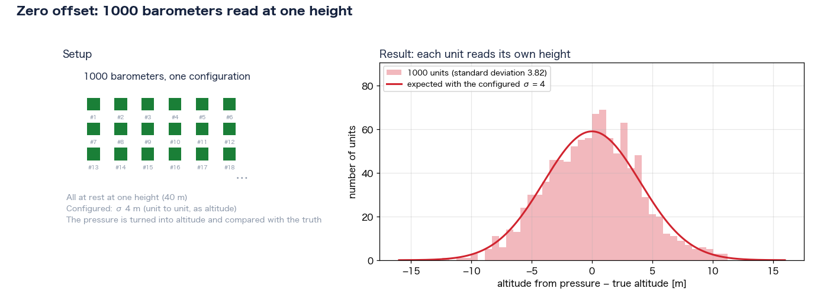

- **Measured:** 1000 barometers with one configuration, at rest at one height (40 m).
- **How to read it:** horizontal: the altitude computed from the measured pressure minus the true altitude. The
  pressure offset is seen in meters of height.
- **Result:** standard deviation 3.82 m (configured 4 m). Each unit reads its own height.

### 2-4. Magnetometer iron

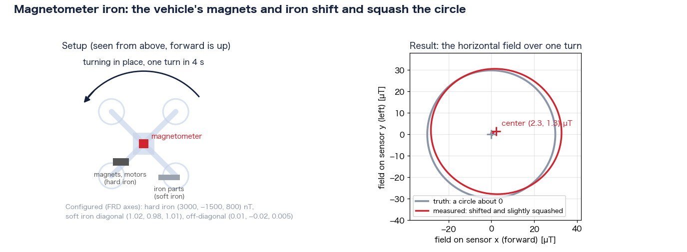

- **Measured:** the vehicle makes one turn in place in 4 s, with the effects of its magnets (hard iron) and iron parts
  (soft iron) configured.
- **How to read it:** horizontal: the field on sensor x (forward); vertical: on sensor y (left). The horizontal field
  over one turn is drawn as a path. Without iron it is a circle about 0.
- **Result:** the circle's center moves to (2.3, 1.3) µT and the circle is slightly squashed. The center follows from
  the configuration, matching the measurement:
  1. The configuration is in FRD axes, so the hard iron (3000, −1500) nT is (3000, +1500) nT in FLU.
  2. The soft iron's off-diagonal terms mix in the vertical field (about −35 µT in FLU): −700 nT into x, and +175 nT
     into y in FRD.
  3. So the center is (3000 − 700, 1500 − 175) nT = (2.3, 1.3) µT.

## 3. Noise

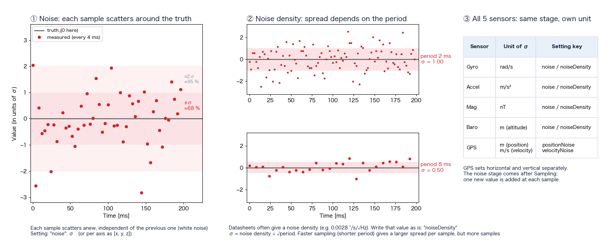

Noise is a fresh value scattered around the truth at every sample, written as σ (a standard deviation). When the
datasheet gives a noise density, that value can be written as it is; σ then follows from the period
(σ = density ÷ √period, [common specification](../../spec/drone-common.md) 4.3).

The histograms (3-1, 3-4) read as in section 2: horizontal, the value; vertical, how many samples had it. The bars
following the red line means the configuration holds.

### 3-1. Noise of a gyro at rest

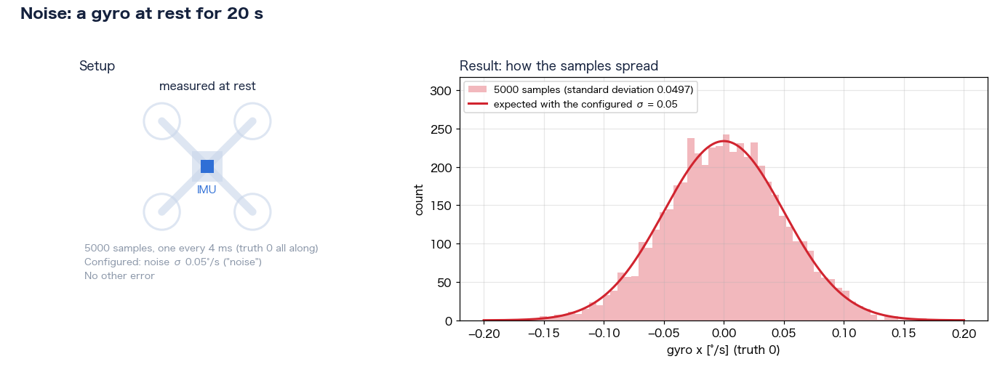

- **Measured:** an IMU at rest, every 4 ms for 20 s (5000 samples). The truth stays 0.
- **How to read it:** horizontal: gyro x; vertical: how many samples had that value.
- **Result:** the standard deviation over 5000 samples is 0.0497°/s (configured 0.05°/s).

### 3-2. Noise density: one gyro at different periods

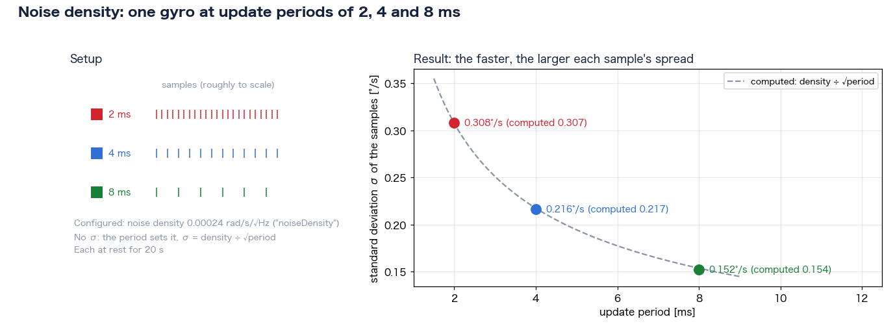

- **Measured:** a gyro configured with a noise density of 0.00024 rad/s/√Hz instead of σ, at rest for 20 s at update
  periods of 2, 4 and 8 ms.
- **How to read it:** horizontal: the period; vertical: the standard deviation of the samples at that period. The
  dashed line is computed (density ÷ √period).
- **Result:** 0.308 / 0.216 / 0.152°/s, as computed (0.307 / 0.217 / 0.154°/s). The faster the sampling, the larger
  each sample's spread, and the more samples there are. As a result, the integrated angle error is the same at any
  period; 3-3 checks this.

### 3-3. What noise density is for: the angle error of an integrated gyro

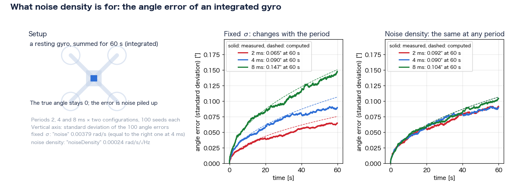

Summing (integrating) the gyro values gives an angle. The noise is summed too, so the angle slowly goes wrong. Summed
noise partly cancels, so the error grows not with time but with √time.

Noise density is the setting that gives this "angle error after integrating for 1 s". Its unit, rad/s/√Hz, is the same
as rad/√s. For 0.00024 rad/s/√Hz the angle error is 0.014° after 1 s, 0.106° after 60 s and 0.83° after an hour. A
datasheet's angle random walk (ARW, °/√h) is that hour's value.

- **Measured:** a resting gyro is summed every physics step (1 ms) for 60 s into an angle, repeated with 100 seeds,
  and the standard deviation of the angle error is taken at each time. Periods 2, 4 and 8 ms, in two configurations:
  - fixed σ: each sample's σ written as 0.00379 rad/s (equal to the other at 4 ms)
  - noise density: written as 0.00024 rad/s/√Hz
- **How to read it:** horizontal: time; vertical: the standard deviation of the 100 angle errors. Solid lines are
  measured, dashed ones computed. A standard deviation from 100 runs moves by about ±7 %.
- **Result:**
  - With a fixed σ (middle), the error at 60 s depends on the period: 0.065 / 0.090 / 0.147° at 2 / 4 / 8 ms. The same
    chip would drift less just by being read faster, which a real chip does not do.
  - With the noise density (right), the three lines nearly coincide: 0.092 / 0.090 / 0.104° (0.106° computed for
    each). The angle drifts by the same amount however often it is read.

If the sensor's period may change, write the noise as a noise density rather than σ. The datasheet value can be used
as it is, and the integrated result stays true to the real part when the period changes.

### 3-4. Noise of a magnetometer and a barometer at rest

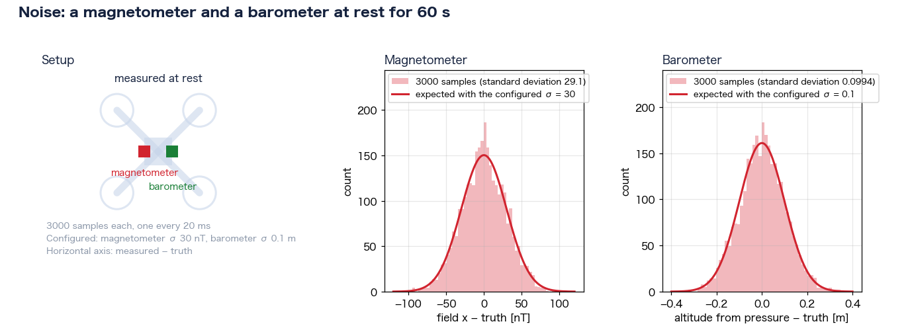

- **Measured:** a magnetometer and a barometer at rest, every 20 ms for 60 s (3000 samples).
- **How to read it:** horizontal: measured − truth; vertical: how many samples had that value. The barometer is seen
  as altitude.
- **Result:** standard deviations of 29.1 nT for the magnetometer (configured 30 nT) and 0.0994 m for the barometer
  (configured 0.1 m).

### 3-5. Noise of a GPS at rest

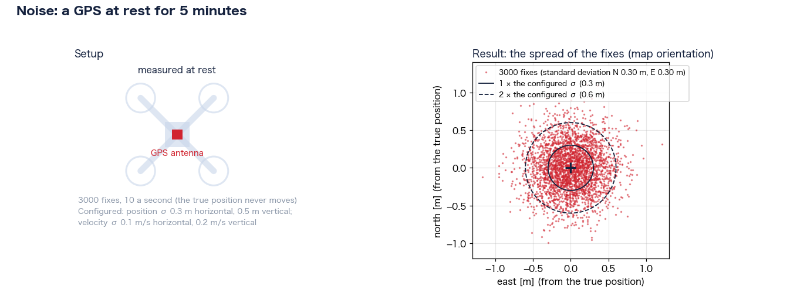

- **Measured:** a GPS at rest, 10 fixes a second for 5 minutes (3000 fixes).
- **How to read it:** map orientation, north up and east right. Each dot is one fix; the true position is the + in the
  middle. The solid circle is the configured σ (0.3 m), the dashed one twice that.
- **Result:** standard deviations of 0.303 m north and 0.299 m east. About 40 % of the dots fall inside the solid
  circle (a property of the two-dimensional normal distribution). The velocity noise is 0.102 m/s (configured
  0.1 m/s).

## 4. Drift

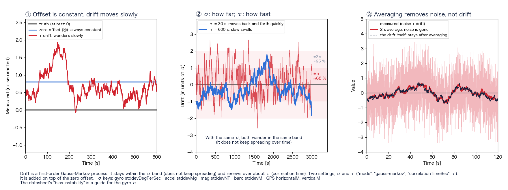

Drift is a zero offset that wanders slowly. It is a first-order Gauss-Markov process written with two values: σ (how
far it wanders) and τ (how fast it moves on) ([common specification](../../spec/drone-common.md) 4.2).

This section uses Allan deviation plots. They read as follows.

- Horizontal: how many seconds of values are averaged. Vertical: how much those averages differ from one to the next.
- With noise alone, longer averaging gives a smaller spread and the plot keeps falling along the dashed line.
- With drift, from some averaging time on the spread no longer falls, and the red line leaves the dashed one. That is
  the time scale from which drift outweighs noise.

### 4-1. Drift of a gyro at rest

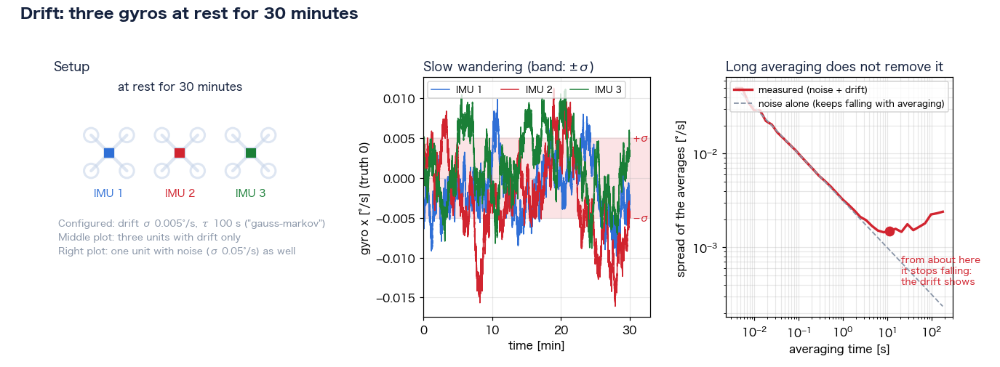

- **Measured:** IMUs at rest for 30 minutes. The middle plot has three units with drift only (σ 0.005°/s, τ 100 s);
  the right plot one unit with noise (σ 0.05°/s) as well.
- **How to read it:** middle: horizontal, time in minutes; vertical, gyro x (truth 0); the band is ±σ. Right: the
  Allan deviation.
- **Result:** all three wander around 0 over a few minutes, mostly within ±2σ. The Allan deviation leaves the dashed
  line and levels off from about 10 s.

### 4-2. Drift of a magnetometer at rest

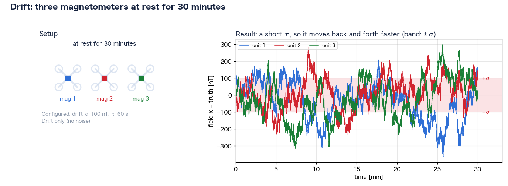

- **Measured:** three magnetometers with drift only (σ 100 nT, τ 60 s), at rest for 30 minutes.
- **How to read it:** horizontal: time in minutes; vertical: field x − truth. The band is ±σ.
- **Result:** all three wander within about ±σ. With τ at 60 s they move back and forth faster than the gyro
  (τ 100 s).

### 4-3. Drift of a barometer at rest

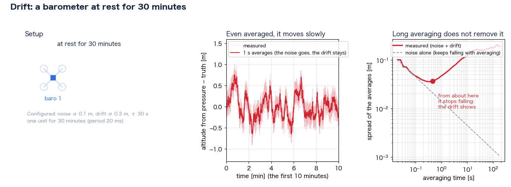

- **Measured:** a barometer with noise (σ 0.1 m) and drift (σ 0.3 m, τ 30 s), at rest for 30 minutes.
- **How to read it:** middle: the first 10 minutes, time against altitude − truth; the light line is measured, the
  dark one 1 s averages. Right: the Allan deviation.
- **Result:** the 1 s averages remove the noise, but the dark line keeps moving slowly by about ±0.5 m: that is the
  drift. The Allan deviation levels off from about 0.5 s.

### 4-4. Drift of a GPS at rest

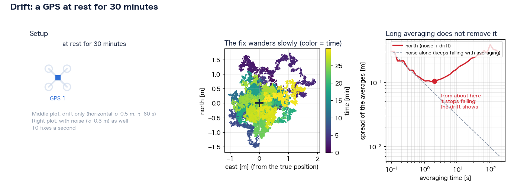

- **Measured:** a GPS at rest for 30 minutes; middle with drift only (horizontal σ 0.5 m, τ 60 s), right with noise
  (σ 0.3 m) as well.
- **How to read it:** middle: map orientation (north up), the dot color is the time. Right: the Allan deviation of
  north.
- **Result:** the fix wanders slowly within about 1 m of the true position (+). The colors cluster by time because it
  moves slowly.

## 5. Period and delay

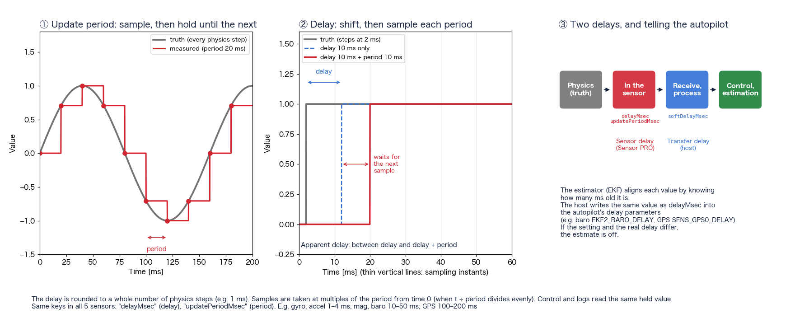

A sensor measures only once per period and holds the value until the next. A delay shifts the truth, which is then
sampled at the period, so the apparent delay lies between the delay and the delay plus one period. Samples are at
multiples of the period from time 0.

The plots in this section all read the same way.

- Horizontal: time from the moment the truth changes (the red dotted line).
- Gray is the truth, blue the measurement with the period alone, green dashed with the period plus a delay.
- How far blue and green lie right of gray is the sensor's delay.

### 5-1. Gyro (period 4 ms, delay 10 ms)

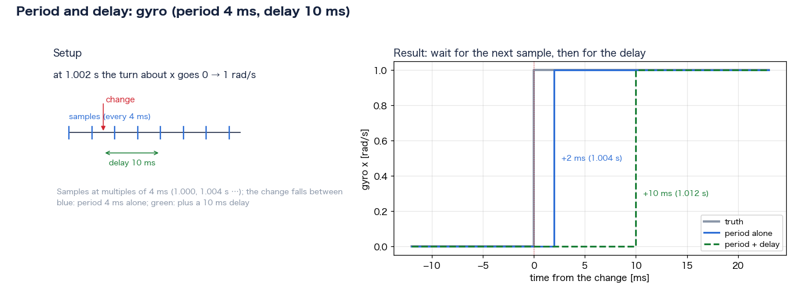

- **Measured:** at 1.002 s the turn about the vehicle's x goes from 0 to 1 rad/s at once. The time is chosen so that
  the change falls between two samples (multiples of 4 ms).
- **Result:** with the period alone, the value changes at the next sample, 1.004 s (+2 ms). With the 10 ms delay it
  changes at 1.012 s (+10 ms): the shifted truth changes at 1.012 s, which is exactly a sample.

### 5-2. Magnetometer (period 20 ms, delay 50 ms)

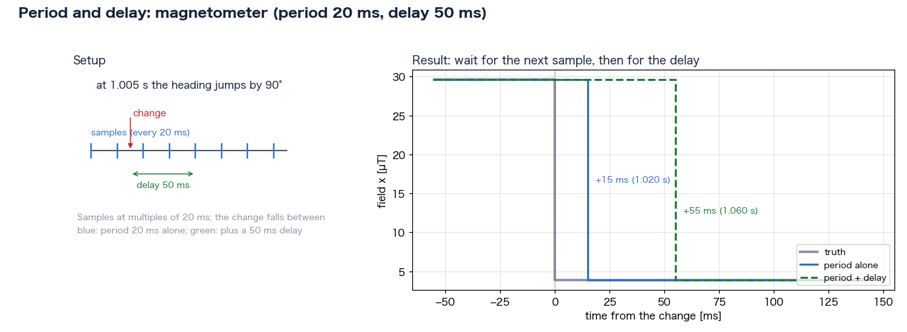

- **Measured:** at 1.005 s the heading jumps by 90°.
- **Result:** 1.020 s (+15 ms) with the period alone, 1.060 s (+55 ms) with the delay.

### 5-3. Barometer (period 20 ms, delay 60 ms)

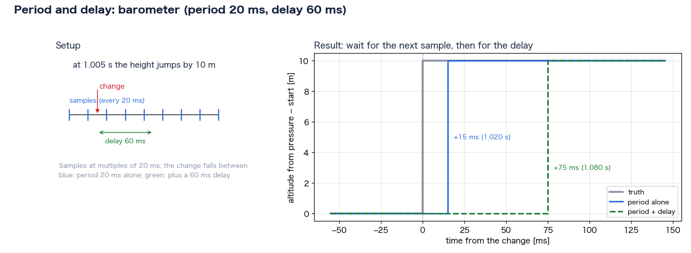

- **Measured:** at 1.005 s the height jumps by 10 m.
- **Result:** 1.020 s (+15 ms) with the period alone, 1.080 s (+75 ms) with the delay.

### 5-4. GPS (period 100 ms, delay 100 ms)

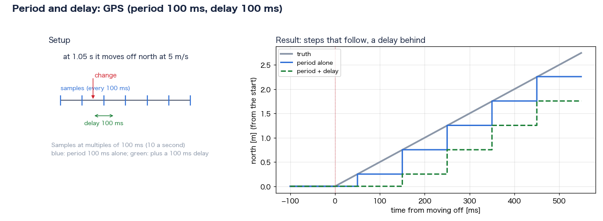

- **Measured:** at 1.05 s the vehicle moves off north at 5 m/s.
- **How to read it:** vertical: the north position. The truth (gray) rises smoothly; the measurements are steps
  every 100 ms.
- **Result:** the blue steps sit on the truth at each sample. The green steps keep showing the position 100 ms
  earlier, 0.5 m behind.

## 6. Resolution and range

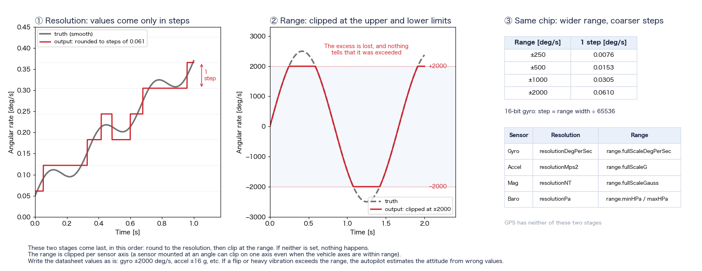

These are the last two stages: the value is rounded to the resolution step, then clipped to the range. Neither does
anything when not written. GPS has neither.

### 6-1. Gyro resolution (0.061°/s steps)

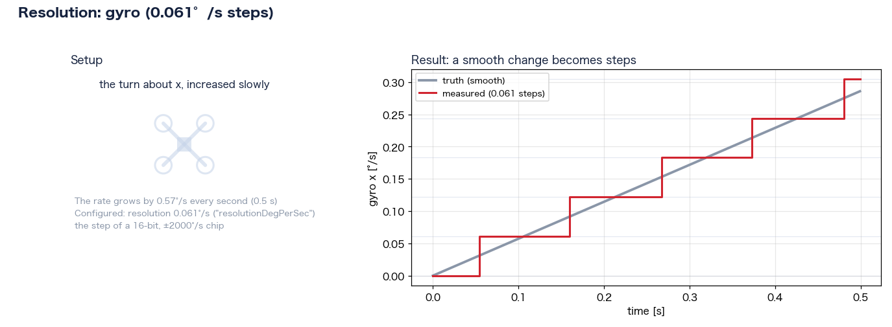

- **Measured:** the turn about the vehicle's x grows slowly, by 0.57°/s every second (0.5 s). The resolution is
  0.061°/s, the step of a 16-bit, ±2000°/s chip.
- **How to read it:** horizontal: time; vertical: gyro x. Gray is the truth, red the measurement.
- **Result:** the smooth change becomes steps of 0.061°/s. A change smaller than a step does not show.

### 6-2. Gyro range (±2000°/s)

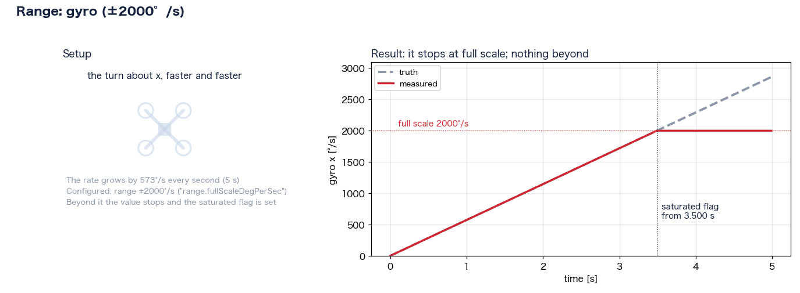

- **Measured:** the turn about the vehicle's x grows faster and faster, by 573°/s every second (5 s).
- **How to read it:** the gray dashed line is the truth, red the measurement. The vertical dotted line is when the
  saturated flag is set.
- **Result:** the measurement stops at 2000°/s and nothing beyond shows. The saturated flag is set from the first
  clipped sample (3.500 s); the truth exceeds 2000°/s at 3.491 s, just before that sample.

### 6-3. Magnetometer resolution and range (15 nT steps, ±0.3 G)

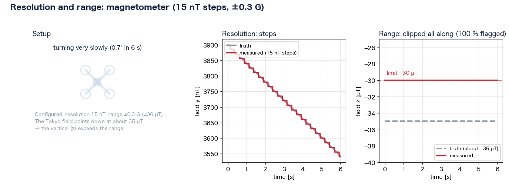

- **Measured:** the vehicle turns very slowly (0.7° in 6 s). The resolution is 15 nT and the range ±0.3 G (±30 µT).
- **How to read it:** middle: the field on sensor y; right: on sensor z (vertical).
- **Result:** y becomes steps of 15 nT. The truth of z is about −35 µT, beyond the range (−30 µT), so every sample is
  clipped to −30 µT and flagged. This is what a range set too narrow does.

### 6-4. Barometer resolution and range (0.5 Pa steps, 300–1100 hPa)

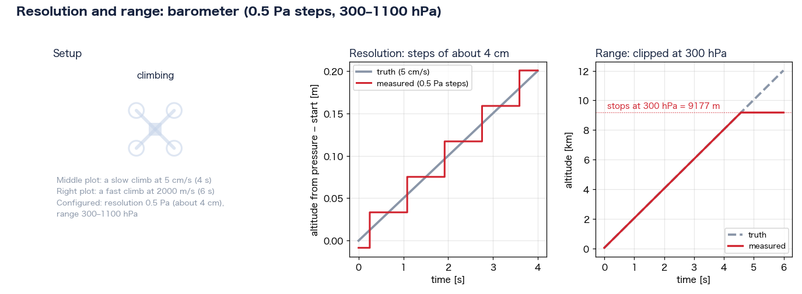

- **Measured:** middle, a slow climb at 5 cm/s; right, a fast climb at 2000 m/s (an impossible speed, to reach the
  range).
- **How to read it:** middle: altitude above the start; right: altitude in km.
- **Result:** the slow climb becomes steps of 0.5 Pa (about 4 cm). The fast climb stops at 9177 m, where the pressure
  reaches the lower limit of 300 hPa.

## Not shown on this page

- **Measured sensitivity (scale error, cross-axis):** only the concept figure. The magnetometer's soft iron is measured
  in section 2.
- **A match with a particular chip:** the configurations are illustrative. A chip's datasheet values go into the same
  keys.
- **Other implementations (Gazebo, Project AirSim):** the tool selects the implementation by name. The comparison with
  other implementations is in [Drone sensors](../drone/README.md).
- **The specification's IMU filter and rotor vibration:** not shown yet.
