# 力覚センサー：仕組みと評価結果（2026-11-19）

[English](README.md) | 日本語

このページは3部に分かれています。

1. 力覚センサーが何を測っているか、誤差がそれぞれどう効くかを、図で1つずつ説明します（図は説明用に描いたものです）。
2. 測定カードで、箱庭と Gazebo を並べて見せます。
3. 6つの評価の軸で比べた結果です。

腕を動かしたときの手首の揺れ（振動モデル）を、実機の記録と比べた結果は、[実機の記録との比較（KUKA）](real-data-kuka.ja.md)にあります。

## 力覚センサーの仕組み

### 1. 何を測っているか

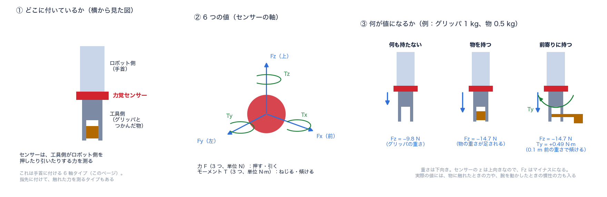

- センサーは、ロボットの手首と工具（グリッパと、つかんだ物）の間に付きます。測るのは、工具側がロボット側を押したり引いたりする力です。
- 指先に付けて、指ごとに触れた力を測るセンサーは、別の種類です。
- 値は、センサーの軸（x 前、y 左、z 上）で6つあります。
  - 力が3つ：Fx、Fy、Fz（単位 N）
  - モーメントが3つ：Tx、Ty、Tz（単位 N·m）
- 何も触れていなくても、工具の重さが値に入ります。
  - 1 kg のグリッパなら Fz = −9.8 N です。重さは下向きで、センサーの z は上向きなので、マイナスになります。
  - 物をつかむと、その重さが足されます。
  - 0.5 kg の物を 0.1 m 前寄りに持つと、Ty = +0.49 N·m も出ます。
  - 物に触れたときの力や、腕を動かしたときの慣性の力も、値に入ります。

### 2. 処理の流れ

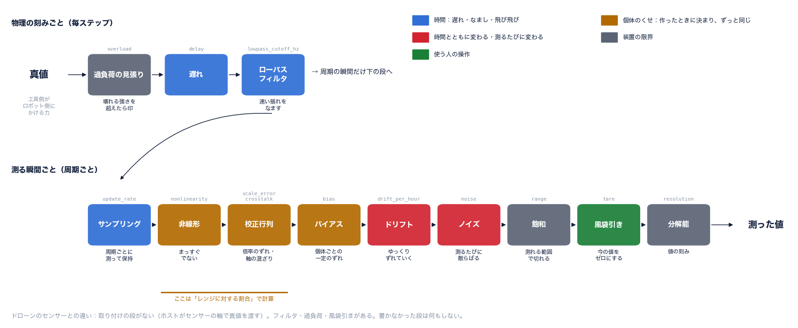

- **物理の刻みごと：** 過負荷の見張りが真値を見て、遅れとローパスフィルタが真値にかかります。
- **測る瞬間ごと：** 非線形 → 校正行列（スケール誤差と軸の混ざり） → バイアス → ドリフト → ノイズ → 飽和 → 風袋引き → 分解能、の順です。非線形と校正行列は、「レンジに対する割合」で計算します。
- 色は、段の種類を表します。

  | 色 | 意味 |
  |---|---|
  | 青 | 時間 |
  | 茶 | 個体のくせ（作ったときに決まる） |
  | 赤 | 時間とともに・測るたびに変わる |
  | 灰 | 装置の限界 |
  | 緑 | 使う人の操作 |

- **ドローンのセンサーとの違い：**
  - 取り付けの段がありません。ホストが、センサーの軸で真値を渡します。
  - 代わりに、フィルタ・過負荷の印・風袋引きがあります。
  - 設定に書かなかった段は、何もしません。

### 3. 風袋引き

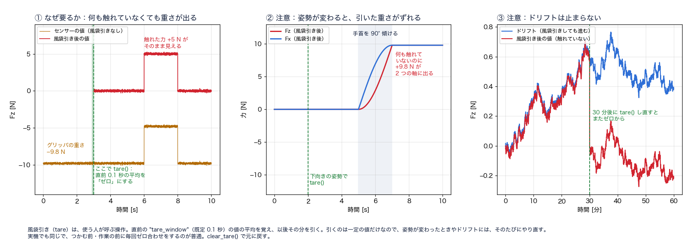

- **なぜ要るか：**
  - 風袋引きをしないと、何も触れていなくてもグリッパの重さが出ます。
  - `tare()` は、直前の `tare_window`（既定 0.1 秒）の平均を覚え、以後その分を引きます。
  - これで、触れた力がそのまま見えます。
- **姿勢に注意：**
  - 風袋引きで引くのは、一定の値だけです。
  - 風袋引きの後に手首を傾けると、重さが他の軸に移ります。何も触れていないのに、力が出てしまいます。
  - 姿勢を変えたら、風袋引きをやり直すか、工具の重さを計算で引きます。
- **ドリフトに注意：**
  - 風袋引きは、ドリフトを止めません。次の風袋引きまで、値はゆっくりゼロから離れていきます。
  - 実機でも、つかむ前や作業の前に毎回ゼロ合わせをします。
  - `clear_tare()` で元に戻せます。

### 4. 校正のずれ

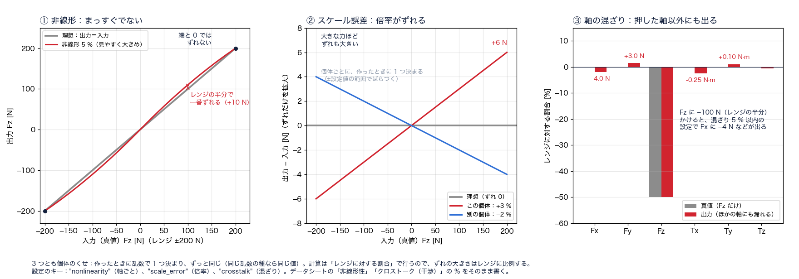

- **非線形：** 出力が、まっすぐな線からわずかに弓なりにずれます。ずれが一番大きいのはレンジの半分のあたりで、0 とレンジの端ではずれません。
- **スケール誤差：** 倍率がずれます。大きな力ほど、ずれも大きくなります。
- **軸の混ざり（クロストーク）：** ある軸の力が、他の軸にも少し出ます。1つの弾性体で6つの値を測るので、実機でも必ずあります。
- **3つに共通すること：**
  - どれも、その個体のくせです。作ったときに乱数で決まり（同じ乱数の種なら同じ値）、その後は変わりません。
  - ずれの大きさは、レンジに比例します。
  - データシートの非線形性とクロストークの % は、そのまま `nonlinearity`、`scale_error`、`crosstalk` に書けます。

### 5. ノイズと帯域

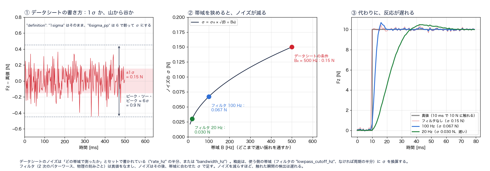

- **データシートの書き方：**
  - ノイズは、1σ か、ピーク・ツー・ピーク（山から谷までの幅、約 6σ）で書かれます。
  - `"definition": "1sigma"` はそのまま使い、`"6sigma_pp"` は 6 で割ります。
- **帯域：**
  - データシートの値は、ある帯域で測ったものです。帯域は `rate_hz` の半分か、`bandwidth_hz` で書かれています。
  - 箱庭は、使う側の帯域に σ = σ₀ × √(B ÷ B₀) で換算します。B は、ローパスフィルタの `lowpass_cutoff_hz`、なければ周期の半分です。
  - ドローンのセンサーのノイズ密度と、同じ考え方です。
- **代わりに失うもの：**
  - フィルタ（2次のバターワース、物理の刻みごと）は、真値をなまします。ノイズは、その後で、その帯域の σ で足されます。
  - ノイズを減らすほど、触れた瞬間に反応するのが遅れます。

### 6. バイアス・ドリフト・飽和・過負荷・分解能

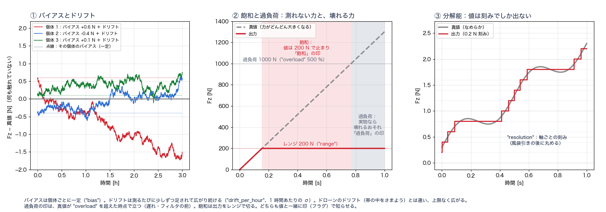

- **バイアス**（`bias`）：個体ごとに一定です。
- **ドリフト**（`drift_per_hour`、1時間あたりの σ）：
  - 測るたびに少しずつ足され、上限なく広がり続けます。
  - ドローンのセンサーのドリフトは「帯の中をさまよう」形なので、そこが違います。
- **飽和**（`range`）：レンジを超えると値はそこで止まり、「飽和」の印が付きます。
- **過負荷**（`overload`）：
  - 実物ならセンサーが壊れるおそれのある力です。
  - 真値がこの値を超えた時点で、「過負荷」の印が付きます。
  - 遅れとフィルタの前の値で見るので、一瞬の衝撃も見逃しません。
- **分解能**（`resolution`）：値は刻みでしか出ません。丸めるのは一番最後で、風袋引きの後です。

## 測定カード：箱庭と Gazebo を並べる

1つの測定を1枚のカードにしています。左の絵は、センサーの置き方と設定です。右のグラフが結果です。Gazebo にも同じ性質があるものは、同じ真値と、同じ意味の設定で両方を動かしています。データは [tools/compare](../../../tools/compare) の `ft-series` で作り、`cards_force_torque.py` でカードを描いています。

### ノイズなしでの一致

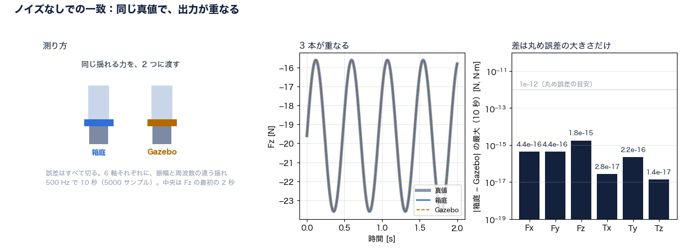

- **測ったこと：** 誤差をすべて切り、6つの軸それぞれに、振幅と周波数の違う揺れを渡しました。500 Hz で 10 秒です。
- **グラフの見方：**
  - 中央は、Fz の最初の 2 秒です。真値・箱庭・Gazebo の3本を重ねています。
  - 右は、軸ごとの2つの差の最大で、対数の目盛りです。
- **結果：** 3本は重なりました。差は最大 1.8e-15 N で、浮動小数点の丸めの大きさです。力の向きとモーメントの軸が、両方でそろっています。

### ノイズ

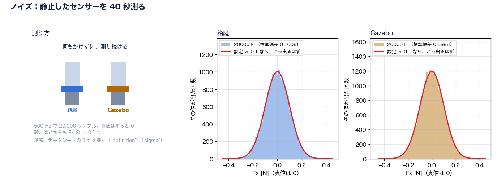

- **測ったこと：** 何もかけずに 20,000 サンプルを測りました。設定はどちらも、Fx の σ 0.1 N です。
- **グラフの見方：** ヒストグラムです。横軸がその値、縦軸がその値が出た回数です。赤い線は、設定した σ のとおりなら出るはずの形です。
- **結果：** 標準偏差は、箱庭 0.1006 N、Gazebo 0.0998 N でした。どちらも設定どおりです。

### バイアス

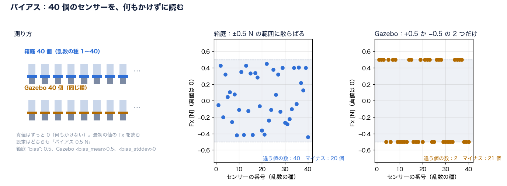

- **測ったこと：** 箱庭と Gazebo のセンサーを 40 個ずつ（乱数の種 1〜40）用意し、何もかけずに最初の Fx を読みました。設定はどちらも「バイアス 0.5 N」です。
- **グラフの見方：** 点の1つ1つが1個のセンサーです。帯は ±0.5 N です。
- **結果：**
  - 箱庭は、40 個が ±0.5 N の範囲に散らばりました（違う値 40、マイナス 20）。データシートの値を「この範囲の中」と読んでいます。
  - Gazebo は、+0.5 か −0.5 の2つの値だけでした（違う値 2、マイナス 21）。設定値に、乱数で符号を付けるだけだからです。個体ごとのばらつきは、別の設定（`bias_stddev`）で書く必要があります。

### ドリフト

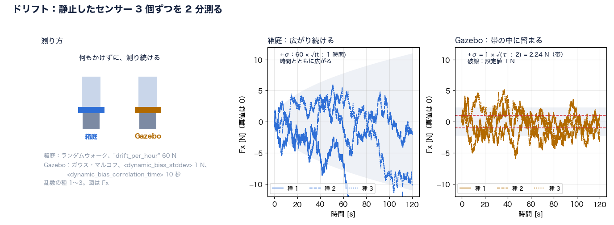

- **測ったこと：** 3個ずつを、静止させて 2 分測りました。
  - 箱庭：ランダムウォーク、`drift_per_hour` 60 N
  - Gazebo：ガウス・マルコフ、`dynamic_bias_stddev` 1 N、相関時間 10 秒
- **グラフの見方：** 横軸は時間、縦軸は Fx です。網かけは、それぞれのモデルの ±σ です。
- **結果：**
  - 箱庭のドリフトは、σ = 60 × √(t ÷ 1 時間) のとおり広がり続けます。実機のセンサーも、風袋引きをやり直すまでずれ続けます。
  - Gazebo は帯の中に留まりますが、帯の幅は ±2.24 N でした。設定した 1 N（破線）の √(τ/2) = 2.24 倍です。σ にしたいときは、σ / √(τ/2) と書く必要があります。

### 再現性

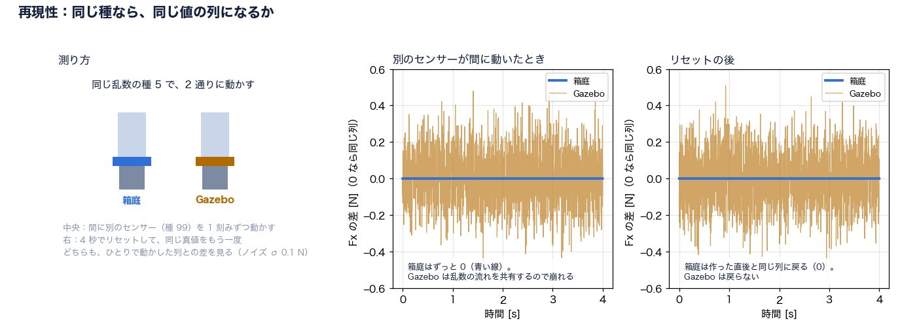

- **測ったこと：** 乱数の種 5、ノイズ σ 0.1 N で、2通りに動かしました。
  - 中央：間に別のセンサー（種 99）を1刻みずつ動かす。
  - 右：4 秒でリセットし、同じ真値をもう一度渡す。
  - どちらも、ひとりで動かしたときの値の列と比べます。
- **グラフの見方：** ひとりで動かした列との差です。0 なら同じ列です。
- **結果：**
  - 箱庭は、どちらもずっと 0 でした。
  - Gazebo は、乱数の流れがプロセスに1つしかありません。そのため、別のセンサーが動くと列が変わり、リセットしても元に戻りません。

### 量子化

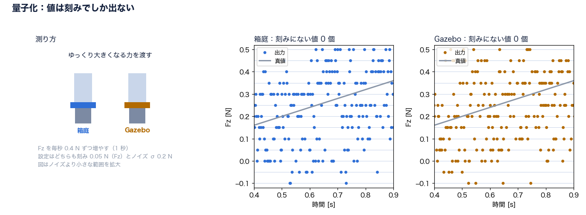

- **測ったこと：** Fz を毎秒 0.4 N ずつ増やしました。設定はどちらも、刻み 0.05 N とノイズ σ 0.2 N です。
- **グラフの見方：** ノイズより小さな範囲を拡大しています。薄い線が刻みです。
- **結果：** どちらも、すべての値が刻みの上にありました（刻みにない値は 0 個）。

### 箱庭だけ：風袋引きとローパスフィルタ

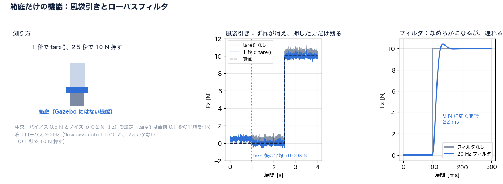

- **測ったこと：**
  - 中央：Fz にバイアス 0.5 N とノイズ σ 0.2 N を設定し、1 秒で `tare()` を呼び、2.5 秒で 10 N 押しました。
  - 右：10 N 押す力を、20 Hz のローパスを通した場合と、通さない場合で比べました。
- **結果：**
  - `tare()` の後は、ずれが消え（平均 +0.003 N）、押した力が 10 N として見えます。
  - フィルタは値をなめらかにしますが、9 N に届くまで 22 ms かかりました。
  - Gazebo には、どちらもありません。

### 箱庭だけ：校正のずれと、飽和・過負荷

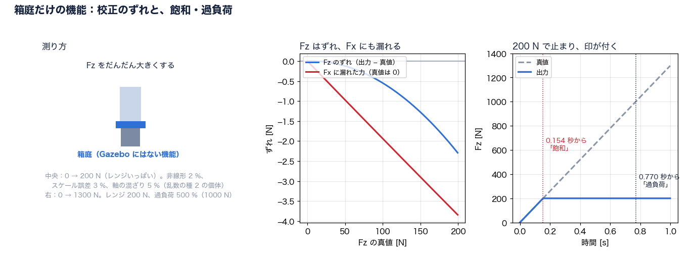

- **測ったこと：**
  - 中央：Fz を 0 からレンジいっぱいの 200 N まで増やしました。設定は非線形 2 %、スケール誤差 3 %、軸の混ざり 5 % で、乱数の種 2 の個体です。
  - 右：Fz を 0 から 1300 N まで増やしました。設定はレンジ 200 N、過負荷 500 %（1000 N）です。
- **結果：**
  - Fz は、200 N のときに最大 −2.3 N ずれました。真値が 0 の Fx にも、最大 −3.9 N が漏れました。
  - 出力は 200 N で止まり、0.154 秒から「飽和」の印が付きました。真値が 1000 N を超えた 0.770 秒からは、「過負荷」の印も付きました。
  - Gazebo には、どれもありません。

## 評価結果

6軸の力覚センサーを、[評価の軸](../drone/evaluation-axes.md)（英語）と同じ6つの軸で比べました。どちらも[力覚センサーのインターフェース](../../design/force-torque-adapter.md)（英語）のアダプタとして包み、同じ真値の列を渡しています。

| 実装 | 版 |
|---|---|
| 箱庭 | [hakoniwa-sensor-pro](https://github.com/hakoniwalab/hakoniwa-sensor-pro) v0.1.0 のリリース（バイナリ）にある `hakoniwa` 実装の力覚センサー。このインターフェースの設計の式を実装したもので、ソースは非公開 |
| Gazebo | gz-sensors 10.2.0 の `ForceTorqueSensor`（hakoniwa-sensor-adapter-gazebo のアダプタ） |

- Project AirSim には力覚センサーがないので、比べていません。
- 物理エンジンの力覚センサー（MuJoCo の `force` と `torque` など）と、ROS 2 の部品（mujoco_ros2_control）は、軸2で機能の有無だけを載せています。

測った日：2026-11-19（最初の測定は 2026-11-11）。マシン：macOS（arm64）。物理の刻み 1 ms、測る周期 500 Hz。

### まとめ

| 軸 | 箱庭 | Gazebo |
|---|---|---|
| 0. ノイズなしでの一致 | 基準 | 一致（差は最大 1.8e-15。測る時刻は 5,000 サンプルすべてで一致） |
| 1. 精度 | ノイズ、量子化、バイアス、ドリフトとも設定どおり | ノイズと量子化は設定どおり。バイアスは ± 設定値の2つの値しかとらない。ゆっくり変わるバイアスの定常 σ は、設定値の √(τ/2) 倍 |
| 2. 網羅性（15項目） | 15 | 4 |
| 3. 再現性（5ケース） | 5ケースとも仕様どおり | 他のセンサー、同じ種の2台、リセットで、値の列が変わる |
| 4. 速度（物理の1刻みあたりの平均） | 0.05 µs（誤差なし）、0.10 µs（ノイズあり） | 0.11 µs、0.22 µs |
| 5. 導入の手間 | 追加の依存なし（設定を読む JSON のヘッダだけ） | gz-sensors とその依存（ドローンのセンサーと同じ） |

### 0. ノイズなしでの一致

誤差をすべて切り、6つの軸それぞれに、振幅と周波数の違う正弦波を加えた真値を 10 秒間渡しました。

| 軸 | 箱庭と Gazebo の差の最大 | 箱庭と真値の差の最大 |
|---|---|---|
| Fx | 4.4e-16 | 4.4e-16 |
| Fy | 4.4e-16 | 4.4e-16 |
| Fz | 1.8e-15 | 1.8e-15 |
| Tx | 2.8e-17 | 2.8e-17 |
| Ty | 2.2e-16 | 2.2e-16 |
| Tz | 1.4e-17 | 1.4e-17 |

- この一致で、力の向き（工具側がロボット側にかける力）とモーメントの軸がそろっていることを確かめました。
  - gz-sensors は「親が子にかける力」を出します。
  - Gazebo のアダプタは、既定の `child_to_parent` でこれを反転して出すので、インターフェースと同じ向きになります。
- 差は、浮動小数点の丸めの大きさです。

### 1. 精度

両方を同じ意味の設定にし、静止した真値（0）で統計をとりました。

#### ノイズ（20,000 サンプル）

| 軸 | 設定した σ | 箱庭 | Gazebo |
|---|---|---|---|
| Fx | 0.1 N | 0.0997 | 0.0991 |
| Fy | 0.1 N | 0.1003 | 0.1003 |
| Fz | 0.2 N | 0.2001 | 0.2008 |
| Tx | 0.01 N·m | 0.01003 | 0.01009 |
| Ty | 0.01 N·m | 0.00998 | 0.01001 |
| Tz | 0.02 N·m | 0.02002 | 0.01991 |

箱庭は、データシートの 1σ を出力の周期（`rate_hz` 500）で書きました。帯域の換算の係数が 1 になる設定にして、比べています。

#### 量子化（10,000 サンプル）

刻み 0.05 N と 0.005 N·m の倍数でない値の数は、箱庭も Gazebo も、6つの軸すべてで 0 でした。

#### バイアス（乱数の種 1〜40 の 40 個、Fx、設定 0.5 N）

| 実装 | 最小 | 最大 | マイナスの個数 | 違う値の数 |
|---|---|---|---|---|
| 箱庭 | −0.442 | 0.449 | 20 | 40 |
| Gazebo | −0.5 | 0.5 | 21 | 2 |

- 箱庭は、±0.5 N の範囲から、個体ごとに1つの値を一様に選びます。データシートの値を「この範囲の中」と読んでいます。
- Gazebo は、設定値に 50 % の確率で符号を付けるだけです（`bias_stddev` が 0 のとき）。個体ごとのばらつきは、別に `bias_stddev` で書きます。

#### ドリフト（それぞれ自分のモデルに対して）

| 実装 | モデル | 設定 | 測った値 | 期待値 |
|---|---|---|---|---|
| 箱庭 | ランダムウォーク | 1時間あたり 60 N | 1回の増分の σ 0.0446 N | 60 × √(0.002 / 3600) = 0.0447 N |
| Gazebo | 1次のガウス・マルコフ | `dynamic_bias_stddev` 1 N、`dynamic_bias_correlation_time` 10 秒 | 200 個の定常 σ 2.226 N | gz-sensors の式で σ_b·√(τ/2) = 2.236 N |

Gazebo の `dynamic_bias_stddev` は、定常状態の σ ではありません。
- gz-sensors の離散化（`sigma_b_d = sqrt(−σ_b²·τ/2·expm1(−2·dt/τ))`）から、定常の σ は σ_b·√(τ/2) になります。
- 定常の σ を σ にしたいときは、σ / √(τ/2) と書きます。

### 2. 網羅性

| # | 項目 | 箱庭 | Gazebo | MuJoCo（`force`、`torque`） | mujoco_ros2_control |
|---|---|---|---|---|---|
| 1 | 向きとモーメントの基準点が決まっている | ○（工具がロボットにかける力、センサー原点まわり） | △（SDFormat の説明と gz-sim の計算が違う） | ○（子から親へ、サイト原点まわり） | △（MuJoCo の値を反転。文書なし） |
| 2 | 軸ごとのノイズ | ○ | ○ | ×（`noise` は書けるが足されない） | ○（σ のみ） |
| 3 | データシートのノイズの定義と帯域の換算 | ○ | × | × | × |
| 4 | バイアス（個体ごと） | ○ | △（± の2値。ばらつきは別に書く） | × | × |
| 5 | ドリフト | ○（ランダムウォーク） | ○（ガウス・マルコフ） | × | × |
| 6 | 分解能 | ○ | ○ | × | × |
| 7 | 非線形 | ○ | × | × | × |
| 8 | スケール誤差、軸の混ざり（6×6） | ○ | × | × | × |
| 9 | 遅れ | ○ | × | ○（`delay`） | × |
| 10 | ローパス | ○ | × | △（履歴の補間） | × |
| 11 | 飽和と印 | ○ | × | △（`cutoff` で切る。印なし） | △（MuJoCo と同じ） |
| 12 | 過負荷の印 | ○ | × | × | × |
| 13 | 風袋引き | ○ | × | × | × |
| 14 | 乱数の種で決まる、センサーごとの乱数の流れ | ○ | ×（プロセスに1つ） | — | ×（種を指定できない） |
| 15 | 物理の真値と独立に使える（他の物理エンジンでも） | ○ | ○ | × | × |

MuJoCo と mujoco_ros2_control の列は、文書とソースを読んで埋めました。mujoco_ros2_control は、main の `hardware_interface.rst` と `MujocoSystemInterface` です。動かして測ってはいません。

### 3. 再現性

ノイズの設定、乱数の種 5、2,000 サンプル。

| ケース | 箱庭 | Gazebo |
|---|---|---|
| 同じ種で作り直すと、同じ列になる | はい | はい |
| 間に別のセンサーが動いても、同じ列になる | はい | いいえ |
| 同じ種の2台を交互に動かしても、同じ列になる | はい | いいえ |
| リセットの後、作った直後と同じ列になる | はい | いいえ |
| 違う種なら、違う列になる | はい | はい |

- Gazebo は、乱数の流れがプロセスに1つしかありません。そのため、他のセンサーの動きで値の列が変わります。
- リセットのときに種を設定し直さないのは、他のセンサーの列まで最初からやり直しになるのを避けるためです（アダプタの決まり）。

### 4. 速度

60 秒（物理の 60,000 刻み）を5回測った中央値です。

| 設定 | 箱庭 | Gazebo |
|---|---|---|
| 誤差なし | 0.048 µs | 0.107 µs |
| ノイズあり | 0.096 µs | 0.220 µs |

どちらも、物理の1刻み 1 ms の 0.03 % 未満です。

### 5. 導入の手間

| 項目 | 箱庭 | Gazebo |
|---|---|---|
| 依存 | 設定を読む nlohmann/json（ヘッダだけ） | gz-sensors とその依存（gz-math、gz-msgs、gz-transport、sdformat、protobuf など。[ドローンのセンサー](../drone/axis5-adoption.md)（英語）と同じ） |
| 設定 | JSON。データシートの値を単位ごと写せる | SDFormat の `<force_torque>` |
| 通信 | なし | gz-transport のパブリッシャを作る（スレッドが1つ立つ） |

### 方法

- 比較プログラムは、2つのアダプタをこのインターフェースだけを通して呼びます。
- 使ったものはすべて公開されているので、両方の列を誰でも再現できます。
  - 比較プログラム：[tools/compare](../../../tools/compare) の `force_torque.cpp`（`pixi run force-torque`。ビルドはその README）
  - 箱庭：hakoniwa-sensor-pro v0.1.0 のリリースにある `hakoniwa` 実装を、共通の窓口から名前で呼びます。`hakoniwa-sensor-pro-0.1.0-macos-arm64.zip`、SHA-256 `82040299ea2eed32139626b8c30a787fb5bc7c44d0660f303edc2155158deb23`
  - Gazebo：公開アダプタ [hakoniwa-sensor-adapter-gazebo](https://github.com/hakoniwalab/hakoniwa-sensor-adapter-gazebo)
- 2026-11-19 の測定では、軸0・1・3の出力が、ソースから測った 2026-11-11 とビット単位で同じでした。リリースのバイナリは、同じ計算をしています。
- 軸4は、3回測って、公開済みの値の範囲に収まりました。
