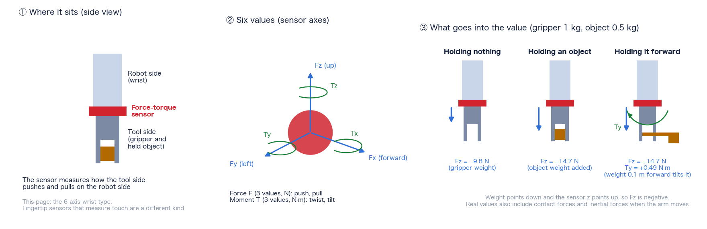
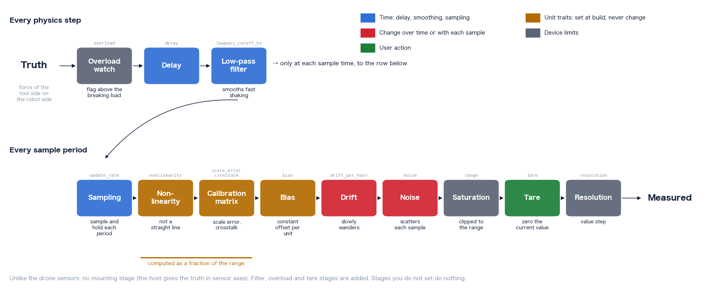
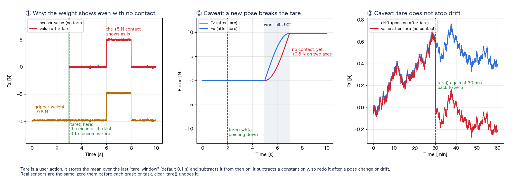
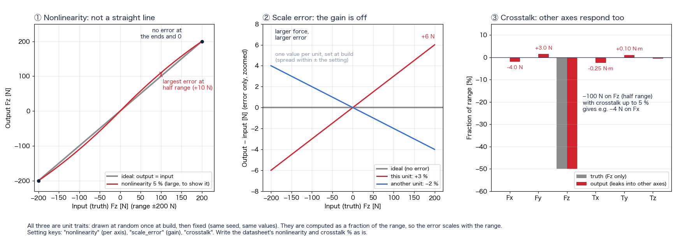
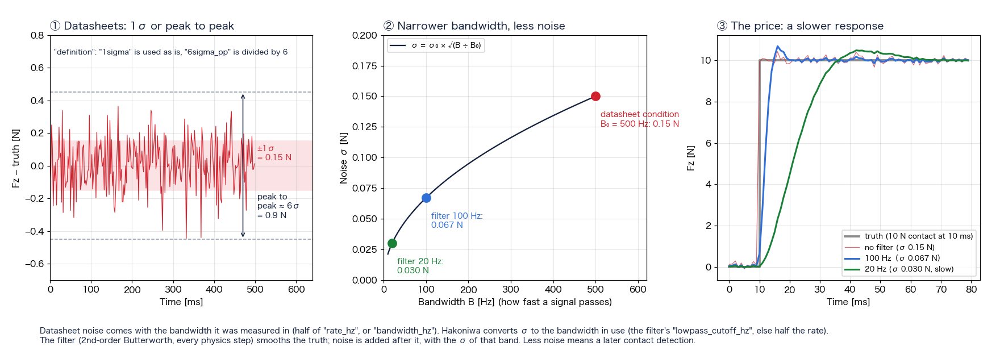
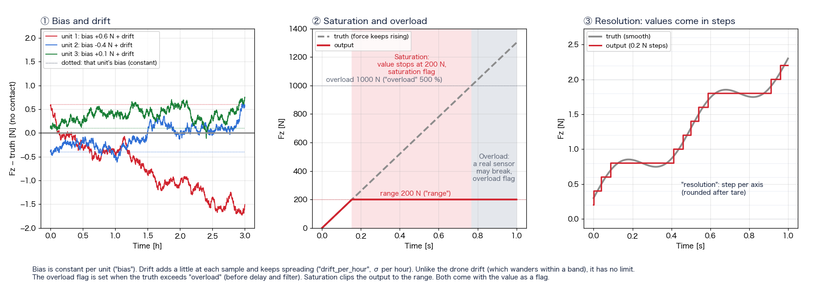

# Force-torque sensor: how it works and evaluation results (2026-11-19)

English | [日本語](README.ja.md)

The first part explains what a force-torque sensor measures and how each of its errors works, one figure per topic (drawn for illustration). The second part compares the Hakoniwa sensor with Gazebo's.

## How a force-torque sensor works

### 1. What it measures

- The sensor sits between the robot's wrist and the tool (the gripper and what it holds). It measures how the tool side pushes and pulls on the robot side. Sensors on the fingertips, which measure the contact force of each finger, are a different kind.
- It gives six values in its own axes (x forward, y left, z up): three forces Fx, Fy, Fz in N, and three moments Tx, Ty, Tz in N·m.
- Even when nothing is touched, the weight of the tool is in the value: a 1 kg gripper gives Fz = −9.8 N (the weight pulls down; the sensor's z points up). A held object adds its weight. Held 0.1 m in front, a 0.5 kg object also gives Ty = +0.49 N·m. Contact forces and the inertia of a moving arm are in the value too.

### 2. The processing order

- **Every physics step:** the overload watch looks at the truth, then the delay and the low-pass filter act on it.
- **At every sample:** nonlinearity, calibration matrix (scale error and crosstalk), bias, drift, noise, saturation, tare and resolution, in that order. Nonlinearity and the calibration matrix work on the value as a fraction of the range.
- The colors group the stages: time (blue), the unit's own character, fixed when it is made (brown), changing with time or at every sample (red), the limits of the device (gray), and the user's operation (green).
- Unlike the drone sensors there is no mounting stage (the host passes the truth in sensor axes), and there are a filter, an overload flag and tare. Stages not written in the configuration do nothing.

### 3. Tare

- **Why:** without tare, the value shows the gripper's weight even when nothing is touched. `tare()` stores the mean of the last `tare_window` (0.1 s by default) and subtracts it from then on, so a contact force shows as it is.
- **Orientation:** tare subtracts a constant. If the wrist tilts after tare, the weight moves to other axes and shows as a force although nothing is touched. Tare again after a change of attitude, or subtract the tool weight by computation.
- **Drift:** tare does not stop the drift; the value slowly leaves zero again until the next tare. On real sensors too, tare is done before each grasp or task. `clear_tare()` undoes it.

### 4. Calibration errors

- **Nonlinearity:** the output bows slightly away from a straight line, most at half the range and not at all at zero and at the ends of the range.
- **Scale error:** the gain is off; the larger the force, the larger the error.
- **Crosstalk:** a force on one axis also shows on the others. A single elastic body measures all six values, so real sensors always have some.
- All three are the unit's own character: drawn once when it is made (the same seed gives the same values) and fixed after that. Their size scales with the range. The datasheet's nonlinearity and crosstalk percentages go into `nonlinearity`, `scale_error` and `crosstalk` as they are.

### 5. Noise and bandwidth

- **How datasheets write it:** either 1σ or peak to peak (about 6σ). `"definition": "1sigma"` is used as is, `"6sigma_pp"` is divided by 6.
- **Bandwidth:** the datasheet value belongs to a bandwidth (half of `rate_hz`, or `bandwidth_hz`). Hakoniwa converts it to the bandwidth in use, σ = σ₀ × √(B / B₀), where B is the low-pass cutoff `lowpass_cutoff_hz` or half the sample rate. The same idea as the noise density of the drone sensors.
- **The price:** the filter (second-order Butterworth, every physics step) smooths the truth; the noise is then added with the σ of that band. Less noise means a slower response to a contact.

### 6. Bias, drift, saturation, overload and resolution

- **Bias** (`bias`) is constant per unit. **Drift** (`drift_per_hour`, σ per hour) adds a little at every sample and keeps spreading without bound, unlike the drone sensors' drift, which wanders within a band.
- **Saturation** (`range`): beyond the range the value stops and the saturated flag is set. **Overload** (`overload`): the force that could break a real sensor; the overloaded flag is set as soon as the truth exceeds it, before the delay and the filter, so short shocks are caught.
- **Resolution** (`resolution`): the value comes only in steps, rounded last (after tare).

## Evaluation results

We compared 6-axis force-torque sensors on the same six axes as [Evaluation axes](../drone/evaluation-axes.md). Both are wrapped as adapters of the [force-torque sensor interface](../../design/force-torque-adapter.md) and receive the same truth sequence.

| Implementation | Version |
|---|---|
| Hakoniwa | The force-torque sensor of the `hakoniwa` implementation in the [hakoniwa-sensor-pro](https://github.com/hakoniwalab/hakoniwa-sensor-pro) v0.1.0 release archive (binaries; an implementation of the equations in this interface's design; the source is not public) |
| Gazebo | gz-sensors 10.2.0 `ForceTorqueSensor` (the hakoniwa-sensor-adapter-gazebo adapter) |

Project AirSim has no force-torque sensor, so it is not compared. The force-torque sensors of physics engines (MuJoCo `force` and `torque`, and so on) and the ROS 2 component (mujoco_ros2_control) are listed in axis 2 for feature coverage only.

Date measured: 2026-11-19 (first measured on 2026-11-11). Machine: macOS (arm64). Physics step 1 ms, sample period 500 Hz.

### Summary

| Axis | Hakoniwa | Gazebo |
|---|---|---|
| 0. No-noise agreement | Reference | Agrees (difference at most 1.8e-15; sample times agree in all 5,000 samples) |
| 1. Accuracy | Noise, quantization, bias and drift as configured | Noise and quantization as configured. Bias takes only the two values ± the setting. Steady-state σ of the slowly varying bias is √(τ/2) times the setting |
| 2. Coverage (15 items) | 15 | 4 |
| 3. Repeatability (5 cases) | As specified in all 5 cases | Sequence changes with other sensors, two units with the same seed, and reset |
| 4. Speed (mean per physics step) | 0.05 µs (no errors), 0.10 µs (with noise) | 0.11 µs, 0.22 µs |
| 5. Adoption effort | No extra dependencies (only a JSON header to read the configuration) | gz-sensors and its dependencies (same as for the drone sensors) |

### 0. No-noise agreement

With every error turned off, we passed 10 seconds of truth with sinusoids of different amplitude and frequency added to each of the 6 axes.

| Axis | Max difference, Hakoniwa vs Gazebo | Max difference, Hakoniwa vs truth |
|---|---|---|
| Fx | 4.4e-16 | 4.4e-16 |
| Fy | 4.4e-16 | 4.4e-16 |
| Fz | 1.8e-15 | 1.8e-15 |
| Tx | 2.8e-17 | 2.8e-17 |
| Ty | 2.2e-16 | 2.2e-16 |
| Tz | 1.4e-17 | 1.4e-17 |

- This agreement confirms that the force direction (the force the tool side exerts on the robot side) and the moment axes are aligned. The Gazebo adapter outputs gz-sensors' "force the parent exerts on the child" reversed with the default `child_to_parent`, so it has the same direction as the interface.
- The differences are of the size of floating-point rounding.

### 1. Accuracy

We configured both to have the same meaning and took statistics with stationary truth (0).

#### Noise (20,000 samples)

| Axis | Configured σ | Hakoniwa | Gazebo |
|---|---|---|---|
| Fx | 0.1 N | 0.0997 | 0.0991 |
| Fy | 0.1 N | 0.1003 | 0.1003 |
| Fz | 0.2 N | 0.2001 | 0.2008 |
| Tx | 0.01 N·m | 0.01003 | 0.01009 |
| Ty | 0.01 N·m | 0.00998 | 0.01001 |
| Tz | 0.02 N·m | 0.02002 | 0.01991 |

For Hakoniwa, we wrote the datasheet 1σ at its output period (`rate_hz` 500), a setting where the bandwidth conversion factor is 1, and compared.

#### Quantization (10,000 samples)

The number of values that were not multiples of the step 0.05 N or 0.005 N·m was 0 on all 6 axes, for both Hakoniwa and Gazebo.

#### Bias (40 units with seeds 1 to 40, Fx, setting 0.5 N)

| Implementation | Min | Max | Negative units | Distinct values |
|---|---|---|---|---|
| Hakoniwa | −0.442 | 0.449 | 20 | 40 |
| Gazebo | −0.5 | 0.5 | 21 | 2 |

- Hakoniwa draws one value per unit uniformly from the range ±0.5 N (reading the datasheet value as "within").
- Gazebo only attaches a sign to the configured value with 50 % probability (when `bias_stddev` is 0). The spread between units is written separately with `bias_stddev`.

#### Drift (each against its own model)

| Implementation | Model | Setting | Measured | Expected |
|---|---|---|---|---|
| Hakoniwa | Random walk | 60 N per hour | σ of one increment 0.0446 N | 60 × √(0.002 / 3600) = 0.0447 N |
| Gazebo | First-order Gauss-Markov | `dynamic_bias_stddev` 1 N, `dynamic_bias_correlation_time` 10 s | Steady-state σ over 200 units 2.226 N | σ_b·√(τ/2) = 2.236 N by the gz-sensors equation |

Gazebo's `dynamic_bias_stddev` is not the steady-state σ. From the gz-sensors discretization (`sigma_b_d = sqrt(−σ_b²·τ/2·expm1(−2·dt/τ))`), the steady-state σ is σ_b·√(τ/2). To get a steady-state σ of σ, write σ / √(τ/2).

### 2. Coverage

| # | Item | Hakoniwa | Gazebo | MuJoCo (`force`, `torque`) | mujoco_ros2_control |
|---|---|---|---|---|---|
| 1 | Direction and moment reference point are defined | ○ (force the tool exerts on the robot, about the sensor origin) | △ (the SDFormat description and the gz-sim computation differ) | ○ (child to parent, about the site origin) | △ (reverses the MuJoCo value; not documented) |
| 2 | Per-axis noise | ○ | ○ | × (`noise` can be written but is not added) | ○ (σ only) |
| 3 | Datasheet noise definition and bandwidth conversion | ○ | × | × | × |
| 4 | Bias (per unit) | ○ | △ (two values ±; spread written separately) | × | × |
| 5 | Drift | ○ (random walk) | ○ (Gauss-Markov) | × | × |
| 6 | Resolution | ○ | ○ | × | × |
| 7 | Nonlinearity | ○ | × | × | × |
| 8 | Scale error, crosstalk (6×6) | ○ | × | × | × |
| 9 | Delay | ○ | × | ○ (`delay`) | × |
| 10 | Low-pass | ○ | × | △ (history interpolation) | × |
| 11 | Saturation and flag | ○ | × | △ (clipped by `cutoff`; no flag) | △ (same as MuJoCo) |
| 12 | Overload flag | ○ | × | × | × |
| 13 | Tare | ○ | × | × | × |
| 14 | Per-sensor random stream determined by the seed | ○ | × (one per process) | — | × (seed cannot be specified) |
| 15 | Usable independently of the physics truth (also with other physics engines) | ○ | ○ | × | × |

The MuJoCo and mujoco_ros2_control columns were read from documentation and source (for mujoco_ros2_control, `hardware_interface.rst` and `MujocoSystemInterface` on main). They were not run and measured.

### 3. Repeatability

Noise setting, seed 5, 2,000 samples.

| Case | Hakoniwa | Gazebo |
|---|---|---|
| Recreated with the same seed gives the same sequence | Yes | Yes |
| Same sequence even when another sensor runs in between | Yes | No |
| Two units with the same seed run alternately give the same sequence | Yes | No |
| After reset, the same sequence as right after creation | Yes | No |
| Different seed gives a different sequence | Yes | Yes |

Gazebo has one random stream per process, so the sequence changes with the activity of other sensors. The seed is not set again at reset so that the sequences of other sensors are not restarted too (an adapter rule).

### 4. Speed

Median of 5 runs of 60 seconds (60,000 physics steps).

| Setting | Hakoniwa | Gazebo |
|---|---|---|
| No errors | 0.048 µs | 0.107 µs |
| With noise | 0.096 µs | 0.220 µs |

Both are below 0.03 % of the 1 ms physics step.

### 5. Adoption effort

| Item | Hakoniwa | Gazebo |
|---|---|---|
| Dependencies | nlohmann/json to read the configuration (header only) | gz-sensors and its dependencies (gz-math, gz-msgs, gz-transport, sdformat, protobuf, and others; same as for the [drone sensors](../drone/axis5-adoption.md)) |
| Configuration | JSON. Datasheet values are copied with units | SDFormat `<force_torque>` |
| Transport | None | A gz-transport publisher is created (a thread starts) |

### Method

- The comparison program calls the two adapters only through this interface.
- Everything used is public, so anyone can reproduce both columns:
  - the comparison program: `force_torque.cpp` in [tools/compare](../../../tools/compare) (`pixi run force-torque`; build in its README);
  - Hakoniwa: the `hakoniwa` implementation of the hakoniwa-sensor-pro v0.1.0 release archive, `hakoniwa-sensor-pro-0.1.0-macos-arm64.zip`, SHA-256 `82040299ea2eed32139626b8c30a787fb5bc7c44d0660f303edc2155158deb23`, reached by name through the common interface;
  - Gazebo: the public adapter [hakoniwa-sensor-adapter-gazebo](https://github.com/hakoniwalab/hakoniwa-sensor-adapter-gazebo).
- On 2026-11-19 the outputs of axes 0, 1 and 3 were bit-identical to those of 2026-11-11, measured with the sources: the release archive computes the same. Axis 4 stayed within the published values over three runs.
