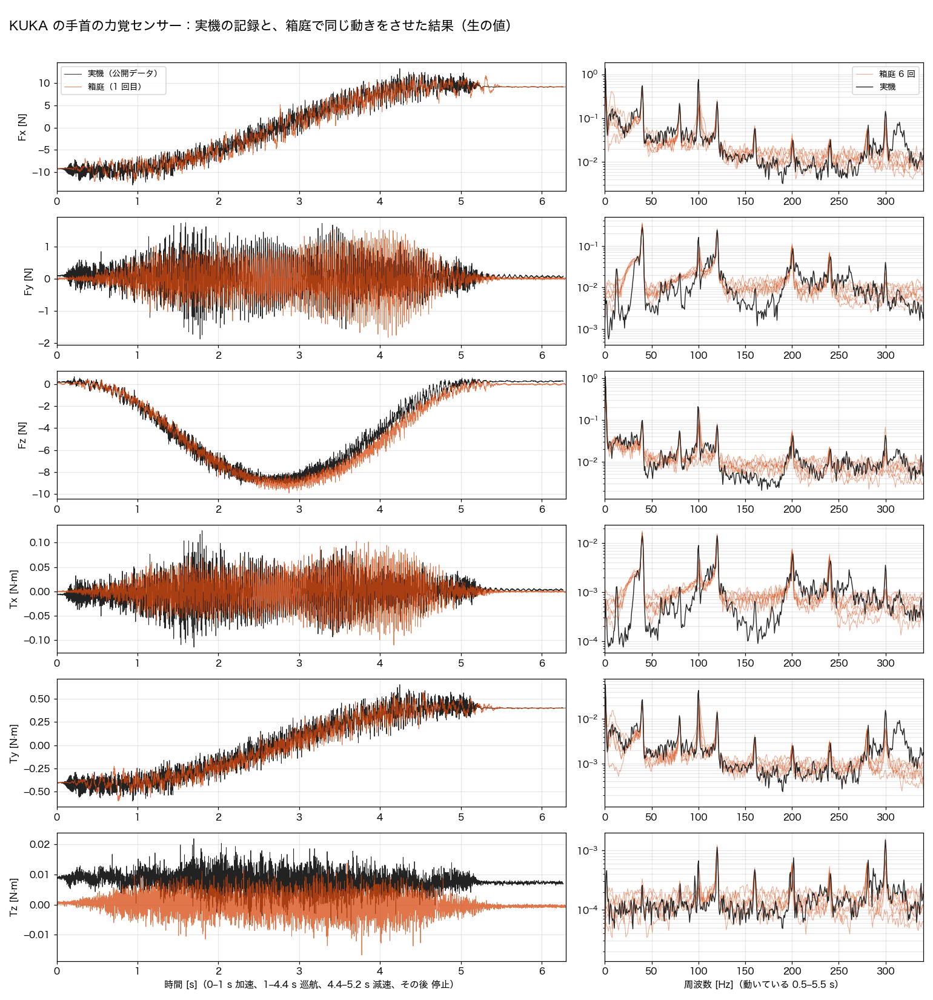
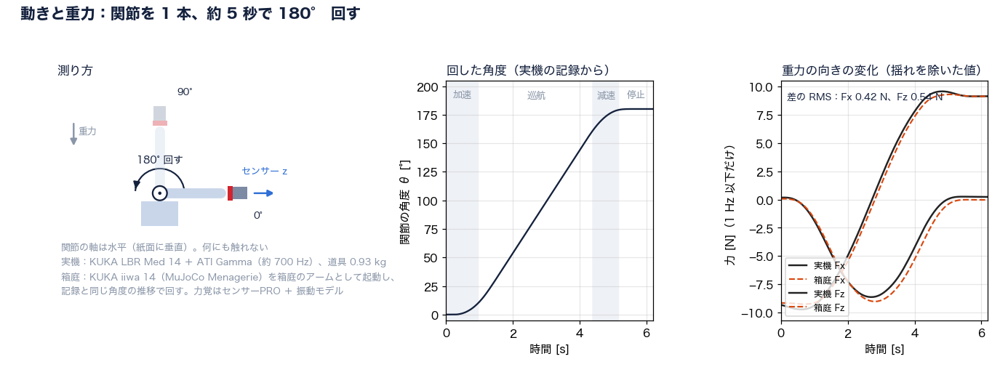
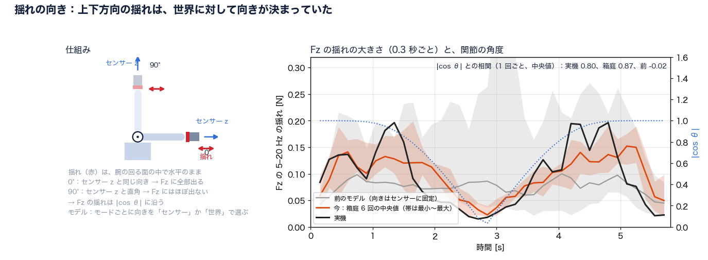
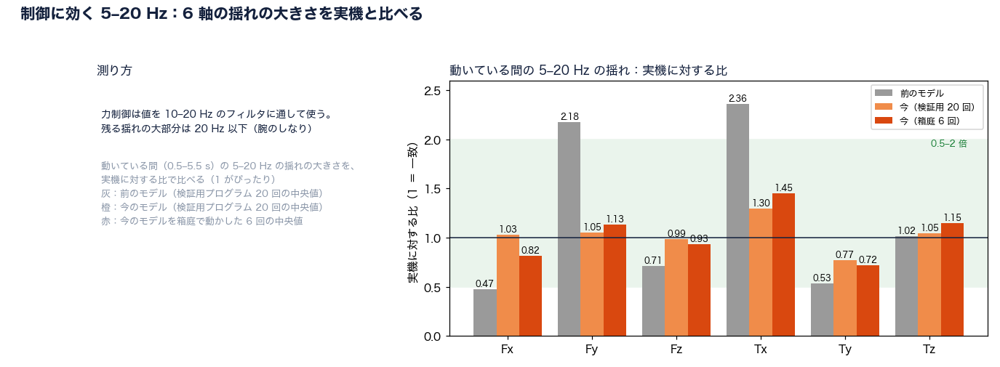
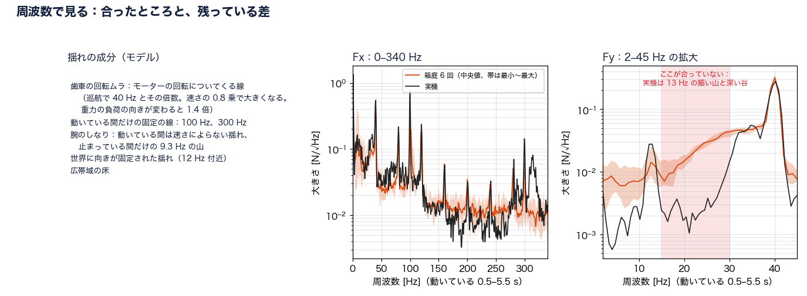

# 力覚センサーの振動：実機の記録との比較（KUKA、2026-11-19）

[English](real-data-kuka.md) | 日本語

ロボットの手首の力覚センサーは、何も触れずに腕を動かすだけで揺れます。原因は、減速機の歯車の回転ムラ、関節の摩擦、腕のしなりです。物理エンジンが計算する力には、この揺れが入りません。

箱庭では、この揺れを[力覚センサーの振動モデル](../../spec/force-torque-vibration.md)（英語）として、真値に足しています。このページは、そのモデルを公開されている実機の記録に合わせ、KUKA の腕を箱庭で動かして比べた結果です。

## 比べたもの

| | 実機 | 箱庭 |
|---|---|---|
| 腕 | KUKA LBR Med 14（7 軸） | KUKA iiwa 14（MuJoCo Menagerie のモデル）。同じ系列の腕 |
| センサー | ATI Gamma（6 軸、約 700 Hz） | センサーPRO の力覚センサー（出力 1 kHz）＋ 振動モデル |
| 道具 | 約 0.93 kg | 0.932 kg（実機の 24 姿勢の校正記録から、重さと重心を求めた） |
| 動き | 関節 1 本を約 5 秒で 180° 回す。何にも触れない | 実機の記録と同じ角度の推移で回す |
| 回数 | 同じ動きの記録 2 本 | 箱庭のロボットアームとして 6 回（物理 1 ms、実時間に同期） |

- 実機の記録：Zenodo レコード 11096791（CC BY 4.0）。
- 振動モデルは、1 本目の記録の動いている間に合わせました。2 本目の記録は、実行ごとのばらつきの幅を決めるのに使いました。そのため、独立した検証用のデータは残っていません。
- 比較はすべて「箱庭 ÷ 実機」の比です。1 がぴったりです。

## 全体

- **グラフの見方：** 左は生の値です（黒が実機、赤が箱庭の 1 回目）。右は、動いている間（0.5–5.5 s）の周波数ごとの大きさです（細い赤線が箱庭の 6 回）。
- **結果：**
  - ゆっくりした変化（重力の向きの変化）は重なります。
  - 揺れは、40 Hz とその倍数、100 Hz、300 Hz の線と、その間の床の高さが、6 軸とも実機に重なります。
  - Tz の生の値で、実機だけが全体に約 0.008 N·m 上にあります。センサーのゼロ点のずれの残りで、揺れの比較には影響しません。

## 測定カード

### 動きと重力

- **測ったこと：** 関節を約 5 秒で 180° 回しました（加速 1 秒、巡航、減速、停止）。センサーから見た重力の向きが回ります。
- **グラフの見方：**
  - 中央は、回した角度です。
  - 右は、Fx と Fz の 1 Hz 以下の成分です（揺れを除いた値）。
- **結果：** 実機と箱庭の差の RMS は、Fx 0.42 N、Fz 0.54 N でした（±10 N の変化に対して）。揺れの比較は、この重力の層を除いて行います。

### 揺れの向き

- **測ったこと：** 動いている間の、Fz の 5–20 Hz の揺れの大きさを 0.3 秒ごとに求め、関節の角度 θ と比べました。
- **グラフの見方：**
  - 黒が実機、赤が箱庭（6 回の中央値。帯は最小〜最大）、灰色が向きをセンサーに固定していた前のモデル（20 回）です。
  - 青い点線が |cos θ| です。
- **結果：**
  - 実機の Fz の揺れは、0° と 180° の近くで大きく、90° の近くでほぼ消えます。|cos θ| との相関は 0.80 です。
  - 揺れの向きが、腕の回る面の中で世界に対して水平に決まっている、と見ると説明がつきます（左の絵）。センサーに固定した揺れでは、角度でこう変わりません（前のモデルの相関は −0.02）。
  - モデルのモードごとに、向きを「センサー」か「世界」で選べるようにしました（`"frame": "world"`）。ホストは、センサーの向きを毎ステップ渡します。箱庭の相関は 0.87 です。

### 制御に効く 5–20 Hz

- **測ったこと：** 動いている間（0.5–5.5 s）の 5–20 Hz の揺れの大きさを、6 軸で実機と比べました。力制御は値を 10–20 Hz のフィルタに通して使うので、制御に効く揺れの大部分はこの帯域にあります。
- **グラフの見方：**
  - 灰色が前のモデル、橙が今のモデルです（どちらも、振動モデルを単体で動かす検証用プログラムの 20 回の中央値）。
  - 赤が、今のモデルを箱庭のロボットとして動かした 6 回の中央値です。
  - 緑の帯は 0.5–2 倍です。
- **結果：**
  - 前のモデルの 0.47–2.36 倍が、箱庭で 0.72–1.45 倍になりました。
  - 巡航中に 20 Hz のフィルタを通した後の揺れでは、6 軸すべてで、実機の値が検証用プログラム 20 回の 5–95 % の幅に入りました。箱庭 6 回の中央値は、実機の 0.73–1.28 倍です。

### 周波数で見る

- **測ったこと：** 動いている間（0.5–5.5 s）の周波数ごとの大きさです。
- **グラフの見方：** 左の文字は、モデルが持つ揺れの成分です。中央は Fx の全体、右は Fy の 2–45 Hz の拡大です。
- **結果：**
  - 歯車の線、固定の線、床の高さは重なります。
  - Fy の 15–30 Hz は合っていません（赤い帯）。実機には 13 Hz の細い山と、その上の深い谷があります。箱庭はなだらかで、20 Hz で約 5 倍高くなります。Tx も同じです。

## 記録から見つけたこと

モデルの形は、記録を読んで確かめたことから決めました。数字を動かして合わせる前に「何がどの範囲に入れば合格か」を書き、後から基準を変えていません。

| 見つけたこと | 記録での根拠 | モデルの形 |
|---|---|---|
| 上下方向の揺れの向きは、世界に対して決まっている | Fz の揺れが \|cos θ\| に沿う（相関 0.80） | モードの向き `"frame": "world"` |
| 腕のしなりの揺れは、動いている間は速さによらない | 4°/s でも 45°/s でもほぼ同じ大きさ（速さの 0.12 乗） | 動いている間の一定の大きさ（`per_motion`） |
| 止まっているときの 9.3 Hz の鋭い山は、動くと消える | 静止時は鋭い山、動作中は 4–15 Hz に平ら | 動いている間に弱める倍率（`at_rest_while_moving`） |
| 歯車の回転ムラは、速さとともに大きくなる | 線の大きさが速さの約 0.8 乗（文献では一定） | 速さの指数（`exponent`） |
| ゆっくり回るときの歯車の線は、5–20 Hz に現れない | 加速・減速中に、速さについてくる低い線がない | 低い周波数で弱める（`deadband_hz`） |
| 重力の負荷の向きが反転すると、回転ムラが大きくなる | 40 Hz の線が 1.36 倍・1.49 倍（2 本とも） | 負荷の向きの倍率（`load_gain`）。箱庭は 1.37 倍 |
| 100 Hz と 300 Hz の線は、動いている間だけ出て、周波数が動かない | 加速・巡航・減速で 99.8–100.0 Hz、299.7–299.9 Hz | 固定の周波数のモード |

確かめて外れた見方も残しています。「低速ほど大きい摩擦（Stribeck）」は外れ、Fz の変化の原因は向きでした。解析の窓の都合で現れた 43.6 Hz の線は、分解能を上げると存在しませんでした。

## 箱庭で動かしても精度は落ちない

振動モデルは、まず小さな検証用プログラムで合わせます。箱庭のロボットとして動かす（起動、軌道の指令、制御器、センサー、出力の記録まで）と、同じ結果になるかを確かめました。

- 実行ごとのばらつきを切って 3 回ずつ比べると、全帯域・全軸で、箱庭 ÷ 検証用プログラムは 0.89–1.10 倍でした。
- 重力の層の差は 0.005–0.018 N でした。

## 合っていないところ

- Fy・Tx の 15–30 Hz の形（上の周波数のカード）。
- 加速中の Tz が実機の 0.35–0.56 倍。止まった後の Fz が約 2 倍（止まると関節が固くなる効果は、モデルにありません）。
- 加速・減速中の Fy・Tx が、20 Hz のフィルタの後で実機の 1.3–1.5 倍。
- 腕のしなりの周波数は、実機では姿勢で 7.6–9.8 Hz と動きます。モデルは周波数を固定で持ちます。
- 世界に固定した揺れの向きは、1 つの動きの記録から推測したものです。
- 別の腕（Franka）の公開データ（REASSEMBLE、CC BY 4.0）も調べました。作業中の接触の揺れが大きく、動きによる揺れや歯車の線は見分けられませんでした。モデルを確かめることも、否定することもできていません。

決着には、違う速さ・違う関節・繰り返しの記録が要ります。

## 方法

- 解析の前に、実機と箱庭の両方に 3 Hz のハイパス（4 次、位相ずれなし）をかけ、重力の向きの変化を除きます。
- 帯の大きさは、Welch 法のパワー密度を帯域で足した平方根です。
- 「20 Hz のフィルタの後」は、2 次のバターワース（位相ずれなし）です。
- 箱庭の記録は、PDU に出る手首の力（1 kHz）を外から読んだものです。抜けは 0.07 % で、前後の値でつなぎました。
- 時刻は、重力の層が検証用プログラムと最もよく重なるようにそろえました（ずれ 0.3 秒前後）。
