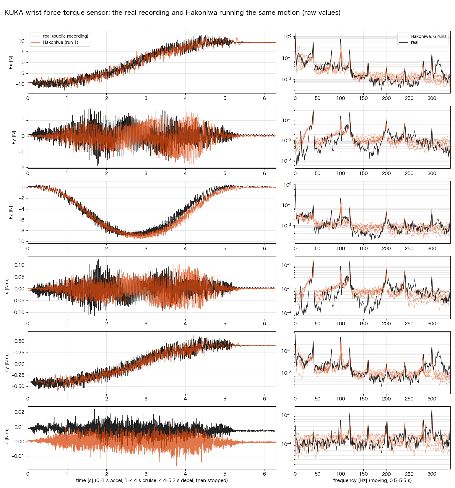
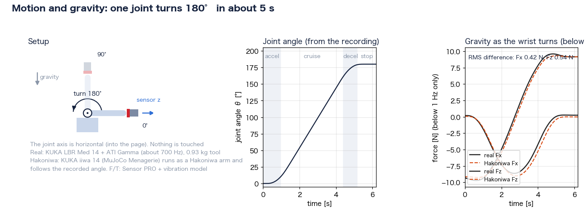
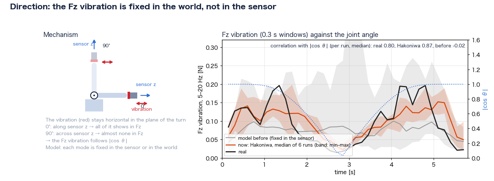
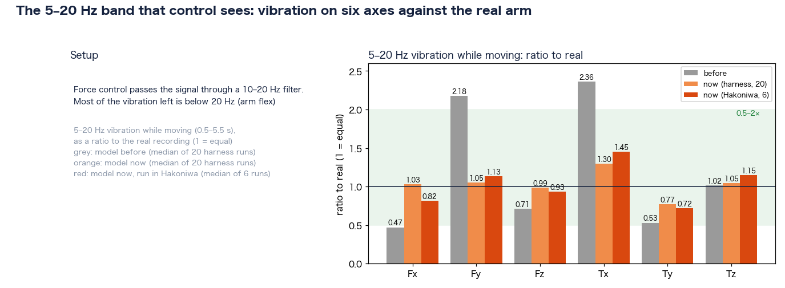
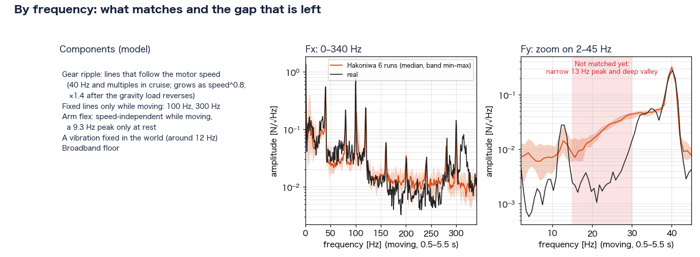

# Force-torque vibration: comparison with a real recording (KUKA, 2026-11-19)

English | [日本語](real-data-kuka.ja.md)

The wrist force-torque sensor of a robot shakes when the arm moves, even when nothing is touched. The causes are the gear ripple of the reducers, joint friction and the flex of the arm. The force a physics engine computes has none of this.

Hakoniwa adds this vibration to the truth with the [force-torque vibration model](../../spec/force-torque-vibration.md). This page fits that model to a public recording of a real arm, runs a KUKA arm in Hakoniwa, and compares the two.

## What was compared

| | Real | Hakoniwa |
|---|---|---|
| Arm | KUKA LBR Med 14 (7 axes) | KUKA iiwa 14 (the MuJoCo Menagerie model), an arm of the same family |
| Sensor | ATI Gamma (6 axes, about 700 Hz) | the Sensor PRO force-torque sensor (1 kHz output) + the vibration model |
| Tool | about 0.93 kg | 0.932 kg (mass and centre of mass from the real 24-pose calibration recording) |
| Motion | one joint turns 180° in about 5 s; nothing is touched | follows the recorded joint angle |
| Runs | two recordings of the same motion | 6 runs as a Hakoniwa robot arm (1 ms physics, real-time) |

- The real recording: Zenodo record 11096791 (CC BY 4.0).
- The vibration model was fitted to the moving part of the first recording. The second recording set the run-to-run spread, so no independent validation data are left.
- All comparisons are ratios Hakoniwa ÷ real; 1 is equal.

## Overview

- **How to read it:** left, the raw values (black real, red Hakoniwa run 1); right, the amplitude by frequency while moving (0.5–5.5 s; the thin red lines are the 6 Hakoniwa runs).
- **Result:**
  - The slow change (gravity turning with the wrist) overlaps.
  - In the vibration, the lines at 40 Hz and its multiples, 100 Hz and 300 Hz, and the floor between them overlap on all six axes.
  - In the raw Tz, only the real trace sits about 0.008 N·m higher. It is what is left of the sensor's zero offset and does not affect the vibration comparison.

## Measurement cards

### Motion and gravity

- **Measured:** one joint turns 180° in about 5 s (1 s acceleration, cruise, deceleration, stop). Gravity turns as seen from the sensor.
- **How to read it:** centre, the joint angle; right, Fx and Fz below 1 Hz (the vibration removed).
- **Result:** the RMS difference between real and Hakoniwa is 0.42 N in Fx and 0.54 N in Fz, against a change of ±10 N. The vibration is compared with this gravity layer removed.

### Direction of the vibration

- **Measured:** the 5–20 Hz amplitude of Fz in 0.3 s windows while moving, against the joint angle θ.
- **How to read it:** black real; red Hakoniwa (median of 6 runs, band min–max); grey the model before, with every mode fixed in the sensor (20 runs). The blue dotted line is |cos θ|.
- **Result:**
  - The real Fz vibration is large near 0° and 180° and almost gone near 90°. Its correlation with |cos θ| is 0.80.
  - This fits a vibration whose direction is fixed in the world, horizontal in the plane of the turn (the sketch on the left). A vibration fixed in the sensor does not change with the angle this way (the model before: −0.02).
  - Each mode of the model can now be fixed in the sensor or in the world (`"frame": "world"`); the host passes the sensor orientation every step. Hakoniwa gives 0.87.

### The 5–20 Hz band that control sees

- **Measured:** the 5–20 Hz vibration on six axes while moving (0.5–5.5 s), against the real arm. Force control filters the signal at 10–20 Hz, so most of the vibration it sees is in this band.
- **How to read it:** grey the model before, orange the model now (both the median of 20 runs of a harness that runs the vibration model alone); red the model now run as a Hakoniwa robot (median of 6 runs). The green band is 0.5–2×.
- **Result:**
  - From 0.47–2.36× with the model before to 0.72–1.45× in Hakoniwa.
  - After a 20 Hz filter in cruise, the real value lies inside the 5–95 % range of the 20 harness runs on all six axes. The median of the 6 Hakoniwa runs is 0.73–1.28× the real value.

### By frequency

- **Measured:** the amplitude by frequency while moving (0.5–5.5 s).
- **How to read it:** the text on the left lists the components of the model; centre, Fx in full; right, Fy zoomed on 2–45 Hz.
- **Result:**
  - The gear lines, the fixed lines and the floor overlap.
  - Fy between 15 and 30 Hz does not match (red band). The real arm has a narrow peak at 13 Hz and a deep valley above it; Hakoniwa is smooth and about 5× higher at 20 Hz. Tx is the same.

## What the recording showed

The form of the model comes from what was checked in the recording. Before each change the pass criteria were written down, and they were not changed afterwards.

| Finding | Evidence in the recording | Form in the model |
|---|---|---|
| The direction of the vertical vibration is fixed in the world | the Fz vibration follows \|cos θ\| (correlation 0.80) | mode direction `"frame": "world"` |
| The arm-flex vibration does not depend on speed while moving | about the same at 4°/s and 45°/s (speed^0.12) | a constant level while moving (`per_motion`) |
| The sharp 9.3 Hz peak at rest disappears when the arm moves | a sharp peak at rest, flat over 4–15 Hz while moving | a factor while moving (`at_rest_while_moving`) |
| The gear ripple grows with speed | line amplitude about speed^0.8 (the literature says constant) | speed exponent (`exponent`) |
| Slow gear lines do not show at 5–20 Hz | no low line following the speed in acceleration and deceleration | weakened at low frequency (`deadband_hz`) |
| The gear ripple grows when the gravity load reverses | the 40 Hz line ×1.36 and ×1.49 (both recordings) | load-direction gain (`load_gain`); Hakoniwa gives ×1.37 |
| The 100 Hz and 300 Hz lines appear only while moving and do not move in frequency | 99.8–100.0 Hz and 299.7–299.9 Hz in acceleration, cruise and deceleration | fixed-frequency modes |

Ideas that were checked and failed are kept too. "Friction that grows at low speed (Stribeck)" failed; the Fz change came from the direction. A 43.6 Hz line, produced by the analysis window, was not there at a finer resolution.

## Running in Hakoniwa keeps the accuracy

The vibration model is first fitted with a small harness. We checked that running it as a Hakoniwa robot (start-up, trajectory commands, controller, sensor, recording of the output) gives the same result.

- With the run-to-run spread switched off, 3 runs each: Hakoniwa ÷ harness is 0.89–1.10 on every band and axis.
- The gravity layer differs by 0.005–0.018 N.

## What does not match

- The shape of Fy and Tx between 15 and 30 Hz (the frequency card above).
- Tz during acceleration is 0.35–0.56× the real value. Fz after the stop is about 2× (the model has no stiffening of the joints at rest).
- Fy and Tx during acceleration and deceleration are 1.3–1.5× the real value after a 20 Hz filter.
- The arm-flex frequency moves with the pose on the real arm (7.6–9.8 Hz); the model keeps the frequency fixed.
- The world-fixed direction is inferred from the recordings of a single motion.
- A public data set of another arm (Franka, REASSEMBLE, CC BY 4.0) was also examined. Contact vibration during the task was too large to separate motion vibration or gear lines; it neither confirms nor rejects the model.

Settling these needs recordings at other speeds, of other joints, and repeated.

## Method

- Before analysis, a 3 Hz high-pass (4th order, zero phase) is applied to both real and Hakoniwa to remove the turning of gravity.
- A band amplitude is the square root of the Welch power density summed over the band.
- "After a 20 Hz filter" is a 2nd-order Butterworth, zero phase.
- The Hakoniwa recording is the wrist wrench (1 kHz) on the PDU, read from outside. 0.07 % of the samples were missing and were filled from their neighbours.
- Time was aligned where the gravity layer overlaps the harness best (a shift of about 0.3 s).
