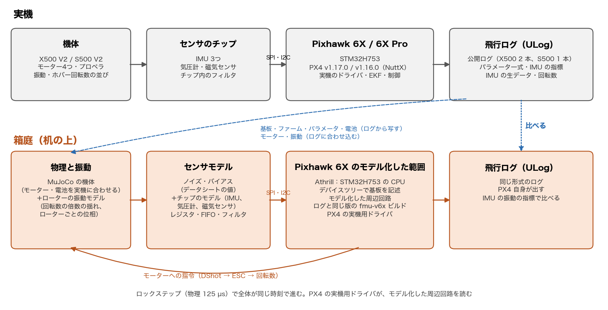
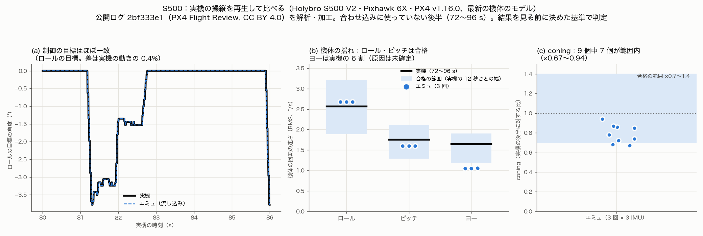
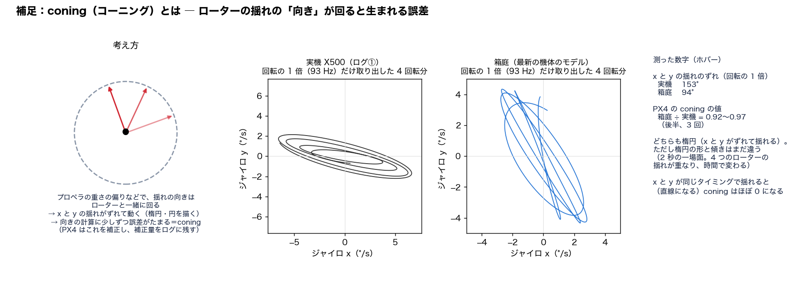
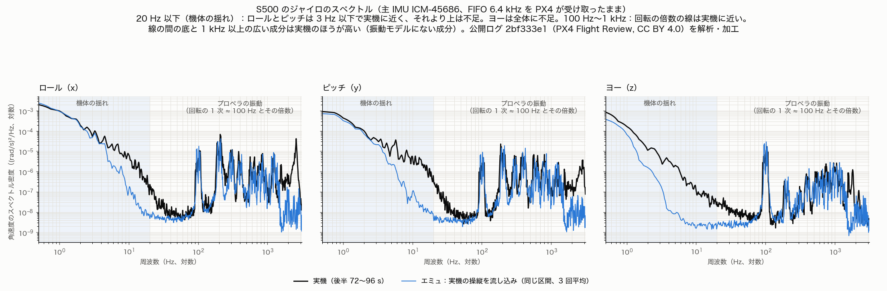
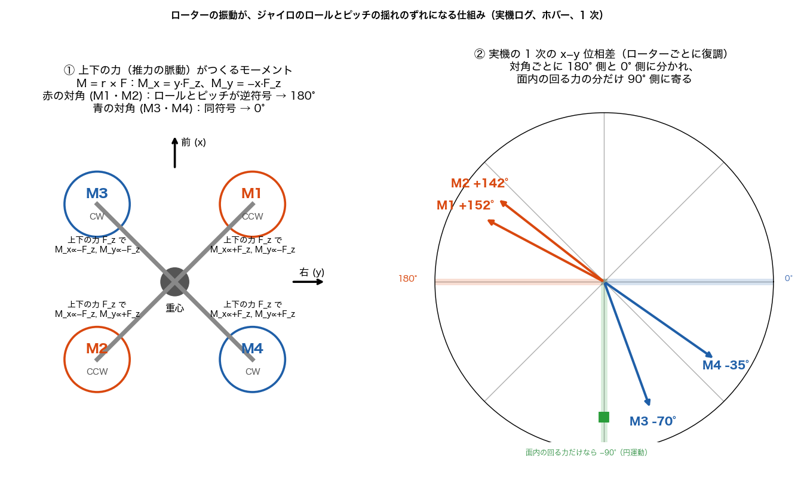
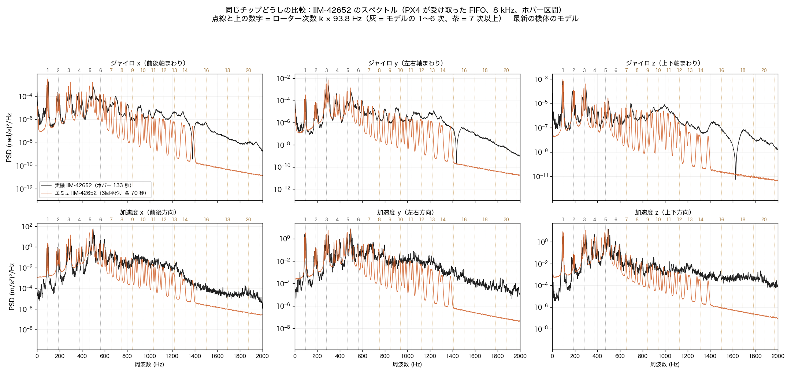

# シミュレーションは、実機にどこまで近づけるか
### 振動と PILS で一歩進めた箱庭を、PX4 の公開ログ（X500 V2・S500 V2）で確かめた

[English](README.md) | 日本語

## 概要
シミュレーションと実機には、必ず差があります。実機を丸ごと再現しようとすれば、計算量と複雑さで破綻します。一方、Gazebo や AirSim などの一般的なシミュレータは、速く、広い範囲を試せるように作られています。そのぶん、ローターの振動が IMU に乗るところや、ファームの中のセンサの経路は、通常は簡略化されています。

箱庭は、その間で、ローターの振動が IMU に乗るところに絞って一歩進めました。手法は次の2つです。
- **振動**：IMU に届くローターの振動を、実機ログから合わせ込む。
- **PILS**：実機用のファームを、エミュレートしたマイコンとセンサのチップの上で、そのまま動かす。

この2つの再現手法を使って、実機ログとどこまで照合できるかを、2機種の公開されている実機ログで検証しました。検証のしかたが妥当かどうかも、あわせて示します（4 節）。見たのは、ローターの振動が IMU にノイズとして現れるところです。飛行制御の心臓部である IMU に、ローターの振動がどれだけ乗るかを、PX4 自身が計算してログに残す値で比べました。同じ飛行の、合わせ込みに使っていない後半では、振動の値は 2機種とも実機の 1 割前後でした。一方、同じ機体の別の飛行では加速度と coning が外れ、人が操縦した S500 のヨーの揺れは実機の 6 割に留まりました。合ったところと、残った差の両方を示します。

※ coning（コーニング）：機体が2つの軸で同時に細かく揺れると、向きの計算にたまる誤差の補正量です。詳しくは「補足：coning とは」を見てください。

## 1. シミュレーションと実機は、どこでずれるのか
シミュレーションと実機には、必ず差があります。原因はいくつもあります。

- **プロペラの空気力学**：回転数と推力・トルクの関係、上昇や前進で変わる流入、地面効果、プロペラどうしの干渉
- **構造**：フレームのしなりと共振、モーターの取り付け、フライトコントローラの防振
- **動力**：モーターの効きと遅れ、ESC、電池の電圧の下がり方、プロペラの個体差
- **機体**：質量、慣性、重心
- **環境**：風、乱流
- **センサ**：ノイズ、バイアス、温度、振動の拾い方
- **ファーム**：ドライバや RTOS の処理のタイミング

**丸ごと再現すると破綻します。** プロペラのまわりの流れを CFD で、フレームの共振を構造解析で解き、それを飛行制御と同じ時間で回すのは、計算量の面でも、合わせ込む項目の多さの面でも現実的ではありません。それに、どこまで細かく作っても、最後は実機のデータで合わせる必要があります。

**一般的なシミュレータは、目的に合わせて簡略化しています。** Gazebo や AirSim で PX4 の SITL を動かす構成は、速く、広い範囲を試せるように作られていて、制御のアルゴリズムの開発や自動テストに向いています。そのぶん既定の構成では、機体は剛体、推力は回転数で決まり、センサの値はシミュレータから PX4 に直接渡されます。ローターの振動が IMU に乗るところや、センサのチップとドライバの経路は、通常は簡略化されています（作り込めば振動やノイズを足すこともできます）。

それでも、シミュレーションには価値があります。壊さずに何度でも、条件をそろえて、ハードができる前に試せます。ただしそれは、**どこが実機に近く、どこがまだ違うのかが分かっている場合**に限られます。

## 2. 箱庭の手法：振動と PILS で、一歩進める

箱庭は、全部を物理から作るのではなく、飛行制御のソフトが受け取る世界を実機に近づけることに絞りました。

- **振動（IMU に届くものを、実機ログから合わせ込む）**：機体には、モーターの回転数の倍数で揺れる振動を、モーターごとのタイミングつきで重ねます。プロペラの空気力学や構造の共振を物理から解くのではなく、それらが IMU に現れた結果を、実機ログから経験的に合わせ込みます。
- **PILS（実機用のファームを、エミュレートしたマイコンで動かす）**：Athrill が、Pixhawk 6X のマイコン STM32H753 の命令を1つずつ実行し、実機用にビルドした PX4（RTOS の NuttX を含む）がそのまま動きます。IMU のチップは、データシートの公称の特性から、周期、FIFO、内部フィルタまで作っています。実機と同じ PX4 のドライバが、エミュレートしたバス（SPI・I2C・DMA・割り込み）を通してチップを読みます。
- 物理（125 µs 刻み）、センサ、CPU は、同じシミュレーションの時計で進みます。

**先行事例**：この2つの考え方は、箱庭のオリジナルではありません。ArduPilot がすでに両方を持っています。
- **振動**：ArduPilot の SITL には、モーターの回転に合わせた振動を IMU の値に足すパラメータがあります（`SIM_VIB_MOT_MAX`、`SIM_VIB_FREQ`、`SIM_VIB_MOT_MULT` など）。
- **エミュレートしたマイコンでの飛行**：ArduPilot の本家は、加工していないファームを Renode（マイコンのエミュレータ）の上で動かし、SITL の物理とつないで飛ばしています（2026 年 9 月・10 月にマージ）。センサのチップもエミュレートしています。

箱庭が今回やったのは、この2つを PX4 で組み合わせ、振動を実機ログから次数ごと・軸ごと・モーターごとのタイミングまで合わせ込み、それを公開されている実機ログで照合したことです（私たちが調べた範囲で）。

何を物理として作り、何をログから合わせ、何はまだ入っていないかを分けると、次のとおりです。

| 原因 | 箱庭での扱い |
|---|---|
| プロペラの空気力学 | 推力とトルクは回転数で決まる単純なモデル。流入、地面効果、干渉は入っていない |
| 構造の共振 | 物理としては入っていない（機体は剛体）。IMU に現れる振動として、ログから合わせ込む |
| 動力 | モーターの効きと遅れ、電池の電圧の時間変化、ローターごとの差を、ログから合わせ込む |
| 機体 | 寸法と質量は仕様とログから。回転数の差は等価な重心のずれ、またはローターごとの係数で表す |
| 環境 | 風は機体の中心を押すだけで、ヨーは回さない |
| センサ | チップのモデル（データシートの公称の特性）。振動はログから合わせ込む |
| ファーム | 実機用のファームと PX4 のドライバを、そのまま動かす（PILS） |

この2つの再現手法で、実機ログとどこまで照合できるかを検証したのが、ここから先です。検証のしかたが妥当かどうかも、4 節に書きます。

## 3. 何を見たか：ローターの振動が、IMU のノイズとして現れるところ
IMU は、飛行制御の心臓部です。PX4 は、ジャイロと加速度の値から姿勢を推定し、ジャイロの値でレート制御を回します。ローターの振動は、IMU にはノイズとして乗り、推定と制御を乱します。**シミュレーションの IMU に乗るノイズが実機と違えば、その先の結果はすべて疑われます。**

そこで、ローターの振動が IMU にノイズとしてどれだけ、どう乗るかを、PX4 が IMU ごとに計算してログに残す次の値で比べました。実機とエミュで、**同じ PX4 のコードが計算した値**を比べられます。

| 値 | 何を表すか | 何の確かめになるか |
|---|---|---|
| 振動の指標（ジャイロ、加速度） | IMU の値に乗ったノイズの大きさ（数 ms ごとの値の揺れ）。主にローターの回転の 1 次（約 100 Hz）で決まる | 振動モデルの大きさ |
| coning | 積分器が補正する、軸どうしの揺れのずれ | 振動の軸どうしのタイミングと、ドライバが何サンプルずつまとめて積分するか（PILS の経路） |
| 機体の揺れ | ロール・ピッチ・ヨーの回転の速さ | 制御、機体、外からの力。入力をそろえられたときだけ比べられる |

## 4. どう確かめたか
| 確かめたいこと | どうしたか | どこまでできたか |
|---|---|---|
| 1つの機体に合わせただけではないか | 基板の版、IMU、ファームの版、飛び方の違う2機種（X500 V2、S500 V2）で、同じ手順を使った | 2機種。どちらもクアッドのホバー |
| 合わせ込んだデータで比べているだけではないか | 振動は前半だけで合わせ込み、後半と比べた。X500 は、同じ日の別の飛行とも比べた | 別の飛行で比べたのは X500 の1本だけ（もう1本は今回は測っていない）。S500 は公開ログが1本しかなく、1回の飛行の中の比較 |
| 入力が違えば比べられないのではないか | 実機の飛び方に合わせて、エミュの飛ばし方を変えた（下の表） | S500 は制御の目標値がほぼそろった。X500 はそろえられないので、機体の揺れは比べていない |
| 偶然ではないか | エミュは各 3 回動かし、範囲を示した | 振動の指標の幅は数 %。coning は回ごとに 3 割ほど動く |
| 他の人が確かめられるか | 実機ログは PX4 Flight Review の公開ログ。使ったファームも公開 | 振動モデルとチップのモデルは非公開（7 節） |

2つの実機は飛び方が違うので、エミュの飛ばし方を変えています。これが、この照合の手法の前提です。

| | X500 V2 | S500 V2 |
|---|---|---|
| 実機の飛び方 | 外部のプログラムが位置を指示してホバー（Offboard）。ログに操縦は残っていない | 人がスティックで操縦（Stabilized）。機体は操縦に合わせて絶えず揺れている |
| エミュの飛ばし方 | MAVLink から自動ホバーを指令 | 10 m まで自動で上げ、そこから実機のスティック指令（スロットルを含む）をログから作り直して再生 |
| 比べられるもの | 振動の指標と coning（coning は機体の揺れの違いの影響が残るので、振動の指標ほど確かではない） | 振動の指標、coning、機体の揺れ |

coning は、機体の揺れと振動の掛け合わせで大きくなります。操縦で揺れている S500 を、静かにホバーするエミュと比べても意味がないので、S500 では操縦を再生して入力をそろえました。

## 5. 結果：どこまで実機に近づき、何が残ったか
数値は、すべて最新の機体のモデル（モーターと電池を実機に合わせた版）で、振動の合わせ込みに使っていないデータと比べたものです（エミュ 3 回の範囲）。

| 実機のログ | 振動の指標（ジャイロ／加速度） | coning | 機体の揺れ |
|---|---|---|---|
| X500 ログ①（後半） | ×0.97〜1.01 ／ ×0.95〜0.98 | ×0.91〜0.97 | 比べられない（入力をそろえられない） |
| X500 ログ②（同じ日の別の飛行。合わせ直していない） | ×0.96〜1.00 ／ ×0.82〜0.88 | ×0.64〜0.72 | 同上 |
| S500 ログ（後半） | ×0.93〜1.08 ／ ×0.92〜1.13 | 9 個中 7 個が ×0.7〜1.4 に入る（×0.67〜0.94） | ロール・ピッチは基準内。**ヨーは実機の 6 割** |

- **合ったこと**：同じ飛行の後半では、振動の指標は 2機種とも実機の 1 割前後です。S500 では、操縦を再生すると、制御の目標値がほぼ実機と同じになり、ロールとピッチの揺れも実機の範囲に入りました。
- **残ったこと**：S500 のヨーの揺れが実機の 6 割です。原因はまだ分かっていません（12 節）。振動のスペクトルでは、6 次（約 560 Hz）より上と、1 kHz より上に広く分布する振動が実機より小さく出ます。X500 の別の飛行（ログ②）では、加速度の振動が実機の 8 割台、coning が 7 割前後でした。このログ②の実機は、ログ①より回転数が 5〜7 % 低く、機体もよく動いていました（10 節）。実機の coning は同じ日の飛行ごとに約 4 割ばらつき、それを予測できるかはまだ言えません。

## 6. この結果で言えること、まだ言えないこと
| 項目 | 今回の結果 |
|---|---|
| 飛行ログから、機体の構成とパラメータを読み取って組む | できた（基板の版、ファームの版、パラメータ一式、電池の電圧） |
| 実機用のファームとパラメータを、そのまま机の上で動かす | できた（ログと同じ版の PX4 を fmu-v6x 向けにビルド） |
| ローターの振動が IMU に乗るノイズを、実機ログに合わせる | できた。同じ飛行の、合わせ込みに使っていない後半でも 1 割前後 |
| 操縦の記録された飛行を、机の上で再生する | S500 で示した |
| 別の飛行の振動を予測する | まだ。X500 ログ②では、ジャイロは合ったが、加速度と coning は外れた。ログ①の実測値をそのまま使うやり方より良いとは言えない |
| 機体の揺れ全体（特にヨー）を実機と合わせる | まだ。S500 のヨーは実機の 6 割 |
| パラメータを変えたときの変化を、実機の変化として予測する | 今回は確かめていない |
| 突風、磁気、電源、構造の共振などの不調の再現 | 今回の範囲の外 |

## 7. 自分の機体で試すには：どんなログが要るか
今回の照合は、公開ログだけでできました。同じことをするには、ログに次の記録が要ります。

| 必要なもの | 何に使うか | PX4 での記録 |
|---|---|---|
| PX4 のログ（.ulg） | すべて | 標準 |
| 基板の版、ファームの版、パラメータ一式 | 同じ構成を組む | 標準で自動的に入る |
| 落ち着いたホバー（目安は 1 分程度。今回の S500 は約 50 秒で行った） | 合わせ込む区間と、比べる区間に分ける | 飛び方（X500 は約 130 秒、S500 は約 50 秒） |
| モーターの回転数 | 振動を回転数の倍数に分ける。モーターの効きを合わせる | `esc_status`（ESC のテレメトリか、双方向 DShot） |
| IMU の生データの高頻度記録 | 振動の大きさとタイミングを合わせ込む | `SDLOG_PROFILE` の「raw FIFO high-rate IMU」（`sensor_gyro_fifo`、`sensor_accel_fifo`） |
| 電池の電圧 | 電池の電圧の時間変化を与える | 標準（`battery_status`） |
| 人が操縦した飛行なら、姿勢と推力の目標値 | スティック指令を作り直す | 標準 |
| 同じ機体・同じ状態での別の飛行 | 合わせ込みに使っていない飛行で比べる | 同じ日に、続けて飛ばしたもの |

回転数と高頻度の生データまで入った公開ログは、多くありません。今回の 2機種は、それが入っていたから選べました。S500 のログにはジャイロの生データしかなく、加速度の振動は、X500 のジャイロに対する比を借りて形を見積もり、その大きさを S500 の前半の加速度の指標に合わせて 0.70 倍にそろえました。そのため、S500 の加速度の指標は、同じ飛行の前半で合わせた値を後半で比べたものです。

基板は、エミュレートしているもの（今は Pixhawk 6X / 6X Pro の一部のリビジョン、6C、Pixhawk 4）である必要があります。公開しているのは、実機ログの ID と、使ったファームです。振動モデル、センサモデル、チップのモデルは非公開です（参照）。

自分の機体のログで試したい、詳しい話を聞きたい、という方は、箱庭ラボまでお問い合わせください。
- 箱庭ラボ：https://hakoniwa-lab.net
- お問い合わせ：https://hakoniwa-lab.net/contact/

## 補足：coning とは

- **何か**：ローターの揺れの向きは、プロペラの重さの偏りなどで、ローターと一緒に回ります。すると、ジャイロの x と y の揺れがずれて動き、x–y の図では楕円や円を描きます。こういう揺れの中で角速度を積み上げて機体の向きを求めると、少しずつ誤差がたまります（軸の先が円すいを描くような動きになるため、coning と呼ばれます）。PX4 はこの誤差を補正していて、その補正量をログに残しています。
- **なぜ見るか**：振動の指標は「揺れの大きさ」で決まりますが、coning は「x と y の揺れのタイミングのずれ」で決まります。x と y が同じタイミングで揺れる（図で直線になる）と、揺れが大きくても coning はほぼ 0 です。なので coning が実機と合うかどうかで、振動の向きとタイミングまで再現できているかが分かります。
- **今回の状態**：X500 のログ①では、実機も箱庭も楕円を描き、PX4 の coning の値は実機の 0.92〜0.97 倍でした。ただし、楕円の形と傾きはまだ違います（回転の 1 倍での x と y のずれは、実機 153°、箱庭 94°。図は 2 秒の一場面で、4 つのローターの揺れが重なって時間で変わります）。

---

## 8. 詳細：比べた実機
| 項目 | X500 V2 | S500 V2 |
|---|---|---|
| 基板 | Pixhawk 6X Pro（センサセットのリビジョン `V6X006`） | Pixhawk 6X（リビジョン `V6X008`） |
| ファーム | PX4 v1.17.0（コミット `d6f12ad1c4f7`） | PX4 v1.16.0 |
| IMU | ADIS16470（主）、IIM-42652、ICM-45686 | ICM-45686 × 3 |
| そのほかのセンサ | 気圧計 ICP201xx・BMP388、磁気センサ BMM150 | 気圧計 ICP201xx、磁気センサ BMM150、GNSS |
| パラメータ | 1,109 個 | 1,145 個 |
| 電池 | 6 セル | 4 セル |
| 飛び方 | 屋内。外部ビジョンで位置を取り、Offboard で飛行。180 秒 | 屋外。Stabilized で手で操縦。空中にいたのは約 56 秒 |
| 使ったログ | ① 75ac4a47（振動の合わせ込みと照合）、② 14600267（同じ日の別の飛行。照合だけ） | 2bf333e1（公開されている3つは同じ飛行） |
| エミュで作ったもの | IMU は ADIS16470 と IIM-42652 の2つ（ICM-45686、BMP388、Ethernet、PX4IO は作っていない） | IMU 3つ |

「Pixhawk 6X」というだけでは足りません。センサセットのリビジョンごとに IMU の組み合わせが違うので、リビジョンまで合わせて初めて、同じチップどうしで比べられます。同じ X500 のログは、ほかの日のものもありますが、日によってホバーの回転数や振動が数倍変わっていて（モーターかプロペラ、または設定が変わっている）、別の状態の機体なので使っていません。

## 9. 詳細：照合の手順
| 種類 | 内容 |
|---|---|
| ログから写した | 基板のリビジョン、ファームの版、パラメータ一式（変えられないものは理由つきで上書き：推定の入力元、ESC の方式、ポート、RC と電源のチェック、センサの校正の値、磁気偏角）、電池の電圧の時間変化 |
| データシートの値 | チップのノイズ、周期、内部フィルタ |
| 同じログに合わせ込んだ | モーターの抵抗とモーター定数（ホバーの指令と回転数の関係から）。4つの回転数の差（X500：推力の特性が同じと仮定した等価な重心のずれ、前に約 1.0 cm・右に約 1.1 cm。S500：ローターごとの効きの係数）。振動の次数ごと・軸ごとの大きさと回転数への依存、モーターごとの振動のタイミング（付録 A）。S500 の加速度の振動は、X500 のジャイロに対する比を借り、前半の加速度の指標に合わせて 0.70 倍にそろえた。**振動はホバー区間の前半だけ**で合わせ込んだ |
| 合わせ込まずに出てきた | 振動の指標と coning、エミュの中のモーターの回転数と指令、機体の揺れ |

- **比べ方**：各飛行のホバー区間で `vehicle_imu_status` の値の中央値を取り、実機の中央値との比にしました。ホバー区間は、離陸の 10 秒後から着陸の 5 秒前まで、水平速度 1 m/s 未満、上下速度 0.5 m/s 未満、ヨーの角速度 10 °/s 未満のところです。
- **3 回の幅**：振動のタイミングのゆらぎ（乱数）の種と、ホストから送る MAVLink の指令が届くシミュレーション時刻は、回ごとに違います。そのため、繰り返した飛行はビット単位では同じになりません。
- **別の飛行との照合（X500 ログ②）**：パラメータはログ①と同じ（違いは 0 個）です。電池の電圧の時間変化だけをログ②から写し、振動モデルと機体は合わせ直していません。
- **S500 の操縦の再生**：200 Hz で残っている姿勢と推力の目標から、PX4 v1.16 の Stabilized でスティック指令を目標値に変える計算を逆にたどり、`rc_update` 後のスティック指令を作り直しました。ログにある 31 Hz の `manual_control_setpoint` とは、ログの時刻で RMS 差 0.00005 未満で一致します（逆算した値を元の計算に戻すと合う、という確認）。±0.1 のデッドゾーン内のヨーは元に戻せないため 0 としました（PX4 の出力には影響しません）。エミュの基板に置いた CRSF の受信機モデルが、物理と同じ時計で CRSF フレームを UART から送ります。無線リンク、パケット損失、受信機側のタイミングは再現していません。実機時刻 46〜98 秒の指令を流し、後半の 72〜96 秒で比べました。結果を見る前に確かめた制御の目標値の差は、姿勢（ロール・ピッチ）0.4 %、ヨーの回転 0.1 %、推力 6 %（平均は一致）です。

## 10. 詳細：X500 の結果
**ログ①の後半（振動の合わせ込みに使っていない区間）**

| 実機に対する比（エミュ3回の範囲） | ジャイロの振動 | 加速度の振動 | coning |
|---|---|---|---|
| ADIS16470（主 IMU） | ×0.99〜1.01 | ×0.97〜0.98 | ×0.92〜0.97 |
| IIM-42652 | ×0.97〜0.99 | ×0.95〜0.96 | ×0.91〜0.94 |
| 実機の値（ADIS16470、後半） | 0.134 rad/s | 8.93 m/s² | 5.80 × 10⁻⁸ |

| ホバー中 | 実機 | エミュ（3回） |
|---|---|---|
| モーターへの指令（4つ） | 0.71 / 0.60 / 0.63 / 0.64 | 0.70 / 0.60 / 0.65 / 0.65 |
| 回転数（4つ） | 5880 / 5208 / 5420 / 5477 rpm | 実機と 1.5 % 以内 |
| 機体の揺れ（ロール／ピッチ／ヨー） | 1.9 / 1.4 / 1.4 °/s | 0.5 / 0.9 / 0.1 °/s |

- 実機の前半と後半は、指標がもともと 0〜7 % しか違いません。ホバー中の振動は時間がたってもあまり変わらないので、前半と後半に分ける確かめは弱めです。
- 振動の大きさは主に IIM-42652 の生データから合わせ込んだので、IIM-42652 の指標が合うことは、半分は当然です。
- 振動モデルの候補を選ぶとき、ADIS16470 の結果を見て、ある補正を採用しませんでした（付録 B）。ADIS16470 の結果はモデル選びにも使っています。
- 機体の揺れは実機より小さいままです。入力をそろえられないので、比べる条件になっていません。coning は機体の揺れと振動の掛け合わせで決まるので、coning の一致（×0.91〜0.97）は、振動の指標の一致ほど確かなものではありません。

**ログ②（同じ日の別の飛行）**：振動モデルと機体はログ①のまま合わせ直さず、電池の電圧の時間変化だけをログ②から写して、3 回飛ばしました。

| 実機に対する比（エミュ3回の範囲） | ジャイロの振動 | 加速度の振動 | coning |
|---|---|---|---|
| ADIS16470（主 IMU） | ×0.96〜0.97 | ×0.86〜0.88 | ×0.66〜0.72 |
| IIM-42652 | ×0.98〜1.00 | ×0.82〜0.85 | ×0.64〜0.70 |
| 比較：ログ①の実測値をそのまま使った場合（ADIS16470） | ×0.97 | ×0.90 | ×0.76 |

| ホバー中 | 実機（ログ②） | エミュ（3回） |
|---|---|---|
| モーターへの指令（4つ） | 0.67 / 0.58 / 0.60 / 0.63 | 0.71 / 0.61 / 0.66 / 0.66 |
| 回転数（4つ） | 5506 / 4936 / 5126 / 5295 rpm | 5920 / 5235 / 5569 / 5607 rpm（ログ①とほぼ同じ） |
| 機体の揺れ（ロール／ピッチ／ヨー） | 2.9 / 2.5 / 3.3 °/s | 0.5 / 0.9 / 0.1 °/s |
| ホバー区間の長さ | 47 秒 | 約 70 秒 |

- ジャイロの振動は、合わせ直さなくても実機の 4 % 以内でした。加速度は実機の 8 割台、coning は 7 割前後で、外れました。
- ログ①の実測値をそのまま予測に使うやり方と比べて、エミュのほうが当たったとは言えません。
- 実機のログ②は、パラメータはログ①と同じ（違いは 0 個）で、電池の電圧もほぼ同じなのに、回転数が 5〜7 % 低く、モーターへの指令も低くなっています。推力が少なくて済んでいた（たとえば機体が軽かった）可能性がありますが、ログからは確かめられません。エミュの回転数はログ①と同じなので、この差は入っていません。回転数は比べる側の値なので、それに合わせてエミュの機体を変えることはしていません。
- 実機のログ②は、ホバー区間の中でも機体がよく動いていました（揺れはログ①の約 2 倍）。coning は機体の揺れと振動の掛け合わせで大きくなるので、エミュの coning が低いことの一因と考えられます。X500 は操縦がログにないので、入力をそろえて確かめることはできません。

## 11. 詳細：S500 の結果
| 項目 | 実機（後半 72〜96 秒） | エミュ（3 回） | 判定（結果を見る前に決めた基準） |
|---|---|---|---|
| ロールの揺れ（RMS） | 2.57 °/s | 2.68 °/s | 合格（実機の 12 秒ごとの範囲 1.9〜3.2） |
| ピッチの揺れ | 1.76 °/s | 1.60 °/s | 合格（1.3〜2.1） |
| ヨーの揺れ | 1.65 °/s | 1.05〜1.06 °/s | 不合格（×0.64） |
| coning（3 IMU × 3 回） | ― | ×0.67〜0.94 | 9 個中 7 個が ×0.7〜1.4 |
| ジャイロの振動 | ― | ×0.93〜1.08 | ― |
| 加速度の振動 | ― | ×0.92〜1.13 | ― |

- coning は、実行ごとに乱数の種を変えて振動のタイミングをずらしたため、回ごとに 3 割ほど動きます。
- 高さは、52 秒の指令を流しても 7.9〜11.5 m に収まり、最後は出発点の高さに戻りました。推力の 0.5 % 程度の差でも数秒で開くので、判定には使っていません。

20 Hz 以下の機体の揺れは、ロールとピッチが 3 Hz 以下で実機に近く、それより上は不足しています。ヨーは全体に不足しています。100 Hz〜1 kHz の回転の倍数の線は、位置も高さも実機に近いです。線と線の間の底と、1 kHz より上に広く分布する振動は、実機のほうが大きく、今の振動モデルにはありません。PX4 の振動の指標と coning は主に 100 Hz 前後の 1 次で決まるので、この差の影響は小さいです。

## 12. 詳細：残った違い（S500 のヨー）
制御の目標値がほぼ同じでも、ヨーの揺れは実機の 6 割です。実機のヨーには 0〜10 Hz のゆっくりした揺れが続いていて、制御の指令では説明できないヨーの角加速度は、実機 9.7 °/s²、エミュ 2.7 °/s² でした。

手元のログで、機体の側の効き（ヨーのトルクの指令 → 回転数、回転数 → ヨーの回転の加速度）を実機とエミュで比べると、選んだ帯域（0.5〜5 Hz）では 1.5 倍を超えるずれは見つかりませんでした。一方、実機のヨーには、制御の目標値と直線的に結びつかない動きが多くありました。これは、計測していない外からのヨーのモーメント（風など）と矛盾しません。ただし、PX4 の姿勢の推定（磁気センサによる向きの補正など）や、機体のモデルの違いとは、まだ分けられていません。原因は未確定です。今のモデルの風は機体の中心を押すだけでヨーを回さないので、次は、風がローターごと・機体の部分ごとに違って当たる働きをモデルに足して確かめます。

## 13. 詳細：SITL との違い
| | PX4 SITL（Gazebo などの既定の構成） | 今回の方式 |
|---|---|---|
| ファーム | パソコン用にビルドした PX4 | 実機用にビルドした NuttX のバイナリ |
| センサの値の届き方 | シミュレータの値を、PX4 のセンサの層に直接渡す | PX4 の実機用ドライバが、SPI・I2C・DMA・割り込みでモデル化したチップを読む |
| センサの周期 | シミュレータ側の設定（既定は数百 Hz 程度） | チップの周期（ADIS16470 2 kHz、IIM-42652 8 kHz、ICM-45686 6.4 kHz） |
| チップの FIFO・内部フィルタ | 通常は模擬しない | データシートの公称の特性で模擬する |
| 速さ | 速い。CI に向く | 遅い（実時間比 0.5〜1.06） |

SITL でも、IMU を複数にしたり、センサの周期を上げたり、振動を加えたりはできます。SITL のシミュレータ側に、チップの周期・まとめ方・フィルタを作り込むこともできます。それでも、次の点は SITL の作りでは残ります。
1. **値の届き方**：実機では、ドライバが割り込みを受け、SPI で FIFO から 10 サンプルずつまとめて読み、NuttX の上で処理します。PX4 が何サンプルずつ積分するか（coning の値に効く）は、このまとめ方と処理の順序で決まります。
2. **チップの中の処理**：チップは、値を取り出す前に内部でフィルタをかけます（IIM-42652 は PX4 が 585 Hz に設定）。これを SITL 側で作るのは、チップのモデルを書くことと同じです。
3. **基板の定義**：DMA の割り当て、SPI のビットの並び、ボードのリビジョンの判定は、実機用のファームの中にしかありません。今回、基板を組む途中で、TIM5 の DMA の要求番号の誤りを、PX4 が ESC に信号を出せないことから見つけました。

## 14. 限界
- 比べたのはどちらもクアッドのホバーだけです。
- X500：別の飛行と比べたのは1本だけです（同じ日のもう1本は、今回の版では測っていません）。その1本では、加速度と coning が外れ、回転数と機体の揺れも実機と違っていました。実機の coning は、同じ日の3本で 5.8〜8.2 × 10⁻⁸ とばらつき、最大は最小より 41 % 大きくなっています。予測できるかはまだ言えません。実機の IMU のうち、作ったのは2つです。機体の揺れは比べられていません。
- S500：公開ログが1本しかなく、1回の飛行の前半で合わせて後半で確かめただけです。ヨーの揺れの不足の原因は未確定です。効きの比べ方は、制御が働いている状態のデータでの推定です。ローターごとの係数は「回転数を多く要るプロペラは、推力もトルクも同じ割合で弱い」と仮定して決めました。
- 振動は、ログから合わせ込んだ経験的なモデルです。機体の物理は剛体のモデルで、フレームの共振や回転数のゆらぎは入っていません。6次（約 560 Hz）より上の振動は、実機より小さく出ます（付録 B）。
- 実機と同じ IMU 構成の版は、実時間より遅く動きます（X500 は実時間比 0.80、主の IMU だけの軽い版は 1.06。S500 は 0.53）。

## 15. 用語
| 用語 | 意味 |
|---|---|
| 箱庭（Hakoniwa） | 箱庭ラボが開発しているシミュレーション基盤。物理、センサ、制御のソフトを同じ時刻で結んで動かす |
| Athrill | マイコンの CPU の命令を1つずつ実行するエミュレータ（TOPPERS プロジェクト発）。今回は STM32H753 を動かす |
| PILS | Processor-in-the-Loop Simulation。実機用のファームを、エミュレートしたマイコンと周辺回路の上で動かし、物理シミュレーションとつなぐ方式 |
| ロックステップ | 物理（125 µs 刻み）・センサ・CPU が同じシミュレーション時計で進むこと |
| 実時間比 | シミュレーションの中の時間 ÷ 実際の経過時間。1.0 で実時間と同じ速さ |
| 振動の指標 | PX4 が IMU ごとに出す `vehicle_imu_status` の `gyro_vibration_metric` と `accel_vibration_metric`。連続する窓（今回は約 6 ms）ごとの平均の角速度または加速度の差の大きさを平滑した値。センサの周期とフィルタで値が変わるので、同じ IMU・同じ設定どうしでしか比べられない |
| coning | `delta_angle_coning_metric`。PX4 の積分器が出す coning 補正量の指標。実装に依存し、機体の物理的な coning そのものではない |
| 次数 | モーターの回転周波数の何倍の振動か。今回のホバーでは 1次が約 93〜100 Hz |

## 参照
### 公開されているもの
- 実機の飛行ログ（X500）：PX4 Flight Review の公開ログ、ログ ID `75ac4a47-a73a-44ea-8016-24d79a164147` と `14600267-e385-4ee0-b647-52a9be62dfea`（2026-10-30、Holybro X500 V2、Pixhawk 6X Pro）。
  ライセンス：[CC BY 4.0](https://creativecommons.org/licenses/by/4.0/)（Flight Review の「CC-BY PX4」）。このページの X500 の図と数値は、これらのログを解析・加工して作成したものです。ログのファイル自体は、このページでは配布していません。
- 実機の飛行ログ（S500）：PX4 Flight Review の公開ログ、ログ ID `2bf333e1-2eb9-4528-9e70-048c71cfa280`（2026-01-16、Holybro S500 V2、Pixhawk 6X、PX4 v1.16.0）。
  ライセンス：[CC BY 4.0](https://creativecommons.org/licenses/by/4.0/)（Flight Review の「CC-BY PX4」）。このページの S500 の図と数値は、このログを解析・加工して作成したものです。ログのファイル自体は、このページでは配布していません。
- PX4 v1.17.0：振動の指標と coning の計算（`src/modules/sensors/vehicle_imu/VehicleIMU.cpp`、`src/modules/sensors/Integrator.hpp`）、Pixhawk 6X のセンサの起動（`boards/px4/fmu-v6x/init/rc.board_sensors`）、IIM-42652 のドライバのフィルタの設定。PX4 v1.16.0：Stabilized のスティックの扱い（`src/modules/mc_att_control`）、RC の較正（`src/modules/rc_update`）、CRSF（`src/lib/rc/crsf.cpp`）
- データシート
  - Analog Devices ADIS16470 Rev. C
  - TDK InvenSense IIM-42652 DS-000440 Rev 1.0
  - TDK InvenSense ICM-45686
  - TDK InvenSense ICP-201xx DS-000416
  - Bosch Sensortec BMM150 DS001
  - STMicroelectronics RM0433（STM32H7）
- 使ったファーム（X500）：[athrill-target-stm32 のリリース px4-v1.17.0-fmu-v6x](https://github.com/hakoniwalab/athrill-target-stm32/releases/tag/px4-v1.17.0-fmu-v6x)（`px4_fmu-v6x_default.elf`、SHA-256 `91b6d066af9bb1eaec8baaa1ddb654df6625fb19cb19d95a70accc264329fb28`）。PX4-Autopilot のタグ v1.17.0、`px4io/px4-dev:v1.17.0-beta1` のコンテナで `make px4_fmu-v6x_default`。ライセンスは PX4-Autopilot の BSD-3-Clause と、各サブモジュールのライセンス
- 使ったファーム（S500）：[athrill-target-stm32 のリリース px4-v1.16.0-fmu-v6x](https://github.com/hakoniwalab/athrill-target-stm32/releases/tag/px4-v1.16.0-fmu-v6x)。PX4-Autopilot のタグ v1.16.0。Athrill v0.4.0 で動かすには、同じリリースの `px4_fmu-v6x_default-athrill.elf`（デバッグ情報を除き、.data の区間の大きさを直した版。コードとデータは同じ）を使います（SHA-256 `b8681c58a518351747f5a2f71b3e30abb9d3ddafd71fb1c0c39bf547166200ed`）。2026-11-22 以降の Athrill のコア（toppers/athrill#98）では、加工していない `px4_fmu-v6x_default.elf` がそのまま動きます
- Athrill（TOPPERS プロジェクト）
- ArduPilot の先行事例：SITL のシミュレーションのパラメータ（[Using Simulation Parameters to Control the Simulation](https://ardupilot.org/dev/docs/SITL_simulation_parameters.html)、`libraries/SITL/SITL.cpp` の `SIM_VIB_*`）。Renode 上の ArduPilot（ArduPilot PR #33975、#34785）

### 非公開の仕様（概要のみ）
- **振動モデル（Hakoniwa Drone PRO）**：モーターの回転数の次数ごとに、3軸それぞれの大きさと、回転数に対する増え方を持つ。モーターごとの振動のタイミング（位相）と、そのゆらぎも持つ。飛行ログから合わせ込める。
- **センサモデル（Hakoniwa Sensor PRO）**：IMU・気圧計・磁気センサ・GNSS。ノイズ、バイアスのふらつき、更新周期を、データシートの値から設定する。取り付け位置や向きも指定できる。
- **チップと基板のモデル**：チップごとに、レジスタ、FIFO、内部のフィルタ、割り込みのタイミングを、データシートの項目から作り、項目ごとにテストを持つ。基板はデバイスツリーで記述する。

## 付録 A：モーターごとの振動のタイミング（X500）

- **測ったこと**：モーターの回転数を使って、IIM-42652 の振動をモーターごとに分け（1次）、ロールとピッチの角速度の振動のタイミングの差（位相差）を求めた。
- **結果**：位相差はモーターごとにほぼ一定で、モーターごとに違う（M1 +152°、M2 +142°、M3 −70°、M4 −35°）。上下の力（推力の脈動）だけなら、対角ごとに 0° または 180° になる。面内の回る力は各対角の位相をずらし、その符号はローターの回転方向で変わる。図の −90° は、図で示した回転方向と符号規約の場合である。観測した値は、両方が混ざると考えれば説明できる。特に M3 は面内の力の寄与が大きい。M3 と M4 は回転数が近く（約 0.7 Hz 差）、分離の確かさは低い。
- **使い道**：振動モデルには、この位相をモーターごとに持たせている。coning は軸どうしのタイミングで決まるので、これが無いと coning の軸ごとの内訳が実機と合わない。

## 付録 B：振動のスペクトル（X500、IIM-42652 どうし）

- **測ったこと**：IIM-42652 のチップ内部のフィルタを通ったあとの FIFO のデータ（8 kHz）。ホバー区間、Welch 法（1 秒窓）。実機約 130 秒、エミュは最新の機体のモデルの 3 回の平均。
- **グラフの見方**：横軸は周波数、縦軸は揺れの強さ（パワースペクトル密度、対数）。点線と数字は、4つのモーターの平均の回転周波数（93.8 Hz）の何倍か。実際の4つのモーターは 89〜100 Hz にばらついているので、高い次数ほど山は横に広がります。
- **結果**：ジャイロでは、1〜5次（〜470 Hz）の大きさは実機の ×0.88〜1.20。6次より上はエミュが低い（6次 ×0.59、10次 ×0.42、14次 ×0.28）。振動モデルは 14 次（約 1310 Hz）までなので、それより上は急に落ちる。エミュは回転数がほぼ一定なので、山と山の間の谷が実機より深い。
- **6次より上が低い理由**：振動モデルの大きさを、チップのフィルタを通ったあとの実機のデータから取ったため、エミュのチップでもう一度フィルタがかかっている。実機のデータから、フィルタの分を戻して見積もり直す補正も試したが、確かめ役の ADIS16470 の coning がかえって実機から離れたので、採用していない。
