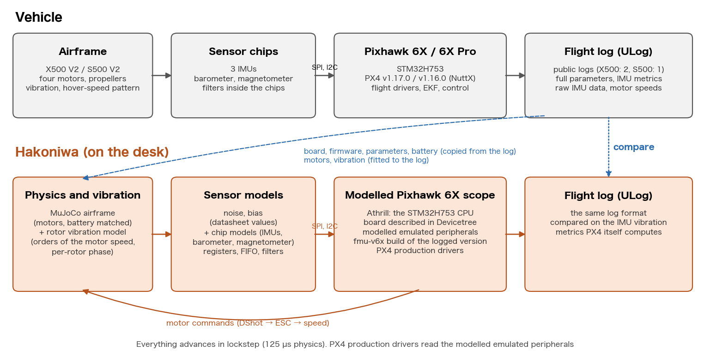
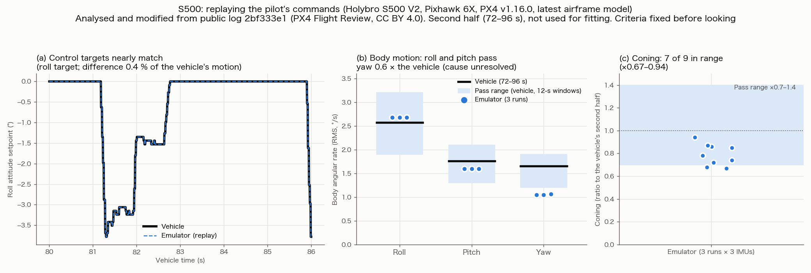
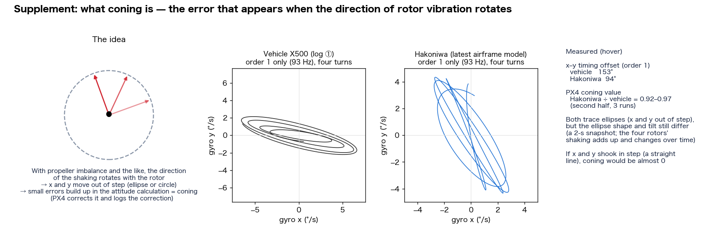
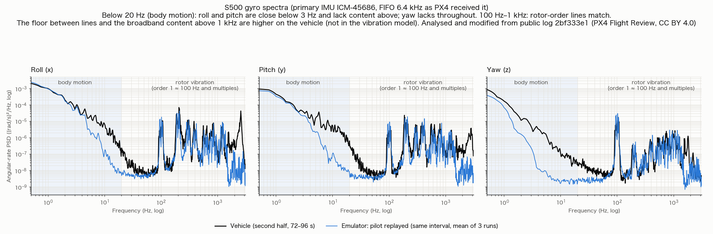
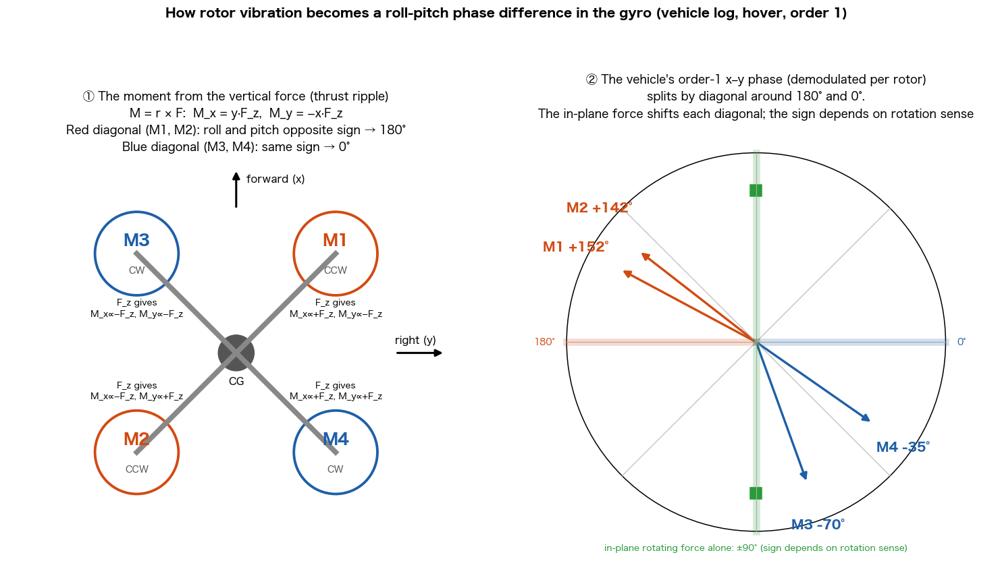
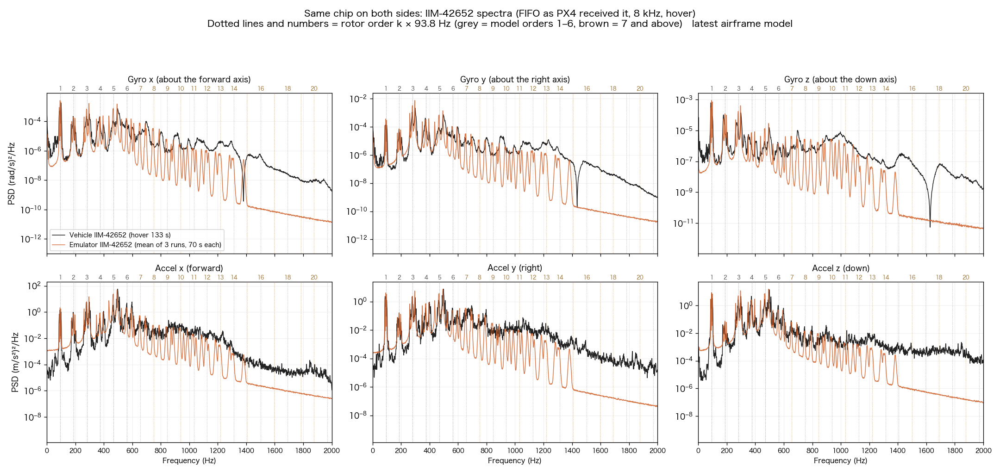

# How close can a simulation get to the real vehicle?
### Hakoniwa, one step further with vibration and PILS, checked against public PX4 logs (X500 V2, S500 V2)

English | [日本語](README.ja.md)

## Summary
A simulation always differs from the real vehicle. Trying to reproduce the whole vehicle breaks down under computation
and complexity. General-purpose simulators such as Gazebo and AirSim, on the other hand, are built to be fast and to
cover a wide range of tests; in exchange, how rotor vibration reaches the IMU and the sensor path inside the firmware
are usually simplified.

Between the two, Hakoniwa took one step further, focused on where rotor vibration reaches the IMU. It uses two methods:
- **Vibration**: the rotor vibration that reaches the IMU is fitted to the flight log.
- **PILS**: the flight firmware runs unchanged on an emulated microcontroller and emulated sensor chips.

Using these two methods, we tested how far the emulator can be matched to flight logs, with public logs of two
airframes, and we also show whether the way we tested is sound (section 4). What we looked at is how rotor vibration
appears as noise in the IMU: how much rotor vibration reaches the IMU, the heart of flight control, measured by the
values PX4 itself computes and logs. On the second half of the same flight, not used for fitting, the vibration values
of both airframes were within about 10 % of the vehicle. On another flight of the same vehicle, the accelerometer value
and coning were off, and the yaw motion of the hand-flown S500 was only 0.6 × the vehicle's. We show both what matched
and what did not.

\* Coning: the correction for the error that builds up in the attitude calculation when the airframe shakes on two axes
at once. See "Supplement: what coning is".

## 1. Where do simulation and the real vehicle differ?
A simulation always differs from the real vehicle, for many reasons:

- **Propeller aerodynamics**: thrust and torque versus speed, inflow that changes with climb and forward flight,
  ground effect, interaction between propellers
- **Structure**: frame flex and resonance, motor mounting, the flight controller's vibration isolation
- **Propulsion**: motor gain and lag, ESCs, battery voltage sag, differences between propellers
- **Airframe**: mass, inertia, centre of gravity
- **Environment**: wind, turbulence
- **Sensors**: noise, bias, temperature, how vibration is picked up
- **Firmware**: timing of drivers and the RTOS

**Reproducing everything breaks down.** Solving the flow around the propellers with CFD and the frame's resonance with
structural analysis, at the speed of the flight control, is not realistic in computation or in the number of things to
fit. And however fine the model, it still has to be matched to real data in the end.

**General-purpose simulators simplify for their purpose.** Running PX4 SITL with Gazebo or AirSim is built to be fast
and to cover a wide range, which suits control-algorithm development and automated testing. In the default setup,
the airframe is a rigid body, thrust follows rotor speed, and the simulator hands sensor values straight to PX4. How
rotor vibration reaches the IMU and the chip and driver path are usually simplified (vibration and noise can be added
with extra work).

Simulation still has value: you can test without breaking anything, as often as you like, under identical conditions,
before the hardware exists. But that holds only **when you know where it is close to the vehicle and where it is not**.

## 2. The Hakoniwa approach: one step further with vibration and PILS

Rather than building everything from physics, Hakoniwa focuses on bringing the world the flight-control software
receives closer to the real one.

- **Vibration (fit what reaches the IMU to the flight log)**: the airframe carries vibration at multiples of each
  motor's speed, with per-motor timing. Instead of solving propeller aerodynamics and structural resonance from
  physics, we fit their result as it appears at the IMU, empirically, to the flight log.
- **PILS (the flight firmware on an emulated microcontroller)**: Athrill executes the instructions of the Pixhawk 6X's
  STM32H753 one by one, and the PX4 flight build, including the NuttX RTOS, runs on it unchanged. The IMU chips are
  modelled from their datasheets' nominal characteristics, including rate, FIFO and internal filters. The same PX4
  drivers as on the vehicle read them over emulated buses (SPI, I2C, DMA, interrupts).
- Physics (125 µs steps), sensors and CPU advance on one simulated clock.

**Prior work**: neither idea is original to Hakoniwa. ArduPilot already has both.
- **Vibration**: ArduPilot SITL has parameters that add vibration synchronised to the motors to the IMU values
  (`SIM_VIB_MOT_MAX`, `SIM_VIB_FREQ`, `SIM_VIB_MOT_MULT` and others).
- **Flying on an emulated microcontroller**: upstream ArduPilot runs unmodified firmware on Renode (a microcontroller
  emulator) connected to SITL physics and flies it (merged in September and October 2026). It emulates the sensor
  chips too.

What we did here is combine the two for PX4, fit the vibration from flight logs per order, per axis and with
per-motor timing, and check it against public flight logs (as far as we found).

What is built from physics, what is fitted from the log, and what is not yet included:

| Cause | How Hakoniwa handles it |
|---|---|
| Propeller aerodynamics | Simple model: thrust and torque follow rotor speed. No inflow, ground effect or interaction |
| Structural resonance | Not modelled physically (rigid body). Fitted from the log as vibration appearing at the IMU |
| Propulsion | Motor gain and lag, battery voltage over time and per-rotor differences fitted from the log |
| Airframe | Dimensions and mass from specifications and the log. Rotor-speed differences represented by an equivalent CG offset or per-rotor scales |
| Environment | Wind only pushes at the centre of the airframe and does not turn it |
| Sensors | Chip models (datasheet nominal characteristics); vibration fitted from the log |
| Firmware | The flight firmware and PX4 drivers run unchanged (PILS) |

From here on, we test how far these two methods can be matched to flight logs. Whether the way we tested is sound is in
section 4.

## 3. What we looked at: rotor vibration appearing as IMU noise
The IMU is the heart of flight control. PX4 estimates the attitude from the gyro and accelerometer and runs its rate
loop on the gyro. Rotor vibration rides on the IMU signals as noise and disturbs estimation and control. **If the noise
on the simulated IMU differs from the vehicle's, every result downstream is in doubt.**

So we compared how much, and how, rotor vibration appears as noise on the IMU, using the values PX4 computes for each
IMU and writes to its log. On both the vehicle and the emulator, we compare **values computed by the same PX4 code**.

| Value | What it represents | What it checks |
|---|---|---|
| Vibration metrics (gyro, accel) | The size of the noise on the IMU values (how much they change over a few ms); dominated by order 1 of the rotor speed (about 100 Hz) | The vibration model's amplitude |
| Coning | The integrator's correction for the timing mismatch between axes | The timing between vibration axes, and how many samples the driver integrates together (the PILS path) |
| Body motion | Roll, pitch and yaw rates | Control, airframe and outside forces; comparable only when the inputs are matched |

## 4. How we checked
| What we wanted to check | What we did | How far we got |
|---|---|---|
| Fitted to one airframe only? | Used the same procedure on two airframes that differ in board revision, IMUs, firmware version and how they were flown (X500 V2, S500 V2) | Two airframes, both quadcopters in hover |
| Compared on the data used for fitting? | Fitted the vibration on the first half only and compared with the second half. For the X500, also compared with another flight of the same day | Only one other X500 flight (the third was not measured this time). The S500 has only one public log, so its check is within one flight |
| Different inputs make comparison meaningless? | Flew the emulator the way the vehicle was flown (table below) | For the S500 the control targets nearly match. For the X500 they cannot be matched, so body motion is not compared |
| Chance? | Ran the emulator 3 times per case and report the range | Vibration metrics vary by a few %; coning by about 30 % run to run |
| Can others check it? | The flight logs are public PX4 Flight Review logs; the firmware we used is published | The vibration and chip models are not public (section 7) |

The two vehicles were flown differently, so the emulator is flown differently. This is a premise of the comparison.

| | X500 V2 | S500 V2 |
|---|---|---|
| How the vehicle flew | Hover under position commands from an external program (Offboard); no pilot input in the log | Flown by hand with sticks (Stabilized); the airframe moves constantly with the pilot |
| How the emulator flew | Automatic hover commanded over MAVLink | Automatic climb to 10 m, then playback of the pilot's stick commands (including throttle), rebuilt from the log |
| What can be compared | Vibration metrics and coning (coning still carries the effect of different body motion, so it is less certain than the vibration metrics) | Vibration metrics, coning and body motion |

Coning grows with the combination of body motion and vibration. Comparing a hand-flown, moving S500 with a quietly
hovering emulator would not be meaningful, so for the S500 we played back the pilot's input.

## 5. Results: how close, and what remains
All numbers use the latest airframe models (motors and battery matched to the vehicle) and data not used for fitting
the vibration (range of 3 emulator runs).

| Flight log | Vibration metrics (gyro / accel) | Coning | Body motion |
|---|---|---|---|
| X500 log ① (second half) | ×0.97–1.01 / ×0.95–0.98 | ×0.91–0.97 | Not comparable (inputs cannot be matched) |
| X500 log ② (another flight that day, not refitted) | ×0.96–1.00 / ×0.82–0.88 | ×0.64–0.72 | Same |
| S500 log (second half) | ×0.93–1.08 / ×0.92–1.13 | 7 of 9 within ×0.7–1.4 (×0.67–0.94) | Roll and pitch within limits; **yaw 0.6 × the vehicle** |

- **What matched**: on the second half of the same flight, the vibration metrics of both airframes are within about
  10 % of the vehicle. For the S500, playing back the pilot's commands makes the control targets nearly the same as the
  vehicle's, and roll and pitch motion fall within the vehicle's range.
- **What remains**: the S500's yaw motion is 0.6 × the vehicle's; the cause is not known yet (section 12). In the
  spectra, vibration above order 6 (about 560 Hz) and broadband vibration above 1 kHz come out lower than the vehicle's.
  On the other X500 flight (log ②), the accelerometer value was in the 0.8s and coning about 0.7 ×. That vehicle flight
  ran at 5–7 % lower rotor speed than log ① and moved more (section 10). The vehicle's coning varies by about 40 %
  between flights of the same day, and whether it can be predicted remains open.

## 6. What these results support, and what they do not
| Item | This result |
|---|---|
| Rebuild a vehicle's configuration and parameters from its flight log | Done (board revision, firmware version, full parameters, battery voltage) |
| Run the flight firmware and parameters unchanged on the desk | Done (the logged PX4 version built for fmu-v6x) |
| Match the noise that rotor vibration puts on the IMU to a flight log | Done; within about 10 % on the second half of the same flight, not used for fitting |
| Play back a hand-flown flight on the desk | Shown on the S500 |
| Predict the vibration of another flight | Not yet. On X500 log ② the gyro matched but accel and coning did not; not better than reusing log ①'s measured values |
| Match all body motion (especially yaw) | Not yet; the S500's yaw is 0.6 × the vehicle's |
| Predict how a parameter change alters the vehicle | Not checked here |
| Reproduce gusts, magnetic, power or structural-resonance problems | Outside this scope |

## 7. Trying it with your vehicle: what the log needs
These checks used public logs only. Doing the same requires the following in the log.

| Needed | Used for | In PX4 |
|---|---|---|
| A PX4 log (.ulg) | Everything | Standard |
| Board revision, firmware version, full parameters | Building the same configuration | Recorded automatically |
| A settled hover (about 1 minute recommended; the S500 here had about 50 s) | Splitting into a fitting part and a comparison part | Flight plan (X500 about 130 s, S500 about 50 s) |
| Motor speeds | Separating the vibration into rotor-speed orders; matching the motors | `esc_status` (ESC telemetry or bidirectional DShot) |
| High-rate raw IMU data | Fitting the vibration amplitude and timing | `SDLOG_PROFILE` "raw FIFO high-rate IMU" (`sensor_gyro_fifo`, `sensor_accel_fifo`) |
| Battery voltage | The battery voltage over time | Standard (`battery_status`) |
| For hand-flown flights, attitude and thrust targets | Rebuilding the stick commands | Standard |
| Another flight of the same vehicle in the same state | Comparing on a flight not used for fitting | Flown in succession on the same day |

Few public logs include motor speeds and high-rate raw IMU data; these two airframes were chosen because theirs did.
The S500 log has raw gyro data only. Its accelerometer vibration was shaped using the X500's accel-to-gyro ratio, and
its size was scaled by 0.70 to match the S500's first-half accelerometer metric. The S500 accelerometer comparison is
therefore a value fitted on the first half of the same flight, compared on the second half.

The board must be one we emulate (currently some Pixhawk 6X / 6X Pro revisions, 6C and Pixhawk 4). What is public is
the flight log IDs and the firmware we used. The vibration, sensor and chip models are not public (see References).

If you would like to try this with your own logs or hear more, please contact Hakoniwa Lab.
- Hakoniwa Lab: https://hakoniwa-lab.net
- Contact: https://hakoniwa-lab.net/contact/

## Supplement: what coning is

- **What it is**: with propeller imbalance and the like, the direction of rotor shaking rotates with the rotor. The gyro
  x and y then move out of step and trace an ellipse or circle on an x–y plot. Integrating angular rate through this
  kind of shaking to get the attitude builds up a small error (the axis traces a cone, hence "coning"). PX4 corrects
  this error and logs the size of the correction.
- **Why we look at it**: the vibration metrics depend on the size of the shaking; coning depends on the timing offset
  between x and y. If x and y shake in step (a straight line on the plot), coning is almost 0 however large the shaking.
  So whether coning matches tells whether the direction and timing of the vibration are reproduced.
- **Where it stands**: on X500 log ①, both the vehicle and Hakoniwa trace ellipses, and PX4's coning value is
  0.92–0.97 × the vehicle's. The ellipse shape and tilt still differ (the x–y offset at order 1 is 153° on the vehicle
  and 94° in Hakoniwa; the plot is a 2-s snapshot, and the four rotors' shaking adds up and changes over time).

---

## 8. Details: the vehicles
| Item | X500 V2 | S500 V2 |
|---|---|---|
| Board | Pixhawk 6X Pro (sensor-set revision `V6X006`) | Pixhawk 6X (revision `V6X008`) |
| Firmware | PX4 v1.17.0 (commit `d6f12ad1c4f7`) | PX4 v1.16.0 |
| IMUs | ADIS16470 (primary), IIM-42652, ICM-45686 | ICM-45686 × 3 |
| Other sensors | Barometers ICP201xx and BMP388, magnetometer BMM150 | Barometer ICP201xx, magnetometer BMM150, GNSS |
| Parameters | 1,109 | 1,145 |
| Battery | 6 cells | 4 cells |
| Flight | Indoors, external-vision positioning, Offboard, 180 s | Outdoors, flown by hand in Stabilized, about 56 s airborne |
| Logs used | ① 75ac4a47 (vibration fitting and comparison), ② 14600267 (another flight that day; comparison only) | 2bf333e1 (the three public copies are the same flight) |
| Emulated | Two IMUs, ADIS16470 and IIM-42652 (ICM-45686, BMP388, Ethernet and PX4IO not modelled) | Three IMUs |

"Pixhawk 6X" is not enough. The IMU set differs by sensor-set revision; only with the revision matched can the same
chips be compared. The same X500 has logs from other days too, but its hover speed and vibration changed several-fold
between days (motors, propellers or settings changed), so those flights are a different vehicle state and were not
used.

## 9. Details: procedure
| Kind | Content |
|---|---|
| Copied from the log | Board revision, firmware version, full parameter set (with documented overrides where they cannot apply: estimator inputs, ESC protocol, ports, RC and power checks, sensor calibration values, magnetic declination), battery voltage over time |
| Datasheet values | Chip noise, rates, internal filters |
| Fitted to the same log | Motor resistance and motor constant (from the hover command-to-speed relation). The differences between the four rotor speeds (X500: an equivalent CG offset assuming equal thrust characteristics, about 1.0 cm forward and 1.1 cm right; S500: a per-rotor effectiveness scale). Vibration amplitude per order and axis and its dependence on speed, per-motor vibration timing (Appendix A). The S500's accelerometer vibration used the X500's accel-to-gyro ratio, scaled by 0.70 to the first-half accelerometer metric. **The vibration was fitted on the first half of the hover only** |
| Not fitted (outputs) | Vibration metrics and coning, motor speeds and commands in the emulator, body motion |

- **Method**: for each flight, the median of `vehicle_imu_status` over the hover, divided by the vehicle's median.
  Hover = from 10 s after take-off to 5 s before landing, horizontal speed < 1 m/s, vertical speed < 0.5 m/s, yaw
  rate < 10 °/s.
- **Run-to-run spread**: the random seed of the vibration timing jitter and the simulated time at which host-sent
  MAVLink commands arrive differ between runs, so repeated flights are not identical bit for bit.
- **The other flight (X500 log ②)**: its parameters are identical to log ① (0 differences). Only the battery voltage
  over time was copied from log ②; the vibration model and airframe were not refitted.
- **S500 playback**: working backwards from the 200 Hz attitude and thrust targets through PX4 v1.16's Stabilized
  stick mapping, we rebuilt the post-`rc_update` stick commands. They agree with the logged 31 Hz
  `manual_control_setpoint` at its sample times with RMS differences below 0.00005 (a check that the backwards
  calculation returns the logged values, not a check by a separate method). Yaw within the ±0.1 deadzone cannot be
  recovered and is set to 0, which has no effect on PX4. A CRSF receiver model on the emulated board sends CRSF frames
  over the UART on the physics clock; the RF link, packet loss and receiver timing are not emulated. The commands for
  vehicle time 46–98 s were played, and 72–96 s was compared. Before viewing the results we checked the control
  targets: attitude (roll, pitch) 0.4 %, yaw rate 0.1 %, thrust 6 % (mean identical).

## 10. Details: X500 results
**Log ①, second half (not used for fitting the vibration)**

| Ratio to the vehicle (3 runs) | Gyro vibration | Accel vibration | Coning |
|---|---|---|---|
| ADIS16470 (primary IMU) | ×0.99–1.01 | ×0.97–0.98 | ×0.92–0.97 |
| IIM-42652 | ×0.97–0.99 | ×0.95–0.96 | ×0.91–0.94 |
| Vehicle value (ADIS16470, second half) | 0.134 rad/s | 8.93 m/s² | 5.80 × 10⁻⁸ |

| Hover | Vehicle | Emulator (3 runs) |
|---|---|---|
| Motor commands (4) | 0.71 / 0.60 / 0.63 / 0.64 | 0.70 / 0.60 / 0.65 / 0.65 |
| Rotor speeds (4) | 5880 / 5208 / 5420 / 5477 rpm | within 1.5 % of the vehicle |
| Body motion (roll / pitch / yaw) | 1.9 / 1.4 / 1.4 °/s | 0.5 / 0.9 / 0.1 °/s |

- The vehicle's two halves differ by only 0–7 % to begin with; hover vibration changes little over time, so the
  first-half/second-half check is weak.
- The vibration amplitude was fitted mainly to the raw IIM-42652 data, so the IIM-42652 metrics matching is partly
  expected.
- While choosing the vibration model we looked at the ADIS16470 result and rejected one correction (Appendix B), so
  that result also helped choose the model.
- Body motion stays smaller than the vehicle's; the inputs cannot be matched, so this is not a like-for-like
  comparison. Coning depends on body motion times vibration, so the coning match (×0.91–0.97) is less certain than
  the vibration-metric match.

**Log ② (another flight that day)**: the vibration model and airframe were kept from log ①; only log ②'s battery
voltage over time was copied; 3 runs.

| Ratio to the vehicle (3 runs) | Gyro vibration | Accel vibration | Coning |
|---|---|---|---|
| ADIS16470 (primary IMU) | ×0.96–0.97 | ×0.86–0.88 | ×0.66–0.72 |
| IIM-42652 | ×0.98–1.00 | ×0.82–0.85 | ×0.64–0.70 |
| Baseline: log ①'s measured values reused (ADIS16470) | ×0.97 | ×0.90 | ×0.76 |

| Hover | Vehicle (log ②) | Emulator (3 runs) |
|---|---|---|
| Motor commands (4) | 0.67 / 0.58 / 0.60 / 0.63 | 0.71 / 0.61 / 0.66 / 0.66 |
| Rotor speeds (4) | 5506 / 4936 / 5126 / 5295 rpm | 5920 / 5235 / 5569 / 5607 rpm (about the same as log ①) |
| Body motion (roll / pitch / yaw) | 2.9 / 2.5 / 3.3 °/s | 0.5 / 0.9 / 0.1 °/s |
| Hover length | 47 s | about 70 s |

- The gyro vibration matched within 4 % without refitting. The accelerometer was in the 0.8s and coning about 0.7 ×:
  both missed.
- The emulator did not do better than simply reusing log ①'s measured values.
- With the same parameters (0 differences) and nearly the same battery voltage, the vehicle's log ② ran at 5–7 % lower
  rotor speed and lower motor commands. It may have needed less thrust (for example, it was lighter), but the log cannot
  confirm this. The emulator's speeds equal log ①'s, so this difference is not included; rotor speed is a compared
  output, so we did not change the emulated airframe to match it.
- The vehicle moved more during log ②'s hover (about twice log ①'s body motion). Coning grows with body motion times
  vibration, which may explain part of the emulator's lower coning. The X500 log holds no pilot input, so the inputs
  cannot be matched to check this.

## 11. Details: S500 results
| Item | Vehicle (second half, 72–96 s) | Emulator (3 runs) | Verdict (criteria fixed before viewing) |
|---|---|---|---|
| Roll motion (RMS) | 2.57 °/s | 2.68 °/s | Pass (vehicle's 12-s range 1.9–3.2) |
| Pitch motion | 1.76 °/s | 1.60 °/s | Pass (1.3–2.1) |
| Yaw motion | 1.65 °/s | 1.05–1.06 °/s | Fail (×0.64) |
| Coning (3 IMUs × 3 runs) | — | ×0.67–0.94 | 7 of 9 within ×0.7–1.4 |
| Gyro vibration | — | ×0.93–1.08 | — |
| Accel vibration | — | ×0.92–1.13 | — |

- We used a different random seed on each run to shift the vibration timing, so coning moves about 30 % run to run.
- The 52-second playback stayed between 7.9 and 11.5 m and ended at its starting height. A thrust difference of about
  0.5 % makes heights diverge within seconds, so height is not judged.

Below 20 Hz (body motion), roll and pitch are close to the vehicle below 3 Hz and lack content above; yaw lacks content
throughout. The rotor-order lines from 100 Hz to 1 kHz match in position and height. The floor between the lines and
broadband vibration above 1 kHz are larger on the vehicle and absent from the current vibration model. PX4's vibration
metrics and coning are dominated by order 1 near 100 Hz, so their effect is small.

## 12. Details: the remaining difference (S500 yaw)
With the control targets nearly the same, yaw motion is 0.6 × the vehicle's. The vehicle has slow yaw motion at
0–10 Hz throughout; yaw angular acceleration not explained by the control commands is 9.7 °/s² on the vehicle and
2.7 °/s² in the emulator.

Comparing the airframe's effectiveness (yaw torque command → rotor speeds, rotor speeds → yaw angular acceleration)
between the vehicle and the emulator from the existing logs found no mismatch beyond 1.5 × in the selected band
(0.5–5 Hz). The vehicle's yaw, however, has much motion not linearly related to its control target. This is consistent
with an unmeasured outside yaw moment (e.g. wind), but it has not been separated from PX4's attitude estimation (e.g.
heading corrections from the magnetometer) or differences in the airframe model. The cause is unresolved. The current
model's wind only pushes at the centre of the airframe and cannot turn it; next we will add wind acting differently on
each rotor and part of the body and check whether the yaw motion approaches the vehicle's.

## 13. Details: how this differs from SITL
| | PX4 SITL (default Gazebo setup) | This approach |
|---|---|---|
| Firmware | PX4 built for the host PC | The NuttX flight binary |
| How sensor data arrives | Simulator values handed straight to PX4's sensor layer | PX4's production drivers read the modelled chips over SPI, I2C, DMA and interrupts |
| Sensor rate | Set by the simulator (typically a few hundred Hz) | The chip's rate (ADIS16470 2 kHz, IIM-42652 8 kHz, ICM-45686 6.4 kHz) |
| Chip FIFO and internal filters | Usually not modelled | Modelled from the datasheet's nominal characteristics |
| Speed | Fast; suited to CI | Slower (real-time factor 0.5–1.06) |

SITL can also have several IMUs, higher sensor rates and added vibration, and the chip rates, batching and filters
could be built into its simulator. Some things still remain different by construction:
1. **How values arrive**: on the vehicle, the driver takes an interrupt, reads the FIFO over SPI ten samples at a time,
   and processes them on NuttX. How many samples PX4 integrates together (which affects coning) follows from this
   batching and ordering.
2. **Processing inside the chip**: chips filter internally before the data is read (PX4 sets the IIM-42652 to 585 Hz).
   Building that into SITL is the same as writing a chip model.
3. **Board definition**: DMA assignments, SPI bit order and board-revision detection exist only in the flight firmware.
   While building the board we found a wrong TIM5 DMA request number because PX4 could not drive the ESCs.

## 14. Limitations
- Both comparisons are quadcopters in hover.
- X500: only one other flight was compared (the third flight of that day was not measured with this version). On it,
  the accelerometer value and coning missed, and the rotor speeds and body motion differed from the vehicle's. The
  vehicle's coning over the day's three flights ranged 5.8–8.2 × 10⁻⁸ (max 41 % above min); whether it can be predicted
  remains open. Two of the vehicle's IMUs are modelled. Body motion is not comparable.
- S500: there is only one public log; the check fits the first half and compares the second half of one flight. The
  cause of the yaw shortfall is unresolved. The effectiveness comparison is estimated from data taken while the
  controller was active. The per-rotor scales assume that "a propeller needing more speed is weaker in both thrust and
  torque by the same factor".
- The vibration is an empirical model fitted to the log. The airframe is a rigid body; frame resonance and speed
  fluctuation are not modelled. Vibration above order 6 (about 560 Hz) comes out lower than the vehicle's (Appendix B).
- The configurations with the vehicle's IMUs run slower than real time (X500 real-time factor 0.80, 1.06 with only the
  primary IMU; S500 0.53).

## 15. Terms
| Term | Meaning |
|---|---|
| Hakoniwa | The simulation platform developed by Hakoniwa Lab. It runs physics, sensors and control software on one shared clock |
| Athrill | An instruction-level CPU emulator for microcontrollers (from the TOPPERS project). Here it runs an STM32H753 |
| PILS | Processor-in-the-Loop Simulation: the flight firmware runs on an emulated microcontroller and peripherals, connected to the physics simulation |
| Lockstep | Physics (125 µs steps), sensors and CPU advance on the same simulated clock |
| Real-time factor | Simulated time ÷ wall-clock time. 1.0 is real time |
| Vibration metrics | `gyro_vibration_metric` and `accel_vibration_metric` in PX4's per-IMU `vehicle_imu_status`: a smoothed size of the difference between consecutive window-averaged (about 6 ms here) angular rates or accelerations. They depend on sensor rate and filters, so only the same IMU with the same settings can be compared |
| Coning | `delta_angle_coning_metric`: PX4's integrator coning-correction metric. Implementation-specific; not a measure of physical airframe coning |
| Order | A vibration at k times the motor rotation frequency. In this hover, order 1 is about 93–100 Hz |

## References
### Public
- Flight logs (X500): PX4 Flight Review public logs `75ac4a47-a73a-44ea-8016-24d79a164147` and
  `14600267-e385-4ee0-b647-52a9be62dfea` (2026-10-30, Holybro X500 V2, Pixhawk 6X Pro). License:
  [CC BY 4.0](https://creativecommons.org/licenses/by/4.0/) (Flight Review "CC-BY PX4"). The X500 figures and numbers on
  this page were produced by analysing and modifying these logs. The log files themselves are not distributed here.
- Flight log (S500): PX4 Flight Review public log `2bf333e1-2eb9-4528-9e70-048c71cfa280` (2026-01-16, Holybro S500 V2,
  Pixhawk 6X, PX4 v1.16.0). License: [CC BY 4.0](https://creativecommons.org/licenses/by/4.0/) (Flight Review
  "CC-BY PX4"). The S500 figures and numbers on this page were produced by analysing and modifying this log. The log
  file itself is not distributed here.
- PX4 v1.17.0: vibration metrics and coning (`src/modules/sensors/vehicle_imu/VehicleIMU.cpp`,
  `src/modules/sensors/Integrator.hpp`), Pixhawk 6X sensor start-up (`boards/px4/fmu-v6x/init/rc.board_sensors`), the
  IIM-42652 driver's filter settings. PX4 v1.16.0: Stabilized stick mapping (`src/modules/mc_att_control`), RC
  calibration (`src/modules/rc_update`), CRSF (`src/lib/rc/crsf.cpp`)
- Datasheets
  - Analog Devices ADIS16470 Rev. C
  - TDK InvenSense IIM-42652 DS-000440 Rev 1.0
  - TDK InvenSense ICM-45686
  - TDK InvenSense ICP-201xx DS-000416
  - Bosch Sensortec BMM150 DS001
  - STMicroelectronics RM0433 (STM32H7)
- Firmware used (X500): [athrill-target-stm32 release px4-v1.17.0-fmu-v6x](https://github.com/hakoniwalab/athrill-target-stm32/releases/tag/px4-v1.17.0-fmu-v6x)
  (`px4_fmu-v6x_default.elf`, SHA-256 `91b6d066af9bb1eaec8baaa1ddb654df6625fb19cb19d95a70accc264329fb28`). PX4-Autopilot
  tag v1.17.0, built with `make px4_fmu-v6x_default` in the `px4io/px4-dev:v1.17.0-beta1` container. Licensed under
  PX4-Autopilot's BSD-3-Clause and the licenses of its submodules
- Firmware used (S500): [athrill-target-stm32 release px4-v1.16.0-fmu-v6x](https://github.com/hakoniwalab/athrill-target-stm32/releases/tag/px4-v1.16.0-fmu-v6x),
  PX4-Autopilot tag v1.16.0. On Athrill v0.4.0 use `px4_fmu-v6x_default-athrill.elf` from the same release (debug
  information removed and the .data segment size corrected; same code and data), SHA-256
  `b8681c58a518351747f5a2f71b3e30abb9d3ddafd71fb1c0c39bf547166200ed`. With the Athrill core from 2026-11-22 on
  (toppers/athrill#98), the unmodified `px4_fmu-v6x_default.elf` runs directly
- Athrill (TOPPERS project)
- ArduPilot prior work: SITL simulation parameters ([Using Simulation Parameters to Control the Simulation](https://ardupilot.org/dev/docs/SITL_simulation_parameters.html), `SIM_VIB_*` in `libraries/SITL/SITL.cpp`); ArduPilot on Renode (ArduPilot PRs #33975, #34785)

### Private specifications (overview only)
- **Vibration model (Hakoniwa Drone PRO)**: per motor-speed order, an amplitude for each of three axes and its growth
  with speed; per-motor vibration timing (phase) and its jitter. Fitted from flight logs.
- **Sensor models (Hakoniwa Sensor PRO)**: IMU, barometer, magnetometer, GNSS. Noise, bias drift and update rate from
  datasheet values; mounting position and rotation configurable.
- **Chip and board models**: per chip, registers, FIFO, internal filters and interrupt timing built from the
  datasheet's items, each with tests. Boards described in Devicetree.

## Appendix A: Per-motor vibration timing (X500)

- **Measured**: using the motor speeds, the IIM-42652 vibration was separated per motor (order 1), and the timing
  difference (phase) between the roll and pitch angular-rate vibration was computed.
- **Result**: the phase is nearly constant for each motor and differs between motors (M1 +152°, M2 +142°, M3 −70°,
  M4 −35°). Vertical force alone (thrust pulsation) would give 0° or 180°. An in-plane rotating force shifts each
  diagonal, with the sign set by rotation sense; the ±90° references shown in the figure cover both senses. A mixture
  of the two can explain the measured phases; M3 has a large in-plane share. M3 and M4 run at close speeds (about
  0.7 Hz apart), so their separation is less certain.
- **Use**: the vibration model carries this phase per motor. Coning depends on the timing between axes; without it the
  per-axis coning breakdown does not match the vehicle.

## Appendix B: Vibration spectra (X500, IIM-42652 to IIM-42652)

- **Measured**: the IIM-42652 FIFO data after the chip's internal filter (8 kHz), hover, Welch's method (1 s window).
  Vehicle about 130 s; emulator average of 3 runs of the latest airframe model.
- **How to read**: frequency on the horizontal axis, power spectral density (log) on the vertical. Dotted lines and
  numbers are multiples of the four motors' mean rotation frequency (93.8 Hz). The actual motors spread over
  89–100 Hz, so higher orders spread wider.
- **Result**: for the gyro, orders 1–5 (up to about 470 Hz) are ×0.88–1.20 of the vehicle. Above order 6 the emulator
  is lower (order 6 ×0.59, order 10 ×0.42, order 14 ×0.28). The model stops at order 14 (about 1310 Hz) and drops off
  above. The emulator's speeds are nearly constant, so the valleys between peaks are deeper than the vehicle's.
- **Why above order 6 is low**: the model amplitudes were taken from the vehicle's data after the chip's filter, so the
  emulated chip filters them a second time. A correction that undoes the filter was tried, but it moved the checking
  IMU's (ADIS16470) coning away from the vehicle, so it was not adopted.
