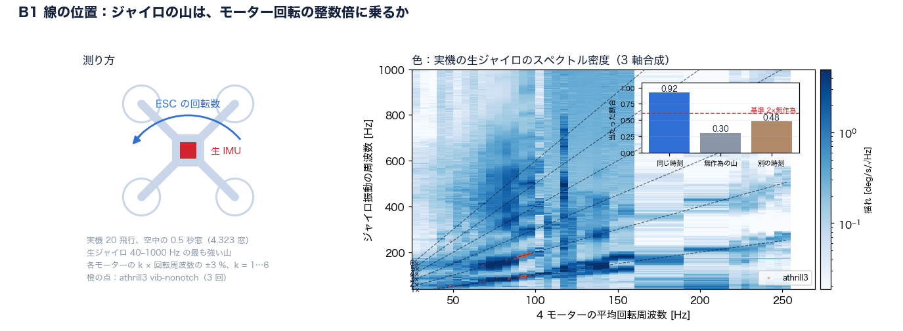
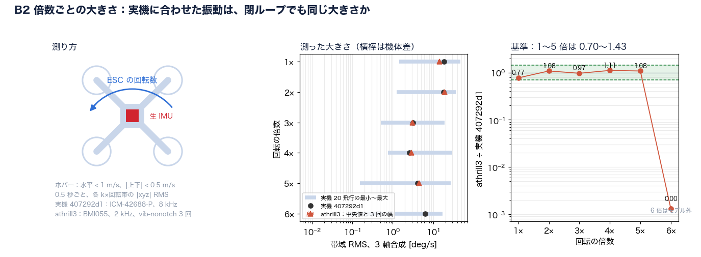
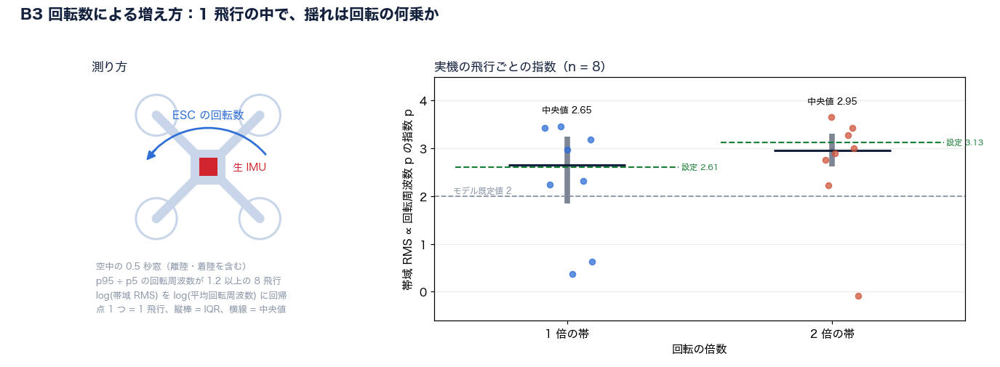
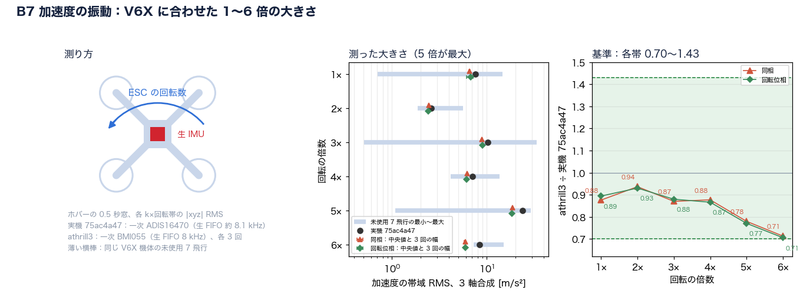
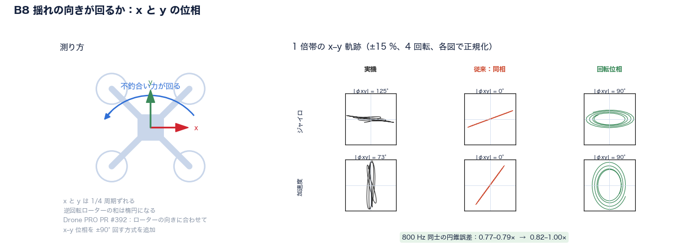
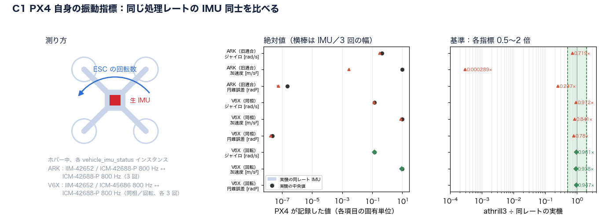

# ドローンの IMU：実機の飛行記録との照合（Holybro X500 V2、2026-11-21）

[English](README.md) | 日本語

このページは、ドローンの IMU（ジャイロ・加速度）のモデルを、**実機の公開ログ**と照合した結果です。
ロボットアームの力覚センサーを KUKA の実機記録と比べたもの（[力覚センサー](../force-torque/README.ja.md)）と同じ考え方で、
1 つの測定を 1 枚のカードにしています。

## 何と何を比べるか

```text
実機の公開ログ（PX4 Flight Review、X500 V2、生ジャイロ 2〜8 kHz と ESC の回転数）
        │  同じ見方（回転の何倍か、0.5 秒ずつ、ホバーの区間）で測る
        ▼
箱庭のモデル ─┬─ 振動モデル単体（回転数の列を入れて、出てくる揺れ）
              └─ 閉ループ：エミュレートした Pixhawk 6C（athrill3）の上の本物の PX4 v1.17.0
                 （物理 125 µs、センサーインスタンス、DShot の ESC テレメトリ）
```

- 実機：PX4 Flight Review の公開ログ（CC BY 4.0）。X500 V2 の 3,174 本から、生ジャイロ（`sensor_gyro_fifo`）と
  4 つのモーターの回転数（`esc_status`）がそろう 20 飛行（重複を除く）を選んだ。
- そのうち同じ PX4_FMU_V6X 機で生加速度もそろう 8 飛行を、加速度モデルの適合 1 飛行と検証 7 飛行に使った。
- IMU 自身の雑音：TUM VI の静止記録（CC BY 4.0、BMI160、111 時間）。
- 合否の線は、測る前に決めて書く。言えないことも書く。機体の完全な一致は保証しない（比べるのは傾向）。

## 評価項目

| 層 | # | 項目 | 状態 |
|---|---|---|---|
| A：IMU 固有 | A1 | 止まっているときの白色雑音・バイアスの揺らぎ（アラン分散） | 測定済み（TUM VI）。カードは次の版 |
| | A2 | 温度によるバイアスの変化 | 測定済み（TUM VI）。カードは次の版 |
| B：機体の振動 | B1 | **線の位置**：揺れが回転の何倍に乗るか | 測定済み（カード 1） |
| | B2 | **倍数ごとの大きさ**（1〜6 倍） | 測定済み（カード 2） |
| | B3 | **回転数による増え方**（倍数ごとの指数） | 測定済み（カード 3） |
| | B4 | 線の幅・割れ（モーターごとの回転差、ローターごとの大きさの違い） | 次の版 |
| | B5 | 線と線の間の床（回転と無関係な揺れ） | 次の版（モデルにまだない） |
| | B6 | 3 軸への分かれ方（飛行ごとに変わる） | 次の版 |
| | B7 | **加速度の振動**（1〜6 倍） | 測定済み（カード 4） |
| | B8 | **揺れの向きが回るか**（x–y 位相） | 測定済み（カード 5） |
| C：閉ループ | C1 | **PX4 自身の振動の指標**（`vehicle_imu_status`） | 訂正して測定済み（カード 6） |
| | C2 | 制御が受け取る揺れと、回転数連動ノッチ（`IMU_GYRO_DNF`）の効き目 | 次の版（高い記録レートが要る） |
| | C3 | 姿勢・位置の保ち方 | 次の版 |
| D：条件 | D1 | 移動・加速・旋回 | 次の版（データが 1 機体・約 3 分） |
| 共通 | E1 | 再現性（同じ条件で同じ結果、3 回以上で判定） | 各カードに書く |

## カード

### B1 線の位置



- **測ったこと：** 実機 20 飛行の空中区間を 0.5 秒ずつに分け、生ジャイロの 40–1000 Hz で最も強い山が、
  どれかのモーターの回転周波数の 1〜6 倍（±3 %）に入るかを 4,323 窓で測った。対照は、山の周波数を
  40–1000 Hz から無作為に選んだときの期待値と、同じ山を全窓の半分だけずらした別の時刻の回転数に
  組み合わせたときである。athrill3 の `vib-nonotch` 3 回も同じ方法で測った。
- **グラフの見方：** 横軸は 4 モーターの平均回転周波数、縦軸はジャイロ振動の周波数、色は実機の
  3 軸合成スペクトル密度である。破線は回転の 1〜6 倍、橙の点は athrill3 の最強の山である。右上の小図は
  各条件で破線の近くに当たった割合で、赤い破線が合格線（無作為の 2 倍）である。
- **結果：** 実機は 0.922、無作為の期待値は 0.302（3.06 倍）、別の時刻との組合せは 0.479 だった。
  20 飛行中 19 飛行でも無作為の 2 倍以上だった。**「無作為の 2 倍以上で、別の時刻より明らかに高い」
  という基準に合格**した。athrill3 は 526 窓の 0.992 が 1〜6 倍に当たった。

### B2 倍数ごとの大きさ



- **測ったこと：** ホバー（水平速度 < 1 m/s、上下速度の絶対値 < 0.5 m/s）の 0.5 秒窓で、回転の 1〜6 倍の
  帯域ごとに生ジャイロの RMS（3 軸合成、deg/s）を測った。実機はモデルを合わせた飛行 `407292d1` と
  20 飛行の機体差、athrill3 は `vib-nonotch` 3 回である。実機は ICM-42688-P の 8 kHz、athrill3 は
  BMI055 の 2 kHz で、チップも標本化周波数も同じではない。
- **グラフの見方：** 中央の薄い横棒は実機 20 飛行の最小〜最大、黒点は `407292d1`、橙の三角は athrill3
  3 回の中央値（短い横線は最小〜最大）である。右は athrill3 ÷ `407292d1` で、緑の破線と帯が
  1〜5 倍の合格範囲 0.70–1.43 である。
- **結果：** 1〜5 倍はそれぞれ 14.39/18.63 = **0.77**、19.27/17.82 = **1.08**、
  3.06/3.17 = **0.97**、2.89/2.61 = **1.11**、4.43/4.10 = **1.08** で、**5 帯すべて合格**した。
  実機 20 飛行の幅は順に 1.42–46.49、1.25–36.72、0.51–19.26、0.76–29.85、0.16–26.83 deg/s と広い。
  6 倍はモデルに合わせていないため判定しない（athrill3 ÷ 実機は 0.0013）。

### B3 回転数による増え方



- **測ったこと：** 空中の全 0.5 秒窓（離陸・着陸を含む）について、1 飛行の中で帯域 RMS が平均回転周波数の
  何乗で増えるかを対数回帰した。回転周波数の p95 ÷ p5 が 1.2 以上だった 8 飛行を使い、1 倍と 2 倍の帯を測った。
- **グラフの見方：** 点 1 つが 1 飛行、太い縦棒が飛行間の IQR、黒い横線が中央値である。灰色の破線はモデルの
  既定値 2、緑の破線は `407292d1` に合わせて設定した 1 倍 2.61、2 倍 3.13 である。
- **結果：** 実機の指数は 1 倍が中央値 **2.65**（IQR 1.84–3.24）、2 倍が **2.95**（2.63–3.31）だった。
  合否を置かない記述的な測定だが、合わせた値 2.61 と 3.13 は飛行間の中心に近く、既定値 2 より急に増える。
  飛行ごとの差は大きく、この数字をホバーだけの指数とは解釈できない。

### B7 加速度の振動



- **測ったこと：** 実機 `75ac4a47` と athrill3 の同相 `v6x-vib`／回転位相 `rot-vib`（各 3 回）について、
  ホバーの 0.5 秒窓で加速度の 1〜6 倍帯の 3 軸合成 RMS を測った。実機は一次 ADIS16470 の生 FIFO
  （約 8.1 kHz）、athrill3 は一次 BMI055 の生 FIFO（8 kHz）であり、チップは同じでない。薄い棒はモデルを
  合わせるのに使わなかった同じ V6X 機の 7 飛行の、飛行ごとの中央値の最小〜最大である。基準は各帯で
  athrill3 ÷ `75ac4a47` が 0.70–1.43 であること。
- **グラフの見方：** 中央は絶対値で、黒点が `75ac4a47`、三角と菱形が 3 回の中央値（短い横線は幅）である。
  右は実機との比で、緑の帯が合格範囲である。
- **結果：** 実機の 1〜6 倍は **7.55、2.61、10.26、7.06、23.97、8.39 m/s²**。同相モデルは
  **6.61、2.44、8.93、6.19、18.69、5.98 m/s²**（比 **0.88、0.94、0.87、0.88、0.78、0.71**）、
  回転位相モデルは **6.75、2.42、9.03、6.11、18.47、5.92 m/s²**（**0.89、0.93、0.88、0.87、
  0.77、0.71**）で、**両方とも 6 帯すべて合格**した。実機・両モデルとも 5 倍が最大だった。未使用 7 飛行の
  幅は順に 0.71–14.65、1.87–5.61、0.51–33.66、4.15–13.58、1.09–29.17、7.26–15.10 m/s² と広い。

### B8 揺れの向きが回るか



- **測ったこと：** ホバーの生ジャイロと生加速度について、1 倍と 2 倍帯の x–y クロススペクトルの
  `|phase|` をクロスパワーで重み付けした。軌跡は平均回転周波数の ±15 % を通した 1 倍帯の 4 回転分で、
  図ごとに一つの尺度で x と y を正規化した。合否ではなく、振動方向が時間とともに回るかを見る記述的な測定である。
- **グラフの見方：** 不釣合い力はローターとともに回り、x と y は 1/4 周期ずれる。逆回転する 4 ローターと
  軸ごとの振幅を足すと円ではなく楕円になる。中央の直線は x と y が同相、右の楕円は 90° ずれたことを表す。
- **結果：** 実機はジャイロが 1 倍 **125°**／2 倍 **100°**、加速度が **73°**／**95°** だった。
  従来の同相モデルは約 **0°**、回転位相モデルはジャイロ・加速度とも約 **90°** だった。Drone PRO
  [PR #392](https://github.com/hakoniwalab/hakoniwa-drone-pro/pull/392) で、各ローターの回転方向に応じて
  x–y 位相を ±90° にする `axisPhase: "rotating"` が加わった。同じ 800 Hz の IMU 同士で比べた PX4 の
  円錐誤差も、athrill3 ÷ 実機が同相 **0.77–0.79** から回転位相 **0.82–1.00** に近づいた。
  調べたシミュレータでは、[ArduPilot SITL](https://github.com/ArduPilot/ardupilot/blob/master/libraries/AP_InertialSensor/AP_InertialSensor_SITL.cpp)、
  [Gazebo](https://github.com/gazebosim/gz-sensors/blob/main/src/ImuSensor.cc)、
  [Project AirSim](https://github.com/iamaisim/ProjectAirSim/blob/main/core_sim/src/sensors/imu.cpp) も、軸に加える成分を
  同じ位相で作っていた。したがって「他より先」ではなく、今回の実機照合で必要性を確認した改善である。

### C1 PX4 自身の振動指標（訂正版）



- **訂正：** 最初の C1 は実機と athrill3 の `vehicle_imu_status` インスタンス 0 をそのまま比べたため、
  **別の IMU と別の処理レート**を比べていた。円錐誤差と振動指標はインスタンスごとで処理レートにも依存する。
  また、そこで加速度が不合格だったのは、`407292d1` に合わせた旧モデルがジャイロだけを使い、加速度データを
  適合に使っていなかったためである。
- **測ったこと：** ホバー中の各 `vehicle_imu_status` インスタンスを分け、同じ公称 800 Hz 同士だけを比べた。
  ARK 機 `407292d1` は実機 IIM-42652（`0x2b000a`）と 2 個の ICM-42688-P（`0x260012`、`0x26001a`）
  （すべて 800 Hz）を、athrill3 の ICM-42688-P（`0x26000a`、800 Hz）と比べた。V6X 機 `75ac4a47` は
  実機 IIM-42652（`0x2b0012`）／ICM-45686
  （`0x34000a`）の 800 Hz 2 個と同じ athrill3 ICM-42688-P を比べた。V6X の一次 ADIS16470
  （`0x58001a`）は 2 kHz なので円錐誤差の比から外した。基準は各指標 0.5–2 倍。
- **結果：** 旧 ARK 適合の athrill3 ÷ 実機は、ジャイロ **0.719（合格）**、加速度
  **0.000289（不合格）**、円錐誤差 **0.247（不合格）**で、訂正後もカード全体は不合格だった。一方、
  加速度も合わせた V6X の同相モデルは **0.912、0.841、0.780**、回転位相モデルは **0.961、0.938、
  0.947** で、**3 指標すべて合格**した。V6X 実機 800 Hz 2 個の円錐誤差は 2.25e-8 / 2.28e-8 rad²、
  athrill3 の 3 回の中央値は同相 1.77e-8、回転位相 2.14e-8 rad² だった。

## 方法と範囲

- 公開ログの ID、出典、ライセンスは [`data/flight_ids.csv`](data/flight_ids.csv) にある。重複アップロード
  `852bba68`、`906dcd6f`（`407292d1` と同じ）と `b3c2da8f`（`50c1c4fa` と同じ）は数えなかった。
- FIFO の周期は `dt` ではなく `timestamp_sample` から求め、欠落をまたぐ FFT 窓は作らなかった。帯域 RMS は
  Hann 窓の利得を補正した。空中かどうかは `vehicle_land_detected` で決めた。
- athrill3 の旧 9 本と V6X 適合の 6 本は、PX4 v1.17.0、エミュレートした Pixhawk 6C、物理 125 µs の
  閉ループ記録である。V6X 適合の `referenceRpm` はシミュレーションのホバー回転数 5540 rpm とした。
  リポジトリには ULog ではなく、同じスクリプトで作った小さな CSV だけを置いた。
- 20 飛行は同じ型の X500 V2 でも、IMU の取付け、プロペラの釣合い、機体、飛ばし方が同一ではない。
  B2 の広い幅はその差を含み、特定の 1 機への適合を全 X500 への適合とは言えない。

## 再現の手順

`tools/compare/imu_x500/` に、公開ログの取得（ログ ID の一覧から）、測定、カードの描画がある。詳しいコマンドは
同ディレクトリの [README](../../../tools/compare/imu_x500/README.md) にある。`measure.py`、`fit_v6x.py`、
`measure_phase2.py` は実機と閉ループの ULog から [`data/`](data/) の CSV を作り、`cards_imu_x500.py` は
その CSV だけから日本語・英語のカードを描く。
閉ループの数字は athrill-target-stm32 の 6C の振動ホバーの手順で取った ULog から測った。
