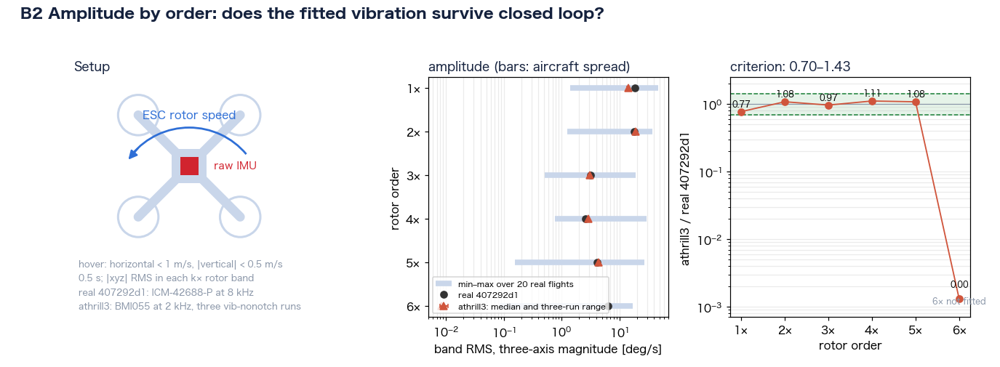
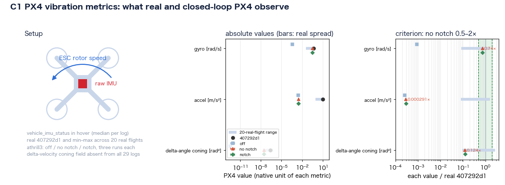

# Drone IMU: comparison with real flight logs (Holybro X500 V2, 2026-11-21)

English | [日本語](README.ja.md)

This page compares the drone IMU (gyroscope and accelerometer) model with public real-aircraft logs. As on the
[force-torque sensor](../force-torque/README.md) page, one measurement is presented on one card.

## What is compared

```text
Public real logs (PX4 Flight Review, X500 V2, 2–8 kHz raw gyro and ESC rotor speed)
        │  Measure both in the same way: rotor orders, 0.5 s windows, hover sections
        ▼
Hakoniwa model ─┬─ Vibration model alone (rotor-speed input and resulting vibration)
                └─ Closed loop: real PX4 v1.17.0 on an emulated Pixhawk 6C in athrill3
                   (125 µs physics, sensor instances, DShot ESC telemetry)
```

- Real aircraft: public PX4 Flight Review logs (CC BY 4.0). From 3,174 X500 V2 logs, 20 distinct flights containing
  both raw gyro (`sensor_gyro_fifo`) and four-motor speed (`esc_status`) were selected.
- The IMU's intrinsic noise: stationary TUM VI records (CC BY 4.0, BMI160, 111 hours).
- Acceptance lines were fixed before measurement. Unsupported claims and mismatched conditions are stated explicitly;
  the comparison tests tendencies and does not promise that the aircraft are identical.

## Evaluation items

| Layer | # | Item | Status |
|---|---|---|---|
| A: IMU itself | A1 | White noise and bias instability at rest (Allan deviation) | Measured (TUM VI); card in a later version |
| | A2 | Temperature-dependent bias | Measured (TUM VI); card in a later version |
| B: airframe vibration | B1 | **Line position:** which rotor order carries vibration | Measured (card 1) |
| | B2 | **Amplitude by order** (orders 1–6) | Measured (card 2) |
| | B3 | **Growth with rotor speed** (exponent by order) | Measured (card 3) |
| | B4 | Line width and splitting (motor-speed differences and per-rotor amplitudes) | Later version |
| | B5 | Floor between lines (vibration unrelated to rotor speed) | Later version (not in the model yet) |
| | B6 | Distribution over three axes (changes between flights) | Later version |
| | B7 | Accelerometer vibration | Later version (nine real flights) |
| C: closed loop | C1 | **PX4's own vibration metrics** (`vehicle_imu_status`) | Measured (card 4) |
| | C2 | Vibration received by control and the dynamic notch (`IMU_GYRO_DNF`) | Later version (higher log rate required) |
| | C3 | Attitude and position holding | Later version |
| D: conditions | D1 | Translation, acceleration, and turns | Later version (about three minutes on one aircraft) |
| Common | E1 | Repeatability (three or more runs under one condition) | Stated on each card |

## Cards

### B1 Line positions


- **What was measured:** Each of 20 real flights was divided into airborne 0.5 s windows. In 4,323 windows, the
  strongest raw-gyro peak from 40–1000 Hz was tested against ±3% of orders 1–6 of any motor's rotor frequency. The
  controls were the expected hit fraction for a frequency drawn uniformly from 40–1000 Hz and the same peaks paired
  with rotor speeds shifted by half of all windows. Three athrill3 `vib-nonotch` runs were measured identically.
- **How to read the graph:** The x-axis is mean rotor frequency over four motors, the y-axis is gyro vibration
  frequency, and colour is the real-flight three-axis spectral density. Dashed lines are orders 1–6; orange dots are
  athrill3 peaks. The inset gives hit fractions; its red dashed line is the criterion, twice the random expectation.
- **Result:** The real hit fraction was **0.922**, against **0.302** at random (a **3.06×** ratio) and **0.479** with
  wrong-time rotor speed. Nineteen of 20 individual flights were also at least twice random. It **passes the criterion
  of at least twice random and clearly above wrong-time pairing**. Athrill3 hit an order in 0.992 of 526 windows.

### B2 Amplitude by order



- **What was measured:** In 0.5 s hover windows (horizontal speed < 1 m/s and absolute vertical speed < 0.5 m/s),
  raw-gyro three-axis RMS in each of the order 1–6 bands was measured. The real data include fitted flight `407292d1`
  and the spread across 20 flights; athrill3 is three `vib-nonotch` runs. The chips and rates differ: real uses an
  ICM-42688-P at 8 kHz, while athrill3 uses a BMI055 at 2 kHz.
- **How to read the graph:** In the middle plot, pale bars are the min–max range over 20 real flights, black circles are
  `407292d1`, and orange triangles are the athrill3 median with the three-run range. The right plot is athrill3 divided
  by `407292d1`; the green dashed band is the 0.70–1.43 acceptance range for orders 1–5.
- **Result:** Ratios for orders 1–5 were **0.77, 1.08, 0.97, 1.11, and 1.08**, respectively; **all five pass**. The
  underlying athrill3/real amplitudes were 14.39/18.63, 19.27/17.82, 3.06/3.17, 2.89/2.61, and 4.43/4.10 deg/s.
  Across real flights, the respective ranges were 1.42–46.49, 1.25–36.72, 0.51–19.26, 0.76–29.85, and
  0.16–26.83 deg/s. Order 6 was not fitted and is not judged (athrill3/real = 0.0013).

### B3 Growth with rotor speed


- **What was measured:** For all airborne 0.5 s windows, including take-off and landing, log band RMS was regressed on
  log mean rotor frequency within each flight. Eight flights with rotor-frequency p95/p5 ≥ 1.2 qualified; order 1 and
  order 2 bands were measured.
- **How to read the graph:** One point is one flight, the thick vertical bar is the interquartile range, and the black
  horizontal line is the median. The grey dashed line is the model default of 2; green dashed lines are the values
  fitted on `407292d1`, 2.61 and 3.13.
- **Result:** The real exponent was **2.65** for order 1 (IQR 1.84–3.24) and **2.95** for order 2 (2.63–3.31). This is
  descriptive rather than pass/fail, but the fitted values 2.61 and 3.13 are near the centres of the flight-to-flight
  distributions, and growth is steeper than the default exponent of 2. Flight variation is large, and these results
  must not be interpreted as hover-only exponents.

### C1 PX4's own vibration metrics



- **What was measured:** The per-log median of `vehicle_imu_status` in hover was compared for real flight `407292d1`,
  all 20 real flights, and athrill3 off / `vib-nonotch` / `vib-notch` (three runs each). The criterion is that
  `vib-nonotch` is within 0.5–2 times `407292d1`. Logged gyro, accelerometer, and delta-angle coning metrics were judged.
- **How to read the graph:** The middle plot gives PX4's absolute values; pale bars are min–max across 20 real flights.
  The right plot divides every value by `407292d1`; the green dashed band is the 0.5–2× acceptance range. Metrics use
  different native units, so both plots use a logarithmic value axis.
- **Result:** `vib-nonotch` divided by real was **0.740 (pass)** for gyro (0.319/0.430), **0.000291 (fail)** for
  accelerometer (0.00293/10.05), and **0.124 (fail)** for delta-angle coning (2.88e-8/2.33e-7). The **card as a whole
  does not meet the criterion**. This fitted vibration model covers gyro only and adds no accelerometer vibration.
  `delta_velocity_coning_metric` was absent from all 29 logs (20 real plus nine athrill3).
  Filter settings were not completely equal: `IMU_GYRO_CUTOFF` and `IMU_ACCEL_CUTOFF` were both 30 Hz, but
  `IMU_DGYRO_CUTOFF` was 30 Hz on real and 20 Hz on athrill3, while `IMU_GYRO_DNF_EN` was 1 on real and 0 on
  `vib-nonotch` (`vib-notch` used 1). DNF minimum 25 Hz, bandwidth 15 Hz, and three harmonics were the same.

## Method and scope

- Public log IDs, source, and licence are in [`data/flight_ids.csv`](data/flight_ids.csv). Duplicate uploads
  `852bba68` and `906dcd6f` (same as `407292d1`) and `b3c2da8f` (same as `50c1c4fa`) were excluded.
- FIFO period came from `timestamp_sample`, not `dt`, and no FFT window crossed a FIFO gap. Band RMS was corrected for
  Hann-window gain. Airborne state came from `vehicle_land_detected`.
- The nine athrill3 logs use PX4 v1.17.0 on an emulated Pixhawk 6C with a 125 µs physics step. The repository contains
  derived CSV files produced by the same script, never the ULogs.
- Although all 20 real flights are X500 V2, IMU mounting, propeller balance, individual airframes, and flight profiles
  differ. B2's wide ranges include those effects; agreement with one fitted aircraft is not agreement with every X500.

## Reproduction

`tools/compare/imu_x500/` contains public-log fetching from the ID list, measurement, and card rendering. Its
[README](../../../tools/compare/imu_x500/README.md) gives complete commands. `measure.py` produces the CSV files in
[`data/`](data/) from real and closed-loop ULogs; `cards_imu_x500.py` draws both language versions from those CSVs only.
The closed-loop numbers come from ULogs recorded by the athrill-target-stm32 6C vibration-hover procedure.
