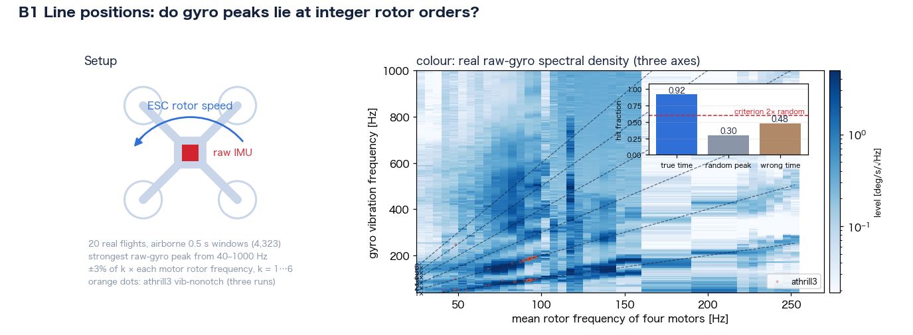
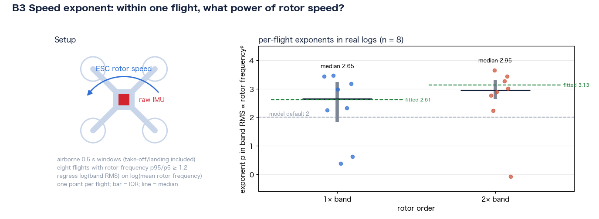
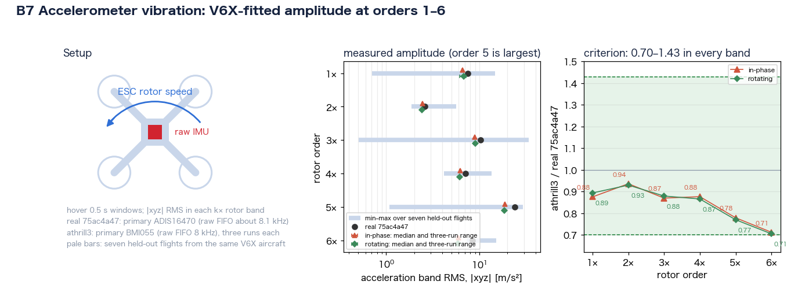
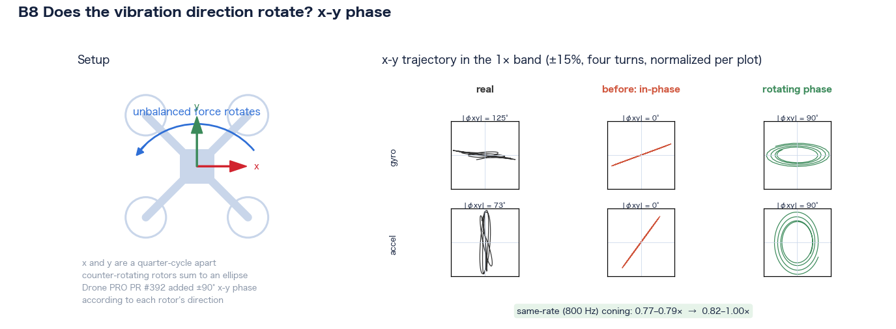

# Drone IMU: comparison with real flight logs (Holybro X500 V2, 2026-11-21)

English | [日本語](README.ja.md)

This page compares the drone IMU (gyroscope and accelerometer) model with public real-aircraft logs. As on the
[force-torque sensor](../force-torque/README.md) page, one measurement is presented on one card.

## What is compared

```text
Public real logs (PX4 Flight Review, X500 V2, 2–8 kHz raw gyro and ESC rotor speed)
        │  Measure both in the same way: rotor orders, 0.5 s windows, hover sections
        ▼
Hakoniwa model ─┬─ Vibration model alone (rotor-speed input and resulting vibration)
                └─ Closed loop: real PX4 v1.17.0 on an emulated Pixhawk 6C in athrill3
                   (125 µs physics, sensor instances, DShot ESC telemetry)
```

- Real aircraft: public PX4 Flight Review logs (CC BY 4.0). From 3,174 X500 V2 logs, 20 distinct flights containing
  both raw gyro (`sensor_gyro_fifo`) and four-motor speed (`esc_status`) were selected.
- Eight of those flights from one PX4_FMU_V6X aircraft also contain raw accelerometer data; one was fitted and seven
  were held out for validation.
- The IMU's intrinsic noise: stationary TUM VI records (CC BY 4.0, BMI160, 111 hours).
- Acceptance lines were fixed before measurement. Unsupported claims and mismatched conditions are stated explicitly;
  the comparison tests tendencies and does not promise that the aircraft are identical.

## Evaluation items

| Layer | # | Item | Status |
|---|---|---|---|
| A: IMU itself | A1 | White noise and bias instability at rest (Allan deviation) | Measured (TUM VI); card in a later version |
| | A2 | Temperature-dependent bias | Measured (TUM VI); card in a later version |
| B: airframe vibration | B1 | **Line position:** which rotor order carries vibration | Measured (card 1) |
| | B2 | **Amplitude by order** (orders 1–6) | Measured (card 2) |
| | B3 | **Growth with rotor speed** (exponent by order) | Measured (card 3) |
| | B4 | Line width and splitting (motor-speed differences and per-rotor amplitudes) | Later version |
| | B5 | Floor between lines (vibration unrelated to rotor speed) | Later version (not in the model yet) |
| | B6 | Distribution over three axes (changes between flights) | Later version |
| | B7 | **Accelerometer vibration** (orders 1–6) | Measured (card 4) |
| | B8 | **Whether the vibration direction rotates** (x-y phase) | Measured (card 5) |
| C: closed loop | C1 | **PX4's own vibration metrics** (`vehicle_imu_status`) | Corrected and measured (card 6) |
| | C2 | Vibration received by control and the dynamic notch (`IMU_GYRO_DNF`) | Later version (higher log rate required) |
| | C3 | Attitude and position holding | Later version |
| D: conditions | D1 | Translation, acceleration, and turns | Later version (about three minutes on one aircraft) |
| Common | E1 | Repeatability (three or more runs under one condition) | Stated on each card |

## Cards

### B1 Line positions



- **What was measured:** Each of 20 real flights was divided into airborne 0.5 s windows. In 4,323 windows, the
  strongest raw-gyro peak from 40–1000 Hz was tested against ±3% of orders 1–6 of any motor's rotor frequency. The
  controls were the expected hit fraction for a frequency drawn uniformly from 40–1000 Hz and the same peaks paired
  with rotor speeds shifted by half of all windows. Three athrill3 `vib-nonotch` runs were measured identically.
- **How to read the graph:** The x-axis is mean rotor frequency over four motors, the y-axis is gyro vibration
  frequency, and colour is the real-flight three-axis spectral density. Dashed lines are orders 1–6; orange dots are
  athrill3 peaks. The inset gives hit fractions; its red dashed line is the criterion, twice the random expectation.
- **Result:** The real hit fraction was **0.922**, against **0.302** at random (a **3.06×** ratio) and **0.479** with
  wrong-time rotor speed. Nineteen of 20 individual flights were also at least twice random. It **passes the criterion
  of at least twice random and clearly above wrong-time pairing**. Athrill3 hit an order in 0.992 of 526 windows.

### B2 Amplitude by order


- **What was measured:** In 0.5 s hover windows (horizontal speed < 1 m/s and absolute vertical speed < 0.5 m/s),
  raw-gyro three-axis RMS in each of the order 1–6 bands was measured. The real data include fitted flight `407292d1`
  and the spread across 20 flights; athrill3 is three `vib-nonotch` runs. The chips and rates differ: real uses an
  ICM-42688-P at 8 kHz, while athrill3 uses a BMI055 at 2 kHz.
- **How to read the graph:** In the middle plot, pale bars are the min–max range over 20 real flights, black circles are
  `407292d1`, and orange triangles are the athrill3 median with the three-run range. The right plot is athrill3 divided
  by `407292d1`; the green dashed band is the 0.70–1.43 acceptance range for orders 1–5.
- **Result:** Ratios for orders 1–5 were **0.77, 1.08, 0.97, 1.11, and 1.08**, respectively; **all five pass**. The
  underlying athrill3/real amplitudes were 14.39/18.63, 19.27/17.82, 3.06/3.17, 2.89/2.61, and 4.43/4.10 deg/s.
  Across real flights, the respective ranges were 1.42–46.49, 1.25–36.72, 0.51–19.26, 0.76–29.85, and
  0.16–26.83 deg/s. Order 6 was not fitted and is not judged (athrill3/real = 0.0013).

### B3 Growth with rotor speed



- **What was measured:** For all airborne 0.5 s windows, including take-off and landing, log band RMS was regressed on
  log mean rotor frequency within each flight. Eight flights with rotor-frequency p95/p5 ≥ 1.2 qualified; order 1 and
  order 2 bands were measured.
- **How to read the graph:** One point is one flight, the thick vertical bar is the interquartile range, and the black
  horizontal line is the median. The grey dashed line is the model default of 2; green dashed lines are the values
  fitted on `407292d1`, 2.61 and 3.13.
- **Result:** The real exponent was **2.65** for order 1 (IQR 1.84–3.24) and **2.95** for order 2 (2.63–3.31). This is
  descriptive rather than pass/fail, but the fitted values 2.61 and 3.13 are near the centres of the flight-to-flight
  distributions, and growth is steeper than the default exponent of 2. Flight variation is large, and these results
  must not be interpreted as hover-only exponents.

### B7 Accelerometer vibration



- **What was measured:** Three-axis accelerometer RMS in the order 1–6 bands was measured in 0.5 s hover windows for
  real flight `75ac4a47` and three runs each of athrill3's in-phase `v6x-vib` and rotating-phase `rot-vib` modes.
  The real primary is an ADIS16470 raw FIFO (about 8.1 kHz); the emulated primary is a BMI055 raw FIFO (8 kHz), so
  the chips are not identical. Pale bars give the min–max of per-flight medians over the other seven flights of the
  same V6X aircraft, which were held out from fitting. The criterion is athrill3 / `75ac4a47` = 0.70–1.43 in every band.
- **How to read the graph:** The middle plot gives absolute values: black circles are `75ac4a47`; triangles and diamonds
  are three-run medians, with short bars showing run-to-run range. The right plot divides them by the reference flight;
  the green band is the acceptance range.
- **Result:** Real orders 1–6 were **7.55, 2.61, 10.26, 7.06, 23.97, and 8.39 m/s²**. The in-phase model measured
  **6.61, 2.44, 8.93, 6.19, 18.69, and 5.98 m/s²** (ratios **0.88, 0.94, 0.87, 0.88, 0.78, 0.71**); the rotating
  model measured **6.75, 2.42, 9.03, 6.11, 18.47, and 5.92 m/s²** (**0.89, 0.93, 0.88, 0.87, 0.77, 0.71**).
  **Both modes pass all six bands**, and order 5 is largest in the real flight and both models. The held-out ranges
  were 0.71–14.65, 1.87–5.61, 0.51–33.66, 4.15–13.58, 1.09–29.17, and 7.26–15.10 m/s², respectively.

### B8 Whether the vibration direction rotates



- **What was measured:** Cross-power-weighted `|phase|` between x and y was measured in the 1× and 2× bands of raw gyro
  and accelerometer hover data. Trajectories show four turns of the 1× band, band-passed to ±15% of mean rotor frequency;
  each plot uses one common x-y normalization. This is descriptive rather than pass/fail: it tests whether the vibration
  direction rotates with time.
- **How to read the graph:** An unbalanced force turns with its rotor, so x and y are a quarter-cycle apart. Summing four
  counter-rotating rotors with different per-axis amplitudes produces an ellipse, not necessarily a circle. A diagonal
  line means x and y are in phase; an ellipse means they are phase-shifted.
- **Result:** Real gyro phase was **125°** at 1× and **100°** at 2×; real accelerometer phase was **73°** and **95°**.
  The former model was about **0°**, while the rotating-phase model was about **90°** for both sensors. Drone PRO
  [PR #392](https://github.com/hakoniwalab/hakoniwa-drone-pro/pull/392) added `axisPhase: "rotating"`, which shifts x-y
  phase by ±90° according to each rotor's direction. Comparing only 800 Hz IMUs, athrill3 / real PX4 coning moved from
  **0.77–0.79** in phase to **0.82–1.00** with rotating phase. In the simulators we checked,
  [ArduPilot SITL](https://github.com/ArduPilot/ardupilot/blob/master/libraries/AP_InertialSensor/AP_InertialSensor_SITL.cpp),
  [Gazebo](https://github.com/gazebosim/gz-sensors/blob/main/src/ImuSensor.cc), and
  [Project AirSim](https://github.com/iamaisim/ProjectAirSim/blob/main/core_sim/src/sensors/imu.cpp) also construct their
  added axis components with the same phase. This is therefore an evidence-driven improvement, not a claim to be first.

### C1 PX4's own vibration metrics (corrected)


- **Correction:** The first C1 compared real and athrill3 `vehicle_imu_status` instance 0 directly, and therefore
  compared **different IMUs at different processing rates**. PX4's vibration and coning metrics are per instance and
  rate-dependent. Its accelerometer failure also came from the old `407292d1` fit, which used gyro data and contained no
  accelerometer data.
- **What was measured:** Each hover `vehicle_imu_status` instance was separated, and only nominal 800 Hz pairs were
  compared. For ARK flight `407292d1`, the real IIM-42652 (`0x2b000a`) and two ICM-42688-P units (`0x260012` and
  `0x26001a`), all at 800 Hz, are paired with athrill3's ICM-42688-P (`0x26000a`, 800 Hz). For V6X flight `75ac4a47`,
  the two real 800 Hz units—IIM-42652 (`0x2b0012`) and
  ICM-45686 (`0x34000a`)—are paired with that same emulated ICM-42688-P. The V6X primary ADIS16470 (`0x58001a`) is
  excluded from the coning ratio because it runs at 2 kHz. The criterion is 0.5–2× for each metric.
- **Result:** For the old ARK fit, athrill3 / real was **0.719 (pass)** for gyro, **0.000289 (fail)** for accelerometer,
  and **0.247 (fail)** for coning, so the corrected card still fails as a whole. With the gyro-plus-accelerometer V6X
  fit, the in-phase ratios were **0.912, 0.841, and 0.780**, while rotating-phase ratios were **0.961, 0.938, and
  0.947**; **all three metrics pass** in both V6X modes. The two real 800 Hz coning values were 2.25e-8 and 2.28e-8 rad²;
  the median over three athrill3 runs was 1.77e-8 in phase and 2.14e-8 rad² with rotating phase.

## Method and scope

- Public log IDs, source, and licence are in [`data/flight_ids.csv`](data/flight_ids.csv). Duplicate uploads
  `852bba68` and `906dcd6f` (same as `407292d1`) and `b3c2da8f` (same as `50c1c4fa`) were excluded.
- FIFO period came from `timestamp_sample`, not `dt`, and no FFT window crossed a FIFO gap. Band RMS was corrected for
  Hann-window gain. Airborne state came from `vehicle_land_detected`.
- The nine original athrill3 logs and six V6X-fit logs use PX4 v1.17.0 on an emulated Pixhawk 6C with a 125 µs physics
  step. The V6X fit's `referenceRpm` is the simulated hover speed, 5540 rpm. The repository contains derived CSV files,
  never the ULogs.
- Although all 20 real flights are X500 V2, IMU mounting, propeller balance, individual airframes, and flight profiles
  differ. B2's wide ranges include those effects; agreement with one fitted aircraft is not agreement with every X500.

## Reproduction

`tools/compare/imu_x500/` contains public-log fetching from the ID list, measurement, and card rendering. Its
[README](../../../tools/compare/imu_x500/README.md) gives complete commands. `measure.py`, `fit_v6x.py`, and
`measure_phase2.py` produce the CSV files in [`data/`](data/) from real and closed-loop ULogs; `cards_imu_x500.py`
draws both language versions from those CSVs only.
The closed-loop numbers come from ULogs recorded by the athrill-target-stm32 6C vibration-hover procedure.
