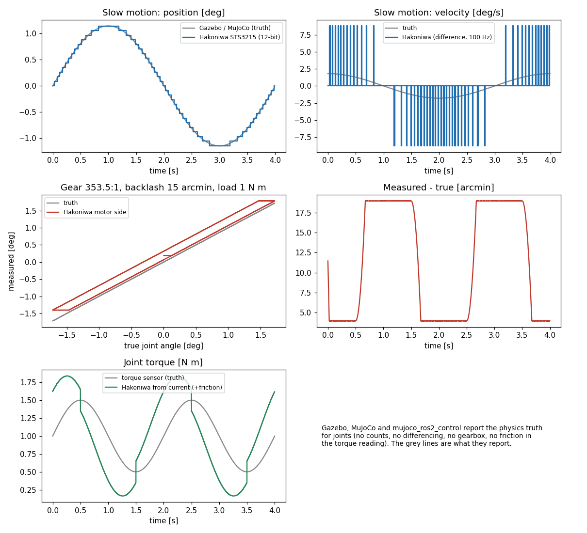

# 関節のセンサ：評価の結果（2026-11-11）

関節のセンサ（エンコーダと関節トルク）を、[評価の軸](../drone/evaluation-axes.md) に沿って比べました。

## 比べ方

関節では、力覚センサのように「同じ真値を 2 つの実装に入れて数値を突き合わせる」比較ができません。Gazebo の gz-sensors にはエンコーダも関節のセンサもないからです。

| 実装 | 関節について出すもの |
|---|---|
| Gazebo（gz-sim の `JointStatePublisher`） | 物理の真値（角度、速度）。ノイズ・分解能・遅れはない |
| MuJoCo（`jointpos`・`jointvel`・`jointactuatorfrc`） | 物理の真値。`noise` は書けるが足さない。遅れと周期は表せる |
| mujoco_ros2_control | 物理の真値（`qpos`、`qvel`、`qfrc_actuator`） |
| Webots（`PositionSensor`） | 真値にノイズを足して分解能で丸めた角度。速度は出さない |

そこで、同じ動きを [関節のセンサの口](../../design/joint-sensor-adapter.md) の箱庭の実装に通し、「ほかのシミュレータが出す値（真値）」と並べて、何が違って見えるかを示します。

| 実装 | 版 |
|---|---|
| 箱庭 | 箱庭の関節のセンサのモデル（この口の設計の式を実装したもの。ソースは非公開） |

測った日：2026-11-11。機械：macOS（arm64）。物理の刻み 1 ms。

## 見え方の違い

| 図 | 場面 | ほかのシミュレータ（灰色） | 箱庭 |
|---|---|---|---|
| 左上 | SO-101 の関節（Feetech STS3215、12 ビット、100 Hz）をゆっくり動かす。振幅 1.15°、周期 4 秒 | なめらかな角度 | 0.088° の階段 |
| 右上 | 同じ動きの速度 | なめらかな速度（最大 1.8°/s） | 角度の差分から作るので、カウントが 1 つ変わった周期だけ 8.8°/s、それ以外は 0。実機のサーボの低速の速度は、こう見える |
| 左中・右中 | モーター側で測る関節（減速比 353.5、ガタ 15 arcmin、剛性 300 N·m/rad、負荷 1 N·m）が往復する | 測った角度 = 本当の角度 | 向きを変えるたびにガタの分だけ遅れ、負荷によるたわみ（約 11.5 arcmin）が足される。差は 4〜19 arcmin で、向きによって 2 つの値の間を行き来する |
| 左下 | モーターの電流からトルクを推定する（Dynamixel XM430-W350 の分解能、摩擦 0.15 N·m + 0.3 N·m·s/rad） | 関節を通るトルク | 摩擦の分だけずれ、速度の向きが変わるところで跳ぶ |

## 6 つの軸

| 軸 | 箱庭 | Gazebo・MuJoCo・mujoco_ros2_control |
|---|---|---|
| 0. ノイズなしの一致 | 誤差を全部切ると、真値そのもの（設計の決まり。試験で確かめている） | 真値 |
| 1. 確からしさ | カウント、ガタ、たわみ、ずれ、周期の誤差、差分の速度、トルクの各誤差が、設計の式どおり（独立に計算した期待値と、2 万サンプルの統計で確かめている） | — |
| 2. 表せる範囲（下の表） | 13 | Gazebo 0、MuJoCo 2（遅れと周期）、mujoco_ros2_control 1（線形の換算）、Webots 3 |
| 3. 再現性 | 同じ種で同じ並び、リセットで同じ並び、関節の名前ごとに別の並び | 乱数を使わない（MuJoCo、Gazebo）。mujoco_ros2_control は関節に乱数を使わない |
| 4. 速さ（1 刻みの平均） | 0.024 µs（STS3215 の設定）、0.10 µs（すべての誤差を入れた設定） | — |
| 5. 入れやすさ | 設定を読む JSON のヘッダだけ | — |

### 2. 表せる範囲

| # | 項目 | 箱庭 | Gazebo | MuJoCo | Webots | mujoco_ros2_control |
|---|---|---|---|---|---|---|
| 1 | エンコーダのカウント（分解能） | ○ | × | × | ○（`resolution`） | × |
| 2 | モーター側で測る（減速比） | ○ | × | △（`actuatorpos` の線形の換算） | × | △（`transmission`） |
| 3 | ガタ | ○ | × | × | × | × |
| 4 | ねじりのたわみ | ○ | × | × | × | × |
| 5 | 原点のずれ（台ごと） | ○ | × | × | × | × |
| 6 | 周期の誤差（エンコーダの正確さ） | ○ | × | × | × | × |
| 7 | 増分式・1 回転で戻す | ○ | × | × | × | × |
| 8 | 角度のノイズ | ○ | × | ×（書けるが足さない） | ○ | × |
| 9 | 差分で作る速度 | ○ | × | × | × | × |
| 10 | 遅れ・周期 | ○ | △（周期だけ） | ○ | △（周期だけ） | × |
| 11 | 関節のトルクセンサ（関節を通るトルク） | ○ | ×（値を書く部分が見当たらない） | ×（アクチュエータの力だけ） | △（モーターのトルク） | ×（アクチュエータの力） |
| 12 | 電流からのトルクの推定（摩擦込み） | ○ | × | × | × | × |
| 13 | トルクの誤差（目盛り、ずれ、ノイズ、頭打ち、分解能） | ○ | × | × | × | × |

Gazebo 以外の列は、資料とソースから読んだものです。動かして測ってはいません。

## 測り方

- 比べるプログラムは、決まった動き（時刻の関数）の真値を、箱庭の関節のセンサに通して CSV に書き、図にします。
- 比べるプログラムと箱庭の実装は非公開です。
