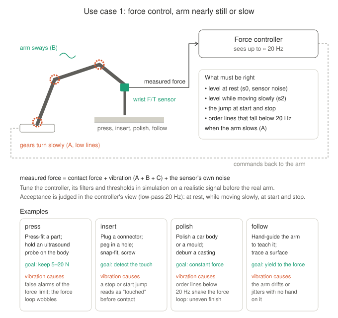

# Force-torque vibration model specification

This is the specification of the vibration model that the host adds to the true wrench in front of a force-torque
sensor adapter. The design, the evidence and the assumptions (`VIB-A*`) are in
[force-torque-vibration.md](../design/force-torque-vibration.md). Requirements are numbered `FTV-<nnn>`.

The model is a host-side model: it does not know the sensor adapter, and the adapter does not know it. The host
calls the model every physics step with the joint velocities and adds its output to the wrench it passes to the
adapter (`ForceTorqueTruth`). The interface below is public; implementations (for example Sensor PRO) are reached by
name.

Notation: axes i = Fx, Fy, Fz, Tx, Ty, Tz in sensor axes (FLU), joints j in the order of the configuration, h the
physics step [s], N(0, σ) the normal distribution. â_{j,k,i} is the amplitude of one order line at this step (the design writes the whole order
component as A_i, so â avoids the clash).

## 0. Intended use (not a requirement)

**Use case 1, the one the model is validated for: force control with the arm nearly still or moving slowly.**
Pressing, insertion, polishing and surface following, where a controller acts on the wrist force-torque. The model
gives that controller, its filters and its thresholds a realistic signal in simulation before the real arm is used.

### 0.1 Examples

| Task | Examples | What the controller does | What the vibration does to it |
|---|---|---|---|
| Press | press-fit a part; check a button; hold an ultrasound probe on a patient | holds a set force, a few N to tens of N | the force limit trips with nothing wrong; the force loop wobbles |
| Insert | plug a connector; peg in a hole; snap-fit; drive a screw | detects the first touch by a force threshold, then searches sideways by force | the jump at a stop or start, or the rest noise, reads as "touched" before contact |
| Polish | polish a car body or a mould; deburr a casting; sand a painted surface | keeps a constant force while moving slowly along the surface | gear lines that fall below 20 Hz shake the force loop: uneven finish |
| Follow | hand-guide the arm to teach it (direct teaching); trace a surface for inspection | moves the arm in the direction of the force it feels | the arm drifts or jitters with no hand on it; a dead band hides a light touch |

In all four the arm is still or slow and the controller acts on the wrist force-torque. A threshold, a filter band
and a gain are chosen for each task, and each depends on how much the signal shakes when nothing touches the tool.

### 0.2 Without this model: what goes wrong in simulation (expected)

The simulated sensor then gives the contact force plus, at most, white noise of the data sheet. Expected, not
measured:

- **Thresholds come out too tight.** A touch threshold tuned on a clean signal sits just above the sensor noise. On the
  real arm the servos, the gears and the arm modes add their vibration, and the threshold trips without contact.
- **The stop and start jump is missing.** A clean simulation is quiet the moment the arm stops. The real arm rings for a
  short time; an insertion that waits for "quiet" or detects contact right after a stop fails there.
- **Low gear lines are missing.** When the arm slows, gear lines fall into the band the controller sees. A force gain
  tuned on a clean signal may then wobble at that frequency on the real arm.
- **Filters look free.** On a clean signal a narrow filter seems unnecessary, or a wide one costs nothing. The trade-off
  between delay and noise only appears on the real arm.

So every threshold, filter and gain is found again on the real arm, by trial: run the task, see a false stop or a
wobble, change a value, run again.

### 0.3 With this model: what simulation shows, and what is left for the real arm

The simulated sensor gives the contact force plus the vibration of that arm, at rest, while moving slowly and at start
and stop, with its run-to-run spread.

- **Thresholds from a false-alarm rate.** Run the approach or the hold hundreds of times in simulation with different
  seeds and count the false touches; pick the lowest threshold with an acceptable rate.
- **Filter band from the delay and noise trade-off.** Compare filters on the same simulated runs: delay of the touch
  detection against the noise left.
- **Force gains checked against the low gear lines.** Sweep the speed in simulation and see whether the loop wobbles
  when the lines enter the controller band.
- **The stop and start behaviour.** How long to wait after a stop, or how to blank the detection, is set in simulation.

What is left for the real arm: confirmation runs with the values found in simulation, instead of the trial loop above.
The cost to get there is one recording session on the customer's arm and tool (section 3 of the identification
design: rest, two or more speeds, start and stop; minutes of recording) and the identification tool. The model is
validated for the states of this section; how many real-arm runs it saves has not been measured yet.

### 0.4 What must be right

What must be right for it, in the controller's view (the measured wrench through a low-pass of about 20 Hz):

| State | What dominates | Model parts |
|---|---|---|
| At rest | the servos holding the pose, the sensor's own noise | B: s0 (section 3); the adapter's noise |
| Moving slowly | joint friction shaking the arm's modes, about the same at any slow speed | B: s2 (FTV-230, 235) |
| Starting and stopping | the jump between the two levels | B: a_r, `at_rest_while_moving` (FTV-232, 235) |
| Slowing down | gear order lines that move below 20 Hz | A: k, a, p, f_dead (section 2) |

Acceptance for this use case is judged on these states, with the fitting data and the validation data kept apart
(design: [force-torque-vibration-identification.md](../design/force-torque-vibration-identification.md)).

Other uses the model supports but is not validated for yet: contact and collision thresholds during fast motion
(the peaks of A, B and C over the full sensor band), and training data for learned policies (the full spectrum and the
run-to-run variation). Out of scope: vibration caused by contact or impacts, wear and temperature (design section 8).

## 1. Interface

| ID | Requirement |
|---|---|
| FTV-010 | A model is created from a configuration file (section 5), the physics step, the vehicle name and index, the sensor name, and an optional seed, the fields of `SensorAdapterSetup`. Creation fails with a message on any configuration error (FTV-510) |
| FTV-020 | `step(sim_time_ns, joint_velocity, out, error)` takes the joint velocities [rad/s, joint side] of this physics step and returns the wrench to add [N, N·m, sensor axes]. The number of velocities must equal the number of configured joints (`joint_names()` gives them in order), and each must be finite; otherwise it returns false with a message and changes no state |
| FTV-022 | `step(sim_time_ns, joint_velocity, joint_load, out, error)` also takes the joint loads [N·m], one per configured joint in the order of `joint_names()`, each finite. The step without loads (FTV-020) is the same with loads unknown: for a model that has `load_gain` on any joint it returns false with a message and changes no state |
| FTV-024 | `needs_joint_load()` is true when any joint has `load_gain`; a host that cannot provide loads refuses such a configuration at start-up |
| FTV-026 | `step(sim_time_ns, joint_velocity, joint_load, orientation_world_to_sensor, out, error)` also takes the rotation from the world to the sensor axes of this step (a unit quaternion, the same value as `ForceTorqueTruth::orientation_world_to_sensor`). It is the step of FTV-022 with the orientation known. The quaternion must be finite with a norm within 1 ± 10⁻⁶; otherwise it returns false with a message and changes no state |
| FTV-027 | `needs_sensor_orientation()` is true when any mode has `"frame": "world"` (section 3.1). The steps without the orientation (FTV-020, FTV-022) then return false with a message and change no state; a host that cannot provide the orientation refuses such a configuration at start-up |
| FTV-030 | Step times are 0, h, 2h, …; any other time is an error without side effects, as for the force-torque adapter (FTS-ADP-020) |
| FTV-040 | `reset` returns the motor phases, the filters and the random streams to their state at creation; the same inputs then give the same outputs as right after creation |
| FTV-050 | An implementation provides the model through an entry point of its own, `HAKO_SENSOR_HOST_MODEL_ENTRY(<name>)`, returning a table with `create_force_torque_vibration`. The table carries a version (`kHostModelImplementationVersion`: 2 since the joint loads, 3 since the sensor orientation); a host refuses another version. `SensorAdapterImplementation` is not changed; an implementation without the model has no such entry |
| FTV-060 | The output is the sum of the order components (section 2), the structural modes (section 3) and the broadband component (section 4). With no component configured, the output is zero |

## 2. Order components (follow motor speed)

| ID | Requirement |
|---|---|
| FTV-110 | Motor phase per joint: φ_j ← φ_j + N_j · q̇_j · h every step, from φ_j = 0 at creation and reset. N_j is the joint's gear ratio |
| FTV-120 | Motor frequency: f_m,j = N_j · \|q̇_j\| / 2π [Hz] |
| FTV-130 | Each configured order k of joint j adds on each axis i: â_{j,k,i} · sin(k · φ_j + θ_{j,k,i}). k is a positive number (usually an integer) |
| FTV-140 | Amplitude: â = a_{j,k,i} · (f_m,j / f_ref)^p · min(1, f_m,j / f_dead,j). p defaults to 0 (amplitude constant with speed, design references [6][9]); f_dead,j defaults to 1 Hz. The factor makes the component vanish smoothly as the joint stops |
| FTV-150 | θ_{j,k,i} is drawn once at creation from U(−π, π) in the stream `vibration_phase`, in the order of joints, then orders, then axes |
| FTV-160 | Optional resonance gain per order (`"resonance": true`): â is multiplied by max over the configured modes of 1 / √((1 − r²)² + (2ζ_n r)²), r = k·f_m,j / f_n. Without modes the gain is 1 |

### 2.1 Load direction of a joint (gear flank)

The orders of a strain-wave gear change with the direction in which the joint transmits torque: the teeth carry the
load on one flank or the other (design section 3.5). Optional per joint; without it nothing changes.

| ID | Requirement |
|---|---|
| FTV-170 | A joint may have `load_gain` `{positive, negative, lag_s}` (all ≥ 0; `positive` and `negative` > 0). The model then needs the joint loads: the host passes, with the velocities, the torque each joint transmits [N·m, joint side] (FTV-022) |
| FTV-175 | The load direction is the sign of P_j = τ_j · q̇_j: P_j > 0 when the joint drives the motion (for example lifting against gravity), P_j < 0 when the load drives it (for example lowering with gravity). P_j = 0 keeps the previous direction |
| FTV-180 | The gain g_j follows the target g_target = `positive` (P_j > 0) or `negative` (P_j < 0) with a first-order lag: g_j ← g_j + (1 − exp(−h / T)) (g_target − g_j), T = `lag_s`; T = 0 switches at once. At creation and reset g_j is 1 until the first step with P_j ≠ 0, which sets g_j to its target |
| FTV-185 | g_j multiplies every order amplitude of joint j (FTV-140), together with the run multiplier (FTV-360). It does not change modes or the broadband component |

## 3. Structural modes (fixed frequency)

| ID | Requirement |
|---|---|
| FTV-210 | Each mode n has a frequency f_n and a damping ζ_n (0 < ζ_n < 1, f_n < 1 / 2h). Its signal is white noise N(0, 1), one draw per step and axis from the stream `vibration_mode`, through a second-order band-pass at f_n with Q = 1 / (2ζ_n), bilinear transform with pre-warping at the physics step, zero initial state |
| FTV-220 | The band-pass output is scaled so that its steady-state standard deviation is 1: by 1 / √(Σ h_k²), with h_k its impulse response, computed at creation |
| FTV-230 | The mode adds σ_{n,i} times that signal on axis i, with σ_{n,i} = s0_{n,i} + s1_{n,i} · activity + s2_{n,i} · min(1, activity / a_r,n). s0 is the level at rest (`at_rest`), s1 the growth with motion (`per_activity`), s2 the level while moving, whatever the speed (`per_motion`, section 3.6 of the design) |
| FTV-235 | a_r,n (`motion_ramp`, an activity > 0, default 0.02) is the activity at which the level while moving is reached; below it the level rises linearly from 0 at rest. With a gear ratio of 160, 0.02 is about 2°/s of the joint |
| FTV-232 | A mode may have `at_rest_while_moving` k (0 ≤ k ≤ 1, default 1). The level at rest then becomes s0 · (1 − (1 − k) · min(1, activity / a_r,n)): k = 1 keeps it while moving (as without the key), k = 0 removes it once the level while moving is reached. This is a mode that exists only while the joints stick (design section 3.6) |
| FTV-240 | activity = Σ_j f_m,j / f_ref, with f_ref from the configuration (default 50 Hz) |

### 3.1 Direction fixed in the world

A vibration whose direction stays fixed in the world while the sensor turns (design section 3.7). Optional per mode;
without it nothing changes.

| ID | Requirement |
|---|---|
| FTV-250 | A mode may have `frame`: `"sensor"` (default) or `"world"`. With `"world"`, its per-axis values (`at_rest`, `per_activity`, `per_motion`) are along the world axes (the host's world, NWU in Hakoniwa): force axes Fx, Fy, Fz along world x, y, z, torque axes about them |
| FTV-255 | A world mode computes its six signals as in FTV-210 to 232, in world axes, and adds them to the output after rotating the force vector and the torque vector into the sensor axes with the orientation of this step (FTV-026). The band-pass filters keep their state in world axes |

## 4. Broadband component

| ID | Requirement |
|---|---|
| FTV-310 | On each axis i, adds N(0, σ_b,i) per step from the stream `vibration_broadband`, with σ_b,i = √(D_i · 1 / 2h) and the one-sided density D_i = c_i · activity^p_b [unit²/Hz]. p_b defaults to 1 |
| FTV-320 | With activity 0 the broadband component is 0 |

### 4.1 Run-to-run variation

The same motion repeated on a real arm gives components whose strength changes from one recording to the next
(design section 3.4). A run of the model is one creation or reset; another run is another seed.

| ID | Requirement |
|---|---|
| FTV-350 | Each joint, each mode and the broadband component may have a run variation σ_r ≥ 0 (`run_log_sigma`, default 0). At creation the model draws one multiplier m = exp(σ_r · z), z from N(0, 1) in the stream `vibration_run`. σ_r = 0 gives m = 1 |
| FTV-360 | m scales the parts driven by motion: every order amplitude â of the joint (FTV-140), the growth s1 and the level while moving s2 of the mode (FTV-230, not the level at rest s0), and σ_b of the broadband component (FTV-310). The configured values are therefore the median over runs |
| FTV-370 | Components with the same `run_group` (a non-empty string) share one z; each uses its own σ_r. A component without a group has a z of its own |
| FTV-380 | One z is drawn for each group and each ungrouped component, whether or not its σ_r is 0, in the order: joints, modes, broadband; a group is drawn at its first member in that order. Changing one σ_r therefore does not change another component's multiplier. `reset` draws the same values again (FTV-040) |

## 5. Configuration

| ID | Requirement |
|---|---|
| FTV-410 | The configuration is JSON with `"type": "force_torque_vibration"` and the optional keys `f_ref_hz`, `joints`, `modes`, `broadband`, as in the design (section 6) |
| FTV-420 | `joints` is a list of `{name, gear_ratio, deadband_hz, orders}`; `orders` a list of `{order, exponent, resonance, amplitude}`. A joint may also have `run_log_sigma` and `run_group` (section 4.1), which apply to all its orders, and `load_gain` (section 2.1). `name` is for logs and must be unique |
| FTV-430 | `modes` is a list of `{frequency_hz, damping, at_rest, per_activity, per_motion, motion_ramp, at_rest_while_moving, frame, run_log_sigma, run_group}` |
| FTV-440 | `broadband` is `{exponent, density_per_activity, run_log_sigma, run_group}` |
| FTV-450 | Per-axis values (`amplitude`, `at_rest`, `per_activity`, `per_motion`, `density_per_activity`) are objects of axis groups and axes as for the force-torque sensor (FTS-ADP-520), in the axis units; an axis not given is 0. Percentages are not allowed |
| FTV-510 | Creation fails on: an unknown key, a wrong type, a missing `type`, `name`, `gear_ratio`, `order`, `frequency_hz` or `damping`, a gear ratio, order or `f_ref_hz` of 0 or less, a negative amplitude, level, density, exponent, dead band or `run_log_sigma`, a `motion_ramp` of 0 or less, an `at_rest_while_moving` outside [0, 1], a `frame` other than `"sensor"` or `"world"`, a `run_group` that is not a non-empty string, a `load_gain` without `positive` or `negative`, a `load_gain` gain of 0 or less or a negative `lag_s`, a damping outside (0, 1), a mode frequency at or above 1 / 2h, a non-finite value, or duplicate joint names |

## 6. Random numbers and reproducibility

| ID | Requirement |
|---|---|
| FTV-610 | The streams `vibration_phase`, `vibration_mode`, `vibration_broadband` and `vibration_run` are separate and derived from the seed, the vehicle name and index, the sensor name and the characteristic (the common derivation of the sensor adapters). Turning one component off does not change the others' sequences |
| FTV-620 | With a seed, the same seed, configuration, inputs and call order give the same outputs; the model's streams are independent of the force-torque adapter's streams |

## 7. Assumptions

Each requirement rests on the assumptions of the design (section 8 there): FTV-110 to 140 on VIB-A2 and A3, FTV-150 on
A4, FTV-210 to 240 on A5 and A6, FTV-230 and 235 (level while moving) on A12, FTV-232 on A13, FTV-250 and 255 on A14, FTV-310 on A6, FTV-170 to 185 on A11,
FTV-350 to 380 on A10, FTV-060 on A8, and the whole model on A7 (fixed direction in sensor axes, except world modes) and A9 (no load,
temperature, wear or contact effects).
